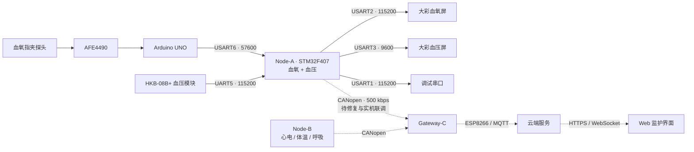

# 多参数心电监护仪系统 · 样机开发

**Multi-parameter Electrocardiogram Monitor System**

基于 **STM32F407ZGT6** 的多参数生理监护样机项目，围绕信号采集、本地交互、节点通信与系统集成开展开发。仓库包含固件源码、Keil 工程、串口屏设计资料、通信协议和器件参考资料。

当前代码重点是 **Node-A：血氧 / 脉率 / PPG 波形 + 无创血压 + 双串口屏**，同时保留裸机与 FreeRTOS 两套工程。心电、体温、呼吸、网关和云端监护属于完整系统方案中的其他模块，相关参考资料不代表这些功能已经集成到 Node-A。

> 项目阶段：样机研发与工程验证。医疗器械注册、临床认证和量产不在本阶段交付范围内。

## 1. 功能与当前状态

以下以仓库中的源码为依据；硬件效果、测量精度和长期稳定性需要单独验证。

| 模块 | 当前内容 | 状态与边界 |
| --- | --- | --- |
| 血氧与脉率 | AFE4490 经 Arduino UNO 输出数据，F407 解帧并显示 SpO₂、PR、探头状态和信号质量 | 已有采集与显示代码；当前脉率显示采用 F407 波形峰检结果 |
| PPG 波形与趋势 | 实时波形、趋势记录、暂停 / 继续、报警记录 | 裸机工程包含独立的显示与 CAN 波形缓冲 |
| 无创血压 | HKB-08B+ 启动 / 停止、袖带压力、SYS / DIA / PR、错误提示与历史查询 | 已有测量状态机和 100 条 RAM 历史缓冲 |
| 双屏交互 | 血氧屏与血压屏独立串口、页面与控件管理、时间同步 | MCU 维护软时钟，支持屏端设置；不等同于网络校时或掉电保存 |
| 运行诊断 | 独立看门狗、复位原因、屏在线探测与恢复、节点诊断快照 | 已接入裸机工程 |
| CANopen | CANopenNode、bxCAN 驱动、对象字典和 TPDO 上报逻辑 | 已集成源码；重置路径存在待修问题，实机联调待完成，见第 8 节 |
| FreeRTOS | 血氧、血压、心跳三个业务任务 | 独立移植工程，尚未接入裸机版的 CANopen 等全部功能 |
| ECG / TEMP / RESP / RR、网关与云端 | 总体架构、协议约定、器件资料和示例 | 系统扩展方向，不作为本仓库主工程的已完成功能 |

## 2. 系统架构

实线表示 Node-A 当前源码涉及的链路，虚线表示系统集成方向。



Node-A 当前采用 **AFE4490 → UNO → F407** 的血氧链路。F407 负责串口解析、波形处理、脉率计算、业务状态、显示和通信；旧规划中的 AFE4490 直接通过 SPI 接入 F407 并非当前主工程路线。

## 3. 仓库结构与工程入口

```text
.
├── README.md
├── .gitattributes                       # Git LFS 大文件配置
├── 代码资料/
│   ├── STM32F407_HOSPITAL/             # Node-A 裸机工程
│   │   ├── CORE/                       # Cortex-M 内核与启动代码
│   │   ├── FWLIB/                      # STM32 标准外设库
│   │   ├── HARDWARE/                   # 血氧、血压、HMI、CANopen、诊断
│   │   ├── USER/                       # main.c、工程配置和中断入口
│   │   └── OBJ/                        # 已提交的构建产物与日志
│   ├── FreeRTOS/                       # 独立的 FreeRTOS 移植工程
│   ├── NodeA项目书.md
│   └── NodeA_未完成任务清单.md
├── 其他资料/
│   ├── CANopenNode-master/             # 协议栈参考源码
│   ├── verify_canopen_d1d11.py          # CAN 日志自检工具
│   └── …                              # 系统方案、接口合同与数据字典
└── 文档资料/医疗检测仪资料/医疗检测仪资料/
    ├── 血氧/                           # AFE4490 库、示例、屏设计与单模块工程
    ├── 血压/                           # HKB 模块资料、屏设计与单模块工程
    ├── ECG/                            # ADS1292R 资料与示例
    ├── 体温/                           # 温度传感器资料与示例
    └── M系列串口屏开发包V3.2/          # 厂商文档、示例与工具
```

| 工程 | 打开文件 | 调度方式与用途 |
| --- | --- | --- |
| Node-A 裸机版 | [STM32F407_Template.uvprojx](代码资料/STM32F407_HOSPITAL/USER/STM32F407_Template.uvprojx) | 1 ms SysTick + 主循环；查看双屏、双传感器、诊断和 CANopen 集成时从这里开始 |
| FreeRTOS 移植版 | [FreeRTOS.uvprojx](代码资料/FreeRTOS/USER/FreeRTOS.uvprojx) | FreeRTOS V10.5.1，1 kHz tick；血氧、血压、心跳任务分别调度 |

两套工程独立构建，各自包含业务源码副本。修改其中一套不会自动同步到另一套。

## 4. 硬件与接口

Node-A 使用 STM32F407ZGT6、AFE4490 血氧模块及 UNO、HKB-08B+ 血压模块、两块大彩串口屏；CAN 通信通过外部收发器连接总线。下表为裸机工程当前配置。

| 外设 | STM32 引脚 | 速率 | 用途 |
| --- | --- | --- | --- |
| USART1 | PA9 TX / PA10 RX | 115200 bps | PC 调试串口 |
| USART2 | PA2 TX / PA3 RX | 115200 bps | 血氧屏 |
| USART3 | PB10 TX / PB11 RX | 9600 bps | 血压屏 |
| UART5 | PC12 TX / PD2 RX | 115200 bps | HKB-08B+ 血压传感器 |
| USART6 | PC6 TX / PC7 RX | 57600 bps | UNO 血氧数据；PC7 接收 UNO TX |
| CAN1 | PA12 TX / PA11 RX | 500 kbps | Node-A CANopen，Node-ID = 1 |

串口屏端的波特率、CRC、画面 ID 和控件 ID 必须与固件匹配。当前血氧屏配置为无 CRC，血压屏配置为启用 CRC。MCU 引脚、板上 RS232 接口与传感器 TTL 接口的电平不同，接线前按实际板卡原理图和模块说明核对转换电路与共地关系。

详细接线与模块说明见 [血氧血压模块项目书](代码资料/多参数心电监护仪系统-血氧血压模块.md)。

## 5. 获取与运行

### 5.1 克隆仓库

仓库包含较多器件资料、示例和配套软件，部分大文件通过 Git LFS 保存。Windows 上建议使用较短的本地目录，并开启 Git 长路径支持。

```powershell
git lfs install
git -c core.longpaths=true clone https://github.com/LZH-0402/Multi-parameter-electrocardiogram-monitor-system.git
cd Multi-parameter-electrocardiogram-monitor-system
git config core.longpaths true
git lfs pull
```

### 5.2 开发环境

| 工具或组件 | 仓库记录的基线 / 用途 |
| --- | --- |
| Keil MDK-ARM | 历史构建日志使用 5.14，Arm Compiler 5.05 update 1 |
| STM32F4 器件包 | 工程引用 `Keil.STM32F4xx_DFP.1.0.8` |
| 固件库 | CMSIS + STM32 标准外设库 SPL |
| Arduino 开发环境 | 构建 UNO 端 AFE4490 采集程序 |
| VisualTFT | 编辑、配置并下载大彩串口屏界面 |
| Python 3 | 运行 CAN 日志自检脚本，仅依赖标准库 |
| Git + Git LFS | 获取代码及完整的大文件内容 |

仓库保存的两套工程构建日志均记录过 `0 Error(s), 0 Warning(s)`。这些是历史构建记录，当前机器仍需重新编译，并核对编译器、器件包和下载器配置。

### 5.3 编译与联调顺序

1. **选择工程**：在 Keil 中打开上表对应的 `.uvprojx`；裸机 Target 为 `STM32F407_Template`，RTOS Target 为 `FreeRTOS`。
2. **检查配置并重新构建**：核对器件、Arm Compiler 5、头文件路径与下载器。工程输出到各自的 `OBJ/`；裸机版生成 `STM32F407_Template.hex`，RTOS 版生成 `FreeRTOS.hex`。
3. **准备 UNO 固件**：使用仓库中的 [AFE4490 库](文档资料/医疗检测仪资料/医疗检测仪资料/血氧/AFE4490_library/)；与 F407 解帧格式对应的示例是 [Example-1-Raw-PPG-plot-openview](文档资料/医疗检测仪资料/医疗检测仪资料/血氧/AFE4490_library/examples/Example-1-Raw-PPG-plot-openview/Example-1-Raw-PPG-plot-openview.ino)，串口为 57600 bps。
4. **准备串口屏界面**：按 [血氧界面指南](文档资料/医疗检测仪资料/医疗检测仪资料/血氧/visualtft_spo2/VisualTFT_医院版血氧界面绘制指南.md) 和 [血压界面指南](文档资料/医疗检测仪资料/医疗检测仪资料/血压/visualtft_bp/VisualTFT_医院版血压界面绘制指南.md) 核对屏工程。应用资料目录主要提供指南和素材，实际下载的屏工程版本需另行确认。
5. **分别验证串口链路**：从 USART1 调试口观察启动信息，确认 UNO 帧计数、血压模块响应和两块屏幕交互，再检查双路同时运行。
6. **最后进行 CAN 联调**：先处理第 8 节所列 CANopen 重置问题，再对照对象字典、网关配置和实测报文验证上报。

UNO 二进制帧为 `0A FA 0A 00 02 + 10 字节数据 + 00 0B`，共 17 字节。屏页面和控件定义见 [hmi_ids.h](代码资料/STM32F407_HOSPITAL/HARDWARE/HMI/hmi_ids.h)，数据解析见 [uno.c](代码资料/STM32F407_HOSPITAL/HARDWARE/UNO/uno.c)。

## 6. CANopen 配置与日志检查

裸机工程已包含 CANopenNode 集成，默认 Node-ID 为 `1`、总线速率为 `500 kbps`。以下是当前对象字典配置的发送布局，周期是配置值，尚不能作为实机发送性能的证明。

| PDO | COB-ID | 映射对象 | 内容 | 配置周期 |
| --- | --- | --- | --- | --- |
| TPDO1 | `0x181` | `0x2110` | PPG 波形 `ir_wave` + `sample_tick` | 8 ms，125 Hz |
| TPDO2 | `0x281` | 未映射（`0x2111` 为协议预留） | 第二路波形预留 | 禁用、不发送 |
| TPDO3 | `0x381` | `0x2120` | SpO₂、PR、收缩压、舒张压 | 1000 ms，1 Hz |
| TPDO4 | `0x481` | `0x2100` | UTC epoch 秒 + 本地毫秒 tick | 1000 ms，1 Hz |
| TPDO5 | `0x681` | `0x2130` | 数据有效位 + 启动代次 | 1000 ms，1 Hz |

标量采用小端定点编码：SpO₂、PR 使用 `uint16 / 100`；血压使用 `uint16 / 10`。PPG 使用归一化 `int32 / 1,000,000`，随帧携带采样 tick。协议细节见 [Node-A CANopen 扩展](其他资料/CANopen_协议扩展_NodeA.md)，实现见 [OD.c](代码资料/STM32F407_HOSPITAL/HARDWARE/CANopen/OD.c)。

从仓库根目录运行：

```powershell
# 无硬件演示：生成 2 秒合成日志并检查
python "其他资料/verify_canopen_d1d11.py" --demo

# 检查实际抓取的 Node-A TPDO 日志
python "其他资料/verify_canopen_d1d11.py" "capture.log" --verbose
```

实际日志应先筛选为 Node-A 的 TPDO 数据，并保留时间戳；脚本会将 Heartbeat、SDO 和其他节点帧判为非预期 COB-ID。示例格式：

```text
(123456.789) can0 181 [8] 00 00 00 00 00 00 00 00
```

`--demo` 仅验证日志解析与检查流程。脚本退出码 `0` 表示没有 `FAIL`，仍需查看 `WARN` / `SKIP`；无时间戳会跳过部分检查。短日志、合成数据和该脚本的通过结果均不能替代真实总线联调、30 分钟时效验证或 24 小时稳定性测试。

## 7. 文档导航

| 文档 | 阅读目的 |
| --- | --- |
| [Node-A 项目书](代码资料/NodeA项目书.md) | 模块设计、软件分层和验收背景 |
| [血氧血压模块项目书](代码资料/多参数心电监护仪系统-血氧血压模块.md) | 双屏双传感器的硬件接口与技术说明 |
| [未完成任务清单](代码资料/NodeA_未完成任务清单.md) | 待办、技术债与系统集成依赖 |
| [系统总方案 v0.7](<其他资料/多参数监护仪_总开发合同与系统方案_v0.7 (1).md>) | Node-A / Node-B / Gateway-C 的整体分工 |
| [CANopen 对象字典](其他资料/CANopen_对象字典_v0.1.md) | 通信对象和私有对象约定 |
| [Node-A CANopen 扩展](其他资料/CANopen_协议扩展_NodeA.md) | Node-A 的当前映射、单位与有效位定义 |
| [CANopen 验收清单](其他资料/CANopen_D1-D11_验收自检清单.md) | 软件检查与实机验证项目 |
| [A/B 联调接口合同](其他资料/A_B_CANopen联调接口合同_v0.1.md) | 节点协作与网关接口约定 |
| [统一数据字典](其他资料/MPM_统一数据字典_v0.1.md) | 系统级数据语义和单位 |

部分文档保留了不同阶段的设计：例如 PPG 的 50 Hz / 125 Hz、NMT 启动方式和旧 PDO 布局并不完全一致。阅读时需结合当前源码；网关联调前应确认双方采用同一版协议。

## 8. 已知限制与后续工作

- **CANopen 重置处理待修正**：当前 [canopen_app.c](代码资料/STM32F407_HOSPITAL/HARDWARE/CANopen/canopen_app.c) 将 `CO_RESET_NOT` 与通信重置一起处理；该值实际表示“正常返回，无需操作”。正常路径会重新初始化并提前返回，影响后续数据生产与 TPDO 处理，需要修复后再做总线验证。
- **FreeRTOS 功能对齐待推进**：当前任务化工程未接入裸机版的 CANopen、屏在线恢复和统一诊断等完整链路，不能直接视为等价替换。
- **硬件验收待补齐**：完成网关联调、双屏重连、传感器异常、数据失效、复位行为和 24 小时连续运行测试，保留真实日志与结果。
- **血压气路保护仍有缺口**：项目待办明确列出独立压力反馈和硬线断泵路径；模块停止应答不等于已经确认泄压。
- **时间与历史主要保存在运行内存中**：软时钟初值由固件给定，上电后需设置；RAM 趋势和血压历史不作为掉电持久化记录。
- **文档与固件版本需同步**：待办中的部分“未实现”内容已进入源码，UNO 刷新优化描述也与当前库中的参数存在差异，修改和复现时应以实际构建版本为准。
- **系统集成后续方向**：Node-B 心电 / 体温 / 呼吸、Gateway-C、网络上传和 Web 展示，以及最终单板集成与结构设计。

## 9. 仓库维护与第三方内容

日常修改后，可以在仓库根目录执行：

```powershell
git status
git add -A
git commit -m "说明本次修改内容"
git push origin main
```

`git add -A` 会同时记录新增、修改和删除。已有大文件的 LFS 规则见 [.gitattributes](.gitattributes)；新增大型安装包、视频或运行库时，先配置对应的 LFS 跟踪，再提交文件和 `.gitattributes`。

仓库包含 STM32/CMSIS、FreeRTOS、CANopenNode、AFE4490 库及厂商开发资料。根目录尚未声明统一开源许可证，各第三方组件保留其原有许可和版权说明，例如 [CANopenNode 许可](代码资料/STM32F407_HOSPITAL/HARDWARE/CANopen/LICENSE.CANopenNode) 与 [AFE4490 库许可](文档资料/医疗检测仪资料/医疗检测仪资料/血氧/AFE4490_library/LICENSE)。
