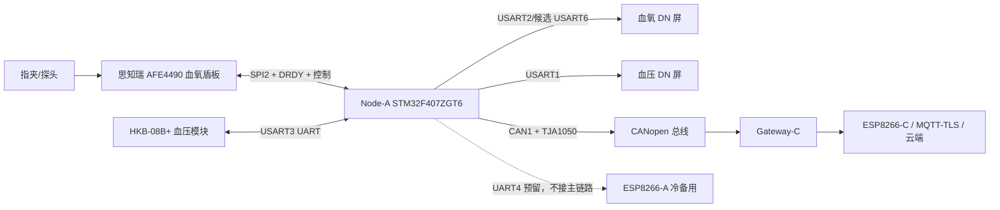
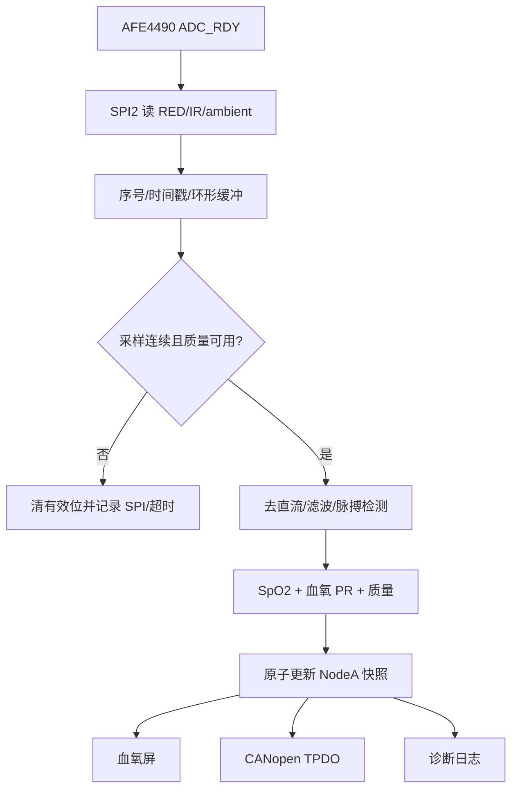
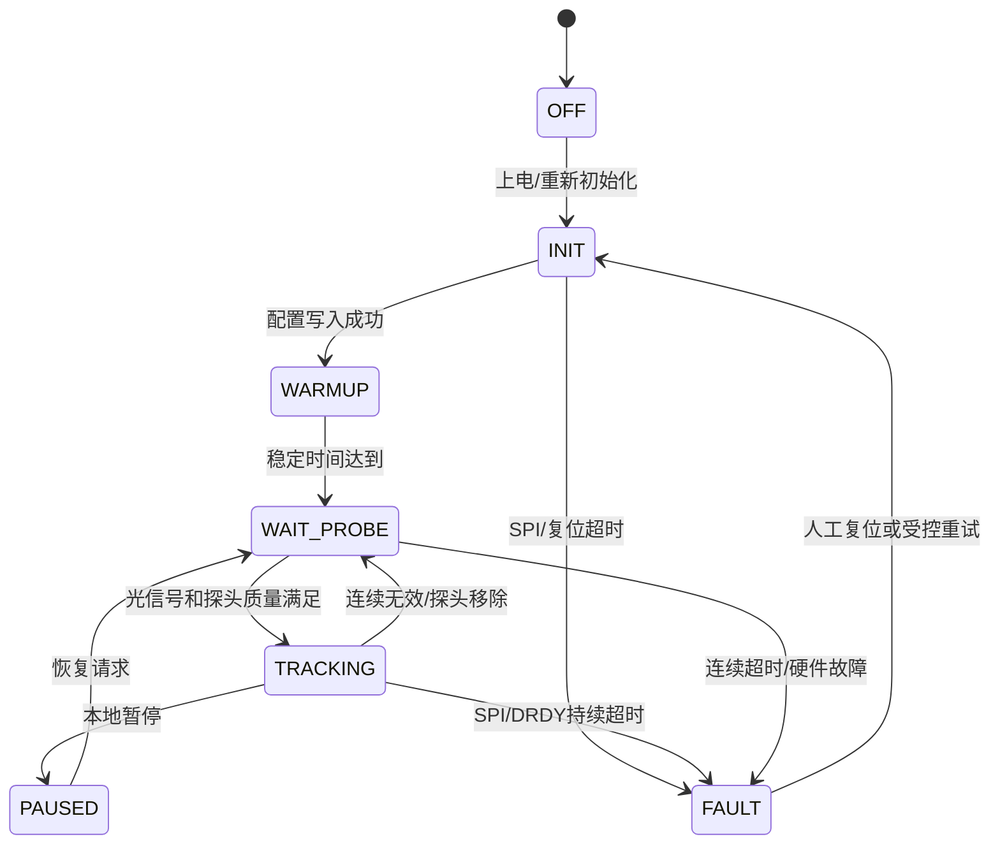
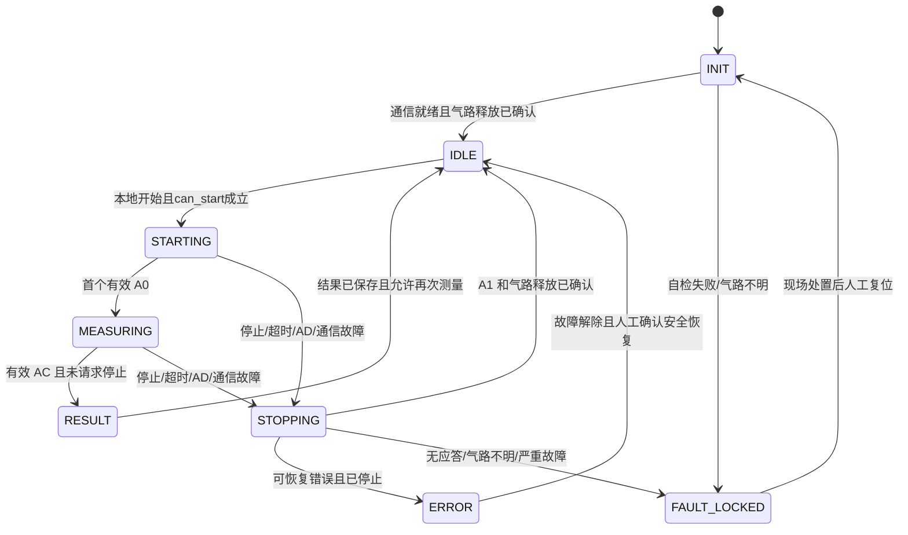

# NodeA 项目书

**项目名称**：多参数生理监护系统 Node-A（血氧 + 无创血压）  
**文档版本**：v0.3  
**编制日期**：2026-09-24  
**最终修订**：2026-10-08  
**适用阶段**：样机开发、模块联调和 Node-A 验收

**本次修订**：按已确认方案，血氧硬件选用思知瑞 AFE4490 指夹式血氧盾板，由 F407 通过 SPI2 直接采集并运行血氧/脉率算法；补充盾板接线、电气确认、采样率适配与验收要求。该确认针对接入方案，实物排针、电源入口和逻辑电平仍须在上电前核实。

> 本项目书将总项目方案、血压模块流程、血氧模块流程、DN 串口屏资料和 STM32F407 开发板资料合并为 Node-A 实施基线。项目范围以总方案为准；两份模块指南中的单模块端口分配在此统一，完整素材和厂家资料由文末链接保留。
>
> “总项目已冻结”指总方案明确要求；“资料事实”指手册、原理图和源代码可核对的内容；“实现建议”是本书提出的集成设计；“待确认”需通过实物核对或测试关闭。本书给出一套有启用条件的并发方案，未将资料审查等同于实机通过。

**阅读顺序**：§1–2 项目与需求 → §3 接线、电源与隔离 → §4 软件资源/并发 → §5–6 血氧/血压实现 → §7 双屏 → §8 CANopen → §9–10 调试验收 → §11–14 交付、开工表、排期与资料。

## 1. 项目概述

### 1.1 项目目标

NodeA 使用一块 STM32F407 开发板，同时完成：

- 通过 SPI2 连接思知瑞 AFE4490 指夹式血氧盾板，在 F407 上完成红光/红外采样、PPG、SpO2、血氧脉率 PR 和信号质量输出；
- HKB-08B+ 无创血压测量，输出状态、实时袖带压力、SYS、DIA、血压脉率和错误码；
- 血氧和血压各自使用一块本地 DN 系列串口屏；
- 通过 CANopen CC（CiA 301） over Classic CAN 向 Gateway-C 提供 Node-A 数据；
- 在 Gateway、CAN 或网络故障时保持本地测量、停止和显示能力；
- 为后续 Gateway-C、MQTT/TLS 和云端 Web 监护提供稳定、可追溯的数据语义。

本项目是样机工程验证，不是医疗器械注册、临床认证或最终产品化 PCB。公网远程开始充气、停止充气和泄压不属于一期功能。

### 1.2 系统边界 



NodeA 只解析 AFE4490 和 HKB 私有接口，并将结果转换为统一业务对象。Gateway-C 不解析 AFE 寄存器或 HKB 私有帧；它只处理 CANopen 对象、节点状态、缓存和上云。

血氧盾板通过转接线或转接板连接 F407，不叠装 Arduino 主板；SPI 寄存器驱动、PPG 处理、SpO2/脉率算法均由 F407 执行。厂家网页中的 115200/57600 是 Arduino 示例向电脑输出结果或波形的串口波特率，不是盾板与 F407 的通信参数，也不代表盾板能独立输出 UART 血氧结果。

### 1.3 已冻结、建议和待确认

| 类别 | 本项目结论 |
|---|---|
| 总项目已冻结 | Node-A=STM32F407；血氧=AFE4490 SPI+DRDY/控制；血压=HKB-08 UART；两模块各一块 UART 屏；Node-A 通过 CAN 接 Gateway-C；正常公网出口是 Gateway-C。 |
| 本次已确认 | 血氧选用思知瑞 AFE4490 指夹式血氧盾板；F407 通过 SPI2 直接接管采集并运行算法，不增加 Arduino 中转主控。SPI2 启用仍须满足 §3.2 板级隔离和 §3.3 电气条件。 |
| 本书实现建议 | USART1→血压屏，USART3→HKB，USART2→血氧屏首选，SPI2→AFE，CAN1→Gateway；AFE 使用 SPI2 双向 DMA，USART3/UART4 发送使用 TXE 有界队列，双屏独立 RX/发送上下文，原子快照和单一 CANopen 节点实例。 |
| 必须实物确认 | HKB 具体后缀、TTL/RS232、针序和门限；屏后缀、J5、CRC、编码和固件；血氧盾板版本、排针方向、供电入口、IO 门限/输出电平、DRDY/RESET 路由和时钟；F407 跳帽、板载外设是否实际接入；CAN 波特率、Node-ID、OD/PDO 映射和终端。 |

## 2. 需求与验收目标

### 2.1 功能需求

| 编号 | 需求 | 证据 |
|---|---|---|
| F-01 | 上电初始化时钟、GPIO、SPI、三路 UART、CAN、屏幕和传感器接口 | 启动日志、复位原因、接口自检记录 |
| F-02 | F407 经 SPI2/DRDY 连续获取血氧盾板 RED/IR 原始数据并带序号和时间戳 | 原始采样日志、无明显丢样 |
| F-03 | F407 算法输出 SpO2、血氧 PR、质量、探头状态和有效位 | 原始/算法输入采样率对应；屏幕、日志、CAN 对象一致 |
| F-04 | HKB 支持唤醒、开始、停止、压力帧、完成帧和错误帧 | 原始 UART 帧与解析结果逐项对应 |
| F-05 | 血压输出压力、SYS、DIA、血压 PR、错误来源和有效性 | 测量记录、状态机日志 |
| F-06 | 两块屏独立显示、触摸/按钮事件独立解析 | 两屏不串帧；血氧屏断开不影响 AFE，血压屏在测量中断开时进入安全停止，另一屏和系统仍可诊断 |
| F-07 | CANopen 支持 Node-A 级 NMT、Heartbeat、TPDO/SDO、EMCY | Gateway 或 CAN 分析仪记录 |
| F-08 | CAN、Gateway 或网络异常不阻塞本地测量和停止 | 断线故障注入记录 |
| F-09 | MCU 复位、串口断线、坏帧、队列溢出后可诊断并进入安全状态 | 故障注入记录 |

### 2.2 非目标

- 不把两个模块合并为两个 CANopen 节点；NodeA 只有一个 CANopen 设备节点。
- 不把旧 HKS UART 血氧路线作为当前主方案；正式血氧接口是 AFE4490 SPI。
- 不把 DN 屏的典型功耗或 HKB 标称精度直接写成整机已验证性能。
- 不在 NodeA 内实现 MQTT、TLS、Nginx、Backend 或 Web 页面。
- 不在没有气路释放依据时实现自动循环测压或无人值守连续充气。

## 3. 硬件设计

### 3.1 开发板基线

开发板资料为郑州精畅 STM32F4 神舟号系列，原理图标题栏为 V1.0（2021-04-09）；最终板卡版本须按实物丝印核对。资料标注 STM32F407ZGT6、8 MHz MCU 外部晶振、DC 6-24 V 输入、板载 5 V 和 3.3 V 电源、CH340、RS232/RS485、CAN1/CAN2、TF、W25Q128、LAN8720A、摄像头和音频接口。用户给出的开发资料目录在本机实际为 `F:\嵌入式\课件资料\1_开发资料`。

原理图的引出和复用关系不代表所有板载外设可以同时启用。NodeA 必须先断开或禁用无关外设，再验证目标引脚的真实波形。

#### 首次上电前的板级隔离清单

| 板上位置/器件 | NodeA 处理 | 目的 |
|---|---|---|
| P3 UART2/RS232/RS485 路径、LAN8720A | 断开 P3 相关外接线；保持 PD3 PHY_RESET 为复位态；不初始化 ETH | 释放 PA2/PA3 给血氧屏 USART2 |
| P5 USART3 路径 | 只保留 PB10/PB11 到 HKB 的目标线；断开 RS232、RS485、BLE/Wi-Fi 其他输出 | 防止 HKB UART 多输出并联 |
| P7 CH340/USB 串口 | 血压屏占用 USART1 时断开 PA9/PA10 到 CH340；USB 只用于供电或另行确认 | 防止 CH340 驱动屏 UART |
| P6 CAN1/USB 路径 | 选择 CAN1 的 1-3、2-4 路径，断开 USB D+/D− 复用；终端只保留物理端 | 释放 PA11/PA12 给 TJA1050 |
| P4 CAN2 | 首版不接、不初始化 | 避免 PB12/PB13 与 CAN2/I2S 复用 |
| P12 摄像头/OLED、P13 NRF24L01 | 移除外设或排线；不初始化 DCMI/NRF | 释放 PE5/PE6、PG6/PG7 |
| P15 并口 TFT/LCD | 移除屏或排线；不用 FSMC/TFT 驱动 | PB15 实际连 LCD_BL，不应让 SPI2 MOSI 波形驱动背光 |
| W25Q128、WM8978、TF/SDIO | 不初始化 SPI1/I2S/SDIO；必要时实测 PB13/PB14/PB15/PC10/PC11/PC12 的负载后加隔离 | 使 SPI2 或 SPI3 候选具备可验证电气条件 |

表中“断开/移除”指线束、排线、跳帽或外部模块的物理隔离；不能把未断开的板载器件仅通过软件注释就称为已隔离。

### 3.2 NodeA 资源矩阵

| 外设 | 引脚 | NodeA 用途 | 板级冲突和处理 |
|---|---|---|---|
| USART1 | PA9=TX，PA10=RX | 血压 DN 屏 | 与 CH340/USB 串口经 P7 复用；屏占用时断开 PA9/PA10 到 CH340 的跳线。调试使用 SWD 和 RAM/离线日志，不把 PB3 默认当 SWO。 |
| USART3 | PB10=TX，PB11=RX | HKB-08B+ TTL UART，首版 115200 8N1 | P5 还可连接 RS232、BLE/Wi-Fi；拆除其他连接，严禁并联多个输出。SPI2 双 DMA 占用 DMA1 S3/S4，因此 USART3 TX 不启用 DMA，使用 TXE 有界队列；RX 可用 DMA1 S1C4。 |
| USART2 | PA2=TX，PA3=RX | 血氧 DN 屏首选 | PA2 与 LAN8720A ETH_MDIO 复用；禁用 Ethernet，保持 PD3 为 PHY 复位低电平，断开 P3 UART2 路径，并实测无争用。 |
| USART6 | PC6=TX，PC7=RX | 血氧屏回退候选 | PC6 还连接摄像头输出和 WM8978 MCLK 负载；移除摄像头、禁用 I2S、确认 MCLK 处于无驱动/复位状态后才可用。回退时复用血氧屏业务缓冲，不与 USART2 同开。 |
| SPI2 | PB13=SCK，PB14=MISO，PB15=MOSI | 思知瑞 AFE4490 盾板 SPI | PB14 接 W25Q128 的 `/CS` 输入，PB13 接音频 BCLK，PB15 接 P15 的 LCD_BL；移除 P15 并口屏，禁用 SPI1、I2S2/I2S3、CAN2，PB3/PB5 固定低，必要时物理隔离。WM8978 的实际数据线为 PC2/PC3，不能把引脚复用能力误作板上连线。 |
| AFE 控制 | PG6=CS，PG7=PWDN，PE5=DRDY，PE6=AFE_RESETZ（条件预留） | 盾板片选、掉电、数据就绪和复位 | PG6/PG7 与 NRF24 接口复用，先移除 P13 NRF24L01；P12 摄像头/OLED 外设移除。PE6 仅在独立 AFE_RESETZ 引出和电路确认后连接。PG8 与 NRF_IRQ/RS485_RE 复用，保留不用。PC0 为 GBC_LED/蓝牙状态，不作为 AFE 控制；PC13 为 TFT 片选，不作为 DRDY。 |
| CAN1 | PA11=RX，PA12=TX | CANopen→Gateway-C | P6 选择 CAN1，断开 USB 路径；通过板载 TJA1050 连接 CANH/CANL。P4 的 CAN2 路径不用并确认跳帽状态。 |
| UART4 | PC10=TX，PC11=RX | ESP8266-A 冷备用预留 | 与 TF/SDIO 复用；一期不接。UART4 TX 的合法 DMA 映射是 DMA1 S4C4，与 SPI2 TX 共用 S4，因此采用 TXE 队列；S0C4 实际是 UART5_RX，不可套用。启用 UART4 时禁用 SDIO 并重新核对。 |
| 调试 | PA13=SWDIO、PA14=SWCLK、NRST、GND、参考电压 | SWD 下载、HardFault、复位原因 | 本配置不用完整 JTAG 和 PB3/SWO；不把日志默认重定向到 HKB 或屏串口。可通过 SWD 读取 RAM 日志，或在 USART6 空闲且板载隔离验证后接专用 USB-TTL。 |

**原血氧单模块文档中的 USART3=血氧屏、SPI1=AFE 是单模块候选，不是合并后的 NodeA 资源分配。** 合并后 USART3 给 HKB，SPI2 给 AFE，以避免两块屏共用一个 UART 和 SPI1 板载 Flash/NRF 资源。

#### SPI2 使用门槛

SPI2 只能作为“已完成板级隔离后的候选”。在接 AFE 前必须完成：

1. 移除 P13 NRF24L01、P12 摄像头/OLED 和 P15 并口 LCD；P4 CAN2 不接，不初始化 CAN2。禁用 W25Q/SPI1、I2S2/I2S3、以太网和 SDIO。PB14 驱动 Flash `/CS` 输入不会直接造成输出短接，但可能误选中 Flash，因此 PB3/SPI1_SCK 与 PB5/SPI1_MOSI 固定低，禁用完整 JTAG/SWO；在复位、下载、运行全过程确认没有 Flash 时钟。焊接芯片需实际隔离时按电路处理，不能仅靠关闭驱动证明电气隔离；
2. 对 PB13 的音频 BCLK 负载和 PC6 的 WM8978 MCLK 负载分别确认复位/输入状态；若不能证明无输出争用，不能使用对应外设；
3. 确认 PG6/PG7/PE5/PE6 的复用外设已断开，PG8 保留不用，PE4 保留给独立停止键；
4. 用逻辑分析仪验证空闲电平、SPI 模式、频率和每次 CS 的 32 位边界；AFE SPI 目标 2 MHz 只是库参考，F407 APB1=42 MHz 时 `/32=1.3125 MHz` 为首轮保守值，`/16=2.625 MHz` 需验证；
5. 若 PB13/PB14/PB15 不能隔离，改用 SPI3（PC10/PC11/PC12），同时放弃 UART4 和 TF/SDIO，并重新做资源评审。SPI3 不是无需代价的“备用引脚”。

### 3.3 思知瑞 AFE4490 血氧盾板接线和电气要求

#### 选型与资料边界

血氧硬件选用思知瑞厂家页面“指夹式心率血氧传感器”所示 Arduino 盾板，配套指夹接到盾板探头接口，F407 通过转接线/转接板连接盾板 SPI 和控制信号。厂家页面介绍 PPG/SpO2/HR 检测、透射式采集以及红光/红外波长 660/905，并提供 `AFE4490_library.zip` 附件；页面和本地同名库的依据见 §14。样机按实物记录硬件版本与配套探头，不能仅凭库名认定不同来源的 AFE4490 板电路相同。

本地计算示例配置 Arduino D7 为 CS、D4 为 PWDN。README 另列 D2=DRDY、D12=MISO、D13=SCK、D11=MOSI、D5=START、VCC=+5 V，但该表明确面向 breakout，不能作为思知瑞盾板已核实的针序或电平表。库未实现独立 START/RESET 控制，DRDY 配置被注释；因此 D2/D5、独立 AFE_RESETZ、时钟与电源路径须根据对应实物电路和通断核对。不要把 Arduino 排针的 RESET、README 的 START 或 PWDN 名称直接等同于芯片 AFE_RESETZ。

#### F407 信号分配

下表是已确认路线的主控资源分配，盾板侧按信号名查找，**不代表已经确认物理针号或允许直接上电连接**。连接前填写 §11.4 的实物针位、电平和路由记录。

| 盾板信号 | F407 接口 | 方向与连接条件 |
|---|---|---|
| SCK / SCLK | PB13 / SPI2_SCK | F407 → 盾板，确认主控侧输入门限 |
| MISO / SOMI | PB14 / SPI2_MISO | 盾板 → F407，确认输出电平 |
| MOSI / SIMO | PB15 / SPI2_MOSI | F407 → 盾板，确认主控侧输入门限 |
| CS / CS0 / SPISTE | PG6 / 软件 CS | F407 → 盾板，低有效 |
| PWDN / AFE_PDN | PG7 | F407 → 盾板，低有效；核对板上是否另接其他复位逻辑 |
| DRDY / ADC_RDY | PE5 / EXTI | 盾板 → F407，核对引出、输出电平、有效边沿和读取窗口；首轮上升沿候选须实测 |
| AFE_RESETZ（如有独立引出） | PE6，条件预留 | 仅确认芯片复位路由、极性和电平后连接；未引出时采用经验证的软件复位/恢复路径 |
| GND | F407 GND | 共地，避免血压泵回流经过盾板信号地 |
| 已确认的板级电源入口 | 独立稳压电源支路 | 本地 breakout 的 +5 V 仅作候选；确认盾板版本、入口与额定值后供电 |

#### 上电前电气确认

1. 盾板与 Arduino 底板分离，由 F407 独占 SPI/控制线；不同时接入第二个主控。转接线标注信号名和针1方向，先断电核对通断，再限流上电。
2. 对应板级电路须明确 VCC/5 V/3.3 V/IOREF 等实际存在的电源或参考端、稳压和电平转换关系；不能把参考 breakout 的 +5 V 直接套到未知端口，也不能把芯片供电范围当成盾板入口范围。确认 5 V 输入版本时，从经确认容量的独立 5 V 支路供电，不从 GPIO 或 USB-TTL 小板供电。
3. 供电电压与通信电平分别核对。记录盾板主控侧输入门限、MISO/DRDY 输出高低电平及上电/复位状态；确认与 F407 的 3.3 V 逻辑双向兼容后才允许直接连接。若不兼容，按信号方向配置满足 SPI 速率和时序的电平转换器；不能仅凭“支持 Arduino”或“5 V 容忍”判断可直接相连。
4. 核实 DRDY 是否确实引出到可接位置、PWDN 和 AFE_RESETZ 的电路、板载晶振/外部时钟及频率。若 DRDY 不可接，当前 DRDY 采样方案尚不具备实施条件，应先补齐引出方案，不能用示例轮询静默替代连续采样验收。
5. 完成 §3.2 的 SPI2/控制脚板载隔离，确认供电/USB/下载器无反灌、无多个输出争用，再依 §9.2 开始寄存器与原始波形测试。

PE4 / KEY0（独立停止键，低有效）用于 NodeA `STOP_REQUEST`。它仍依赖 MCU 和 HKB 通信，不代替独立断泵/物理泄压路径。

本地 AFE4490 Arduino 库给出的移植基线是 SPI 2 MHz、MSB first、SPI mode 0、8 位寄存器地址加 24 位数据。F407 SPI2 时钟来自 APB1；按本书 42 MHz PCLK1 配置，首轮使用 `/32=1.3125 MHz`，`/16=2.625 MHz` 需验证后再选。TI 手册规定每次事务 32 个 SCLK；普通 ADC 输出为 22-bit two's complement。各结果寄存器的更新时间交错，ADC_RDY 上升沿作为一组结果可读的同步点，主控必须在最早的下一次相关结果覆盖前读完（TI 手册 §8.4.1、§8.5）。

AFE4490 的 `LED2VAL(0x2A)`、`ALED2VAL(0x2B)`、`LED1VAL(0x2C)`、`ALED1VAL(0x2D)` 和差分寄存器 `0x2E/0x2F` 的通道含义沿用本地库，但接入实物后必须用光源/遮挡和波形方向确认 RED/IR 映射。普通 ADC 值按 22 位二补码解释：先取 `raw & 0x3FFFFF`，若 bit21 置位则减 `0x400000`；差分寄存器的有效宽度需按手册和逻辑值另行确认，不能无条件复用 22 位符号扩展。

AFE 初始化和采样必须使用模块实物对应的供电和时序。PWDN 唤醒和 RESET 脉冲是两个独立动作；TI 时序中的百毫秒稳定等待和高精度电容相关的更长启动时间只能作为非阻塞状态机的参考，不能把库中的 `delay()` 复制到并发运行路径。若模块没有 RESET 引脚，应以已验证的软件复位和超时恢复为准。AFE 的原始值、符号扩展、采样频率和 DRDY 周期必须在 F407 端重新验证，不能直接把 Arduino 的串口输出波特率当作 AFE 通信速率。

本地配置中 `PRPCOUNT=0x1F3F=7999`、AFE 定时器 4 MHz 对应约 500 Hz（2 ms 周期），这是 NodeA 的首轮配置假设，不是已经实测的产品指标。DRDY ISR 记录事件序号和时间戳；采集服务必须在下一次相关寄存器更新前完成一组读事务。以 1.3125 MHz 估算，六次 32 位读事务加一次 32 位 CONTROL0 事务共 224 bit，纯移位约 170.7 μs（未计 CS 间隔、调度和 DMA 装载）。首轮把 DRDY 到完成读出小于 0.5 ms 作为工程预算，但须先按配置时序确认稳定读取窗口；不能把 2 ms 全周期都视作安全窗口。512 点环形缓存只提供约 1.024 s 的算法排队空间，不能弥补 AFE 寄存器被覆盖后的漏读。

### 3.4 HKB-08B+ 接线和供电

```text
独立 5 V 分支  -> HKB VCC
电源参考地    -> HKB GND、F407 GND、两块屏 GND（按电源拓扑连接）
PB10 USART3_TX -> HKB RX（方向按 HKB 实物标识确认）
PB11 USART3_RX <- HKB TX（方向按 HKB 实物标识确认）
```

已知资料标称 HKB-08B+ 为 5 VDC、350-500 mA、0-300 mmHg、1 mmHg 分辨率，优先使用 TTL UART，115200 8N1。HKB 具体接插件针序、TTL 门限、RS232/TTL 版本和启动峰值仍待实物确认，禁止按线色或 A 型照片推断。

HKB 泵阀电源不得从 3.3 V、GPIO 或 USB-TTL 供电。台架初期可使用带限流的 5 V/3 A 电源测试 HKB 和一块屏，接入第二块屏、AFE 和其他外设后必须重新测量启动压降、纹波和温升。断电、复位或 UART 断线不等于气路已泄压，必须保留人工泄压和独立断泵路径。

### 3.5 DN 串口屏接线

用户 PDF 的型号为 `DC80480DN050_1111_0T/C/N`，5.0 英寸、800x480、UART 1200-921600、典型 115200、DC 5-30 V、HY2.0-8P。最亮有喇叭典型功耗约 2.1 W；5 V 换算约 0.42 A，仅用于电源预算，不能替代启动峰值实测。

| J4 | 定义 | 接法 |
|---:|---|---|
| 1,2 | VCC | 屏电源正极 |
| 3 | NC | 悬空 |
| 4 | DOUT | 屏 TX → MCU RX |
| 5,6 | DIN | MCU TX → 屏 RX，按原配线束选择一个，不能自行短接 |
| 7,8 | GND | 屏地 |

屏出厂默认 RS232，短接 J5 后才是 TTL。RS232 屏不能直接接 F407；需要合适的 3.3 V 逻辑侧 RS232 收发器。TTL 路线也必须实测电平和输入门限。血压屏接 USART1；血氧屏接 USART2，只有 USART2 与 LAN8720A 隔离失败时才回退 USART6。

| 屏幕 | MCU → 屏 DIN（J4-5/6，按线束确认） | 屏 DOUT（J4-4）→ MCU | 电源/配置 |
|---|---|---|---|
| 血压屏 | PA9 / USART1_TX | PA10 / USART1_RX | 独立电源支路，共地；首轮 115200 8N1、大彩协议 |
| 血氧屏 | PA2 / USART2_TX | PA3 / USART2_RX | 独立电源支路，共地；首轮 115200 8N1、大彩协议 |
| 血氧屏回退 | PC6 / USART6_TX | PC7 / USART6_RX | 与 USART2 二选一，业务队列仍只有一份 |

J4-5 和 J4-6 在该 PDF 中均写 DIN，没有给出内部连接差异，不能自行推断一个是 RS232、另一个是 TTL。两块屏分别核对 J5 和线束。后缀 0T 为电阻触摸、0C 为电容触摸、0N 无触摸；本书本地触控流程要求 T/C，若实物为 N，应补充独立开始/停止/导航按键后再验收。串口屏的 M 系列示例不能代替 DN 型号的工程选择和固件协议确认。

### 3.6 CAN 接线

```text
F407 PA12 CAN1_TX -> 板载 TJA1050 TXD
F407 PA11 CAN1_RX <- 板载 TJA1050 RXD
TJA1050 CANH/CANL -> Gateway-C CANH/CANL
Node-A GND <-> Gateway-C 信号参考地，按总线布线要求处理
```

P6 选择 CAN1 路径并断开 USB D-/D+ 路径。CAN 线使用收发器后的 CANH/CANL，不能把 PA11/PA12 当成长线总线。板上 R7=120 ohm 的实际固定方式需现场确认；整条总线只在两个物理端保留终端，不能三块板默认全部并联终端。

### 3.7 电源分配与并发干扰

建议电源按 HKB 泵阀、两块屏、F407/AFE 分支布线，回流在电源参考点汇合，避免泵电流经过 AFE 信号地回路；探头/AFE 线与泵线分开固定。AFE 板电源须按模块原理图确认稳压与电平转换，不能直接把芯片供电范围当作模块 VCC 端口要求。

两屏最高亮度带喇叭的资料典型值合计约 4.2 W；以 5 V 供电相当于约 0.84 A，再加 HKB 标称 0.35–0.50 A，已约 1.19–1.34 A，尚未包括 F407、AFE、转换损耗及泵/背光启动峰值。按实测峰值加裕量选电源和线径。开发板 DC 插座输入为 6–24 V，不能直接套用模块 5 V 支路；使用板上 5 V 端输入前须核对允许的供电入口、USB/下载器反灌和跳帽。

泵启停时同时记录模块端 5 V、MCU 3.3 V、AFE 供电纹波、DRDY/SPI 时延及 PPG 质量。资源无冲突不代表生理信号互不影响：同侧袖带充气会影响远端 PPG，联调优先使用模拟器或将指夹与袖带分侧；低质量时输出无效状态，不能以平滑旧数值掩盖干扰。

## 4. 软件设计

### 4.1 软件分层

```text
BSP
  时钟、GPIO、EXTI、UART、SPI、CAN、Tick、看门狗、复位原因
Driver
  afe4490.c、hkb08b_protocol.c、hmi_protocol.c、can_port.c
Algorithm
  ppg_filter.c、spo2.c、pulse_rate.c、quality.c
Service
  spo2_service.c、bp_service.c、snapshot.c、diagnostics.c
HMI
  hmi_bp.c、hmi_spo2.c、各自 RX 环和 TX 队列
CANopen
  一个 Node-A 栈实例、OD 适配、TPDO/SDO/NMT/Heartbeat/EMCY
Application
  裸机事件循环或 FreeRTOS 任务、启动和故障策略
```

总项目没有强制 FreeRTOS 或裸机。首版可以使用非阻塞事件循环；如果采用 FreeRTOS，传感器采集、协议解析、HMI 和 CAN 任务必须使用有界队列与正确的 FromISR API。不能在 ISR 中等待、打印、切屏或执行测量状态迁移。

### 4.2 中断、DMA 和缓冲区规则

- AFE DRDY EXTI 记录递增事件序号和时间戳，唤起采集服务；SPI 读寄存器在采集上下文完成，不能在 EXTI 中执行长算法。单个布尔标志会合并多次 DRDY，应另计 `drdy_count`、`read_count`、`deadline_miss`；过期事件不能靠重复读当前寄存器冒充历史样本。
- 每路 UART 使用独立 RX 环形缓冲、组帧器、超时计数和错误计数。UART RX 中断只读字节、清 ORE/FE/NE 等错误并入队。
- HKB RX 环建议 256 B，HKB 帧组包上限 32 B；每块屏 RX 环建议至少 2048 B，单帧上限 1024 B。队列溢出时丢弃未完成帧、重同步并上报故障。
- 屏幕发送使用独立有界队列或 DMA，发送失败可降频、合并旧显示数据，但不能阻塞 AFE 采样或 HKB 停止命令。
- SPI2 短事务首版按资源表启用双向 DMA；UART TX 维持 TXE 有界队列，后续若要增加 DMA 必须重新做 Stream 冲突审查。所有 DMA 启用前必须核对 Stream/Channel、IDLE 清除、缓冲区所在 SRAM 和 RTOS 中断优先级。不能把现有 USART1 TX DMA 例程当成完整的多路 DMA RX 实现。
- 看门狗由监督服务根据关键任务的前进计数、调度时限和超时恢复执行情况统一喂养。外设离线不等于任务卡死：CAN 断线、探头脱落、屏掉电被故障状态机正常处理时仍喂狗，避免反复复位。只有任务不再推进且无法受控恢复时才停止喂狗；复位后先进入 HKB 安全恢复，禁止自动重新充气。

#### DMA 资源实施表

依据本地 RM0090 Table 42/43，DMA 的 Channel 只是请求选择，不能消除同一 Stream 的并发占用。NodeA 首版采用下表；所有 DMA 缓冲区放在可被 DMA 访问的 SRAM1/2，不能放在 CCM SRAM。

| 请求 | 映射 | NodeA 决定 | 说明 |
|---|---|---|---|
| SPI2_RX/TX | DMA1 S3C0 / S4C0 | 启用双向 DMA | AFE 短事务；S3/S4 被占用 |
| USART3_RX | DMA1 S1C4 | 建议启用循环接收 | HKB 接收；USART3_TX 不使用 DMA |
| USART3_TX | 合法为 S3C4 或 S4C7 | 禁用 DMA，TXE 队列 | 两个合法 Stream 都与 SPI2 冲突；S7C4 是 UART5_TX，不能使用 |
| USART2_RX/TX | DMA1 S5C4 / S6C4 | RX 建议启用，TX 首版用 TXE | 血氧屏主端口；TX DMA 为可选优化 |
| UART4_RX | DMA1 S2C4 | 仅冷备用时评估 | 与 SPI2 无 Stream 冲突 |
| UART4_TX | DMA1 S4C4 | 禁用 DMA，TXE 队列 | S4 已给 SPI2_TX；S0C4 是 UART5_RX |
| USART1_RX/TX | DMA2 S2C4 / S7C4 | RX 建议启用，TX 首版用 TXE | 血压屏；TX DMA 为可选优化 |
| USART6_RX/TX | DMA2 S1C5 / S6C5 | 回退屏时启用 RX，TX 首版用 TXE | 与 USART1 两组 DMA2 Stream 不冲突，先移除摄像头并确认音频负载 |

DMA 仲裁、优先级、半传输/空闲中断清除、环形缓冲回卷和错误恢复必须通过计数器与逻辑分析仪验证；该表证明的是请求映射，不等于已经完成并发实测。

如果因板级条件切到 SPI3 PC10/PC11/PC12，则替换 SPI2 两项为 `SPI3_RX=DMA1 S0C0`、`SPI3_TX=DMA1 S7C0`，禁用 SPI2 和 UART4、拔除 TF 卡，保留 HKB/双屏映射；不用 SPI3_TX 的 S5 选项，以免与 USART2_RX 冲突。该回退配置单独保存并重跑采样和 CAN 压测，不能运行时随意切换 GPIO。

本表经 RM0090 Rev 11 第 309–310 页逐列核对。每个 Stream 和 ISR 只有一个 BSP 所有者。接收 DMA 的 HT/TC/IDLE 事件统一计算新数据区间，避免重复入队或遗漏回卷；若首轮仍用 RXNE 收字节，115200 8N1 下约每 86.8 μs 可到一字节，须证明最坏屏蔽中断时间满足接收要求。SPI DMA 传输完成后还须按 F407 流程检查 SPI BSY、清理 RX 状态再释放 CS，并给所有等待设置超时。

#### 时钟、中断与内存预算

建议统一时钟为 HSE=8 MHz、PLLM=8、PLLN=336、PLLP=2、PLLQ=7，HCLK=168 MHz、APB1=42 MHz、APB2=84 MHz；按芯片规范配电压档和 Flash 等待周期，工程启动时打印/存储实际时钟值。APB1 定时器在该分频下为 84 MHz，TIM2 内部计数器可按 `/84` 得到 1 MHz，无需占用 PB10/PB11 的定时器引脚。

中断优先级的先后建议为：PE4/EXTI4 本地停止请求，PE5/EXTI9_5 和 SPI2 完成，HKB RX/TX，双屏 RX/TX，CAN，日志。EXTI ISR 只记录事件；停止动作由高优先级服务发送，不在 ISR 等 ACK。只有一套 NVIC 分组与 SysTick，若采用 FreeRTOS，调用 FromISR API 的中断数值优先级必须符合 `configMAX_SYSCALL_INTERRUPT_PRIORITY`；不能直接照抄裸机优先级。

| 缓冲对象 | 首轮建议容量 | 满载策略 |
|---|---:|---|
| AFE 原始样本环 | 512 × 16 B = 8 KB（序号、时间、RED、IR） | 计数丢样，标记数据不连续，重建算法窗口 |
| HKB RX / 组帧 / TX | 256 / 32 / 64 B | 关键流溢出按测量故障；停止命令预留独立槽 |
| 每块屏 RX / 组帧 / TX | 2048 / 1024 / 2048 B | 合并旧显示值，事件溢出可诊断，探测请求独立 |
| BP 完成结果缓存 | 16 × 64 B 固定记录槽 = 1 KB | 明确报告溢出，保留丢失计数 |
| CAN 发送/日志 | 按冻结负载配置固定上限 | 状态和最新波形可合并；结果优先；日志可丢并计数 |

上述前三类加结果缓存约 20 KB，另计算法窗口、CANopen 对象/协议栈、日志、趋势历史和任务栈。STM32F407 的 SRAM1/2 合计 128 KB 可供 DMA 使用，64 KB CCM 只能放适合 CPU 访问的数据；不能按“192 KB 都可 DMA”布置。编译后保存 map 文件和栈高水位；首版不用运行时无限分配。

#### 现有工程迁移审计

现有 `keil5_STM32/STM32/STM32F407ZGT6_Hosptial` 可借用驱动框架，但不能原样并入 NodeA：`hmi_user_uart.c` 的 `SendChar` 每字节等待 TXE/TC，会把屏刷新变成阻塞路径；`cmd_queue.c` 只有单个全局队列；`app_spo2.c/meas.c` 仍有模拟信号/演示数据路径。NodeA 应为 HKB、血氧屏、血压屏分别实例化 RX 环、组帧器、TX 队列和统计对象，并用 `DATA_SOURCE_REAL`/`DATA_SOURCE_TEST` 编译或运行标志隔离测试数据。现有 `F407移植说明.md` 中的 19200 波特率和旧工程路径不能覆盖本项目实际配置。

现有时基代码还需单独审查：若先调用 `SysTick_CLKSourceConfig(HCLK_Div8)`，随后又调用 CMSIS `SysTick_Config()`，后者会重新选择 HCLK，可能使预期 10 ms Tick 变为约 1.25 ms。NodeA 统一使用一个经过 GPIO/定时器测量的 1 ms Tick；不要复制两套 SysTick 或在模块库中私自改时基。建议 TIM2 作为 1 MHz 自由运行时间戳，具体定时器所有权在工程配置中冻结。

### 4.3 推荐调度预算

| 工作 | 触发/周期 | 规则 |
|---|---:|---|
| AFE 采样 | DRDY 触发 | 先读样本、带序号入环，算法后置 |
| 血氧算法 | 凑齐窗口 | 输出质量、SpO2、`spo2_pr_bpm` 和有效位 |
| 血压解析 | UART 有帧 | 压力帧及时更新，完成/错误事件优先 |
| 血压屏压力 | 100-200 ms 建议 | 只发变化字段；血压屏在测量中掉线按保守策略请求停止，不能让显示故障变成无限等待 |
| 血氧屏数值 | 200-500 ms 建议 | 只发最新快照，不发送过期值 |
| 血氧波形 | 20-50 ms 建议 | 批量刷新，屏队列拥塞时降频 |
| CANopen | 1-10 ms 或栈要求 | 只发送原子快照；不能阻塞传感器 |
| 日志/诊断 | 100-1000 ms | 不占用 HKB 和屏协议 UART |

高优先级顺序为：本地停止和故障处理、AFE/HKB 采样与解析、HMI 事件、HMI 显示、CAN 发送、普通日志。CAN 拥塞时可以合并旧的压力更新，但必须保留最新状态和完成结果。

### 4.4 统一数据快照

本地屏、诊断日志和 CANopen 适配层读取同一份业务快照。各采集服务单独拥有写权限，通过短临界区复制，或保证读者完成前缓冲不被复用的双缓冲机制发布一致结果；`volatile` 不保证多字段一致。建议按以下类型分开保存原始样本、计算结果、血压状态和节点诊断（内部结构示意，不是 CAN 线格式）：

```c
typedef struct {
    uint32_t sample_seq, sample_time_ms;
    int32_t red_raw, ir_raw;
} spo2_sample_t;

typedef struct {
    uint32_t result_seq, result_time_ms, age_ms;
    int16_t spo2, spo2_pr_bpm;
    uint8_t quality, probe_state, spo2_valid, pr_valid;
    uint8_t state, error_active, error_source;
    uint16_t local_error_code;
    uint16_t algo_version;
} spo2_result_t;

typedef struct {
    uint32_t session_id, measurement_id, result_time_ms;
    uint32_t pressure_time_ms, state_time_ms;
    uint32_t pressure_age_ms, result_age_ms;
    uint16_t cuff_pressure_mmHg, sys_mmHg, dia_mmHg;
    uint8_t nibp_pr_bpm, pulse_detected, irregular_pulse;
    uint8_t pressure_valid, result_valid, state, error_active, error_source;
    uint16_t vendor_error_code, local_error_code;
} nibp_snapshot_t;

typedef struct {
    uint32_t boot_id, uptime_ms;
    uint8_t hkb_online, afe_online, hmi_bp_online, hmi_spo2_online;
    uint32_t spi_error_count, uart_error_count, can_drop_count;
    uint32_t drdy_count, read_count, deadline_miss, reset_reason;
    uint16_t queue_high_water;
} node_status_t;

typedef struct {
    spo2_result_t spo2;
    nibp_snapshot_t nibp;
    node_status_t status;
} node_a_snapshot_t;
```

`measurement_id` 只属于一次血压测量；`sample_seq` 是 AFE 原始序号，`result_seq` 是算法结果序号。`spo2_pr_bpm` 和 `nibp_pr_bpm` 不互相覆盖；SpO2 与 PR 的有效标志也可分别无效。错误来源区分模块 AD、本地 UART/SPI、屏通信及节点通信，`error_active` 单独指示错误存在，以保留 HKB 错误码 0。

年龄字段使用 `uint32_t`，同一次启动内按无符号 `now_ms - timestamp_ms` 计算短时超时，不能在 65.5 s 后回卷成“新数据”；跨复位不直接比较 uptime，必须连同 `boot_id` 和测量 ID 判断。血压压力到达只刷新 `pressure_time_ms`，不能刷新上次结果时间。每个新会话另建记录；上次结果单独保留并明确标为历史，失败/取消不产生新成功记录。时间未同步时屏显示“时间未校准”，对外区分本地单调时钟与 Gateway 校准时间。

## 5. 血氧模块设计

### 5.1 采样和算法流程



当前本地 Arduino 库可作为寄存器和算法移植参考：AFE SPI 2 MHz、Mode 0、MSB first；HR 路径假定输入 125 Hz，SpO2 头文件定义 `SF_spo2=25`，窗口 100 点。示例的串口由 Arduino `Serial` 输出，换成 F407 后结果由 NodeA 快照统一交付屏幕和 CAN，不新增“盾板 UART 结果解析”任务。

**原示例的实际调用节奏与算法采样率不一致，不能原样移植。** 计算示例主循环含 `delay(8)`，未接入 DRDY 中断，忽略处理和串口开销也最多约 125 次调用/s；驱动内部每约 20 次调用取一个 SpO2 样本，输入最多约 6.25 Hz，100 点至少约 16 s，与算法假定的 25 Hz/4 s 不匹配。这些是源码推算，不是盾板实测速率；轮询还可能跳过 AFE 已更新的数据。

NodeA 将采集与算法拆开，按经验证的原始采样率设计滤波和降采样。首轮约 500 Hz 仍以 §3.3 的晶振、寄存器和 DRDY 实测为启用条件：

| 路径 | 首轮输入/转换 | 必须验证 |
|---|---|---|
| 原始采集 | DRDY → SPI2/DMA → 约 500 Hz 同步 RED/IR | 每组序号和时间戳连续，实际 PRF 与寄存器配置一致 |
| 血氧脉率 PR | 500 Hz 经抗混叠滤波、4:1 降至 125 Hz | 峰间隔使用该路径的真实时间基准，丢样后重建窗口 |
| SpO2 | 500 Hz 经抗混叠滤波、20:1 降至 25 Hz | RED/IR 同步，100 点约 4 s；绕开或移除库内重复的 /20 抽取 |
| HMI/CAN | 读取业务快照与独立波形队列 | 发送节奏不改变采集或算法输入频率 |

若实测原始采样率不同，应重新设计降采样和算法时间基准，不能只改显示刷新率。HR 的 125 Hz 不能仅靠每次调用累加计数得到，SpO2 的 4 s 也不能套到任意 100 点数据；配置、时间戳和算法输入计数必须互相对应。

AFE 采集、算法和 HMI 必须分离。无手指、采样中断、质量不足、窗口不足或超时时，SpO2/血氧 PR 置无效，屏显示 `--` 或“探头异常”，CAN 发送明确的无效语义；不能继续显示上一笔数值而不标注时效。

移植顺序与算法约束：

实施时按“电气确认 → 寄存器通信/复位 → 连续原始采集 → 算法与质量 → 屏幕/CAN 集成”逐步推进。初始化中的稳压等待、PWDN 和复位脉冲使用带超时的状态机；DRDY ISR 只记录事件，SPI2 双向 DMA 与样本环按 §4.2 实施，禁止在中断中执行算法或阻塞显示。

1. 用 `afe4490_write/read_reg()` 封装 SPI。配置写入前置写模式，读取前按手册设置 CONTROL0 的 SPI_READ；保留控制位，区分读写方向。参考库的寄存器数组须连同晶振、PRPCOUNT、LED 脉宽/电流、TIA 增益、环境光抵消和 ADC 窗口逐项建表并回读，不能仅凭“能读数”判断配置正确。AFE 默认数字输出并非简单随 CS 自动三态，因此首版独占 SPI2；今后共享总线须验证 DIGOUT_TRISTATE 机制。
2. 先保存带序号、时间和符号的 RED/IR。本地库暂把 LED1VAL 作为 IR、LED2VAL 作为 RED；探头接法确认前标作 channel1/channel2。不要无检查地右移后截成 `uint16_t`，以免丢失符号或饱和信息。
3. PR 路径可从 500 Hz 抗混叠后按 4:1 降至 125 Hz，再去直流、带通/平滑、峰值门限和最小峰间隔筛选；计算 `PR = 60000/T_ms` 或 `60*Fs/N`。通道切换、掉样和改变采样率后重建峰间隔，不能跨缺口计算。
4. SpO2 路径从同步 RED/IR 计算 `R=(AC_red/DC_red)/(AC_ir/DC_ir)`，按参考算法/校准关系得到结果。若沿用 25 Hz 库，500 Hz 到 25 Hz 的 20:1 抽取须先抗混叠；100 点窗口需约 4 s。库内 `ch_spo2_valid/ch_hr_valid` 需显式传到适配层，不能把函数返回 true 当作测量有效。LED/探头及校准版本变化后重新验证，不能承诺示例表的医疗精度。
5. 质量判定至少覆盖探头脱落、直流过低/饱和、脉动幅度不足、环境光/运动异常、采样间隔异常和窗口不足。阈值由受控数据确定；探头移除的 2 s 门槛走独立快速质量路径，不必等满 4 s SpO2 窗口。用 1000 ms/500 ms 脉搏间隔测试约 60/120 bpm，并覆盖缺样、噪声、常量输入和恢复。

### 5.2 血氧状态机



采集服务在 `WAIT_PROBE` 仍持续取样和做粗质量检测。算法、显示和 CAN 消费快照并行运行；血氧屏掉线仅暂停普通显示更新，保留独立探测和重握手（§7.4），不得停止 AFE。血压屏测量中掉线请求 HKB 安全停止；CAN 或 Gateway 掉线时两模块继续运行。`PAUSED` 状态不发布新有效值，恢复后清算法窗口并等待新的有效结果；若为省电进入 PDN，应重走 INIT/WARMUP。

### 5.3 血氧屏

血氧屏至少实现：启动/自检、等待探头、实时 SpO2、血氧 PR、质量、PPG 曲线、探头异常和恢复状态。VisualTFT 页面和控件 ID 必须从实际工程导出并集中维护在 `hmi_ids.h`，不要在代码中散落裸数字。屏幕按钮只发送事件，NodeA 判断状态后回写页面，不能只依赖屏内跳页代表测量已开始。

## 6. 血压模块设计

### 6.1 HKB 帧格式和校验

HKB 普通帧：

```text
FF C0 LEN CKSUM CMD DATA...
```

- `LEN` 包含 LEN、CKSUM、CMD 和 DATA；整帧长度为 `LEN + 2`。
- `CKSUM = (LEN + CMD + 所有 DATA 字节之和) & 0xFF`，不含帧头和校验字节。
- 多字节数值高字节在前。
- `FF 00` 是无应答复位指令，不能等待 ACK，也不能以此证明已经泄压。

接收器必须支持拆包、粘包、垃圾前缀、环形回卷、坏帧重同步、LEN 上限、命令长度校验和半帧超时。只有完整有效帧才能刷新通信看门。

### 6.2 命令和上行帧

| 动作 | 下行 | 期望 |
|---|---|---|
| 复位 | `FF 00` | 无应答；之后用唤醒确认通信 |
| 唤醒 | `FF C0 03 AD AA` | `AA` 应答帧 |
| 开始 | `FF C0 03 A3 A0` | 后续收到 `A0` 压力帧，不把开始命令当结果 |
| 停止 | `FF C0 03 A4 A1` | `A1` 应答；不等同气路已释放 |
| 休眠 | `FF C0 03 AB A8` | 普通故障停止不以休眠替代停止流程 |

| CMD | LEN/总长 | DATA | 语义 |
|---|---|---|---|
| `A0` | 5/7 | QYH,QYL | 实时压力和脉搏检测标志 |
| `AC` | 8/10 | SSYH,SSYL,SZYH,SZYL,XL | 完成 SYS、DIA、血压 PR |
| `AD` | 4/6 | X | 模块错误 |
| `AA/A1/A8` | 3/5 | 无 | 对应控制应答 |

字段解析：

```c
pulse_detected = (QYH & 0x10u) != 0u;
pressure_mmHg  = ((uint16_t)(QYH & 0xEFu) << 8) | QYL;
irregular_pulse = (SSYH & 0x80u) != 0u;
sys_mmHg = ((uint16_t)(SSYH & 0x7Fu) << 8) | SSYL;
dia_mmHg = ((uint16_t)SZYH << 8) | SZYL;
nibp_pr_bpm = XL;
```

`QYH.bit4` 必须先剥离再组合压力；否则带心跳标志的 120 mmHg 可能被显示成四千多。`AC` 普通完成帧没有 MAP 字段，不自行估算并标作模块实测值。

#### 校验回归向量

下列字节可作为解析器单元测试输入，校验值按 `LEN + CMD + DATA` 低 8 位计算：

| 场景 | 测试帧 | 期望 |
|---|---|---|
| A0 压力 120 | `FF C0 05 1D A0 00 78` | `pressure=120`，`pulse_detected=0` |
| A0 压力 120+脉搏标志 | `FF C0 05 2D A0 10 78` | `pressure=120`，`pulse_detected=1` |
| AC 120/80/PR72 | `FF C0 08 C4 AC 00 78 00 50 48` | SYS=120，DIA=80，PR=72 |
| AC 不规则脉搏 | `FF C0 08 44 AC 80 78 00 50 48` | SYS=120，`irregular_pulse=1` |
| AD 错误 0 | `FF C0 04 B1 AD 00` | 本次结果无效，保留错误码 0 |
| AD 超压 3 | `FF C0 04 B4 AD 03` | 立即进入停止/锁定路径 |
| 停止命令 | `FF C0 03 A4 A1` | 只验证 A1 应答，不判定气路已释放 |

解析器应逐字节喂入、随机拆分、插入垃圾前缀和跨环边界运行这些向量；禁止只用完整数组测试。

### 6.3 HKB 错误码

| X | 含义 | 处置 |
|---:|---|---|
| 0 | 无有效脉搏 | 本次结果无效，停止并提示检查 |
| 1 | 11 s 内未到 50 mmHg | 检查袖带、软管和漏气 |
| 2 | 测量值有误 | 停止，本次结果无效 |
| 3 | 超过 295 mmHg，超压保护 | 立即故障停止并锁定检查 |
| 4 | 干预过多 | 提示重新测量，停止后人工开始 |
| 其他 | 未定义 | 显示未知错误并保留原码 |

X=0 是真实错误，不能当作“无错误”。模块错误、UART 超时、校验错误、屏掉线和 CAN 故障使用不同的 `error_source`。

### 6.4 血压状态机和停止安全



STARTING 只发一次开始命令，生成新的 `measurement_id` 并清除本次 `result_valid`。停止请求优先于迟到 AC；STOPPING 中收到的 AC 只留诊断，不能生成新成功结果。A1 只证明模块收到停止命令，必须通过台架压力仪、泵阀状态或供应商定义的条件确认气路释放。停止超时可有限重发 A1，必要时发 `FF 00`，仍无法确认则进入 `FAULT_LOCKED`，禁止自动重新充气并要求人工泄压。

普通测量的首帧、帧间和总超时由台架实测，不把静压模式 10 Hz 直接套作普通帧频率。唤醒/停止 ACK 可从 1 s、最多 2 次重试作为初始配置，必须记录最坏响应时间并写回配置表。

`can_start` 应同时要求：HKB 就绪、血压屏/替代本地操作入口正常、无锁定故障、上次气路释放已确认、配置和必要测量间隔符合厂家要求。MCU 复位而 HKB 独立供电时，应先处理残余测量并确认安全，不能只发 AA 就放行 A0。正常 AC 结果也要确认已满足再次测量条件，不自动循环。没有压力传感器反馈的首版台架必须保留现场释放确认，不能编造自动判据。

停止优先级高于开始：撤销尚未发出的 A0，已在发送的短命令须完成帧边界，再优先发 A1，不能在帧中插字节。115200 8N1 的 5 字节命令纯线时约 0.434 ms，队列等待和调度时延需另测。HKB 帧没有测量 ID，因此本地 ID 只能减少重复发布，无法绝对识别跨会话迟到的 AC；新会话前应确认上次停止/完成、排空已处理旧帧和通信安静窗口，禁止依靠改 ID 掩盖迟到数据。

| 超时/策略 | 首轮配置原则 |
|---|---|
| 首个 A0、普通 A0 最大间隔、单次总时长 | 台架统计最坏时延加裕量；未定前只进行有人值守调试；开始超时进入停止，不重复 A0 |
| AA/A1 应答 | 可从 1 s、最多 2 次重试起步；验证模块最坏响应 |
| 气路释放 | 与 A1 分开计时，以压力仪/厂家明确判据确认；超时锁定 |
| HMI 在线/恢复 | 按 §7.4 独立探测；重连不自动开始测量 |

B+ 的 D0 静压、D1 停止静压、D2 放大和 D3 波形为扩展调试模式，普通测量 A0/AC/AD 通过后再做。静压 10 Hz/波形 200 Hz 不能作为普通 A0 帧率；首版不开放静压入口。参考命令：D0 设 120 为 `FF C0 05 4D D0 00 78`，D1 为 `FF C0 03 D4 D1`，D2 ×3 为 `FF C0 04 D9 D2 03`，均须按所购 B+ 协议确认。

## 7. 串口屏协议和页面

### 7.1 通用规则

DN 屏默认使用大彩组态指令；M 系列开发包的 `hmi_driver.c`、队列和控件处理代码只作为移植参考。常见无 CRC 帧尾为 `FF FC FF FF`，有 CRC 时必须按实际固件配置确认算法和覆盖范围。页面 ID、控件 ID 按 16 位大端处理；最大指令长度按 1024 B 保护，RX 环建议至少 2048 B。

屏幕按键事件必须做页面 ID + 控件 ID 白名单检查并去重。按键 ID=10 在不同页面含义不同，不能只按控件 ID 处理。MCU 确认状态后回写页面；屏掉电重启后握手并恢复状态，不重复发送血压 A0。

血压 VisualTFT 指南中的无 CRC 帧可作为协议向量：握手 `EE 04 FF FC FF FF`；查询当前页 `EE B1 01 FF FC FF FF`；切到 P02 `EE B1 00 00 02 FF FC FF FF`；向 P02 控件 111（`0x006F`，压力文本）写入 ASCII `120` 为 `EE B1 10 00 02 00 6F 31 32 30 FF FC FF FF`。`0x10` 是 `B1 10` 写文本子指令，不是控件 ID。基本按钮事件为 `EE B1 11 SH SL CH CL 10 Subtype Status FF FC FF FF`，无 CRC 14 字节；Subtype=01 是开关按钮，Status=01/00 为按下/释放，选择一种边沿执行一次；Subtype=00 为切页按钮，Status 是保留字节，不能套开关过滤。通用控件通知不全是按钮。CRC、编码和实际通知格式以 DN 固件抓包为准。

两块屏必须各自拥有协议上下文：`hmi_bp_port` 和 `hmi_spo2_port` 分开维护页面、RX 环、TX 队列、重试计数和在线状态。现有示例中的单全局 `que`、`CMD_MAX_SIZE=64`、`QUEUE_MAX_SIZE=512` 不能直接作为双屏工程配置；发送一帧时要保证完整帧原子入队，不能由多个生产者交错写同一个 UART。

### 7.2 血压屏首版页面

| 页面 | 功能 | 关键显示/事件 |
|---|---|---|
| P00 | 启动 | 自检、版本、HKB/AFE/屏状态 |
| P01 | 就绪 | 开始按钮、上次结果和连接状态 |
| P02 | 测量中 | 停止按钮、实时压力、经过时间 |
| P03 | 结果 | SYS、DIA、血压 PR、测量时间和有效性 |
| P04 | 提示/错误 | 错误来源、错误码、人工处理提示 |
| P05 | 历史记录 | 历史结果和时间 |
| P06 | 设置 | 单位、声音和报警设置 |
| P07 | 维护 | 诊断入口，首版可隐藏 |
| P08 | 停止中 | A1 等待、释放确认、故障锁定提示 |
| P09 | 换测量会话确认 | 已停止才允许换会话；新 `session_id` 不等同真实患者身份 |
| P10 | 时间设置 | 时间校准；未校准不伪造绝对时间 |

关键控件沿用血压指南：P01/P02 的 ID10 分别为开始/停止，必须结合页面判断；P02:110 状态、111 压力、112 用时；P03:110 SYS、111 DIA、112 血压 PR；P04:110 错误码、111 错误标题、114 本次有效性。公共 ID100 时钟、101 会话/对象、102 页脚状态。完整坐标、素材和控件表链接见 §14。

### 7.3 血氧屏首版页面

| 页面 | 功能 | 关键显示/事件 |
|---|---|---|
| P0 | 床旁主测量 | SpO2、PR、质量、PPG、探头/状态 |
| P1 | 趋势 | 30 min/2 h/8 h 趋势和返回 |
| P2 | 报警记录 | 历史报警和记录选择 |
| P3 | 监护设置 | 报警限值、声音和设备设置 |
| P4 | 暂停确认 | 暂停/恢复请求 |
| P5 | 报警与探头状态 | 当前状态详情 |
| P6 | 清空记录确认 | 清空操作确认 |

血氧不新建 S00–S03 页面：现有 VisualTFT 血氧指南已定义 P0–P6。P0 通过 `boot/warmup/wait/tracking/paused/fault` 子状态表现启动和故障，页面 ID 与控件 ID 必须在“端口”命名空间下维护。血压屏可独立复用相同数字 ID，但消息必须带端口上下文；已有血氧控件可先沿用 ID 10=SpO2、11=PR、17=质量、18=质量图标、19=PPG、20=状态、21=时长、90=床位、91=探头、92=时钟。

页面和控件的实际 ID 以 VisualTFT 导出工程为准。示例工程中的 `CRC16_ENABLE=0`、`CMD_MAX_SIZE=64`、`QUEUE_MAX_SIZE=512` 不是 DN 实物保证；NodeA 代码必须按本书的长度和队列要求重新配置。

### 7.4 双屏恢复、带宽和历史记录

两屏各自维护 `INIT/ONLINE/OFFLINE/RESYNC`。使用匹配请求的有效查询应答判断在线，不能把任意字节或“长时间无人触摸”作为在线/掉线依据。可从每 1 s 查询、连续 3 次无匹配回复判失联作为首轮建议，最终以固件能力和实屏响应调整。显示队列停用或拥塞时，保留独立限频的探测槽；恢复后先握手/查询页面、重发当前快照和按钮状态，再恢复曲线，不重复血压开始命令。

115200 8N1 单方向理论上限约 11520 B/s。逐屏按“每秒帧数 × 实际帧长”测量占用；建议正常显示负载保留至少一半余量。血氧数值 2–5 Hz，PPG 按目标 20–50 次/s 批量写点，不能每个原始 500 Hz 样本都独立发一帧；压力 5–10 Hz。完成/错误/停止状态优先于曲线和普通日志，屏拥塞丢旧显示帧但保留最新状态。

显示数据全部来自快照。趋势页面仅展示已存储的真实区间，未采集/暂停区间留缺口；30 min/2 h/8 h 是界面时段，不代表首版自动具备 8 h RAM 历史。应冻结保存步长和容量，容量不足时明确“记录不足”，或由后续持久化/网关提供。报警限值、声音开关和清空记录由 MCU 确认；示例画面的 90%/120 bpm 等数字仅为演示，不作为已确认的临床报警设置。清空报警不能自动清除进行中的故障或血压停止锁定。

## 8. CANopen 和统一数据出口

### 8.1 单一 Node-A CANopen 实例

NodeA 只有一套 CAN 初始化、一个 CANopen 栈实例、一个 Node-ID、一份对象字典和一套 NMT/Heartbeat/EMCY 处理。血氧和血压作为同一 Node-A 下的两个业务域，不能复制两个单模块例程中的 CAN 中断、Node-ID 或栈定时器。

总项目只冻结 CANopen 选型和数据语义，以下内容由 P 与 A 在对象字典文档中共同冻结：CAN 波特率、Node-ID、Index/Sub-index、TPDO 数量与映射、周期、Heartbeat、EMCY 编码、SDO 权限、时间同步和结果去重。

### 8.2 逻辑对象建议

| 数据域 | 建议字段 | 语义 |
|---|---|---|
| 血氧 | `spo2`、`spo2_pr_bpm`、`spo2_quality`、`probe_state`、`spo2_valid` | 来源 AFE4490；无效、质量和时龄独立表达 |
| PPG 波形 | `ppg_samples`、通道/缩放、采样间隔、首点序号/时间、连续性/有效性 | 正常主链路业务；允许降采样和批量，精确频率/PDO 映射由 P 冻结 |
| 血压 | `pressure_mmHg`、`sys_mmHg`、`dia_mmHg`、`nibp_pr_bpm`、`bp_state`、`pressure_valid`、`result_valid` | 来源 HKB-08B+；实时压力与完成结果分开 |
| Node-A | `boot_id`、`measurement_id`、`uptime_ms`、版本、队列和复位诊断 | 追溯启动、测量和固件来源 |
| 故障 | `error_source`、`error_code`、`quality`、`age_ms` | 区分模块、UART、SPI、HMI、CAN 和状态故障 |

PDO 发送前先生成不可变快照，保证同一 `measurement_id` 的 SYS/DIA/PR/有效性/时间一致。Classic CAN 单帧最多 8 B，超出部分按冻结的多 PDO 或标准传输机制拆分，不能直接发送 C 结构体内存。

### 8.3 本地与网络隔离

CAN 队列必须有界、非阻塞。Gateway 或网络掉线时，NodeA 继续本地测量和显示；恢复时先同步当前状态，再按冻结规则补交历史，不自动启动新一轮血压。ESP8266-A 只保留接口和软件扩展位置，一期不实现自动冷备切换。

Heartbeat 表示 Node-A 通信节点在线，不表示 AFE 或 HKB 的测量结果有效；模块在线和结果有效必须由业务对象单独表达。CAN 通信复位、Heartbeat 超时和 NMT 状态变化不自动重新充气，也不清除正在进行的本地停止状态。NMT Stop/Reset 的具体安全动作需和 Gateway-C 联调后冻结。

建议为完成的血压结果保留有限 RAM FIFO，便于 CAN 短时断线后按启动/会话/测量 ID 补交；FIFO 不是掉电数据库。正常链路必须包含 PPG 波形、状态、有效性、时间/序号、SYS/DIA/PR 和当前压力；PPG 可选约 100 Hz 作为带宽讨论起点，实际采样、缩放、批量大小和 PDO 映射由 P 冻结。原始 500 Hz RED/IR 的诊断上传是可选扩展，不能替代正常 PPG。

带宽评估使用 Node-A、Node-B、Gateway 全部帧量：`总占用≈Σ(帧频率×实际线上位数)/CAN波特率`，计入仲裁、填充、SDO、Heartbeat 和重发余量。协议栈选型、版本与许可证归档；`19_CAN` 仅提供底层，不能以自定义 CAN 帧替代 CANopen。缓存补交需定义 Gateway 的结果 ID 确认/去重及 LIVE/REPLAY 语义，CAN 的链路 ACK 不代表业务记录已持久保存。

## 9. 并发调试方案

### 9.1 不冲突原则

1. 每路 UART 有独立硬件端口、RX 环、组帧器、发送队列和错误计数。
2. AFE 采样路径不依赖屏幕发送、CAN 发送或日志输出。
3. HKB 停止和本地故障处理优先级高于普通屏幕刷新和日志。
4. 两屏不共享未区分端口的全局队列；屏幕一侧断开不锁住另一侧。
5. 同一 GPIO 不允许一个任务改变成不同复用功能；板载模块必须物理断开或保持复位。
6. CAN 只有一个栈实例；两个业务域通过快照和对象适配层进入该实例。
7. 所有 UI、日志和 CAN 数据来自快照，避免新旧字段混合。

### 9.2 分阶段联调

| 阶段 | 只接入内容 | 通过门槛 |
|---|---|---|
| A0 | 记录实物型号、电平、跳帽、电源和针号；补齐盾板转接表 | 盾板版本/针1/供电入口/IO 电平/DRDY/复位/时钟与实物对应，具备安全连接条件；配置表完整可复查 |
| A1 | F407 空工程、SWD、时钟、LED、复位原因 | HSE/PLL 与实物一致，可重复下载 |
| A2 | 两块屏分别单独联调 | 查询、切页、文本、按钮事件可靠；两路不串线 |
| A3 | 仅 HKB UART，不接气路 | 唤醒/校验/模拟帧解析通过 |
| A4 | 仅 F407 + 血氧盾板，先做 SPI 寄存器、PWDN/复位与 DRDY | 寄存器配置可回读；供电和逻辑电平匹配；SPI 模式/频率/CS 32 位边界正确；复位/掉电后可恢复且超时可诊断 |
| A4b | 连续获取盾板 RED/IR/ambient 原始数据 | 通道映射、符号扩展、DRDY 周期、读取窗口和样本序号/时间戳验证通过 |
| A4c | F407 本地 PR/SpO2 和质量算法 | 原始及降采样频率对应；没有重复 /20 抽取；受控数据的脉率时间基准、窗口、无效/恢复路径正确 |
| A5 | 各自单模块状态机和屏 | 血压或血氧单独可测、可停、可恢复 |
| A6 | NodeA 双模块 + 双屏 | 泵启动不复位 MCU，不导致 AFE 丢样，两屏互不影响 |
| A7 | 加 CAN1 回环和第二节点 | CANopen NMT、Heartbeat、PDO/SDO/EMCY 记录一致 |
| A8 | 接 Gateway-C | 本地与 Gateway 数据一致，CAN 断线可恢复 |
| A8b | Node-A、Node-B、Gateway 三板同时在线 | Node-B 目标负载和掉线不影响 Node-A 采样、双屏及 Heartbeat；总线终端保持正确 |
| A9 | 接真实云链路 | 网络不影响本地，LIVE/REPLAY 语义正确 |
| A10 | 长时间和故障注入 | 至少完成一次 24 h 综合稳定性测试 |

禁止在 AFE、HKB 单模块没有测试依据前同时接入 CAN、ESP8266 和真实云端。

### 9.3 必做故障注入

- HKB TX/RX 断线、坏校验、非法 LEN、拆包/粘包和队列溢出；
- 屏幕掉电、重启、无回复、按钮连点和错误页面事件；
- AFE DRDY 停止、SPI 错误、探头移除、低质量和窗口丢样；
- 停止与 AC 同时到达、MCU 复位、HKB A1 无应答、气路释放不明；
- CAN 断线、bus-off、Gateway 重启、旧结果补传和网络掉线；
- 泵启动时电源跌落、USB 反灌和板载外设误驱动。

## 10. 可执行验收表

### 10.1 指标层级

| 层级 | 内容 | 性质与依据 |
|---|---|---|
| 总方案事实 | Node-A 完成 AFE4490 血氧 + HKB-08 血压 + 两块本地屏 + CAN；双模块并行、两屏互不影响、CAN 不影响采集 | 总方案 §14.2、§17 |
| 指南事实 | 血氧第一版建议：连续运行 10 min 无 UART/屏发送队列溢出；手指移除后 2 s 内进入“探头未接入”；稳定放置 30 s 时 RED/IR 波形连续 | 血氧指南 §3.3，108–114；为指南建议，不是总合同量化指标 |
| 指南事实 | 血压单模块建议至少完成 10 次台架测量/模拟周期并覆盖失败分支 | 血压指南 §10，A6，514；工程重复性门槛，不是医疗精度认证 |
| 总方案事实 | 最终至少完成一次 24 h 连续运行；记录 STM32 复位、CAN 中断、ESP8266 重启、云掉线、重连、数据缺失和 Web 重连 | 总方案 §14.6、§17 |
| 实施建议 | 10 min/2 s/30 s 作为单模块与 Node-A 早期回归门槛；24 h 使用受控混合负载和模拟器，不对人连续循环测压 | 由上述事实形成的执行方案，须在验收计划中确认 |

### 10.2 Node-A 验收矩阵

| ID | 操作/场景 | 建议通过条件 | 证据记录 | 性质 |
|---|---|---|---|---|
| NA-01 | 核对板卡、模块、屏完整型号、线束、跳帽、电源、电平与 CAN 端接 | 实物与接线表一致；盾板针位/供电入口/IO 门限和输出电平/DRDY/复位/时钟已核实；无 TTL/RS232/RS485 误接；板载复用已处理 | 照片、通断表、电压/电流与电平兼容依据 | 实施建议 |
| NA-02 | 思知瑞 AFE4490 盾板独立 SPI2/DRDY 采集 Red/IR | 配置回读、SPI 事务和符号扩展正确；DRDY 实测频率及读取窗口符合配置；样本序号/时间连续，错误可计数 | 寄存器表/逻辑分析仪/原始样本与计数 | 总方案接口事实+建议 |
| NA-03 | AFE 无手指、插入、移除、低质量信号 | 无效状态有明确有效位和质量；移除后 **2 s 内**进入无探头（早期门槛） | 状态时间线、屏幕/日志 | 指南事实 |
| NA-04 | 稳定手指连续采集 **30 s** | RED/IR 无明显断帧；屏和日志来自同一快照 | 波形、样本序号、算法版本 | 指南事实 |
| NA-05 | AFE 单模块连续运行 **10 min** | UART 接收队列、屏幕发送队列无溢出；无异常复位 | 队列高水位、复位原因、运行日志 | 指南事实 |
| NA-06 | HKB-08 正常台架测量 | 状态、实时压力、SYS/DIA/血压 PR、结果 ID/时间解析正确；成功结果只发布一次 | 原始 UART 帧、压力参考、结果表 | 总方案事实+实施建议 |
| NA-07 | HKB-08 至少 **10 次**台架/模拟周期，含失败分支 | 无意外校验错误/溢出；超时、坏帧、取消和错误可恢复 | 每次 measurement_id、错误注入和结论 | 指南事实 |
| NA-08 | 两块屏分别刷新、收事件、重启/断开一块 | 两路独立 UART/队列；不串帧；血氧屏异常不阻塞 AFE；血压屏测量中异常触发安全停止但不阻塞另一屏和诊断 | 双路抓包、队列水位、重连日志 | 总方案事实+实施建议 |
| NA-09 | 血氧采集期间启动血压测量并刷新双屏 | 泵启动不复位；AFE 不丢样；血压停止/释放优先；两屏互不影响 | 电源波形、采样计数、状态时间线 | 总方案事实+实施建议 |
| NA-10 | CAN 目标业务流量下持续运行 Node-A | CAN 队列有界、非阻塞；发送/拥塞不改变 AFE 采样完整性 | CAN 分析仪、丢弃/Bus-off 计数 | 总方案事实+实施建议 |
| NA-11 | 单一 Node-A CANopen 实例接 Gateway-C | 一个 Node-ID、一个栈实例、统一 OD；NMT/Heartbeat/PDO/SDO/EMCY 可观察 | OD/PDO 版本、CAN 抓包、Gateway 记录 | 总方案事实+实施建议 |
| NA-12 | 故意断 CAN、Gateway 重启、再恢复 | 本地血氧/血压/双屏继续；故障可见；恢复不自动启动新一轮血压 | 故障时序、恢复时间、状态/数据年龄 | 总方案事实+实施建议 |
| NA-13 | Gateway/云/ESP8266-C 网络不可用，再恢复 | 网络不阻塞本地；恢复时实时优先；LIVE/REPLAY、来源和测量时间可区分 | 本地日志、Gateway 缓存/补传记录 | 总方案事实 |
| NA-14 | 血氧 PR 与 HKB 血压 PR 使用不同测试来源/时间 | `spo2_pr_bpm` 与 `nibp_pr_bpm` 不覆盖；各自来源、单位、时间、有效位保留 | 快照、屏值、PDO、Gateway 值 | 实施建议，遵循数据字典原则 |
| NA-15 | 任一模块无效、停止或离线 | 该模块变为无效/陈旧/离线；不将旧值伪装新值；另一模块继续正常 | 有效位、数据年龄、模块状态 | 总方案数据语义+实施建议 |
| NA-16 | Node-A 综合连续运行 **至少 24 h** | 记录复位、丢帧、CAN、队列峰值、重连、数据缺失和屏恢复；所有异常有结论 | 稳定性报告、原始日志、配置基线 | 总方案事实 |
| NA-17 | Node-A、Node-B、Gateway 三板同时在线，再断开 Node-B | Node-A 双模块/双屏和 Heartbeat 正常；总线负载有余量，Gateway 正确区分单节点离线 | 三板配置、CAN 抓包、采样计数和故障时间线 | 总方案 §14.4 |
| NA-18 | 验证血氧原始采集、PR/SpO2 降采样与窗口；注入已知间隔及缺样数据 | 采用 500 Hz 配置时分别得到 125 Hz/25 Hz 算法输入，SpO2 100 点约 4 s；无重复抽取；1000/500 ms 脉搏间隔对应约 60/120 bpm；缺样后重建窗口并清有效位 | 各路径时间戳/样本计数、受控输入和算法版本 | 本次方案实施建议，非临床精度结论 |
| NA-19 | 盾板上电、PWDN 恢复及实际可用的复位路径 | 按对应电路与手册稳定后初始化；读配置/DRDY 可恢复，失败有界超时；恢复前不发布旧有效结果 | 电源/控制线/DRDY 波形、状态日志、配置回读 | 本次方案实施建议 |

> 24 h 测试不等于对受试者连续循环测压。血压长时间测试使用批准的台架/压力模拟器和规定测量间隔；人体安全、医疗准确度和临床认证不属于当前合同必交项。

### 10.3 验收证据最低字段

每次记录至少保存：硬件/屏/模块完整型号与版本、固件提交号、工具链、供电和跳帽、时间基准、原始 SPI/UART/CAN 帧、样本/测量序号、数据来源、单位、有效/陈旧/离线状态、算法版本、错误源与错误码、队列峰值、复位原因、测试结论。10 min、2 s、30 s、10 次和 24 h 要在记录中分别标注，不能以其中一个时长代替另一个。

## 11. 工程交付、BOM 与工具清单（简版）

### 11.1 交付物

| 交付物 | 必须包含 |
|---|---|
| Node-A 设计说明 | 系统边界、框图、接口/电源/接线、软件分层、并发约束、故障策略 |
| BOM 与实物确认表 | 料号/后缀、数量、版本、替代料、实物照片、待确认电气参数 |
| F407 资源表 | SPI/UART/CAN/GPIO、DMA/IRQ、板载占用、跳帽、端接、电源路径 |
| AFE 单测记录 | 盾板版本/转接表/电气确认、寄存器与复位/DRDY 波形、Red/IR 原始样本、采样/降采样计数与窗口、算法/质量、10 min/2 s/30 s 早期门槛 |
| HKB 单测记录 | 原始帧、状态/压力/结果/错误、至少 10 个台架周期及失败分支 |
| 双屏/双模块记录 | 两路抓包、并发压力、电源波形、队列峰值、屏和采集隔离 |
| CANopen 接口交付 | 单 Node-A 实例说明、OD/PDO/SDO/NMT/Heartbeat/EMCY 版本、抓包 |
| 故障与系统报告 | CAN/模块/屏/网络故障、恢复、LIVE/REPLAY、24 h 日志与结论 |

### 11.2 建议 BOM 类别

总方案事实是 Node-A 使用 STM32F407、AFE4490、HKB-08、两块独立屏、CAN 接入和 ESP-A 预留。本次确认血氧采用思知瑞 AFE4490 盾板 + 配套指夹 + F407 SPI2 转接，精确型号/板版/数量仍以实物确认表冻结。建议列入：

- STM32F407 开发板、下载器和调试线；思知瑞 AFE4490 指夹式血氧盾板、配套指夹探头、带信号标识的转接线/转接板；HKB-08B+、配套袖带/气路/泵阀或厂家规定台架。
- 盾板独立稳压电源支路；按实测电平及门限决定是否配置 SPI/控制信号电平转换器，标明方向、供电和时序能力；Arduino 主板不作为 NodeA 运行所需 BOM。
- 两块 DC80480DN050 系列串口屏（完整后缀分别记录）、线束/接插件；TTL 或兼容 RS232 收发器按实物电平决定，RS232 不得直连 F407。
- CAN 收发器、CANH/CANL 线、120 Ω 端接/开关、共地与隔离配件；ESP8266-A 模块、独立供电/复位/隔离连接器作为冷备用预留。
- 稳压电源、保险/限流、示波器探头、逻辑分析仪、UART/CAN 抓包线；必要的电流采样和电源完整性测试点。
- 压力/血压模拟器或合适台架、参考血氧设备（仅工程对照）；ESD/静电和备用线材按现场条件准备。

### 11.3 软件与工具

建议基线：Keil MDK/对应 F407 DFP、STM32F4 标准外设库/CMSIS 或团队已确认框架；VisualTFT 与匹配的 DN 屏设备定义；串口终端/抓包工具；CAN 分析工具；逻辑分析仪与示波器；Git 版本库、编译/下载脚本和日志归档。开发资料中的 `16_DMA_UART` 是发送 DMA 例程、`19_CAN` 是底层 CAN 示例，不能当作双串口循环接收或完整 CANopen 栈的交付证明。

ESP8266-A 仅保留独立 UART、电源和软件适配位置，一期不验收自动冷备用切换；正常上云仍由 Gateway-C + ESP8266-C 完成。

ESP-A 预留接口按信号名标出 3.3 V 电源、GND、PC10/TX→ESP RX、PC11/RX←ESP TX、EN/RST/启动配置；电源容量按模块发送峰值实测，不从 GPIO 或 USB-TTL 小板供电。EN/RST 的 GPIO 尚未冻结时用模块自带按键/跳线调试，不临时借用 AFE 控制线。若切换 SPI3，PC10/11 将被占用，ESP-A UART 需改到空闲且已隔离的 USART6 或重新分配；不能在该配置下宣称原 UART4 冷备仍可用。

### 11.4 开工实物确认表

下列未知数不是等待软件“自动解决”的参数；开发时应填写实测值、证据、责任人和关闭日期。未关闭的电平/短接/气路项只允许继续独立台架核对，不作为双模块正式验收通过。

| 项目 | 当前可用依据 | 待填写/关闭条件 |
|---|---|---|
| F407 实物版本、HSE、供电入口 | 原理图 STM32F407ZGT6/8 MHz，标题栏 V1.0 | 丝印与原理图对应；实际时钟、工具链、供电/USB 防反灌 |
| P3/P4/P5/P6/P7/P12/P13/P15 | §3 板级资源审查 | 跳帽照片、逐线通断、外接模块拆接记录；P6 以针1方向核对 |
| SPI2 条件路线 | PB14=Flash CS、PB13=音频时钟、PB15=LCD_BL | P15 已移除；PB3/PB5 静态；复位/下载/运行无输出争用；AFE 读窗口与边沿实测 |
| 血氧屏 USART2 | PA2=ETH_MDIO，P3 复用 | PHY复位低电平、MDIO 无争用；失败回退 USART6 并重新核对负载 |
| 血氧盾板型号/转接 | 思知瑞厂家页、本地同名 AFE4490 库；Arduino 示例 D7/D4 仅为软件参考 | 板版/探头型号、正反面与针1照片、每条信号至 F407 的通断表；不把 breakout 针表当作盾板实物证明 |
| 血氧盾板供电/电平 | §3.3 供电与逻辑电平分别核对；README 的 +5 V 仅为 breakout 参考 | 对应板级电路、额定输入与实际供电入口、稳压/转换路径、IO 输入门限与 MISO/DRDY 输出电平；3.3 V 兼容依据或电平转换方案；无反灌 |
| 血氧盾板控制/采样 | SPI/PDN/DRDY 路线、库配置与 TI 手册；PE6 仅条件预留 | DRDY 可接性/有效边沿、PWDN/独立 AFE_RESETZ 路由及替代复位路径、实际时钟、PRF/读取窗口、探头通道、LED/TIA 参数、稳定时间、降采样与算法窗口计数 |
| HKB-08B+ | 5 V、115200 8N1，普通帧见 §6 | 具体后缀、针序、电平、泵峰值、普通帧间隔/总时长、停止与释放判据 |
| 两块 DN 屏 | PDF J4/J5 与协议能力 | 每屏完整 T/C/N 后缀、针1方向、TTL/RS232、波特率、编码、CRC、固件、VisualTFT工程和在线查询 |
| CANopen | 总方案选型已定 | 栈版本/许可证、波特率、Node-ID、终端、OD/PDO/PPG、Heartbeat/EMCY、时间和补交确认协议 |
| 并发预算 | §4 内存/IRQ/DMA建议 | linker map、最坏时延、队列水位、CPU占用、丢帧与电源峰值；记录额定测试负载 |
| 暂停/趋势/报警/会话 | 原 HMI 页面与 §7 | 数据保留容量、年龄/陈旧策略、限值和恢复权限，不沿用演示默认值 |

### 11.5 配置与变更管理

一份 `board_config.h` 管理引脚/时钟/DMA，一份模块配置管理采样/超时，一份 `hmi_ids.h` 按端口维护页面和控件。每个交付版本保存固件、算法、屏工程和 OD 版本。改模块型号、电平、屏连接、SPI2/SPI3 路线、波特率或不兼容对象映射时，记录原因、受影响资源、回退方案和需重跑的验收项，并按总方案由负责人 P 协调确认。两个单模块例程只迁移驱动/服务，不复制两个 main、启动文件、SysTick、CANopen 实例或同名中断。

2026-10-08 / v0.3 已确认变更：血氧硬件具体化为思知瑞 AFE4490 盾板，采用 F407 SPI2 直连及本地算法；补充 §3.3、§5.1、§9–11、§14。此记录不表示驱动移植或实机验收完成；替换盾板版本、探头、供电/转换电路或时钟后，重跑 NA-01/02/18/19，并按影响范围复验质量和并发项目。

## 12. 原 2026 排期（按总方案 §13）

以下为总方案原计划，不表示阶段已经完成。总方案流程图的阶段编号与 §13 的 G 编号不同，本表以 §13 的日期与任务为准；实际进度由测试记录填写。

| 日期 | 原计划任务 | Node-A 交付重点 |
|---|---|---|
| 2026-09-20 | G0 方案冻结：实物/BOM/接口确认 | 板卡、AFE、HKB、双屏、电源、CAN 接口确认 |
| 09-21—10-05 | G1 并行开发：AFE4490+NIBP、四屏初步；云端第一版 | 两个单模块与屏幕测试记录 |
| 10-06—10-11 | G2 RR/云端完善；模拟多参数链路 | 修正单模块问题，准备统一工程与数据快照 |
| 10-12—10-18 | G3 独立节点联调：Node-A/B 各自双模块+双屏 | 双模块并发、资源隔离、Node-A 设计说明 |
| 10-19—10-25 | G4 CANopen 与 Gateway 联调 | 单 CANopen 实例、OD/PDO、Heartbeat/故障联调 |
| 10-26—11-01 | G5 真实设备上云 | 配合来源/单位/时间/有效性端到端核对 |
| 11-02—11-08 | G6 系统完善 | 并发、数据质量、屏和诊断问题整改 |
| 11-09—11-15 | G7 故障与缓存 | CAN/模块/网络隔离与恢复验证 |
| 11-16—11-19 | G8 系统验收 | Node-A 证据纳入综合验收和 24 h 报告 |
| 后续暂定 | G9 样机开发，待评审决定 | 不提前承诺单板合并或冷备自动切换 |

## 13. 需求覆盖总表（精简）

| 需求主题 | Node-A 项目书应出现的结论 | 验收证据 |
|---|---|---|
| 模块范围 | 思知瑞 AFE4490 血氧盾板经 F407 SPI2 采集并运行算法（Red/IR、PPG、SpO2、血氧 PR）+ HKB-08 NIBP（压力、SYS、DIA、血压 PR/Error） | 盾板接线/电气依据、单模块及算法时基记录 |
| 双屏本地监护 | 血氧屏、血压屏各自 UART/队列；血氧屏故障不阻塞 AFE，血压屏测量中故障进入安全停止，均不阻塞另一屏和诊断 | 抓包、断屏测试 |
| 并发 | AFE、HKB、双屏、CAN 在同一 F407 上有界、非阻塞、资源不重复 | AFE+泵+双屏+CAN 压测 |
| CANopen | Node-A 只有一个 CANopen 栈/Node-ID/OD 实例；Gateway 管理与汇聚 | NMT/Heartbeat/PDO/SDO/EMCY 抓包 |
| 数据语义 | `spo2_pr_bpm` 与 `nibp_pr_bpm` 保留不同来源；每值带时间、单位、有效/陈旧/离线和来源 | 快照、屏、PDO、Gateway 对照 |
| 网络边界 | Node-A 本地测量不依赖网络；Gateway-C+ESP8266-C 是一期正常出口 | 拔网/关 PC/恢复测试 |
| ESP-A | UART/电源/软件扩展位置预留；冷备用自动切换不属一期强制 | 接口和范围审查 |
| 24 h | 综合运行至少 24 h，记录复位、丢帧、CAN、队列、重连、数据缺失 | 稳定性报告 |
| 范围边界 | 不新增公网充放气、医疗注册/临床认证、最终单板合并承诺 | 范围审查 |

## 14. 资料索引

1. [总开发合同与系统方案 v0.7](<F:/多参数心电监护仪系统-样机开发/其他资料/多参数监护仪_总开发合同与系统方案_v0.7 (1).md>)：Node-A 边界、协议选型、阶段和验收。
2. [血压模块快速开发指南](<F:/多参数心电监护仪系统-样机开发/文档资料/医疗检测仪资料/医疗检测仪资料/血压/血压模块_串口屏_STM32F407_快速开发指南.md>)：HKB 协议、状态机、屏幕接线和并发约束。
3. [血氧模块快速上手规划](<F:/多参数心电监护仪系统-样机开发/文档资料/医疗检测仪资料/医疗检测仪资料/血氧/STM32F407_AFE4490_M系列串口屏_快速上手开发规划.md>)：AFE4490 数据链路、血氧算法、HMI 和 CANopen 边界。
4. [DN050 数据手册](<F:/多参数心电监护仪系统-样机开发/文档资料/医疗检测仪资料/医疗检测仪资料/M系列串口屏开发包V3.2/DC80480DN050_1111_0X(TCN) datasheet_V1.0.pdf>)：J4 针序、5-30 V、RS232/TTL、波特率和 VisualTFT 能力。
5. [HKB-08B+ 协议资料](<F:/多参数心电监护仪系统-样机开发/文档资料/医疗检测仪资料/医疗检测仪资料/血压/HKB-08B+血压传感器V2.2.pdf>)：控制、压力、完成、错误帧和校验依据。
6. [STM32F407 原理图](<F:/嵌入式/课件资料/1_开发资料/STM32F407_原理图.pdf>)：板载复用、P3/P4/P5/P6/P7、CAN、UART、SPI 和供电。
7. [STM32F4xx 英文参考手册](<F:/嵌入式/课件资料/1_开发资料/STM32F4xx英文参考手册.pdf>)：RM0090 DMA1/DMA2 Stream-Channel 映射和仲裁。
8. [AFE4490 官方数据手册](<F:/多参数心电监护仪系统-样机开发/文档资料/医疗检测仪资料/医疗检测仪资料/血氧/AFE4490_library/docs/afe4490-datasheet.pdf>)：SPI 时序、ADC_RDY、22-bit 数据和复位时序核对。
9. [大彩串口屏指令集 V5.1](<F:/多参数心电监护仪系统-样机开发/文档资料/医疗检测仪资料/医疗检测仪资料/M系列串口屏开发包V3.2/M系列串口屏开发包V3.2/2. 技术资料/2. 大彩串口屏指令集V5.1 .pdf>)：帧格式、页面/控件和 CRC 选项。
10. F:/嵌入式/课件资料/1_开发资料 与 F:/嵌入式/课件资料/4_程序资料：STM32F4 标准外设库、CMSIS、USART/SPI/DMA/CAN 例程。例程只作驱动参考，不能替代本书的双模块并发验证。
11. [血压 VisualTFT 页面与控件指南](<F:/多参数心电监护仪系统-样机开发/文档资料/医疗检测仪资料/医疗检测仪资料/血压/visualtft_bp/VisualTFT_医院版血压界面绘制指南.md>)、[血压完整控件配置表](<F:/多参数心电监护仪系统-样机开发/文档资料/医疗检测仪资料/医疗检测仪资料/血压/visualtft_bp/控件配置表.csv>)：P00–P10、坐标、素材、事件与真实值更新。
12. [血氧 VisualTFT 页面与控件指南](<F:/多参数心电监护仪系统-样机开发/文档资料/医疗检测仪资料/医疗检测仪资料/血氧/visualtft_spo2/VisualTFT_医院版血氧界面绘制指南.md>)：P0–P6、完整坐标/素材、暂停、趋势、报警与清空记录。
13. [本地 AFE4490 驱动库](<F:/多参数心电监护仪系统-样机开发/文档资料/医疗检测仪资料/医疗检测仪资料/血氧/AFE4490_library/src/S_afe44xx.cpp>)、[PR 参考算法](<F:/多参数心电监护仪系统-样机开发/文档资料/医疗检测仪资料/医疗检测仪资料/血氧/AFE4490_library/src/S_hr_algorithm.cpp>)、[SpO2 参考算法](<F:/多参数心电监护仪系统-样机开发/文档资料/医疗检测仪资料/医疗检测仪资料/血氧/AFE4490_library/src/S_spo2_algorithm.cpp>)：作为移植输入，实际采样率和有效性需重新核对。
14. [现有 F407 HMI 工程](<F:/多参数心电监护仪系统-样机开发/代码资料/keil5_STM32/STM32/STM32F407ZGT6_Hosptial/user/DCDEMO7.uvprojx>)：§4 迁移审计的依据，不是已完成的 NodeA 固件。
15. [TI AFE4490 Rev. H 官方在线手册](https://www.ti.com/lit/ds/symlink/afe4490.pdf)：与本地手册互查；优先定位 §7.7（启动/掉电时序）、§8.4.1（ADC和结果更新时间）、§8.5（SPI）、§8.6（寄存器）。
16. [思知瑞：指夹式心率血氧传感器](https://sichiray-tech.yuque.com/dm0eyv/chanpin/tfe0e5goi073bugh)：2026-10-08 核查，页面标示更新日期 2026-02-26；盾板/指夹使用方式、AFE4490 库附件、Arduino 串口示例。页面没有完整板级原理图和电平/排针规格，不能单独据此完成实物电气确认。
17. [本地 AFE4490 库 README](<F:/多参数心电监护仪系统-样机开发/文档资料/医疗检测仪资料/医疗检测仪资料/血氧/AFE4490_library/README.md>)、[计算示例](<F:/多参数心电监护仪系统-样机开发/文档资料/医疗检测仪资料/医疗检测仪资料/血氧/AFE4490_library/examples/Example-2-computed-spo2/Example-2-computed-spo2.ino>)、[SpO2 参数头文件](<F:/多参数心电监护仪系统-样机开发/文档资料/医疗检测仪资料/医疗检测仪资料/血氧/AFE4490_library/src/S_spo2_algorithm.h>)：SPI/Arduino D7/D4、breakout 接线表、8 ms 轮询与算法频率假设的核查依据；结合第 13 项驱动中的 /20 抽取复核。网页附件下载需登录，本次使用本地同名库，未断言它与当前在线附件逐字节一致。
18. [ProtoCentral AFE4490 原始项目](https://github.com/Protocentral/AFE4490_Oximeter)：本地 README 指向的同源硬件/软件参考；存在不同硬件版本，未确认与思知瑞实物同板同版，不作为其针序、电平或供电入口的替代证明。

建议按以下关系回查：第 3 节硬件资源对应板卡原理图与 RM0090；第 5 节 AFE 时序对应 AFE4490 数据手册和本地库；第 6 节 HKB 帧对应 HKB 协议 PDF；第 7 节页面和控件对应血压/血氧 VisualTFT 指南与实际导出工程；第 8 节 CANopen 对象必须由 P 的统一对象字典最终冻结。

本项目书没有连接实物、编译 NodeA 固件或验证 VisualTFT 工程；“通过条件”是后续执行的验收标准，不是已完成的测试结果。
