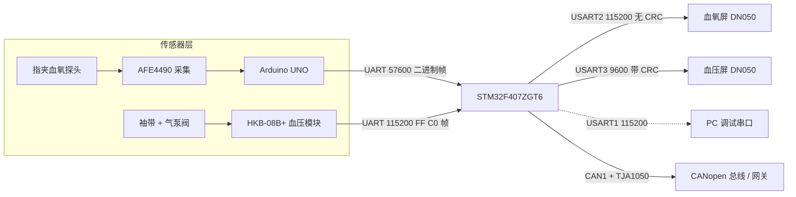
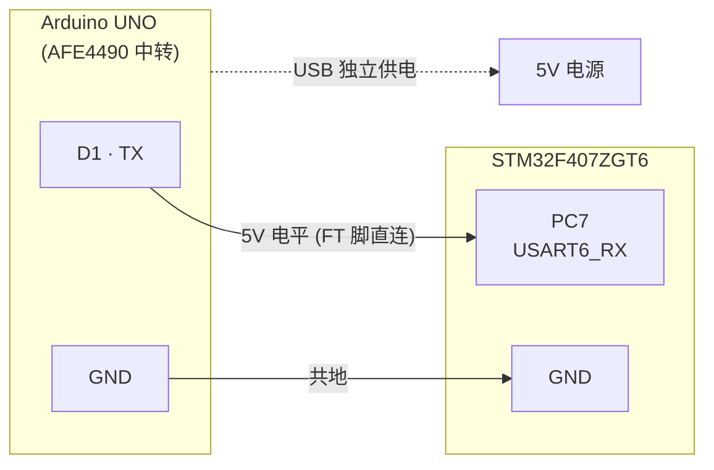
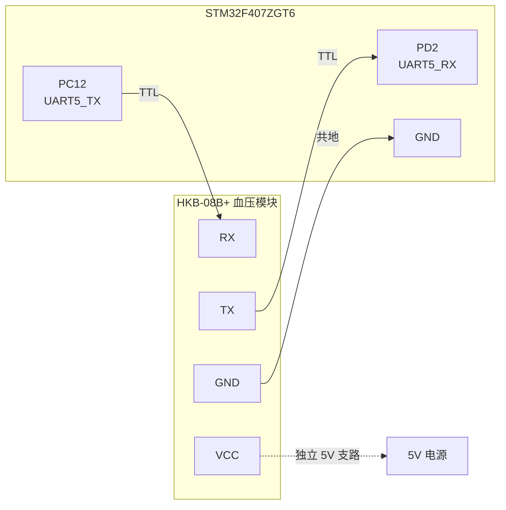
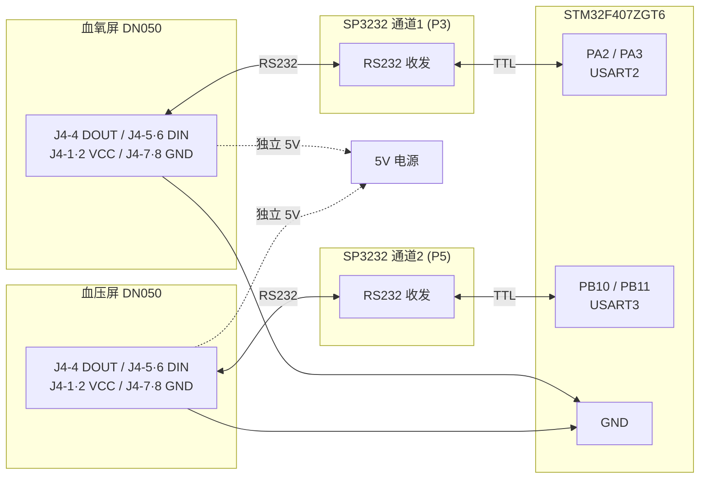
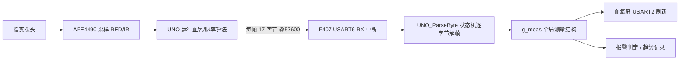
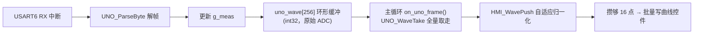
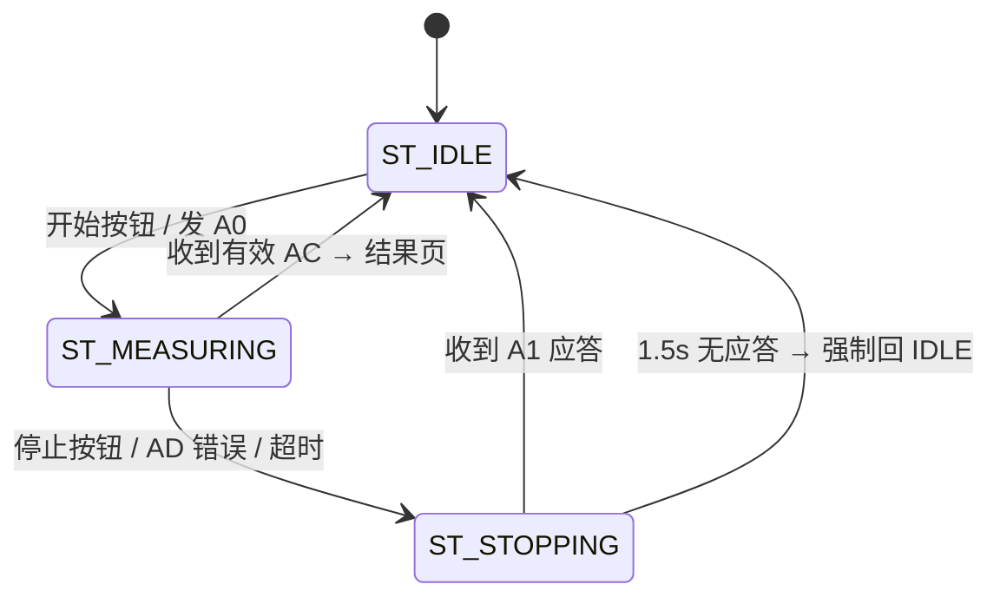

# 多参数心电监护仪系统-血氧血压模块 项目书

**项目名称**：多参数生理监护系统 —— 血氧（SpO2/PR）+ 无创血压（NIBP）模块
**文档版本**：v1.0（对外技术说明版）
**编制日期**：2026-10-26
**主控平台**：STM32F407ZGT6（标准外设库 SPL + Keil MDK V5.14 / Arm Compiler 5）
**适用阶段**：样机开发 / 双屏双传感器并行联调 / 验收交付

> 本版为对外技术说明文档，聚焦系统架构、硬件接口、模块设计与验收基线。已去除本地工程路径、器件采购地、内部排错过程细节；引脚接线以「示意图 + 引脚表」呈现，便于评审与交接。

---

## 目录

- [1. 项目概述](#1-项目概述)
  - [1.1 项目目标](#11-项目目标)
  - [1.2 系统框图](#12-系统框图)
- [2. 需求与验收目标](#2-需求与验收目标)
  - [2.1 功能需求](#21-功能需求)
  - [2.2 非目标](#22-非目标)
- [3. 硬件设计](#3-硬件设计)
  - [3.1 开发板基线](#31-开发板基线)
  - [3.2 UART 资源分配](#32-uart-资源分配)
  - [3.3 引脚接线示意图](#33-引脚接线示意图)
  - [3.4 电源与共地](#34-电源与共地)
- [4. 血氧模块设计](#4-血氧模块设计)
  - [4.1 数据链路](#41-数据链路)
  - [4.2 UNO 二进制帧格式](#42-uno-二进制帧格式)
  - [4.3 测量数据结构](#43-测量数据结构)
  - [4.4 血氧算法说明与误差边界](#44-血氧算法说明与误差边界)
  - [4.5 血氧状态与显示规则](#45-血氧状态与显示规则)
  - [4.6 PPG 波形显示](#46-ppg-波形显示)
- [5. 血压模块设计](#5-血压模块设计)
  - [5.1 帧格式与校验](#51-帧格式与校验)
  - [5.2 命令与上行帧](#52-命令与上行帧)
  - [5.3 校验回归向量](#53-校验回归向量)
  - [5.4 错误码](#54-错误码)
  - [5.5 血压状态机](#55-血压状态机)
  - [5.6 气压写屏节流](#56-气压写屏节流)
- [6. 串口屏设计与协议](#6-串口屏设计与协议)
  - [6.1 大彩帧格式](#61-大彩帧格式)
  - [6.2 CRC 两端一致性](#62-crc-两端一致性)
  - [6.3 血压屏页面与控件](#63-血压屏页面与控件)
  - [6.4 时钟刷新（屏内 RTC 同源方案）](#64-时钟刷新屏内-rtc-同源方案)
  - [6.5 血氧屏 Lua 脚本置空](#65-血氧屏-lua-脚本置空)
  - [6.6 按钮类型约定](#66-按钮类型约定)
  - [6.7 结果页「历史」按钮行为](#67-结果页历史按钮行为)
- [7. 软件架构](#7-软件架构)
  - [7.1 分层与文件清单](#71-分层与文件清单)
  - [7.2 主循环调度](#72-主循环调度)
  - [7.3 中断与缓冲](#73-中断与缓冲)
  - [7.4 并发约束](#74-并发约束)
- [8. 关键设计约束与已解决问题](#8-关键设计约束与已解决问题)
- [9. 配置基线与编译验证](#9-配置基线与编译验证)
  - [9.1 必须两端一致的配置项](#91-必须两端一致的配置项)
  - [9.2 编译验证结论](#92-编译验证结论)
  - [9.3 上电顺序建议](#93-上电顺序建议)
- [10. 联调与验收](#10-联调与验收)
  - [10.1 分阶段联调](#101-分阶段联调)
  - [10.2 验收矩阵](#102-验收矩阵)
- [11. 已知限制与后续计划](#11-已知限制与后续计划)

---

## 1. 项目概述

### 1.1 项目目标

系统使用一块 **STM32F407ZGT6** 开发板（标准外设库 SPL + Keil MDK V5.14 / Arm Compiler 5），同时完成两路独立监护：

| 通道 | 传感器 | 供电/接口 | 本地显示 |
|---|---|---|---|
| **血氧** | 指夹式血氧探头 + **AFE4490**（经 Arduino UNO 采集） | UNO → F407，UART @57600 | 一块大彩 DN 串口屏（USART2） |
| **血压** | **HKB-08B+** 无创血压模块 | TTL UART @115200 | 另一块大彩 DN 串口屏（USART3） |

核心能力：

- 血氧与血压**同时测量、两块屏幕同时刷新**，互不阻塞；
- 血氧输出 SpO2、脉率 PR、探头状态、有效位；PPG 波形实时上屏并支持趋势记录；
- 血压输出袖带实时压力、SYS/DIA/血压 PR、错误码，支持测量结果历史（100 条环形缓冲）；
- 软 RTC 时钟每秒同步到两块屏，支持时间设置页；                         
- CANopen（CAN1 + TJA1050）向网关上报已实现（单实例 CANopenNode 栈 + 私有对象字典 + 5 路 TPDO，含 PPG 波形 125 Hz），预留扩展 UART。

### 1.2 系统框图



关键分工：**F407 不解析 AFE 寄存器，也不运行血氧算法**——它接收 UNO 已经算好的 `spo2/hr` 与原始 RED/IR，负责显示、趋势、报警判定与 CAN 上报。这一划分降低了 F407 的实时压力，代价是多一个 MCU 中转环节。

---

## 2. 需求与验收目标

### 2.1 功能需求

| 编号 | 需求 | 证据 |
|---|---|---|
| F-01 | 上电初始化时钟（168 MHz）、GPIO、5 路 UART、两块屏、两路传感器 | 启动日志、心跳计数 |
| F-02 | 血氧：解析 UNO 17 字节二进制帧，得到 RED/IR/spo2/hr | `frames` 计数持续增长、数值随探头变化 |
| F-03 | 血氧：实时刷数值、状态、PPG 波形、监护时长；支持暂停/继续 | 屏显示与日志一致 |
| F-04 | 血压：唤醒/开始/停止/压力帧/完成帧/错误帧全流程 | 原始帧与解析结果逐条对应 |
| F-05 | 血压：输出压力、SYS、DIA、PR、分级提示与错误码 | 结果页/历史页记录 |
| F-06 | 双屏独立：任一块屏断开/重启不影响另一路，也不影响采样 | 断屏测试、双路抓包 |
| F-07 | 时钟：软 RTC 每秒同步到全部页面，切页/测量时不受影响 | 目视无跳变、各页时间一致 |
| F-08 | 血压结果历史 ≥100 条，结果页「历史」按钮显示最新一条 | 历史页翻页、结果页回填 |
| F-09 | 异常可诊断：坏帧、队列溢出、超时均有计数/状态 | 调试口计数、故障注入 |

### 2.2 非目标

- 不为两条业务线各建一个 CANopen 节点（本模块只有一个节点实例）；
- 不在血压屏测量中掉线时「继续等」——按保守策略请求停止；
- 不用屏幕内 Lua 脚本参与动态内容显示（见 §6.5，血氧屏 `main.lua` 已置空）；
- 不做无人值守自动循环测压。

---

## 3. 硬件设计

### 3.1 开发板基线

- **MCU**：STM32F407ZGT6，HSE 8 MHz → PLL → HCLK 168 MHz / APB1 42 MHz / APB2 84 MHz；
- **开发板**：STM32F4 系列通用开发板，板载 CH340（调试串口）、SP3232（双通道 RS232）、TJA1050（CAN1）、W25Q128、LAN8720A 及多组复用排针；
- **开发环境**：Keil MDK **V5.14**，器件包 STM32F4xx_DFP 1.0.8（无 HAL，标准外设库）+ CMSIS 4.2.0；编译器为 **Arm Compiler 5.05（armcc）**。

> ⚠️ 板载外设复用严重：使用某组引脚前必须确认对应板载器件已断开或未初始化。本工程实际用到的 PA2/PA3（USART2）经 SP3232 通道 1，PB10/PB11（USART3）经 SP3232 通道 2——**两路均走板载 RS232 收发器**，屏侧须为 RS232 或经原配线束转 TTL。

### 3.2 UART 资源分配

| 外设 | 引脚 | 用途 | 波特率 | 物理出口 |
|---|---|---|---|---|
| USART1 | PA9 / PA10 | 调试口 | 115200 | 经板载 CH340（或 USB-TTL）到 PC |
| **USART2** | **PA2 / PA3** | **血氧屏** | **115200** | SP3232 通道 1 → RS232 |
| **USART3** | **PB10 / PB11** | **血压屏** | **9600** | SP3232 通道 2 → RS232 |
| **UART5** | **PC12 / PD2** | **血压传感器 HKB-08B+** | **115200** | 扩展口（TTL 直连） |
| USART6 | PC6 / PC7 | 血氧传感器（UNO） | 57600 | PC7 = RX ← UNO TX；PC6 = TX 暂不用 |

**改造要点**：血压传感器原先挂在 USART3。本次把传感器移到 **UART5(PC12/PD2)**，**把 USART3 让给第二块血压屏**——这是「双屏并行」能成立的前提。

> 选 UART5 而非 UART4 的原因：UART4 的 PA0 与板上 `WK_UP` 冲突；UART5 的 PC12/PD2 在扩展口，且本工程不启用 SDIO（PC12 是 SDIO 复用脚），无争用。USART6 已被血氧传感器占用，不再作为屏口回退候选。

### 3.3 引脚接线示意图

下面按接口分别绘制引脚接线示意图，图中标注了实际使用到的引脚名称；配套引脚表给出供电与电平说明。

#### 3.3.1 血氧传感器接线（UNO ↔ F407 · USART6）



| 信号 | UNO 侧引脚 | F407 侧引脚 | 说明 |
|---|---|---|---|
| 数据 | D1 (TX) | PC7 (USART6_RX) | 5 V 电平，PC7 为 FT 脚可直连 |
| 地 | GND | GND | 与 F407 共地 |
| 供电 | USB | — | UNO 由 USB 独立供电（AFE 盾板功耗大，勿从 F407 取电） |

#### 3.3.2 血压传感器接线（HKB-08B+ ↔ F407 · UART5）



| 信号 | HKB 侧引脚 | F407 侧引脚 | 说明 |
|---|---|---|---|
| 发送（F407→HKB） | RX | PC12 (UART5_TX) | TTL 直连 |
| 接收（HKB→F407） | TX | PD2 (UART5_RX) | TTL 直连 |
| 供电 | VCC | — | 独立 5 V 支路（泵阀电流大，禁止从 3.3 V/GPIO/USB-TTL 取电） |
| 地 | GND | GND | 与 F407 共地 |

#### 3.3.3 双串口屏接线（屏 ↔ 板载 SP3232 ↔ F407）



| 信号 | 屏侧（J4） | 板载收发器 | F407 侧引脚 | 说明 |
|---|---|---|---|---|
| 血氧屏数据 | DOUT(4) → DIN(5/6) | SP3232 通道 1 (P3) | PA2(TX)/PA3(RX) USART2 | RS232 电平，115200 |
| 血压屏数据 | DOUT(4) → DIN(5/6) | SP3232 通道 2 (P5) | PB10(TX)/PB11(RX) USART3 | RS232 电平，9600 |
| 供电 | J4-1/2 (VCC) | — | — | 独立 5 V 支路，与血氧屏分开走线、共地 |
| 地 | J4-7/8 (GND) | — | GND | 电源参考地 |

> 屏端为 RS232 电平，经板载 SP3232 转换，**不需要额外收发器**；若原配线束为 TTL 直连版本，须核对是否短接跳线后接 TTL 侧。

#### 3.3.4 调试串口接线（F407 ↔ PC · USART1）

| 信号 | F407 侧引脚 | PC 侧 | 说明 |
|---|---|---|---|
| 发送 | PA9 (USART1_TX) | RX | 经板载 CH340 或 USB-TTL，115200 |
| 接收 | PA10 (USART1_RX) | TX | 同上 |

### 3.4 电源与共地

- 血氧屏 + 血压屏最亮带喇叭典型功耗合计约 4.2 W；按 5 V 折算约 0.84 A，再加 HKB 泵阀 0.35~0.50 A，合计约 1.2~1.35 A，**未含启动峰值**；
- 泵启停瞬间电流冲击最大，必须**按实测峰值加裕量**选电源和线径；
- 三块地（两屏、HKB、F407/UNO）在**电源参考点单点汇合**，避免泵电流经过信号地回路造成串口误码；
- 探头/AFE 走线与泵线束分开固定走线，避免充气抖动引入 PPG 干扰。

---

## 4. 血氧模块设计

### 4.1 数据链路



**为什么用 UNO 中转**：AFE4490 官方示例库为 Arduino 平台编写，直接移植到 F407 需要重写 SPI 驱动、寄存器配置、DRDY 时序与算法时基。样机阶段先用 UNO 跑通「传感器 → 数值」链路，把不确定性隔离在 UNO 侧，F407 只做确定性很强的显示与业务逻辑。数据来源与业务层通过 `measurement_t` 接口解耦——若未来去掉 UNO，只替换数据来源，业务层代码基本不动。

### 4.2 UNO 二进制帧格式

源：AFE4490 官方库 Example-1 帧，兼容配套解析脚本。

| 偏移 | 字节 | 含义 |
|---|---|---|
| [0] | `0x0A` | 同步字 1 |
| [1] | `0xFA` | 同步字 2 |
| [2] | `0x0A` | 数据长度低（DATA_LEN = 10） |
| [3] | `0x00` | 数据长度高 |
| [4] | `0x02` | 类型 = DATA |
| [5..8] | IR_data | `int32` 小端（LED1VAL） |
| [9..12] | RED_data | `int32` 小端（LED2VAL） |
| [13] | spo2 | `uint8`，0~100；0 = 未算出/探头错误 |
| [14] | hr | `uint8`，bpm；0 = 无效 |
| [15] | `0x00` | 保留 |
| [16] | `0x0B` | 帧尾 |

**共 17 字节。**

解析器（`uno.c`）为 8 态状态机 `S0_SYNC1 → S7_FOOT2`：先匹配 5 字节固定头 `0A FA 0A 00 02`，再收 10 字节负载，最后用 `00 0B` **二次校验**帧尾。即使 IR/RED 数据体内出现 `0x0A/0xFA` 也不会误同步。每字节先计入诊断计数并写入诊断环，**再做状态机判定**——这样即使波特率配错、同步不上，调试口也能看到「字节确实在进」。

### 4.3 测量数据结构

```c
typedef struct {
    int32_t  red_raw;        /* RED 通道原始 ADC（AFE4490 LED2VAL） */
    int32_t  ir_raw;         /* IR  通道原始 ADC（AFE4490 LED1VAL） */
    int16_t  spo2;           /* 血氧 0~100；0 表示无效/探头错误 */
    int16_t  pulse_rate;     /* 脉率 PR，bpm */
    uint8_t  signal_quality; /* 灌注质量 0~100（F407 峰检 SQI，连续值） */
    uint8_t  probe_state;    /* 0 未接入/错误，1 接入 */
    uint8_t  result_valid;   /* 1 = 数值有效 */
    uint8_t  fault_code;
    uint32_t monitor_sec;    /* 监护时长（秒），由 main 累加 */
    uint32_t result_time_ms; /* 最近一次有效结果时间戳（时效判定用） */
    uint32_t age_ms;         /* 当前值年龄 = now - result_time_ms */
} measurement_t;
```

有效性推导（`UNO_ParseByte` 内）：`spo2 == 0` → `result_valid = 0`、`probe_state = 0`、`quality = 0`；否则均为有效（`quality = 100`，再由 F407 峰检写入连续 0~100 SQI）。`signal_quality` 由 F407 峰检推导提供连续 0~100 值，屏上「灌注质量 0/100」代表真实峰检质量。

### 4.4 血氧算法说明与误差边界

算法运行在 **UNO 侧**（AFE4490 官方库的 HR/SpO2 例程）。主循环 `delay(8)` 帧率 ≈125 Hz；SpO2 库内部降采样后血氧值约每 2 s 刷新一次。因此：

- SpO2 数值稳定后可用；快速变化场景（运动、末梢循环差）误差偏大；
- 报告中的数值**仅作工程验证**，不作为临床结论；
- `hr` 与冻结的 `spo2` 更新不同步——**算法算完才更新，其余时间保持上次值**，因此短时间内的 `spo2/hr` 是「上一拍结果」；屏上**已做时效标注**：`measurement_t` 增 `result_time_ms`/`age_ms`，`SPO2_STALE_MS=4000` 判定陈旧，陈旧后数值转 `--`、状态显「数据陈旧」、释放报警、趋势停记。

### 4.5 血氧状态与显示规则

血氧屏页面与关键控件：

| 页面 | ID | 功能 |
|---|---|---|
| 主界面 | 0 | SpO2、PR、质量、PPG、探头/状态、监护时长 |
| 趋势 | 1 | 1/5/30 分钟时段曲线 |
| 报警记录 | 2 | 4 行报警历史 + 条数 + 空态 |
| 设置 | 3 | SpO2 下限、PR 上限、声音开关、背光 |
| 暂停监护 | 4 | 暂停确认弹窗 |
| 报警与探头状态 | 5 | 质量条、探头状态、建议 |
| 清空报警记录 | 6 | 清空确认 |

主界面关键控件：

| ID | 控件 | 写入方 |
|---|---|---|
| 10 | SpO2 数值 | MCU |
| 11 | PR 脉率 | MCU |
| 12 | 「测量有效」/「已暂停」 | MCU |
| 13 / 15 | 报警限值文案 | MCU（随设置页联动） |
| 14 / 16 | 「正常」/「血氧偏低」/「脉率偏快」 | MCU |
| 17 | 灌注质量 0~100 | MCU |
| 19 | PPG 曲线（742 px / 300 点 / 1 字节每点） | MCU |
| 20 | 「脉搏波采集中」/「暂停中」 | MCU |
| 21 | 「监护时间 HH:MM:SS」 | MCU，每秒刷新，暂停冻结 |
| 91 | 「探头已接入/未接入」 | MCU |
| 92 | RTC 时钟（`type="rtc"`） | **用 `EE 81` 指令设 RTC，写文本无效** |

趋势页曲线控件为 `historygraph`，`sample_data_format=2`（UINT16，每点 2 字节），`sample_cycle = 2 s`，三个时段按钮为 1 / 5 / 30 分钟。

### 4.6 PPG 波形显示

血氧波形显示由两个架构性改进保障：

#### 4.6.1 采样通路：中断入环 + 主循环全量取走



- 环容量 256 点（2 的幂，1 KB RAM）；单生产者（中断）单消费者（主循环），16 位读写原子，**无需关中断**；
- 环满时丢弃并计入丢弃计数（正常应恒为 0，可作诊断）；
- 暂停监护时清空积压，避免恢复瞬间把暂停期间攒的点一次冲出。

#### 4.6.2 纵向映射：自适应归一化（取代固定增益）

旧实现固定增益 + 硬削幅，导致弱灌注「平线」、强灌注「方波」，且 `>>8` 量化台阶明显。新实现：

1. **去掉 `>>8`**，环里存原始 ADC 全精度；
2. 慢 EMA 跟踪基线，只去掉大直流与缓慢漂移；
3. 对交流分量做**快起慢落**的上下包络；
4. 把 `[lo, hi]` 线性映射到 `[24, 248]` —— **每个脉搏都撑满量程**；
5. **增益封顶**：跨度相对 DC 太小时不无限放大，避免「一条乱抖的线」；
6. `valid = 0` 时推**平线贴底**并复位包络。

自适应归一化后，灌注强弱只体现在包络的疏密上，「看不看得见」不再取决于灌注。

| 宏 | 默认 | 作用 |
|---|---|---|
| `WAVE_BASE` / `WAVE_TOP` | 24 / 248 | 基线与峰值在 0~255 的位置 |
| `WAVE_DC_SHIFT` | 5 | 基线 EMA 速度（≈0.6 Hz 高通截止） |
| `WAVE_ENV_SHIFT` | 8 | 包络回落速度（≈2 s） |
| `WAVE_MIN_SPAN_DIV` | 400 | 增益封顶阈值（跨度下限 = DC/400） |
| `HMI_WAVE_CHUNK` | 16 | 一帧批量发多少点 |

---

## 5. 血压模块设计

### 5.1 帧格式与校验

```text
FF C0 | LEN | CKSUM | CMD | DATA...
```

- `LEN` = 3 + N(DATA)，即包含 LEN 自身、CKSUM、CMD、DATA 的总字节数；整帧长度 = `LEN + 2`；
- `CKSUM = (LEN + CMD + ΣDATA) & 0xFF`，**含 LEN**，不含帧头与校验字节本身；
- 多字节数值**高字节在前**；
- 特例：复位指令 `FF 00`（无帧头，仅两字节，无应答）。

接收器必须能处理拆包、粘包、垃圾前缀、环形回卷、坏帧重同步、LEN 上限和半帧超时；**只有完整有效帧才刷新通信看门状态**。

### 5.2 命令与上行帧

| 动作 | 下行帧 | 期望应答 |
|---|---|---|
| 复位 | `FF 00` | 无应答（之后用唤醒确认通信） |
| 唤醒 | `FF C0 03 AD AA` | `AA` 应答帧 |
| 开始 | `FF C0 03 A3 A0` | 后续 `A0` 压力帧（**不把开始命令当结果**） |
| 停止 | `FF C0 03 A4 A1` | `A1` 应答（**不等同气路已释放**） |
| 休眠 | `FF C0 03 AB A8` | `A8` 应答 |

| CMD | 语义 | DATA |
|---|---|---|
| `A0` | 实时压力 + 脉搏标志（约 10 Hz） | `QYH, QYL` |
| `AC` | 测量完成：SYS / DIA / 血压 PR | `SSYH, SSYL, SZYH, SZYL, XL` |
| `AD` | 模块错误 | `X` = 错误码 |
| `AA`/`A1`/`A8` | 控制应答 | 无 |

字段解析（**注意剥离标志位**）：

```c
pulse_detected  = (QYH  & 0x10u) != 0u;          /* QYH.bit4 = 心跳标志 */
pressure_mmHg   = ((uint16_t)(QYH & 0xEFu) << 8) | QYL;
irregular_pulse = (SSYH & 0x80u) != 0u;          /* SSYH.bit7 = 心律不齐 */
sys_mmHg        = ((uint16_t)(SSYH & 0x7Fu) << 8) | SSYL;
dia_mmHg        = ((uint16_t)SZYH << 8) | SZYL;
nibp_pr_bpm     = XL;
```

> ⚠️ **`QYH.bit4` 必须先剥离再组合压力**。否则带心跳标志的 120 mmHg 会被算成 4000 多，写屏越界 → 屏渲染成 `？？`。`AC` 普通完成帧**没有 MAP 字段**，不自行估算并标作模块实测值。

### 5.3 校验回归向量（单元测试输入）

| 场景 | 测试帧 | 期望 |
|---|---|---|
| A0 压力 120 | `FF C0 05 1D A0 00 78` | `pressure=120`，无脉搏标志 |
| A0 压力 120 + 脉搏 | `FF C0 05 2D A0 10 78` | `pressure=120`，`pulse_detected=1` |
| AC 120/80/PR72 | `FF C0 08 C4 AC 00 78 00 50 48` | SYS=120，DIA=80，PR=72 |
| AC 心律不齐 | `FF C0 08 44 AC 80 78 00 50 48` | SYS=120，`irregular=1` |
| AD 错误 0（无脉搏） | `FF C0 04 B1 AD 00` | 结果无效，保留错误码 0 |
| AD 超压 3 | `FF C0 04 B4 AD 03` | 立即进入停止/锁定路径 |

测试时须**逐字节喂入、随机拆分、插入垃圾前缀并跨环形边界**，禁止只用完整数组测试。

### 5.4 错误码

| X | 含义 | 处置 |
|---|---|---|
| 0 | 无有效脉搏 | 本次结果无效，停止并提示检查 |
| 1 | 11 s 内未到 50 mmHg | 检查袖带、软管和漏气 |
| 2 | 测量值有误 | 停止，本次结果无效 |
| 3 | 超过 295 mmHg，超压保护 | 立即故障停止并锁定检查 |
| 4 | 干预过多 | 提示重新测量，停止后人工开始 |
| 其他 | 未定义 | 显示未知错误并保留原码 |

**X = 0 是真实错误，不能当作「无错误」。**

### 5.5 血压状态机



- 开始测量：发一次 `A0`，复位气压写屏节流计数，状态 → `ST_MEASURING`，测量计时归零；
- 测量中：处理 `A0` 压力帧、`AC` 完成帧、`AD` 错误帧；
- 停止：发 `A1`，状态 → `ST_STOPPING`；收到 `A1` 应答回 `ST_IDLE`；**若 1.5 s 内无应答，强制回 `ST_IDLE`**；
- **每次成功/失败/取消都写入历史环形缓冲**（`HIST_CAP = 100`），失败记录 `valid = 0`。

> 实机安全提醒：`A1` 只证明模块**收到**停止命令，不代表气路已泄压。样机阶段必须保留人工泄压与独立断泵路径；断电、复位或 UART 断线都不等于已泄压。

### 5.6 气压写屏节流

血压屏走 **9600 8N1 ≈ 960 字节/秒**，而屏发送是**轮询阻塞**（`uart_send_byte` 等 TXE）。若气压帧到达即写屏，会与每秒时钟广播叠加击穿串口（470~1070 B/s 超物理上限），导致屏 RX 溢出、时钟帧被丢弃 → **测量时屏幕时间「卡住几秒后猛地跳一下」**。

**修复**：`on_bp_frame()` 加**纯时间闸门**——距上次写屏 ≥ 150 ms 才刷新一次（≈6.7 Hz）：

```c
static uint32_t s_press_send_tick = 0;
if (p.pressure > 600u) break;              /* 越界值丢弃，沿用上次显示 */
{
    uint32_t now = g_tick;
    if (now - s_press_send_tick >= 150u)   /* ★ 纯时间闸门，与压力变化率无关 */
    {
        /* 写气压到屏 */
        s_press_send_tick = now;
    }
}
```

节流后负载恒定 ≈ 420 B/s（44%），**与传感器帧率、压力变化率无关**，时钟帧每 1 s 准时到达。

> 最终删除「变化闸门」（压力变化 ≥3 mmHg 立即刷新）——因为充放气时气压本来就急变，变化闸门形同虚设，会退回高频写屏。参数可调：链路质量差放宽到 200 ms，需要更跟手可收紧到 100 ms（均不改变时钟广播）。

---

## 6. 串口屏设计与协议

### 6.1 大彩帧格式

```text
0xEE | body... | [CRC16/MODBUS 高字节在前] | FF FC FF FF
```

常用指令：

| 功能 | 帧（无 CRC 版） |
|---|---|
| 握手 | `EE 04 FF FC FF FF` |
| 查询当前页 | `EE B1 01 FF FC FF FF` |
| 切换页面到 P02 | `EE B1 00 00 02 FF FC FF FF` |
| 向 P02 控件写 ASCII "120" | `EE B1 10 00 02 00 6F 31 32 30 FF FC FF FF` |
| 按钮事件（屏 → MCU） | `EE B1 11 SH SL CH CL 10 Subtype Status FF FC FF FF` |

- `B1 00` = 切页，`B1 01` = 查页，`B1 10` = 写文本，`B1 11` = 控件通知（**两个字节**，不是两位十六进制字符）；
- 页面 ID、控件 ID 均按 **16 位大端**；
- `Subtype=01` 为开关按钮，`Status=01/00` = 按下/弹起；`Subtype=00` 为切页按钮，`Status` 为保留字节。

### 6.2 CRC 两端一致性

MCU 侧 `HMI_USE_CRC` 与屏工程 `DeviceEnableCRC` **必须同时开或同时关**，否则会出现乱码或整屏不显示。

| 屏 | 驱动 | MCU CRC | 屏 `DeviceEnableCRC` | 波特率 |
|---|---|---|---|---|
| 血氧屏 | `dc_hmi.c` | **0（不发）** | **"0"** | 115200 |
| 血压屏 | `hmi_dacai.c` | **1（发 CRC16/MODBUS）** | **"1"** | 9600 |

CRC-16/MODBUS **只对 body 计算，插在帧尾 `FF FC FF FF` 之前，高字节在前**。屏回传帧的 CRC 字节由 `hmi_rx_frame` 在解析前剥离。

> 改动任何一侧后，**必须重新编译并下载到屏**，否则屏固件里的开关不会变。

### 6.3 血压屏页面与控件

血压屏工程（无 boot 页，页号 0~9）：

| 页 | ID | 功能 | 关键控件 |
|---|---|---|---|
| idle | 0 | 就绪 / 上次结果 | 开始(10)、历史(11)、设置(12)；上次结果(110) |
| measuring | 1 | 测量中 | 停止(10)；状态(110)、**压力(111)**、用时(112) |
| result | 2 | 结果 | 再测(10)、**历史(11)**、换患者(12)；SYS(110)、DIA(111)、PR(112) |
| notice | 3 | 错误提示 | 重试(10)、返回(11)；错误码(110)、标题(111)、说明(112/113) |
| history | 4 | 历史记录 | 上页(10)、下页(11)、返回(12)；行数据 110~133 + 页码 140 |
| settings | 5 | 设置 | 时间(12)、亮度减/加(10/11)；亮度(110)、时间(111) |
| maintenance | 6 | 维护（可隐藏） | — |
| stopping | 7 | 停止中 | 停止(10)；状态(110)、压力(111)、说明(112) |
| confirm | 8 | 换测量会话确认 | — |
| time | 9 | 时间设置 | 字段(10)、加(15)、减(16)、取消(17)、保存(18)；年(110)~分(114) |

公共控件：`CLOCK`(100)、`CONTEXT`(101)、`FOOTER`(102)、`TIP_TITLE`(103)、`TIP_DETAIL`(104)。

> **控件 ID 与页面绑定判断**：ID 10 在 idle 是「开始」、在 measuring 是「停止」、在 history 是「上页」——**必须连同页面 ID 一起判断，不能只按控件 ID 分发**。

### 6.4 时钟刷新（屏内 RTC 同源方案）

软 RTC 基于 `g_tick`（= `uwTick`，SysTick 1 ms 累加）。最终方案：血压屏时钟的 `CLOCK`(id=100) 由**文本控件**改为 **`type="rtc"` 控件**，MCU 用 `EE 81` 每秒设置一次屏内 RTC，与血氧屏 `dc_hmi` 的 `HMI_SetRTCTime()` **同指令同字段顺序**。

- 时钟开销 **340 B/s → 15 B/s**，各页天然一致，两屏完全同源；
- 同时把血氧侧 `SPO2_RTC_SYNC_MS` 从 5 分钟改为 **1000 ms**，两块屏都变成「每秒被 MCU 用同一条指令对齐一次」；
- 两套软 RTC **共用 `g_rtc_epoch_tick`** 基准，Δ 恒为 0；
- 残留的屏间亚秒相位差通过血压屏侧 `BP_RTC_OFFSET_SEC`（默认 +1）微调。

> **⚠️ 前置条件**：血压屏**必须重新编译 + 下载新固件**，否则 `EE 81` 会打到一个已被改成 RTC 的控件上；只烧 MCU 不更新屏 ⇒ 血压屏时钟会永远停在「时间未校准」。

### 6.5 血氧屏 Lua 脚本置空

血氧屏工程根目录的 `main.lua` 原本会随工程下发并执行，与 MCU **抢着写同一批控件**，导致监护时间永远显示 `00:00:01`、暂停后按钮文案不变等问题。

**处理**：`main.lua` 已替换为空壳，**全部动态内容改由 MCU 独占写入**。

### 6.6 按钮类型约定

| `button_type` | 行为 |
|---|---|
| 0 | 切换画面，屏自己跳页；**实测不可靠上报按键事件** |
| 1 | 开关描述，只上报事件、不跳页（**要 MCU 干活的按钮都用它**） |
| 2/3/4 | 自定义按键/指令/弹出菜单，本工程未用 |

屏工程 `DeviceControlNotify="3"` = **按下和弹起都上报**，所以一次点击会收到**两帧**（`state=1` 按下 / `state=0` 弹起）。**凡翻转型动作必须只在 `state==1` 时执行**，否则一次点击翻转两次 = 看起来没反应。

### 6.7 结果页「历史」按钮行为

点击结果页「历史」按钮时，除刷新历史列表外，**结果页左侧数据区同时回填历史中最新一次的 SYS/DIA/PR**：

- 若最新一条 `valid` 为真 → 写 SYS/DIA/PR；
- 若**最新一条不存在、被取消或为错误记录** → 三处一律写 `"--"`。

---

## 7. 软件架构

### 7.1 分层与文件清单

```text
USER/
  main.c              双屏双传感器主循环（唯一 main）
  stm32f4xx_it.c      仅保留一个 SysTick_Handler；USART2/3、UART5、USART6 中断分发
  merge_cfg.h         双屏并行架构说明
HARDWARE/
  SYS/sys.c(.h)       时钟、uwTick(1ms)、millis、delay_ms
  DEBUG/debug.c(.h)   USART1 调试输出
  USART/usart.c(.h)   USART2 血氧屏 / USART6 UNO 初始化与中断
  UNO/uno.c(.h)       UNO 17 字节帧解析状态机 + g_meas
  HMI/dc_hmi.c(.h)    血氧屏驱动（不发 CRC）
  HMI/app_bloodoxygen.c(.h)  血氧业务：数值/状态/PPG/趋势/报警/软 RTC
  HMI/hmi_ids.h       血氧屏页面与控件 ID
  hmi_dacai.c(.h)     血压屏驱动（发 CRC16/MODBUS）
  bp_sensor.c(.h)     HKB-08B+ 组帧/解帧（纯 C，无 SDK 依赖）
  app_bp.c(.h)        血压业务：状态机/结果/历史/设置/时间/亮度
```

### 7.2 主循环调度

```c
while (1)
{
    /* ---- 血氧子系统 ---- */
    HMI_Poll();              /* 血氧屏上行按键通知 */
    on_uno_frame();          /* 把 UNO 积压的 PPG 采样全部推给屏 */
    task_hmi_value();        /* 数值/状态刷新：每 400 ms（含报警判定） */
    task_hmi_trend();        /* 趋势：每 2 s 追加一点 */
    task_clock();            /* 软 RTC：每秒推进并同步到屏 */
    g_meas.monitor_sec = millis() / 1000;

    /* ---- 血压子系统 ---- */
    app_loop();              /* 传感器组帧 + 软 RTC + 时钟广播 + 血压屏刷新 */
}
```

`app_loop()` 内部三步：①把血压屏字节送 `hmi_rx_feed` 组帧；②把传感器字节送 `bp_sensor_feed` 解帧，整帧回调 `on_bp_frame`；③每 1 s 软 RTC 刷新时钟与测量计时。

### 7.3 中断与缓冲

- **统一 SysTick**：仅 `it.c` 一处 `SysTick_Handler` 累加 `uwTick`；血压模块的 `g_tick` 用 `#define g_tick uwTick` **别名**到同一个计数器；
- **接收方式**：全部走 **RXNE 逐字节中断**（数据量小，不必申请 DMA 流）；
- **环形缓冲**：`s_q2`（血压屏，256 B）、`s_q3`（血压传感器，256 B），中断只入队，业务在主循环出队；`uno_wave[256]`（PPG 采样环，`int32` 共 1 KB），USART6 中断逐点入环、主循环全量取走；
- **中断向量**：`USART2_IRQHandler` → 血氧屏；`USART3_IRQHandler` → 血压屏；`UART5_IRQHandler` → 血压传感器；`USART6_IRQHandler` → UNO。**中断里只入队，不做解析、不写屏、不切页。**

### 7.4 并发约束

1. 每路 UART 独立端口、独立环形缓冲、独立错误计数；
2. 血压屏发送与血压传感器接收互不阻塞；
3. 屏发送是**轮询阻塞**的，因此所有写屏路径都必须限频（时钟 1 Hz/页、气压 6.7 Hz、数值 2.5 Hz）；
4. 两条业务线共用一份 `uwTick`，任何一方不得私自重配 SysTick；
5. 同一次启动内用无符号 `now - timestamp` 计算短时超时，避免回卷。

---

## 8. 关键设计约束与已解决问题

本模块经历样机迭代后，以下约束为必须遵循的「铁律」，避免重复踩坑：

1. **CRC 两端一致性（头号坑）**：MCU `HMI_USE_CRC` 与屏 `DeviceEnableCRC` 必须同开或同关；不一致会导致乱码或整屏不显示。血氧屏关闭 CRC，血压屏开启 CRC——两侧独立配置，互不影响。
2. **气压写屏必须纯时间闸门**：不能用「压力变化量」作为放行条件（充放气时气压本来就急变），否则退回高频写屏、时钟卡顿。
3. **PPG 采样必须进环 + 主循环全量取走**：单布尔标志门控会因血压屏阻塞发送丢失采样点，导致波形「一秒卡一次」。
4. **PPG 纵向映射必须自适应归一化**：固定增益在弱/强灌注下分别表现为平线/方波；自适应归一化让每个脉搏撑满量程。
5. **两屏时钟必须同源（屏内 RTC + 共用基准）**：文本逐页写方案存在固定滞后与相位差；改用 `EE 81` 设置屏内 RTC + 共用 `g_rtc_epoch_tick` 后两屏完全一致。
6. **`QYH.bit4` 必须先剥离再组合压力**：否则带心跳标志的压力值溢出，写屏越界渲染 `？？`。
7. **UNO 必须独立供电、与 F407 共地**：AFE 盾板功耗大，勿从 F407 取电。
8. **HKB 必须独立 5 V 支路供电**：泵阀启动电流大，禁止从 3.3 V/GPIO/USB-TTL 取电。

---

## 9. 配置基线与编译验证

### 9.1 必须两端一致的配置项

| 项 | 血氧屏 | 血压屏 |
|---|---|---|
| MCU 端口 | USART2 | USART3 |
| 波特率 | 115200 | 9600 |
| CRC | MCU 不发；屏 `"0"` | MCU 发 CRC16/MODBUS；屏 `"1"` |
| 时钟控件 | id=92 `type="rtc"`，`EE 81` 驱动，每 1 s 校准 | id=100 `type="rtc"`，`EE 81` 驱动，每 1 s 校准 |
| UNO 波特率 | 57600，须与 UNO sketch 的 `Serial.begin()` 一致 | — |

### 9.2 编译验证结论

用 Keil AC5 的 `armcc` + `armasm` + `armlink` 对工程清单内**全部源文件**（含 CANopenNode 栈、bxCAN 驱动、适配层等）做完整编译 + 链接。

```text
编译: 全部 .c，0 error / 0 warning
链接: armlink exit 0，生成 fw.axf

Code   44316 B   RO-data   3012 B   RW-data   1480 B   ZI-data  15552 B
Total ROM (Code + RO Data + RW Data) 48808 B (47.66 kB)
```

> ⚠️ **屏工程同样要重新编译下载**：血压屏 10 个页面把 `CLOCK` 由文本控件改成了 `type="rtc"`。只烧 MCU 不更新屏 ⇒ 血压屏时钟会永远停在「时间未校准」。

### 9.3 上电顺序建议

1. 两屏各自供电，确认屏自检与握手；
2. 接 UNO，调试口看 `uno_rx / frames` 是否增长；
3. 接 HKB（**先不接气路**），调试口看唤醒/握手帧；
4. 接气路，做第一次有人值守测量。

---

## 10. 联调与验收

### 10.1 分阶段联调

| 阶段 | 只接入内容 | 通过门槛 |
|---|---|---|
| A0 | 核对板卡/屏/传感器型号、线束、跳帽、波特率、CRC 开关 | 与 §9.1 配置表逐项一致 |
| A1 | F407 空跑、SWD、时钟、调试口心跳 | 168 MHz 稳定，心跳计数正常 |
| A2 | 血压屏单独联调（USART3） | 查询/切页/写文本/按钮事件可靠 |
| A3 | 血氧屏单独联调（USART2） | 同上；确认 `main.lua` 已置空 |
| A4 | 仅 HKB UART（UART5），不接气路 | 唤醒、校验、模拟帧解析通过 |
| A5 | 仅 UNO（USART6） | `frames` 持续增长；RED/IR 随遮挡变化；spo2 稳定后收敛 |
| A6 | 血氧单通道完整闭环 | 数值/PPG/趋势/暂停/报警全通 |
| A7 | 血压单通道完整闭环 | 至少 **10 次**台架测量，含失败分支 |
| **A8** | **双屏双传感器并行** | **两屏互不干扰；泵启动不复位 MCU；时钟不跳；无 `？？`** |
| A9 | 加 CAN1 回环 / 接网关 | CANopen 代码已实现，待 CAN 收发器/分析仪到位后做总线回环与联调 |
| A10 | 长时间稳定性 | 至少完成一次 24 h 综合运行 |

### 10.2 验收矩阵

| ID | 场景 | 通过条件 |
|---|---|---|
| NA-01 | 配置核对 | 两屏波特率/CRC、UNO 波特率、UART 分配与 §9.1 一致 |
| NA-02 | 血氧数值 | 手指稳定放置 30 s 后 SpO2、PR 有值且不跳变；遮挡后 `--` 或「探头未接入」 |
| NA-03 | 血氧无效语义 | `spo2 == 0` 时屏不显示旧值，明确标无效 |
| NA-04 | 血压流程 | 唤醒→开始→压力上升→完成 SYS/DIA/PR 全链路正确 |
| NA-05 | 血压失败分支 | 至少 10 个周期，覆盖无脉搏/超压/干预过多/取消 |
| NA-06 | 血压历史 | ≥100 条记录可翻页；结果页「历史」按钮回填最新一条；无有效记录显示 `--` |
| NA-07 | 时钟稳定性 | 切页、按按钮、测量中，时钟**每秒 +1 无跳变**；各页时间一致 |
| NA-08 | 双屏隔离 | 拔掉任一屏，另一屏与两路采样均正常 |
| NA-09 | 串口负载 | 血压屏 9600 占用 ≤50%；血氧屏 115200 占用 ≤50% |
| NA-10 | 复位/异常 | 坏帧、队列溢出、屏重连后状态可恢复，不产生伪数据 |
| NA-11 | 24 h | 记录复位、丢帧、队列峰值、重连，所有异常有结论 |
| NA-12 | 血氧 PPG 波形连续性 | 探头稳定后波形无「一秒一次」停顿；脉冲间距均匀；采样丢弃计数恒为 0 |
| NA-13 | 时钟分页节流等价性 | 切到任意页，时钟与真实时间差 ≤1 s，各页时间不互相矛盾；血压屏无 `？？`；测量中时钟不卡 |
| NA-14 | PPG 波形观感 | 弱/强灌注下波形均撑满控件纵向 1/2 以上且不削顶；取下探头是一条干净平线 |
| NA-15 | 两屏时钟一致 | 血压屏已下载新屏固件后，调试口每秒打印时间与两块屏逐秒对照：三处秒数一致（差 ≤1 帧） |
| NA-16 | 改时间后两屏同步 | 在血压屏「时间设置」页改一次时间并保存，血氧屏 RTC 应**同时**跳到新时间（差 ≤1 s） |
| NA-17 | 时钟不再占用串口 | 血压屏 9600 链路时钟开销从 340 B/s 降到 **15 B/s（≈1.6%）** |
| NA-18 | CANopen 上报 | 单实例栈上电自主进入 OPERATIONAL；5 路 TPDO 正常；波形 125 Hz 上送 |
