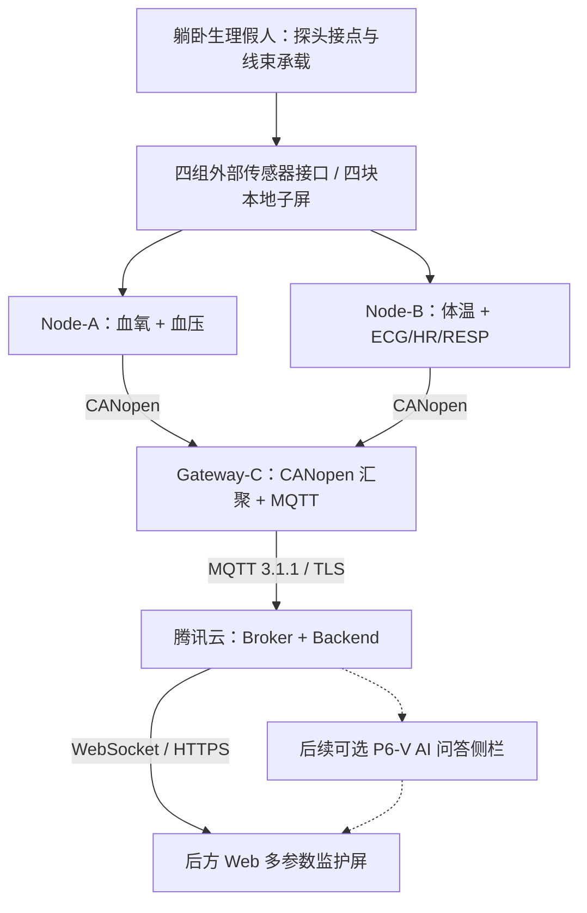

# P6-S 多参数监护仿真沙盘与一体式终端总体开发合同

> **文件编号**：MPM-P6-S-SOW-001  
> **版本/日期**：v1.0｜2026-10-12  
> **项目**：多参数生理监护仪系统工程样机  
> **设计基线**：P4 当前合并基线 `67f5f57bd82c6e326e9e78ec9540481c80105e5f`  
> **文件性质**：**总体外观、功能与协同规划——供设计评审，不是 3D 建模加工、采购或硬件实施合同。**

## 1. 总体目标与平台定位

参考常见多参数监护仪和医疗教学仿真场景，设计一套**具有完整外观、四组传感器接线、四块本地子屏、云端大屏**的工程样机展示与沙盘验证平台：

> **前方躺卧的生理假人 + 明确可见的传感器物理连接线 + 床旁一体式 3D 打印监护终端 + 后方多参数监护显示屏。**

四个传感器模块及其采集电路原则上**封装在单个 3D 打印外壳内**，观众只看到**四块独立子屏及四组外接传感器接口**，不直接展示传感器 PCB、裸露电路和零散杜邦线。外部接口通过壳体预留插口引出，配有清晰的模块名称和接口标识。

本平台定位为**多参数生理监护工程样机的外观展示与功能验证沙盘**，不是医疗器械注册产品或临床诊断设备。

## 2. 总体形态与外观设计

### 2.1 沙盘物理部署

现场布局分为三个展示区域：

- **前景假人区**：假人躺卧在简化床位上，预留心电导联、指夹血氧、无创血压袖带、温度探头的连接位置；外部线束整齐可见。
- **中景仪器区**：一套一体式 3D 打印终端，正面排列四块本地子屏，下部或侧面为四组独立外接接口；供电、主控和传感器电路统一收纳。
- **后景显示区**：现有 Web 多参数监护大屏，显示汇总波形、数值、连接/数据状态；后续可增加 P6-V 的 AI 对话侧栏。

**外观不是实测能力的证明**。普通教学假人本身不会自然产生可被 ECG、PPG/SpO2、NIBP 等前端测得的生理信号。可将线束与假人用于物理展示；如需声称传感器级测量有效，应另用与具体传感器兼容的信号参考设备作验证。

### 2.2 四屏一体式终端概念

外壳总体原则：**四屏同时可见、接口分别引出、内部电路隐藏、整体可拆装维护**。可采用统一外壳+分区安装方式，但**不在本合同中提前冻结壳体尺寸、3D 模型、公母接口型号及具体走线**。外接端子采用有标识、受保护的连接方式，不以裸露供电排针作为面向参观者的常用插拔接口。

## 3. 四个实体传感器模块与显示分工

| 模块（外观子屏） | 现有模块及主要显示内容 | 负责节点 | 对外物理连接 |
|---|---|---|---|
| **① 血氧屏** | AFE4490 血氧：PPG / SpO2 / PR | **Node-A** | 指夹血氧探头/独立接口 |
| **② 血压屏** | HKB-08 无创血压：SYS / DIA / 测量状态 | **Node-A** | 袖带和气路/独立接口 |
| **③ 体温屏** | GY-641V3：TEMP | **Node-B** | 体温探头或测量窗口/独立接口 |
| **④ ECG / 心率屏** | ADS1292R：ECG / HR；预留 RESP / RR 信息 | **Node-B** | 心电导联/独立接口，RESP_RAW 复用该采集链 |

四块子屏不是四块 MCU；**Node-A 和 Node-B 仍按原计划使用各自 STM32F407**。Gateway-C 继续作为独立的 CANopen 汇聚与 MQTT 上云主控，不把四路传感器寄存器读取功能转移到网关。三板是否全部封装在同一个机壳内，由外壳空间、电源、散热、CAN 走线与维护需求共同决定；无论外观怎么封装，原来的逻辑分工保持不变。

RR 仍由 ADS1292R 的 RESP_RAW 经后续算法得到，不能为装饰效果直接将未验证的呼吸率显示为“真实测量值”。

## 4. 总体系统架构与流程

总体流程为：**假人布置/传感器连接 → Node-A/B 采集或仿真场景 → 四块子屏本地显示 → CANopen 汇聚 Gateway-C → MQTT 上云 → 后方大屏汇总展示**。

演示阶段可以使用清晰标识的合成数据和场景脚本先验证显示及链路；真实采集与精度判断则需要实际传感器、相容的参考源与独立测试记录，两者不可混称。

## 5. 协议与软硬件总体选型

| 范围 | 规划采用 | 原则 |
|---|---|---|
| 四传感器到采集节点 | 沿用现有 AFE4490 / HKB-08 / GY-641V3 / ADS1292R 对应厂家接口 | 传感器底层处理仍归属各自节点 |
| Node-A/B 到 Gateway-C | **CANopen over Classic CAN** | 保留对象字典、过程数据、状态管理；不重写私有通用总线协议 |
| Gateway-C 到云端 | **MQTT 3.1.1 / TLS** 经 ESP8266 | 保留 P4/P5 技术成果与遥测数据语义 |
| 云端到后方大屏 | **HTTPS + WebSocket** | 继续复用 Vite/TypeScript/DOM/Canvas 前端 |
| 终端结构 | **单个 3D 打印可拆装机壳**、四子屏、四组外部接口 | 只冻结整体外观原则，不预定机械加工细节 |

本期**不引入 FreeRTOS、不因沙盘改用 ESP32/BLE、不更换原 Gateway-C 网络出口**。云端 AI 可作为第二份合同的独立功能并行推进，不应成为四传感器本地显示的必需条件。

## 6. 团队责任与阶段协作

| 成员 | 本阶段规划责任 |
|---|---|
| **A** | 血氧与 NIBP 的实物参数、探头接口和两块屏显示内容；配合机壳对外接口布局 |
| **B** | 体温与 ECG/HR/RESP_RAW 的实物参数、探头接口和两块屏显示内容；与 P 配合 RR 展示有效性 |
| **P** | 一体式系统架构、外观与云端展示需求统筹、Gateway-C/CANopen/网络接口、沙盘集成协调与验收 |
| **共同** | 统一子屏风格与单位、连接标识、设备状态和现场演示流程 |

结构设计可以委托建模人员或由团队完成，但外壳设计以 A/B 提供的实际模块与屏幕尺寸为依据，不在总规划中假定所有模块尺寸已冻结。

## 7. 总体开发阶段

| 阶段 | 主要任务 | 阶段结果 |
|---|---|---|
| **S0 · 外观与模块需求确认** | 确定假人外观、四模块尺寸与四屏位置、机壳展示形式 | 沙盘布局草案、3D 外壳外观方案 |
| **S1 · 四屏封装与独立展示** | 完成四模块隐藏安装、外接接口引出、本地屏显示 | 可展示的四屏一体式终端及实体线束 |
| **S2 · 原系统真实数据贯通** | Node-A/B、Gateway-C 与云端大屏按现有架构连接 | 多参数本地/云端同步展示与联调记录 |
| **S3 · 综合沙盘展示与评审** | 假人布置、场景演示、状态标识、AI 可选联动 | 总体展示验收、风险和后续样机决策 |

若 S2 包含三块**独立实物** STM32 的 CAN 通信，应为真实三板联调单独留出验证阶段；已有 P5 同板合成回环不能代替该结果。若后续增加模拟器做真实传感器级验证，需另立详细技术与采购计划。

## 8. 总体验收、边界与变更管理

总体成果应具备：**躺卧假人、可见且对应正确的四组传感器线束、四块本地子屏、完整一体式 3D 打印外观、独立标识的外接接口，以及后方云端多参数汇总显示**。展示照片应能清楚解释 A/B/Gateway 的职责与信号流向。

风险主要是**外壳空间与散热、电源/线束安全、假人不能产生真实生理信号、真实三板 CANopen 尚需联调、部分 RR 与传感器实际精度尚待验证**。本合同不要求为了装饰效果隐藏失败状态，也不将数字模拟显示视作传感器精度证明。

**本方案评审阶段只冻结展示形态、四传感器归属、四屏布局、接口外置原则和既有协议主线**。具体 3D 文件/材料厚度/开孔尺寸、板卡固定方案、电气接线、传感器测试工装、硬件采购、固件修改和沙盘场景测试须另立实施合同。**本文件不授权任何加工、仓库写入、硬件操作或购买行为。**

## 参考依据

- 《多参数生理监护系统总开发合同与系统方案 v0.7》（本次提供）：四模块、双采集节点、四屏及 CANopen/MQTT 规划。
- [Laerdal SimMan 3G 参考资料](https://cdn.laerdal.com/downloads/f7668/user_guide_simman_3g__en_)：仿真假人、物理连接与监护屏布局参考；不意味着普通假人能提供真实测量信号。
- [CANopenNode 官方仓库](https://github.com/CANopenNode/CANopenNode)：标准 CANopen 对象字典、PDO、NMT、Heartbeat 等机制。
- [Fluke ProSim 8/8P 官方资料](https://www.flukebiomedical.com/products/patient-simulators/prosim-8-and-prosim-8p-vital-signs-patient-simulator)：电气/光学/气路参考设备属于传感器级验证，可选，非当前展示方案强制采购项。
