# VisualTFT 医院版血压界面绘制指南
版本 1.0 · 2026-09-21 · 800×480 横屏 · N050 类电容触摸 · 配色参考 `F:\VisualTFT\SPO2_Hospital`

本指南把已经确认的深蓝血压界面拆成可以手工导入 VisualTFT 的背景图、按钮图片和动态文本，并补齐所有按钮按下时的样子、点击后目标页面、配置步骤与控件表。**PNG 图片可直接用于绘图；本包不是可直接烧录的 `.tftprj` 工程，也不包含测压固件。**

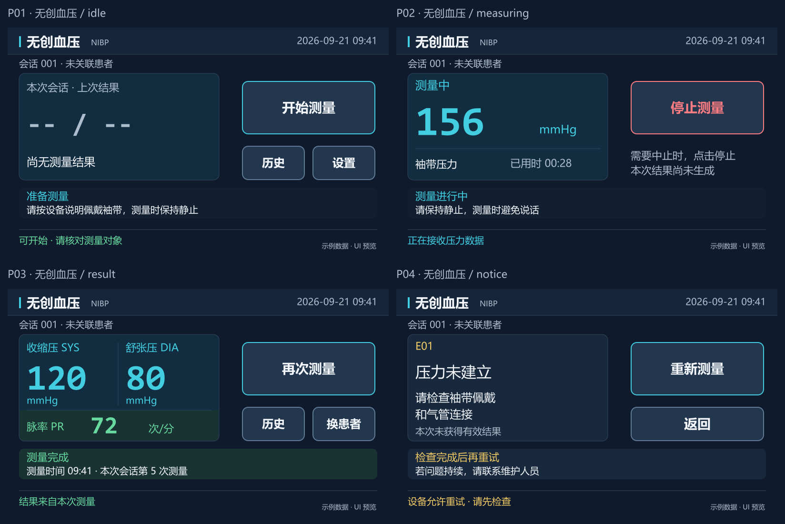

图中 120/80、72、156、日期、会话号均为排版演示。`assets/backgrounds/` 不含这些演示值，主控数据应通过文本控件显示。补充页面沿用主界面配色和触控尺寸；未改变已经确认的测量流程。

## 1. 先看这三种图片的区别

| 文件夹 | 用途 | 能否设为屏幕背景 |
| --- | --- | --- |
| assets/backgrounds/ | 11 张 800×480 静态底图；留出按钮、读数和状态文本位置 | 可以，按页面表逐一选取 |
| assets/buttons/ | 按钮常态 up、按下 down、禁用 disabled；另有时间字段 selected | 放到按钮/图标属性，不是整页背景 |
| previews/ | 11 页效果图、控件标注图，以及不同状态的示例 | 不可以：含演示数据和已绘制的按钮 |
| transitions/ | 每个按钮的按下整页图和目标画面对照 | 不可以：只用于照着配置、核对动作 |
| sources/ | 所有图片的 SVG 源文件，可修改和重新导出 | VisualTFT 优先使用已导出的 PNG |
| 控件配置表.csv / manifest.json | 坐标、控件 ID、状态与资源清单 | 查表使用 |
| 阅读版.html | 浏览器离线查看本指南、图片和目录 | 仅供阅读 |

所有素材放在同一目录内；复制或解压时请保留文件夹结构。Markdown 内图片使用相对路径，方便整包移动。本文“目标页面”均指对应主控事件被接受后的显示结果，不意味着仅设置一个跳页属性就能启动或停止血压模块。

## 2. 建立工程：按这个顺序操作

1. 打开 VisualTFT，选择 **文件 → 新建工程**，保存到一个新的血压工程目录。按屏幕背面完整料号选择硬件、800×480 横屏和电容触摸。
2. 用户目前只确认“N050 类”。本机 `DeviceInfo.xml` 有 `DC80480DN050 / TypeID 21011 / 5.0 英寸 / 800×480`，这只是可选型号线索；须与实物标签一致。不要因为编译方便而改成其他 7 英寸型号。
3. 按下一节顺序使用 **文件 → 新建画面** 建立 P00～P10，并重命名。把上电初始画面设为 P00。
4. 双击画面空白处，打开画面属性；背景图片选本页的 `assets/backgrounds/pXX_*.png`，显示尺寸 800×480，坐标 0,0，不拉伸、不偏移。
5. 先添加并配置按钮，再添加动态文本。按表输入 X、Y、宽、高，不用鼠标目测位置。打开工具栏“显示控件 ID”核对。
6. 设置按钮的弹起、按下图片，并按第 4 节填写公共属性。数字、时间和状态文字按第 5 节添加。
7. 如果 VisualTFT 自动分配的画面或控件 ID 不能修改，保留实际 ID，并在 CSV 的副本中记录映射；联调代码必须使用实际导出的 ID。
8. 先运行虚拟屏检查排版、按下反馈和事件，再连接主控验证业务跳转。最后按真实型号编译、下载并检查实屏字体与触摸。

### 页面清单

| 建议画面 ID | 画面名 | 实际使用 |
| --- | --- | --- |
| 0 | boot | 无创血压 |
| 1 | idle | 无创血压 |
| 2 | measuring | 无创血压 |
| 3 | result | 无创血压 |
| 4 | notice | 无创血压 |
| 5 | history | 测量历史 |
| 6 | settings | 设备设置 |
| 7 | maintenance | 维护信息 |
| 8 | stopping | 无创血压 |
| 9 | confirm | 切换测量会话 |
| 10 | time | 时间设置 |

P00～P07 沿用原方案的建议页号；新增 P08 正在停止、P09 换患者确认、P10 时间编辑。`starting`、`notice_locked`、历史翻页等是同一个画面的内容/按钮状态变化，**不额外创建画面**。

## 3. 配色和字体配置

| 用途 | HEX | VisualTFT RGB（R;G;B） |
| --- | --- | --- |
| background | #0F1B2D | 15;27;45 |
| header | #16263A | 22;38;58 |
| surface | #18293D | 24;41;61 |
| inset | #111F31 | 17;31;49 |
| data | #132D40 | 19;45;64 |
| pulse | #193333 | 25;51;51 |
| border | #30465E | 48;70;94 |
| text | #F4F7FB | 244;247;251 |
| muted | #ADBDCE | 173;189;206 |
| cyan | #42CDE0 | 66;205;224 |
| green | #68D99F | 104;217;159 |
| amber | #F2CB67 | 242;203;103 |
| red | #FF7C82 | 255;124;130 |
| button | #22364D | 34;54;77 |
| pressed | #304D63 | 48;77;99 |
| button_border | #607B95 | 96;123;149 |

背景图已经包含静态中文、分区、单位和边框，按钮 PNG 已包含按钮文字。动态读数和提示要配置屏幕字库。效果图使用微软雅黑和等宽数字；表中的字号是目标像素高度，不是屏幕字库 ID。

**先检查“字体资源/字库选择”实际提供的字体。** 本地血氧工程的现有字库包括 ASCII 12×24、16×32、32×64 和 GBK/GB2312 的 24×24、32×32、64×64 等；它们的 ID 只属于那个工程，不应照搬。基础/N 系列不应默认具备物联/F 系列的任意矢量字库能力。

| 内容 | 效果图目标 | 首轮可用字库方案 |
| --- | --- | --- |
| 压力 | 88 px | ASCII 32×64，高 64；保持文本框坐标不变并垂直居中 |
| SYS / DIA | 76 px | ASCII 32×64，高 64；三个数字宽 96，可容纳于本表文本框 |
| PR | 52 px | ASCII 16×32，高 32；若实物支持定制数字字库，再替换为目标高度 |
| 动态中文正文 | 22 / 24 px | 优先 24×24；必要时把辅助说明改为 16×16，必须实屏确认可读性 |
| 动态时间/页码 | 20 / 22 px | 16 或 24 像素字库；24 像素时检查长文本宽度，可使用短日期格式 |
| 按钮、静态标签 | PNG 内的 20～30 px | 无需再叠加同样的文字控件 |

若使用 24×24 中文，超出文本框时优先缩短文案，不要任意缩小重要提示。例如页脚改为“等待主控确认”，日期改为“09-21 09:41”。空值统一 `--`，不显示 0/0 作为无结果。正式字库需要包含 `--`、百分号、斜杠、冒号、所有中文状态文案。

## 4. 按钮的公共属性与事件配置

| VisualTFT 属性 | 本包建议填写 |
| --- | --- |
| 控件类型 | 按钮 |
| X / Y / 宽 / 高 | 按各页按钮表 |
| 弹起时的图片 | assets/buttons/名称_up.png |
| 按下时的图片 | assets/buttons/名称_down.png |
| 裁剪 / 图片裁剪 | 否。这里每张图片就是按钮自身尺寸，不是从整屏背景裁切 |
| 文字状态 | 否。PNG 已含文字；时间字段按钮是例外，使用单独动态文本覆盖 |
| 触控用途 | 开关描述 |
| 操作风格 | 瞬变；一次按下后弹回，不用长按连发或自锁 |
| 初始状态 | 弹起 |
| 事件通知 | 是/开启；若软件可选择事件阶段，按下通知即可 |
| 对外指令 | 留空，使用系统按钮事件通知；不要再发送第二套自定义命令 |
| 对内指令 | 正式业务工程留空，页面和数据由主控状态统一回写 |
| 触控范围 | 与按钮矩形一致；不扩张到相邻按钮 |

本包统一推荐按钮先上报事件、主控处理后再切页，方便“历史返回到来源页”、动态设置和测量状态一致。若只做无硬件外观演示，可在工程副本中把纯导航按钮设为“触控用途 → 切换画面 → 目标画面”；这是演示配置，不代替 START/STOP/NEW_SESSION/SET_TIME 等设备动作。

### 先亲手做一个“开始测量”按钮

1. 打开 P01，双击空白处把背景图片选为 `assets/backgrounds/p01_idle.png`。
2. 从工具栏放入一个按钮，在属性窗口填 `X=492、Y=112、宽=280、高=112`；本指南建议 ID 为 10。
3. “弹起时的图片”选 `assets/buttons/start_up.png`；“按下时的图片”选 `assets/buttons/start_down.png`。
4. “裁剪”选否，“文字状态”选否，“触控用途”选开关描述，“操作风格”选瞬变，“初始状态”选弹起，“事件通知”开启。
5. 本按钮不填直接切换 P02 的对内指令。运行虚拟屏，按下应看到蓝灰按下效果，串口/指令窗口出现该按钮的按下通知。
6. 主控识别 P01 / B10 并允许开始后，先给 P02 的文本控件写入“启动中”、压力 `--` 和已用时 `00:00`，再切换至 P02。其余按钮照各页控件表和第 8 节动作说明配置。

本地指令集 V5.1 的“开关描述”按钮通知子类型为 `01`，状态 `01` 是按下、`00` 是弹起。业务处理只响应一次按下事件，不能两次都执行开始。**“切换画面”按钮子类型为 `00`，其状态位是保留字段，不能套用按下/弹起判断。** 最终以该屏固件、指令助手和串口抓包为准；本文不要求手填猜测的帧字节。停止不使用与开始相同的防重复锁，连续停止请求交给主控安全处理。

### 禁用样式不等于不能点击

`disabled.png` 只是外观。必须同时把控件置为不可操作，并由主控再次拒绝越权动作。软件若没有单独“禁用图片”属性，可在禁用时隐藏并禁用按钮，在同一位置显示使用 disabled 图片的图标/图片控件；恢复时隐藏该图片控件、启用并显示按钮。具体可用的显示、使能和图片更新命令用本机指令助手确认。不要只换一张灰色图片而保留有效触控。

默认：P01 开始、P03 再测、P04 重试都等主控许可；P02/P08 的停止保持可操作。历史首/末页禁用对应翻页按钮，时间未校准也不能伪造日期。

## 5. 动态文本的公共属性

| 属性 | 填写方法 |
| --- | --- |
| 控件类型 | 文本控件；数值也是文本，由主控格式化后发送 |
| 输入方式 | 用户主机输入；关闭系统键盘/用户触控输入 |
| 文本初值 | 使用每页表中的安全初值，不填演示测量数字 |
| 背景模式 | 纯色/选定背景色；按表中 BG 精确填写，避免旧数字残影 |
| 文字颜色 | 按表中 FG 填写；血压青色，PR 绿色，正文白色 |
| 对齐 | 默认左对齐；CLOCK 右对齐，亮度/页码/时间字段居中 |
| 自动换行 | 本表单行字段关闭换行；异常正文拆成两行控件 |
| 刷新 | 同一框整体覆盖；保持单位和卡片边框不被文本背景擦除 |

P10 时间字段的文本在按钮上层，选择操作应由按钮接收；文本设置为仅主机输入，实机确认它不会截获触摸。按下时文本框背景同步为 pressed 色、弹起恢复 button 色；也可使用该机已验证可正确擦除的透明文本模式。若该固件的文本层会拦截触控，改用一个可动态更新文字的按钮承载数值，仍沿用同一控件坐标和事件 ID。不能留下只能点数字边缘才响应的热区。

## 6. 按页绘制：背景、控件、坐标

坐标格式统一为 `X / Y / W / H`，单位像素。B 表示按钮，T 表示文本；它们在同页中的 ID 不重复。每页先放背景，再放按钮，最后放动态文字。标题/单位等已经在背景内的文字不用重复添加。

### P00 · 无创血压（boot）

上电初始页；不放“跳过”按钮。不使用延时自动进入可测量状态。主控完成连接检查后进入 P01，异常进入 P04。

**最终效果（含演示数据）**

**真正导入的背景图**：`assets/backgrounds/p00_boot.png`

控件位置图：[查看 B/T 编号标注](previews/p00_boot_controls.png)。

本页没有可点击按钮，由主控状态驱动画面。

| 文本 ID / 名称 | X / Y / W / H | 字号目标 / 对齐 | FG / BG | 安全初值 |
| --- | --- | --- | --- | --- |
| 100 CLOCK | 548 / 17 / 228 / 28 | 20 / right | #ADBDCE / #16263A | 时间未校准 |
| 101 CONTEXT | 24 / 65 / 752 / 27 | 20 / left | #ADBDCE / #0F1B2D | 未关联患者 |
| 102 FOOTER | 24 / 436 / 584 / 30 | 20 / left | #F2CB67 / #0F1B2D | 等待设备状态 |
| 110 BOOT_STATUS | 48 / 169 / 690 / 48 | 32 / left | #F4F7FB / #18293D | 正在初始化 |
| 111 BOOT_DETAIL | 48 / 237 / 690 / 34 | 24 / left | #ADBDCE / #18293D | 正在检查设备连接 |
| 112 VERSION | 48 / 306 / 690 / 30 | 20 / left | #ADBDCE / #18293D | 屏幕版本：-- |

### P01 · 无创血压（idle）

初始开始按钮禁用，主控明确 start_allowed 后才启用。同一会话存在上次结果时可更新 LAST_RESULT 和 LAST_INFO，必须同时带历史时间说明。

**最终效果（含演示数据）**

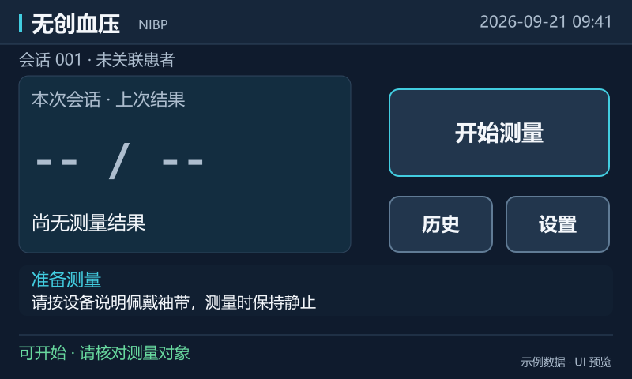

**真正导入的背景图**：`assets/backgrounds/p01_idle.png`

控件位置图：[查看 B/T 编号标注](previews/p01_idle_controls.png)。

| 按钮 ID | 标签 | X / Y / W / H | 弹起 / 按下图片 |
| --- | --- | --- | --- |
| 10 | 开始测量 | 492 / 112 / 280 / 112 | start_up.png / start_down.png |
| 11 | 历史 | 492 / 248 / 132 / 72 | history_up.png / history_down.png |
| 12 | 设置 | 640 / 248 / 132 / 72 | settings_up.png / settings_down.png |

| 文本 ID / 名称 | X / Y / W / H | 字号目标 / 对齐 | FG / BG | 安全初值 |
| --- | --- | --- | --- | --- |
| 100 CLOCK | 548 / 17 / 228 / 28 | 20 / right | #ADBDCE / #16263A | 时间未校准 |
| 101 CONTEXT | 24 / 65 / 752 / 27 | 20 / left | #ADBDCE / #0F1B2D | 未关联患者 |
| 102 FOOTER | 24 / 436 / 584 / 30 | 20 / left | #68D99F / #0F1B2D | 等待设备状态 |
| 110 LAST_RESULT | 40 / 170 / 388 / 80 | 58 / left | #ADBDCE / #132D40 | -- / -- |
| 111 LAST_INFO | 40 / 269 / 388 / 34 | 24 / left | #F4F7FB / #132D40 | 尚无测量结果 |
| 103 TIP_TITLE | 40 / 342 / 714 / 28 | 22 / left | #42CDE0 / #111F31 | 等待设备状态 |
| 104 TIP_DETAIL | 40 / 372 / 714 / 26 | 20 / left | #F4F7FB / #111F31 | 空字符串 |

### P02 · 无创血压（measuring）

P02 包含启动中、测量中、压力断流三种文案。启动时压力为 --；没有有效压力时清空显示，不能保留过时数字。

**最终效果（含演示数据）**

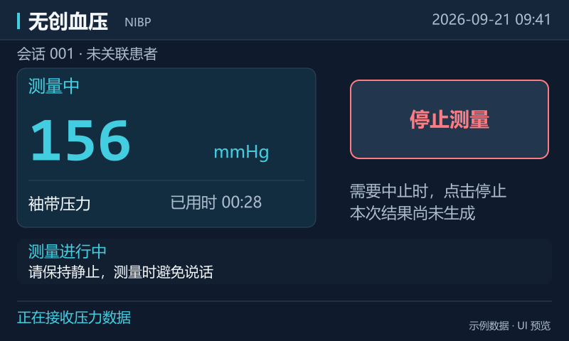

**真正导入的背景图**：`assets/backgrounds/p02_measuring.png`

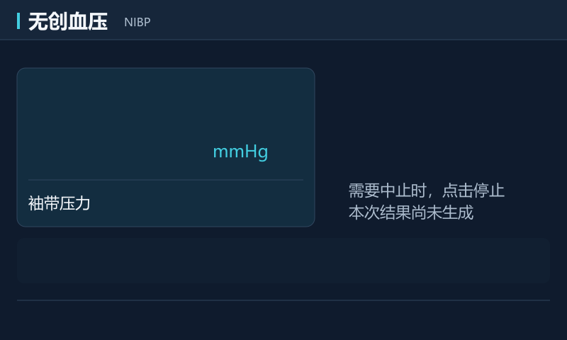

控件位置图：[查看 B/T 编号标注](previews/p02_measuring_controls.png)。

| 按钮 ID | 标签 | X / Y / W / H | 弹起 / 按下图片 |
| --- | --- | --- | --- |
| 10 | 停止测量 | 492 / 112 / 280 / 112 | stop_up.png / stop_down.png |

| 文本 ID / 名称 | X / Y / W / H | 字号目标 / 对齐 | FG / BG | 安全初值 |
| --- | --- | --- | --- | --- |
| 100 CLOCK | 548 / 17 / 228 / 28 | 20 / right | #ADBDCE / #16263A | 时间未校准 |
| 101 CONTEXT | 24 / 65 / 752 / 27 | 20 / left | #ADBDCE / #0F1B2D | 未关联患者 |
| 102 FOOTER | 24 / 436 / 584 / 30 | 20 / left | #42CDE0 / #0F1B2D | 等待设备状态 |
| 110 MEASURE_STATUS | 40 / 108 / 388 / 36 | 24 / left | #42CDE0 / #132D40 | 启动中 |
| 111 PRESSURE | 40 / 148 / 250 / 100 | 88 / left | #42CDE0 / #132D40 | -- |
| 112 ELAPSED | 239 / 273 / 189 / 32 | 22 / left | #ADBDCE / #132D40 | 已用时 --:-- |
| 103 TIP_TITLE | 40 / 342 / 714 / 28 | 22 / left | #42CDE0 / #111F31 | 等待设备状态 |
| 104 TIP_DETAIL | 40 / 372 / 714 / 26 | 20 / left | #F4F7FB / #111F31 | 空字符串 |

### P03 · 无创血压（result）

SYS/DIA/PR、会话、时间、有效标识一起更新后才显示“测量完成”。绿色表示流程完成，不代表血压正常。字体若不支持目标尺寸，用本机可用的 64 px / 32 px 字库完成首轮联调。

**最终效果（含演示数据）**

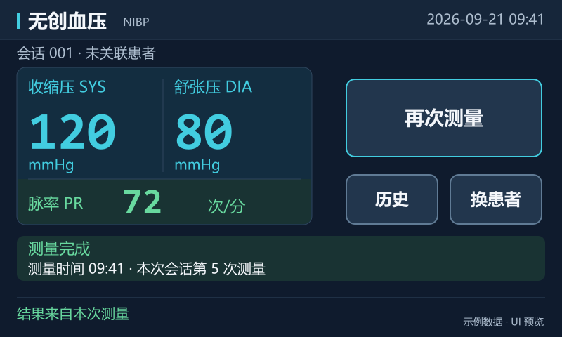

**真正导入的背景图**：`assets/backgrounds/p03_result.png`

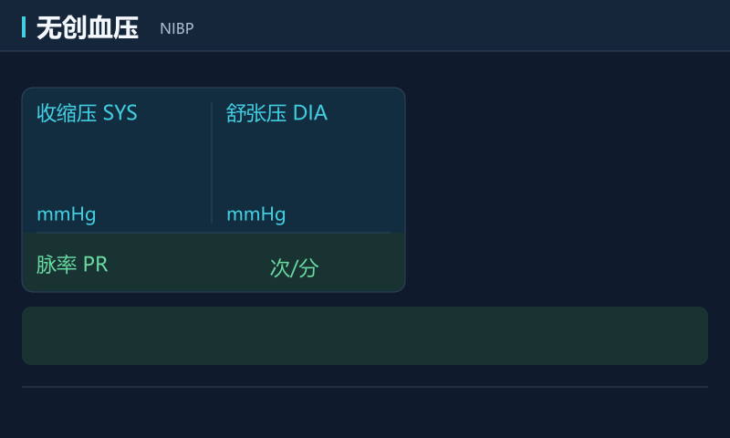

控件位置图：[查看 B/T 编号标注](previews/p03_result_controls.png)。

| 按钮 ID | 标签 | X / Y / W / H | 弹起 / 按下图片 |
| --- | --- | --- | --- |
| 10 | 再次测量 | 492 / 112 / 280 / 112 | remeasure_up.png / remeasure_down.png |
| 11 | 历史 | 492 / 248 / 132 / 72 | history_up.png / history_down.png |
| 12 | 换患者 | 640 / 248 / 132 / 72 | new_patient_up.png / new_patient_down.png |

| 文本 ID / 名称 | X / Y / W / H | 字号目标 / 对齐 | FG / BG | 安全初值 |
| --- | --- | --- | --- | --- |
| 100 CLOCK | 548 / 17 / 228 / 28 | 20 / right | #ADBDCE / #16263A | 时间未校准 |
| 101 CONTEXT | 24 / 65 / 752 / 27 | 20 / left | #ADBDCE / #0F1B2D | 未关联患者 |
| 102 FOOTER | 24 / 436 / 584 / 30 | 20 / left | #68D99F / #0F1B2D | 等待设备状态 |
| 110 SYS | 40 / 145 / 176 / 80 | 76 / left | #42CDE0 / #132D40 | -- |
| 111 DIA | 248 / 145 / 180 / 80 | 76 / left | #42CDE0 / #132D40 | -- |
| 112 PR | 174 / 258 / 112 / 58 | 52 / left | #68D99F / #193333 | -- |
| 103 TIP_TITLE | 40 / 342 / 714 / 28 | 22 / left | #68D99F / #193333 | 等待设备状态 |
| 104 TIP_DETAIL | 40 / 372 / 714 / 26 | 20 / left | #F4F7FB / #193333 | 空字符串 |

### P04 · 无创血压（notice）

该图是允许重试的 E01 示例。通信故障或停止状态不明时，ID10 更换为 stop 图片并解释为 STOP，ID11 隐藏且禁用；见锁定变体。错误信息由主控填入，不把 E01 烘焙到背景。

**最终效果（含演示数据）**

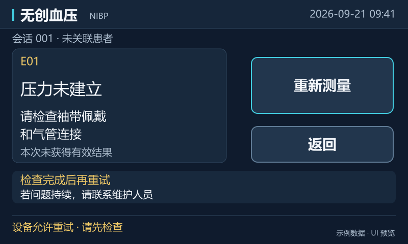

**真正导入的背景图**：`assets/backgrounds/p04_notice.png`

控件位置图：[查看 B/T 编号标注](previews/p04_notice_controls.png)。

| 按钮 ID | 标签 | X / Y / W / H | 弹起 / 按下图片 |
| --- | --- | --- | --- |
| 10 | 重新测量 | 492 / 112 / 280 / 112 | retry_up.png / retry_down.png |
| 11 | 返回 | 492 / 248 / 280 / 72 | back_wide_up.png / back_wide_down.png |

| 文本 ID / 名称 | X / Y / W / H | 字号目标 / 对齐 | FG / BG | 安全初值 |
| --- | --- | --- | --- | --- |
| 100 CLOCK | 548 / 17 / 228 / 28 | 20 / right | #ADBDCE / #16263A | 时间未校准 |
| 101 CONTEXT | 24 / 65 / 752 / 27 | 20 / left | #ADBDCE / #0F1B2D | 未关联患者 |
| 102 FOOTER | 24 / 436 / 584 / 30 | 20 / left | #F2CB67 / #0F1B2D | 等待设备状态 |
| 110 ERROR_CODE | 40 / 109 / 388 / 32 | 22 / left | #F2CB67 / #18293D | -- |
| 111 ERROR_TITLE | 40 / 158 / 388 / 48 | 32 / left | #F4F7FB / #18293D | 等待状态确认 |
| 112 ERROR_LINE1 | 40 / 216 / 388 / 34 | 24 / left | #F4F7FB / #18293D | 空字符串 |
| 113 ERROR_LINE2 | 40 / 251 / 388 / 32 | 24 / left | #F4F7FB / #18293D | 空字符串 |
| 114 RESULT_VALIDITY | 40 / 289 / 388 / 27 | 20 / left | #ADBDCE / #18293D | 本次未获得有效结果 |
| 103 TIP_TITLE | 40 / 342 / 714 / 28 | 22 / left | #F2CB67 / #18293D | 等待设备状态 |
| 104 TIP_DETAIL | 40 / 372 / 714 / 26 | 20 / left | #F4F7FB / #18293D | 空字符串 |

### P05 · 测量历史（history）

示例包含有效结果、取消和错误事件。只展示当前会话，最多缓存 100 条事件、每页 4 条。缓存由主控实现，屏幕本身不会因为有历史页就自动保存记录。

**最终效果（含演示数据）**

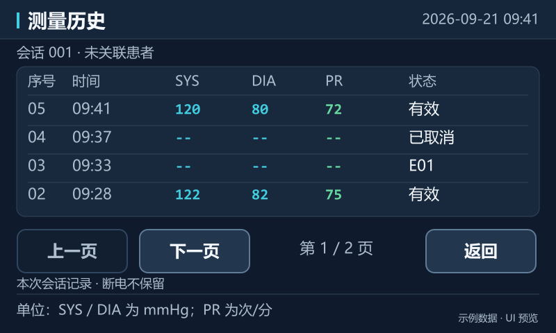

**真正导入的背景图**：`assets/backgrounds/p05_history.png`

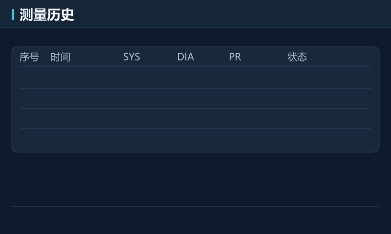

控件位置图：[查看 B/T 编号标注](previews/p05_history_controls.png)。

| 按钮 ID | 标签 | X / Y / W / H | 弹起 / 按下图片 |
| --- | --- | --- | --- |
| 10 | 上一页 | 24 / 330 / 160 / 64 | previous_up.png / previous_down.png |
| 11 | 下一页 | 200 / 330 / 160 / 64 | next_up.png / next_down.png |
| 12 | 返回 | 612 / 330 / 160 / 64 | back_160_up.png / back_160_down.png |

| 文本 ID / 名称 | X / Y / W / H | 字号目标 / 对齐 | FG / BG | 安全初值 |
| --- | --- | --- | --- | --- |
| 100 CLOCK | 548 / 17 / 228 / 28 | 20 / right | #ADBDCE / #16263A | 时间未校准 |
| 101 CONTEXT | 24 / 65 / 752 / 27 | 20 / left | #ADBDCE / #0F1B2D | 未关联患者 |
| 102 FOOTER | 24 / 436 / 584 / 30 | 20 / left | #ADBDCE / #0F1B2D | 等待设备状态 |
| 110 ROW1_NO | 40 / 145 / 52 / 32 | 22 / left | #ADBDCE / #18293D | 空字符串 |
| 111 ROW1_TIME | 104 / 145 / 132 / 32 | 22 / left | #ADBDCE / #18293D | 空字符串 |
| 112 ROW1_SYS | 252 / 145 / 96 / 32 | 22 / left | #42CDE0 / #18293D | 空字符串 |
| 113 ROW1_DIA | 362 / 145 / 88 / 32 | 22 / left | #42CDE0 / #18293D | 空字符串 |
| 114 ROW1_PR | 468 / 145 / 96 / 32 | 22 / left | #68D99F / #18293D | 空字符串 |
| 115 ROW1_STATE | 588 / 145 / 172 / 32 | 22 / left | #F4F7FB / #18293D | 空字符串 |
| 116 ROW2_NO | 40 / 186 / 52 / 32 | 22 / left | #ADBDCE / #18293D | 空字符串 |
| 117 ROW2_TIME | 104 / 186 / 132 / 32 | 22 / left | #ADBDCE / #18293D | 空字符串 |
| 118 ROW2_SYS | 252 / 186 / 96 / 32 | 22 / left | #42CDE0 / #18293D | 空字符串 |
| 119 ROW2_DIA | 362 / 186 / 88 / 32 | 22 / left | #42CDE0 / #18293D | 空字符串 |
| 120 ROW2_PR | 468 / 186 / 96 / 32 | 22 / left | #68D99F / #18293D | 空字符串 |
| 121 ROW2_STATE | 588 / 186 / 172 / 32 | 22 / left | #F4F7FB / #18293D | 空字符串 |
| 122 ROW3_NO | 40 / 227 / 52 / 32 | 22 / left | #ADBDCE / #18293D | 空字符串 |
| 123 ROW3_TIME | 104 / 227 / 132 / 32 | 22 / left | #ADBDCE / #18293D | 空字符串 |
| 124 ROW3_SYS | 252 / 227 / 96 / 32 | 22 / left | #42CDE0 / #18293D | 空字符串 |
| 125 ROW3_DIA | 362 / 227 / 88 / 32 | 22 / left | #42CDE0 / #18293D | 空字符串 |
| 126 ROW3_PR | 468 / 227 / 96 / 32 | 22 / left | #68D99F / #18293D | 空字符串 |
| 127 ROW3_STATE | 588 / 227 / 172 / 32 | 22 / left | #F4F7FB / #18293D | 空字符串 |
| 128 ROW4_NO | 40 / 268 / 52 / 32 | 22 / left | #ADBDCE / #18293D | 空字符串 |
| 129 ROW4_TIME | 104 / 268 / 132 / 32 | 22 / left | #ADBDCE / #18293D | 空字符串 |
| 130 ROW4_SYS | 252 / 268 / 96 / 32 | 22 / left | #42CDE0 / #18293D | 空字符串 |
| 131 ROW4_DIA | 362 / 268 / 88 / 32 | 22 / left | #42CDE0 / #18293D | 空字符串 |
| 132 ROW4_PR | 468 / 268 / 96 / 32 | 22 / left | #68D99F / #18293D | 空字符串 |
| 133 ROW4_STATE | 588 / 268 / 172 / 32 | 22 / left | #F4F7FB / #18293D | 空字符串 |
| 140 PAGE_INDEX | 384 / 346 / 200 / 30 | 22 / center | #ADBDCE / #0F1B2D | 暂无记录 |
| 141 CACHE_NOTE | 24 / 399 / 752 / 24 | 18 / left | #ADBDCE / #0F1B2D | 本次会话记录 · 断电不保留 |

### P06 · 设备设置（settings）

本包包含亮度调整和时间编辑的外观与控件表；实际亮度/RTC 指令须按实物型号验证。亮度按成功读回的值显示，时间未经校准仍写“时间未校准”。

**最终效果（含演示数据）**

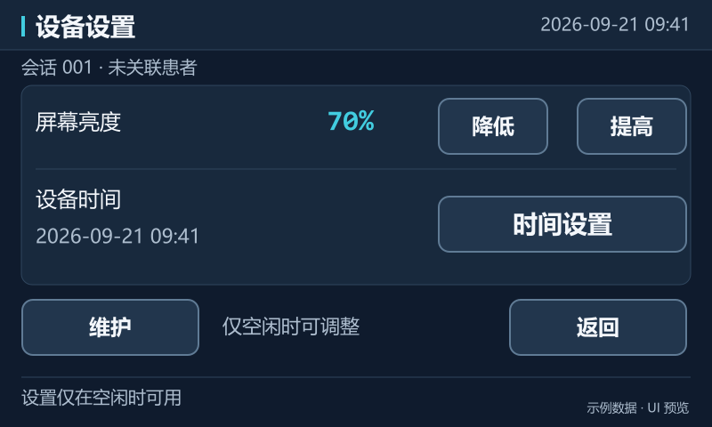

**真正导入的背景图**：`assets/backgrounds/p06_settings.png`

控件位置图：[查看 B/T 编号标注](previews/p06_settings_controls.png)。

| 按钮 ID | 标签 | X / Y / W / H | 弹起 / 按下图片 |
| --- | --- | --- | --- |
| 10 | 降低 | 492 / 110 / 124 / 64 | brightness_minus_up.png / brightness_minus_down.png |
| 11 | 提高 | 648 / 110 / 124 / 64 | brightness_plus_up.png / brightness_plus_down.png |
| 12 | 时间设置 | 492 / 220 / 280 / 64 | set_time_up.png / set_time_down.png |
| 13 | 维护 | 24 / 336 / 200 / 64 | maintenance_up.png / maintenance_down.png |
| 14 | 返回 | 572 / 336 / 200 / 64 | back_200_up.png / back_200_down.png |

| 文本 ID / 名称 | X / Y / W / H | 字号目标 / 对齐 | FG / BG | 安全初值 |
| --- | --- | --- | --- | --- |
| 100 CLOCK | 548 / 17 / 228 / 28 | 20 / right | #ADBDCE / #16263A | 时间未校准 |
| 101 CONTEXT | 24 / 65 / 752 / 27 | 20 / left | #ADBDCE / #0F1B2D | 未关联患者 |
| 102 FOOTER | 24 / 436 / 584 / 30 | 20 / left | #ADBDCE / #0F1B2D | 等待设备状态 |
| 110 BRIGHTNESS | 324 / 118 / 140 / 44 | 32 / center | #42CDE0 / #18293D | -- |
| 111 DEVICE_TIME | 40 / 254 / 430 / 32 | 22 / left | #ADBDCE / #18293D | 时间未校准 |

### P07 · 维护信息（maintenance）

本包只提供维护入口和只读信息版式，不虚构默认密码。真正权限在主控校验；不要用长按标题、隐藏按钮或固定密码代替权限。授权后的版本/通信信息见同页变体。

**最终效果（含演示数据）**

**真正导入的背景图**：`assets/backgrounds/p07_maintenance.png`

控件位置图：[查看 B/T 编号标注](previews/p07_maintenance_controls.png)。

| 按钮 ID | 标签 | X / Y / W / H | 弹起 / 按下图片 |
| --- | --- | --- | --- |
| 10 | 返回 | 492 / 336 / 280 / 64 | back_280_up.png / back_280_down.png |

| 文本 ID / 名称 | X / Y / W / H | 字号目标 / 对齐 | FG / BG | 安全初值 |
| --- | --- | --- | --- | --- |
| 100 CLOCK | 548 / 17 / 228 / 28 | 20 / right | #ADBDCE / #16263A | 时间未校准 |
| 101 CONTEXT | 24 / 65 / 752 / 27 | 20 / left | #ADBDCE / #0F1B2D | 未关联患者 |
| 102 FOOTER | 24 / 436 / 584 / 30 | 20 / left | #F2CB67 / #0F1B2D | 等待设备状态 |
| 110 ACCESS_STATUS | 40 / 153 / 712 / 46 | 32 / left | #F4F7FB / #18293D | 权限未授予 |
| 111 MAINT_LINE1 | 40 / 213 / 712 / 34 | 24 / left | #ADBDCE / #18293D | 请由授权维护端启用访问权限 |
| 112 MAINT_LINE2 | 40 / 261 / 712 / 34 | 22 / left | #ADBDCE / #18293D | 当前仅显示访问说明 |

### P08 · 无创血压（stopping）

主控确认取消且允许重新测量后回 P01；无法确认时进入 P04 锁定变体。停止 ACK 不等于已泄压。此页仍能发送停止请求。

**最终效果（含演示数据）**

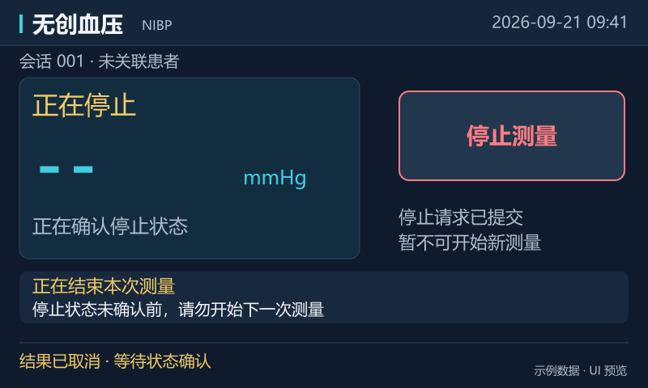

**真正导入的背景图**：`assets/backgrounds/p08_stopping.png`

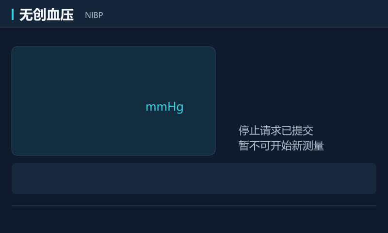

控件位置图：[查看 B/T 编号标注](previews/p08_stopping_controls.png)。

| 按钮 ID | 标签 | X / Y / W / H | 弹起 / 按下图片 |
| --- | --- | --- | --- |
| 10 | 停止测量 | 492 / 112 / 280 / 112 | stop_up.png / stop_down.png |

| 文本 ID / 名称 | X / Y / W / H | 字号目标 / 对齐 | FG / BG | 安全初值 |
| --- | --- | --- | --- | --- |
| 100 CLOCK | 548 / 17 / 228 / 28 | 20 / right | #ADBDCE / #16263A | 时间未校准 |
| 101 CONTEXT | 24 / 65 / 752 / 27 | 20 / left | #ADBDCE / #0F1B2D | 未关联患者 |
| 102 FOOTER | 24 / 436 / 584 / 30 | 20 / left | #F2CB67 / #0F1B2D | 等待设备状态 |
| 110 STOP_STATUS | 40 / 113 / 388 / 44 | 32 / left | #F2CB67 / #132D40 | 正在停止 |
| 111 PRESSURE | 40 / 163 / 250 / 88 | 76 / left | #42CDE0 / #132D40 | -- |
| 112 STOP_DETAIL | 40 / 267 / 388 / 34 | 24 / left | #ADBDCE / #132D40 | 正在确认停止状态 |
| 103 TIP_TITLE | 40 / 342 / 714 / 28 | 22 / left | #F2CB67 / #18293D | 等待设备状态 |
| 104 TIP_DETAIL | 40 / 372 / 714 / 26 | 20 / left | #F4F7FB / #18293D | 空字符串 |

### P09 · 切换测量会话（confirm）

采用完整页面实现确认框，不依赖子画面弹窗或透明层。未接入患者系统时“换患者”表示新建测量会话，不代表完成真实患者身份绑定。

**最终效果（含演示数据）**

**真正导入的背景图**：`assets/backgrounds/p09_confirm.png`

控件位置图：[查看 B/T 编号标注](previews/p09_confirm_controls.png)。

| 按钮 ID | 标签 | X / Y / W / H | 弹起 / 按下图片 |
| --- | --- | --- | --- |
| 10 | 取消 | 24 / 336 / 280 / 64 | cancel_280_up.png / cancel_280_down.png |
| 11 | 确认换患者 | 492 / 336 / 280 / 64 | confirm_session_up.png / confirm_session_down.png |

| 文本 ID / 名称 | X / Y / W / H | 字号目标 / 对齐 | FG / BG | 安全初值 |
| --- | --- | --- | --- | --- |
| 100 CLOCK | 548 / 17 / 228 / 28 | 20 / right | #ADBDCE / #16263A | 时间未校准 |
| 101 CONTEXT | 24 / 65 / 752 / 27 | 20 / left | #ADBDCE / #0F1B2D | 未关联患者 |
| 102 FOOTER | 24 / 436 / 584 / 30 | 20 / left | #ADBDCE / #0F1B2D | 等待设备状态 |
| 110 CURRENT_SESSION | 40 / 268 / 712 / 30 | 22 / left | #ADBDCE / #18293D | 当前会话：待主控提供 |

### P10 · 时间设置（time）

5 个选择框实际是按钮＋原生文本叠放，按钮图片无数字。文本用“用户主机输入”，不启用键盘。本机 DN050 配置不支持系统键盘，因此此页采用选择字段和加减按钮。RTC 范围、闰年和整机时间源由主控处理。

**最终效果（含演示数据）**

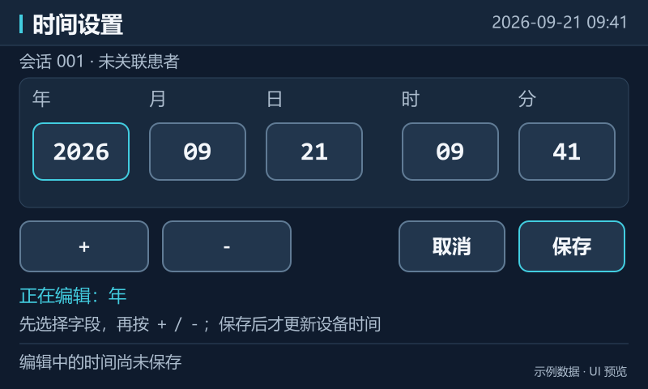

**真正导入的背景图**：`assets/backgrounds/p10_time.png`

控件位置图：[查看 B/T 编号标注](previews/p10_time_controls.png)。

| 按钮 ID | 标签 | X / Y / W / H | 弹起 / 按下图片 |
| --- | --- | --- | --- |
| 10 | 时间字段选择 | 40 / 151 / 120 / 72 | time_field_up.png / time_field_down.png |
| 11 | 时间字段选择 | 184 / 151 / 120 / 72 | time_field_up.png / time_field_down.png |
| 12 | 时间字段选择 | 328 / 151 / 120 / 72 | time_field_up.png / time_field_down.png |
| 13 | 时间字段选择 | 496 / 151 / 120 / 72 | time_field_up.png / time_field_down.png |
| 14 | 时间字段选择 | 640 / 151 / 120 / 72 | time_field_up.png / time_field_down.png |
| 15 | ＋ | 24 / 272 / 160 / 64 | time_add_up.png / time_add_down.png |
| 16 | － | 200 / 272 / 160 / 64 | time_subtract_up.png / time_subtract_down.png |
| 17 | 取消 | 492 / 272 / 132 / 64 | cancel_small_up.png / cancel_small_down.png |
| 18 | 保存 | 640 / 272 / 132 / 64 | save_time_up.png / save_time_down.png |

| 文本 ID / 名称 | X / Y / W / H | 字号目标 / 对齐 | FG / BG | 安全初值 |
| --- | --- | --- | --- | --- |
| 100 CLOCK | 548 / 17 / 228 / 28 | 20 / right | #ADBDCE / #16263A | 时间未校准 |
| 101 CONTEXT | 24 / 65 / 752 / 27 | 20 / left | #ADBDCE / #0F1B2D | 未关联患者 |
| 102 FOOTER | 24 / 436 / 584 / 30 | 20 / left | #ADBDCE / #0F1B2D | 等待设备状态 |
| 110 YEAR | 44 / 169 / 112 / 40 | 32 / center | #F4F7FB / #22364D | -- |
| 111 MONTH | 188 / 169 / 112 / 40 | 32 / center | #F4F7FB / #22364D | -- |
| 112 DAY | 332 / 169 / 112 / 40 | 32 / center | #F4F7FB / #22364D | -- |
| 113 HOUR | 500 / 169 / 112 / 40 | 32 / center | #F4F7FB / #22364D | -- |
| 114 MINUTE | 644 / 169 / 112 / 40 | 32 / center | #F4F7FB / #22364D | -- |
| 120 EDIT_FIELD | 24 / 353 / 752 / 30 | 22 / left | #42CDE0 / #0F1B2D | 正在编辑：年 |
| 121 EDIT_HELP | 24 / 389 / 752 / 26 | 20 / left | #ADBDCE / #0F1B2D | 选择字段，再调整数值 |

## 7. 所有按钮素材：常态、按下、禁用

以下 PNG 已按实际控件尺寸导出，无需裁切。三态图片尺寸完全一致。按钮中文已烘焙进 PNG，避免在 VisualTFT 中重复显示两层文字。

### 开始测量 · `start` · 280×112

| 弹起（up） | 按下（down） | 禁用（disabled） |
| --- | --- | --- |
|  |  |  |

文件：`assets/buttons/start_up.png`、`assets/buttons/start_down.png`、`assets/buttons/start_disabled.png`。

### 历史 · `history` · 132×72

| 弹起（up） | 按下（down） | 禁用（disabled） |
| --- | --- | --- |
|  |  |  |

文件：`assets/buttons/history_up.png`、`assets/buttons/history_down.png`、`assets/buttons/history_disabled.png`。

### 设置 · `settings` · 132×72

| 弹起（up） | 按下（down） | 禁用（disabled） |
| --- | --- | --- |
|  |  |  |

文件：`assets/buttons/settings_up.png`、`assets/buttons/settings_down.png`、`assets/buttons/settings_disabled.png`。

### 停止测量 · `stop` · 280×112

| 弹起（up） | 按下（down） | 禁用（disabled） |
| --- | --- | --- |
|  |  |  |

文件：`assets/buttons/stop_up.png`、`assets/buttons/stop_down.png`、`assets/buttons/stop_disabled.png`。

### 再次测量 · `remeasure` · 280×112

| 弹起（up） | 按下（down） | 禁用（disabled） |
| --- | --- | --- |
|  |  |  |

文件：`assets/buttons/remeasure_up.png`、`assets/buttons/remeasure_down.png`、`assets/buttons/remeasure_disabled.png`。

### 换患者 · `new_patient` · 132×72

| 弹起（up） | 按下（down） | 禁用（disabled） |
| --- | --- | --- |
|  |  |  |

文件：`assets/buttons/new_patient_up.png`、`assets/buttons/new_patient_down.png`、`assets/buttons/new_patient_disabled.png`。

### 重新测量 · `retry` · 280×112

| 弹起（up） | 按下（down） | 禁用（disabled） |
| --- | --- | --- |
|  |  |  |

文件：`assets/buttons/retry_up.png`、`assets/buttons/retry_down.png`、`assets/buttons/retry_disabled.png`。

### 返回 · `back_wide` · 280×72

| 弹起（up） | 按下（down） | 禁用（disabled） |
| --- | --- | --- |
|  |  |  |

文件：`assets/buttons/back_wide_up.png`、`assets/buttons/back_wide_down.png`、`assets/buttons/back_wide_disabled.png`。

### 上一页 · `previous` · 160×64

| 弹起（up） | 按下（down） | 禁用（disabled） |
| --- | --- | --- |
|  |  |  |

文件：`assets/buttons/previous_up.png`、`assets/buttons/previous_down.png`、`assets/buttons/previous_disabled.png`。

### 下一页 · `next` · 160×64

| 弹起（up） | 按下（down） | 禁用（disabled） |
| --- | --- | --- |
|  |  |  |

文件：`assets/buttons/next_up.png`、`assets/buttons/next_down.png`、`assets/buttons/next_disabled.png`。

### 返回 · `back_160` · 160×64

| 弹起（up） | 按下（down） | 禁用（disabled） |
| --- | --- | --- |
|  |  |  |

文件：`assets/buttons/back_160_up.png`、`assets/buttons/back_160_down.png`、`assets/buttons/back_160_disabled.png`。

### 降低 · `brightness_minus` · 124×64

| 弹起（up） | 按下（down） | 禁用（disabled） |
| --- | --- | --- |
|  |  |  |

文件：`assets/buttons/brightness_minus_up.png`、`assets/buttons/brightness_minus_down.png`、`assets/buttons/brightness_minus_disabled.png`。

### 提高 · `brightness_plus` · 124×64

| 弹起（up） | 按下（down） | 禁用（disabled） |
| --- | --- | --- |
|  |  |  |

文件：`assets/buttons/brightness_plus_up.png`、`assets/buttons/brightness_plus_down.png`、`assets/buttons/brightness_plus_disabled.png`。

### 时间设置 · `set_time` · 280×64

| 弹起（up） | 按下（down） | 禁用（disabled） |
| --- | --- | --- |
|  |  |  |

文件：`assets/buttons/set_time_up.png`、`assets/buttons/set_time_down.png`、`assets/buttons/set_time_disabled.png`。

### 维护 · `maintenance` · 200×64

| 弹起（up） | 按下（down） | 禁用（disabled） |
| --- | --- | --- |
|  |  |  |

文件：`assets/buttons/maintenance_up.png`、`assets/buttons/maintenance_down.png`、`assets/buttons/maintenance_disabled.png`。

### 返回 · `back_200` · 200×64

| 弹起（up） | 按下（down） | 禁用（disabled） |
| --- | --- | --- |
|  |  |  |

文件：`assets/buttons/back_200_up.png`、`assets/buttons/back_200_down.png`、`assets/buttons/back_200_disabled.png`。

### 返回 · `back_280` · 280×64

| 弹起（up） | 按下（down） | 禁用（disabled） |
| --- | --- | --- |
|  |  |  |

文件：`assets/buttons/back_280_up.png`、`assets/buttons/back_280_down.png`、`assets/buttons/back_280_disabled.png`。

### 取消 · `cancel_280` · 280×64

| 弹起（up） | 按下（down） | 禁用（disabled） |
| --- | --- | --- |
|  |  |  |

文件：`assets/buttons/cancel_280_up.png`、`assets/buttons/cancel_280_down.png`、`assets/buttons/cancel_280_disabled.png`。

### 确认换患者 · `confirm_session` · 280×64

| 弹起（up） | 按下（down） | 禁用（disabled） |
| --- | --- | --- |
|  |  |  |

文件：`assets/buttons/confirm_session_up.png`、`assets/buttons/confirm_session_down.png`、`assets/buttons/confirm_session_disabled.png`。

### 时间字段空白选择框 · `time_field` · 120×72

| 弹起（up） | 按下（down） | 禁用（disabled） |
| --- | --- | --- |
|  |  |  |

文件：`assets/buttons/time_field_up.png`、`assets/buttons/time_field_down.png`、`assets/buttons/time_field_disabled.png`。

### ＋ · `time_add` · 160×64

| 弹起（up） | 按下（down） | 禁用（disabled） |
| --- | --- | --- |
|  |  |  |

文件：`assets/buttons/time_add_up.png`、`assets/buttons/time_add_down.png`、`assets/buttons/time_add_disabled.png`。

### － · `time_subtract` · 160×64

| 弹起（up） | 按下（down） | 禁用（disabled） |
| --- | --- | --- |
|  |  |  |

文件：`assets/buttons/time_subtract_up.png`、`assets/buttons/time_subtract_down.png`、`assets/buttons/time_subtract_disabled.png`。

### 取消 · `cancel_small` · 132×64

| 弹起（up） | 按下（down） | 禁用（disabled） |
| --- | --- | --- |
|  |  |  |

文件：`assets/buttons/cancel_small_up.png`、`assets/buttons/cancel_small_down.png`、`assets/buttons/cancel_small_disabled.png`。

### 保存 · `save_time` · 132×64

| 弹起（up） | 按下（down） | 禁用（disabled） |
| --- | --- | --- |
|  |  |  |

文件：`assets/buttons/save_time_up.png`、`assets/buttons/save_time_down.png`、`assets/buttons/save_time_disabled.png`。

时间字段的 selected 是“正在编辑这个字段”的持久高亮，down 是手指正在按下的短暂反馈。图中没有年份/月日数字，数字由 P10 的文本控件显示。

## 8. 每个按钮按下后显示什么

每组图左边是按钮按下瞬间，右边是目标页面。右边图上的读数只用于说明排版；实际必须等待主控确认和真实数据。图片宽度较大，可以点开原图看 800×480 像素的单页。

| 序号 | 来源页 / 控件 | 操作 | 目标逻辑状态 |
| --- | --- | --- | --- |
| 1 | P01 / B10 | 开始测量 | starting |
| 2 | P01 / B11 | 历史 | history |
| 3 | P01 / B12 | 设置 | settings |
| 4 | P02 / B10 | 停止测量 | stopping |
| 5 | P03 / B10 | 再次测量 | starting |
| 6 | P03 / B11 | 历史 | history |
| 7 | P03 / B12 | 换患者 | confirm |
| 8 | P04 / B10 | 重新测量 | starting |
| 9 | P04 / B11 | 返回 | idle |
| 10 | P05 / B10 | 上一页 | history_first |
| 11 | P05 / B11 | 下一页 | history_second |
| 12 | P05 / B12 | 返回 | result |
| 13 | P06 / B10 | 降低 | brightness_lower |
| 14 | P06 / B11 | 提高 | brightness_higher |
| 15 | P06 / B12 | 时间设置 | time |
| 16 | P06 / B13 | 维护 | maintenance |
| 17 | P06 / B14 | 返回 | idle |
| 18 | P07 / B10 | 返回 | settings |
| 19 | P08 / B10 | 停止测量 | stopping |
| 20 | P09 / B10 | 取消 | result |
| 21 | P09 / B11 | 确认换患者 | idle_new |
| 22 | P10 / B10 | 选择年 | time_year |
| 23 | P10 / B11 | 选择月 | time_month |
| 24 | P10 / B12 | 选择日 | time_day |
| 25 | P10 / B13 | 选择时 | time_hour |
| 26 | P10 / B14 | 选择分 | time_minute |
| 27 | P10 / B15 | ＋ | time_increment |
| 28 | P10 / B16 | － | time_decrement |
| 29 | P10 / B17 | 取消 | settings |
| 30 | P10 / B18 | 保存 | time_saved |
| 31 | P04 / B10 | 停止测量（故障锁定时） | stopping |
| 32 | P05 / B12 | 返回（从待机进入历史） | idle |

### 01. P01 / B10 · 开始测量

发送 START；主控接受后进入 P02 启动中；拒绝时保持 P01 并更新提示。

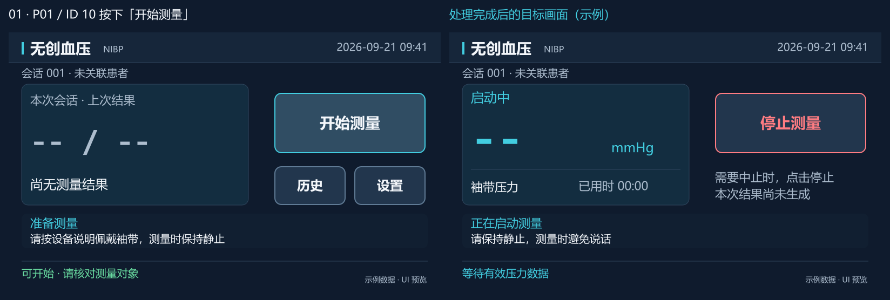

[按下状态原图](transitions/a01_pressed.png) · [目标页面原图](previews/starting.png)

### 02. P01 / B11 · 历史

发送 OPEN_HISTORY，记录返回页 P01，主控加载本会话历史后进入 P05。

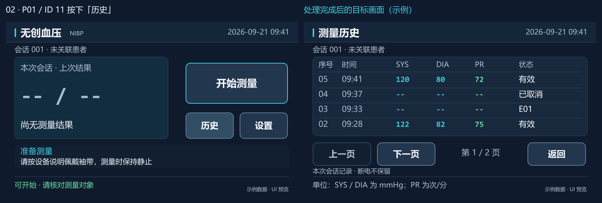

[按下状态原图](transitions/a02_pressed.png) · [目标页面原图](previews/p05_history.png)

### 03. P01 / B12 · 设置

仅安全空闲时进入 P06；从主控读回当前亮度与时间。

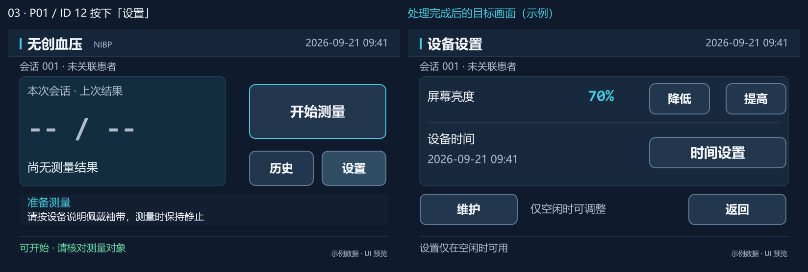

[按下状态原图](transitions/a03_pressed.png) · [目标页面原图](previews/p06_settings.png)

### 04. P02 / B10 · 停止测量

发送 STOP；主控接受停止请求后进入 P08。停止不弹确认框；允许重复请求，由主控去重。

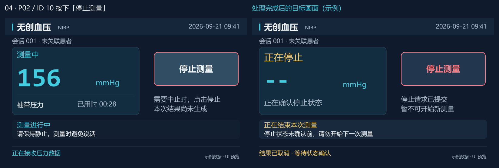

[按下状态原图](transitions/a04_pressed.png) · [目标页面原图](previews/p08_stopping.png)

### 05. P03 / B10 · 再次测量

同一会话发送 START；仅 safe_to_restart 且 start_allowed 时允许。主控接受后进入 P02。

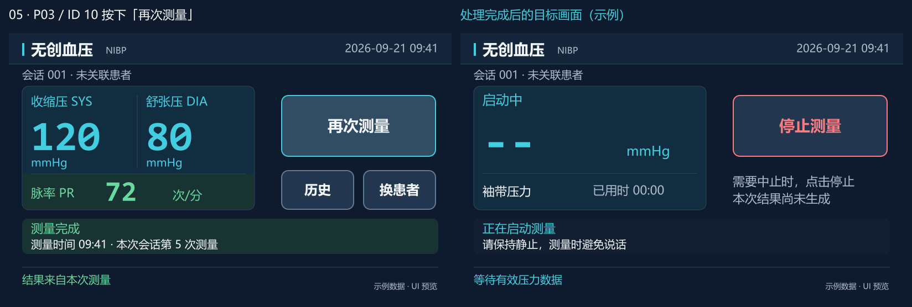

[按下状态原图](transitions/a05_pressed.png) · [目标页面原图](previews/starting.png)

### 06. P03 / B11 · 历史

发送 OPEN_HISTORY，记录返回页 P03；主控加载本会话记录后进入 P05。

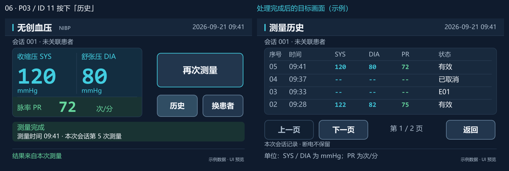

[按下状态原图](transitions/a06_pressed.png) · [目标页面原图](previews/p05_history.png)

### 07. P03 / B12 · 换患者

仅安全空闲时显示 P09 确认页面；此时尚不更换会话。

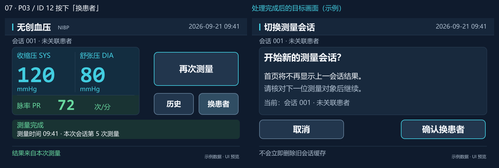

[按下状态原图](transitions/a07_pressed.png) · [目标页面原图](previews/p09_confirm.png)

### 08. P04 / B10 · 重新测量

仅 retry_allowed 且 safe_to_restart 时发送 START；主控接受后进入 P02。

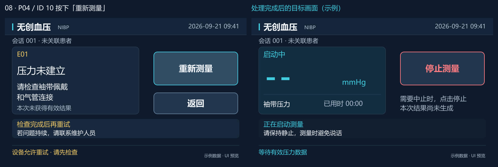

[按下状态原图](transitions/a08_pressed.png) · [目标页面原图](previews/starting.png)

### 09. P04 / B11 · 返回

仅安全空闲时进入 P01；故障未解除时保持禁止开始，不通过返回按钮绕过保护。

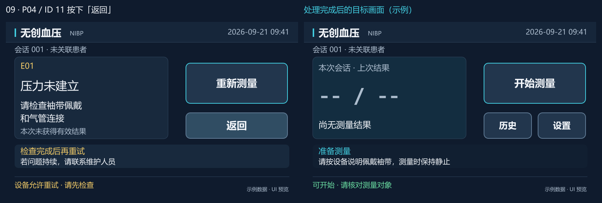

[按下状态原图](transitions/a09_pressed.png) · [目标页面原图](previews/p01_idle.png)

### 10. P05 / B10 · 上一页

请求前一组 4 条；页号及四行一次更新。已是第 1 页时禁用该按钮。

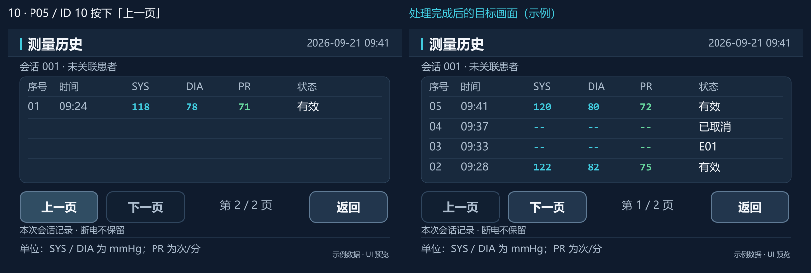

[按下状态原图](transitions/a10_pressed.png) · [目标页面原图](previews/history_first.png)

### 11. P05 / B11 · 下一页

请求后一组 4 条；到末页后禁用下一页。

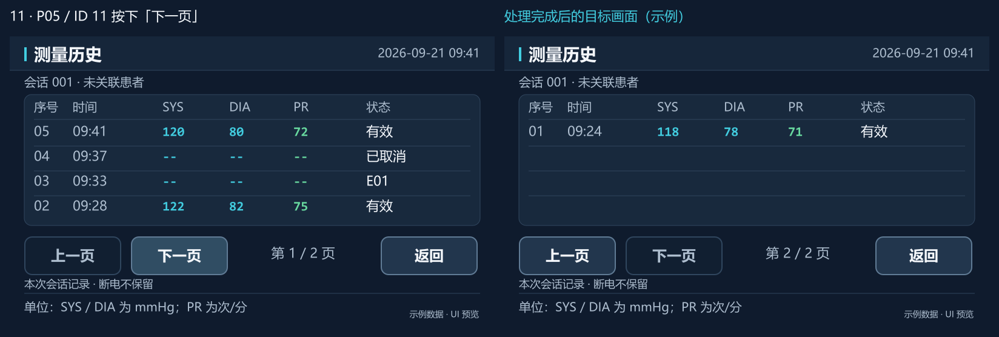

[按下状态原图](transitions/a11_pressed.png) · [目标页面原图](previews/history_second.png)

### 12. P05 / B12 · 返回

返回 OPEN_HISTORY 保存的来源页 P01 或 P03；不得固定返回 P03 显示旧结果。

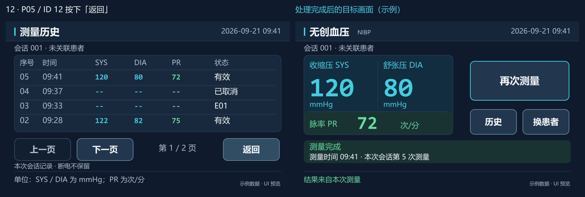

[按下状态原图](transitions/a12_pressed.png) · [目标页面原图](previews/p03_result.png)

### 13. P06 / B10 · 降低

请求亮度减 10 个百分点；建议交互范围 30%～100%，最终范围由实屏确认。主控应用成功后回写读数。

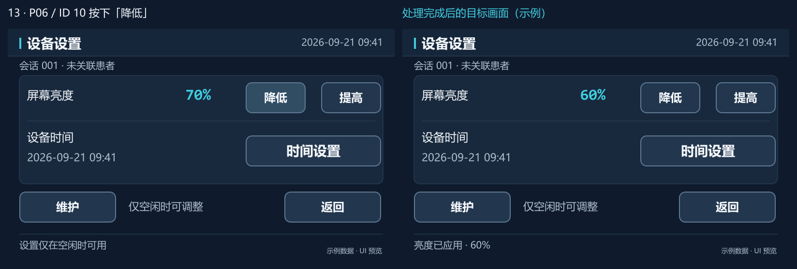

[按下状态原图](transitions/a13_pressed.png) · [目标页面原图](previews/brightness_lower.png)

### 14. P06 / B11 · 提高

请求亮度增 10 个百分点；达到上限后禁用提高。百分比到屏幕指令值的转换由主控实现。

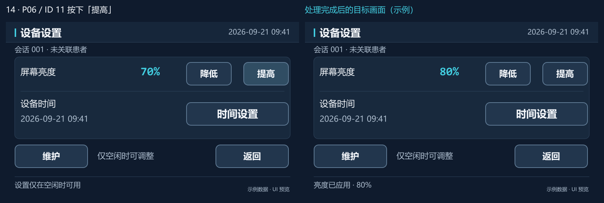

[按下状态原图](transitions/a14_pressed.png) · [目标页面原图](previews/brightness_higher.png)

### 15. P06 / B12 · 时间设置

仅空闲时进入 P10；复制当前设备时间作为编辑草稿，不立即改系统时间。

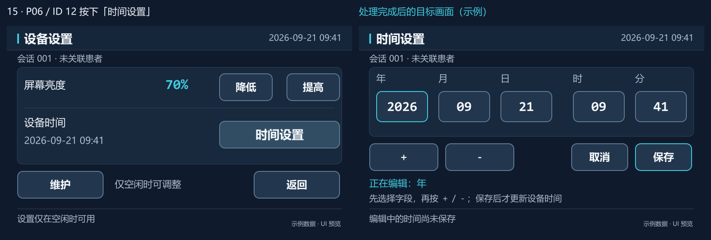

[按下状态原图](transitions/a15_pressed.png) · [目标页面原图](previews/p10_time.png)

### 16. P06 / B13 · 维护

进入 P07 的访问检查页；没有主控授权时只显示未授权说明，不提供维护命令。

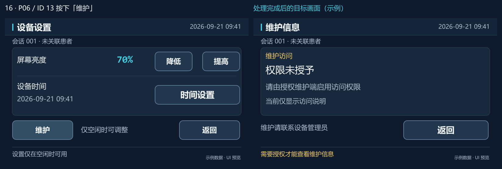

[按下状态原图](transitions/a16_pressed.png) · [目标页面原图](previews/p07_maintenance.png)

### 17. P06 / B14 · 返回

返回 P01，主控回写当前会话和 start_allowed。

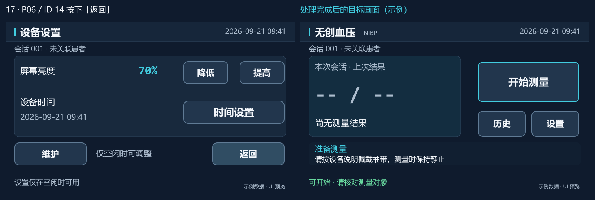

[按下状态原图](transitions/a17_pressed.png) · [目标页面原图](previews/p01_idle.png)

### 18. P07 / B10 · 返回

返回 P06；退出后是否撤销维护授权由主控权限策略决定。

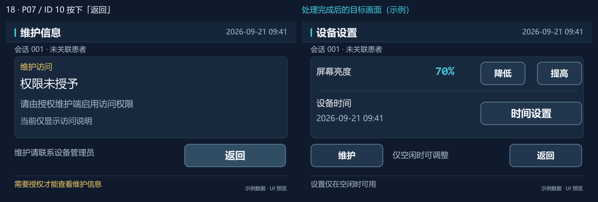

[按下状态原图](transitions/a18_pressed.png) · [目标页面原图](previews/p06_settings.png)

### 19. P08 / B10 · 停止测量

再次发送 STOP。保持 P08，直到主控确认允许恢复；不得仅凭按钮弹起或停止 ACK 进入待机。

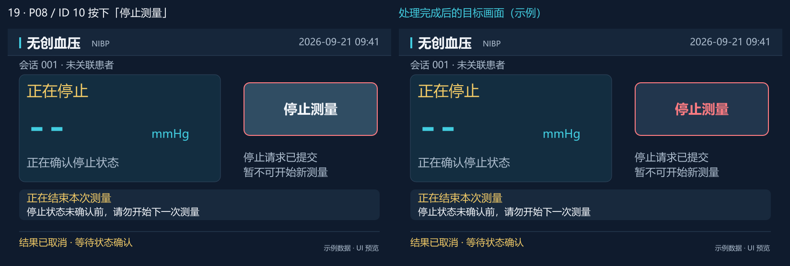

[按下状态原图](transitions/a19_pressed.png) · [目标页面原图](previews/p08_stopping.png)

### 20. P09 / B10 · 取消

不创建新会话，返回来源结果页 P03；原结果继续显示。

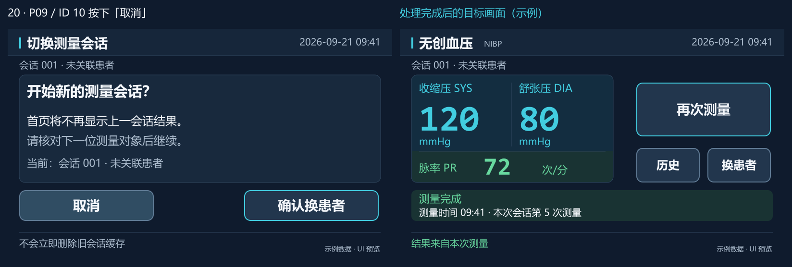

[按下状态原图](transitions/a20_pressed.png) · [目标页面原图](previews/p03_result.png)

### 21. P09 / B11 · 确认换患者

发送 NEW_SESSION；主控校验安全空闲、结束旧事务、建立新会话并清空当前显示后进入 P01。

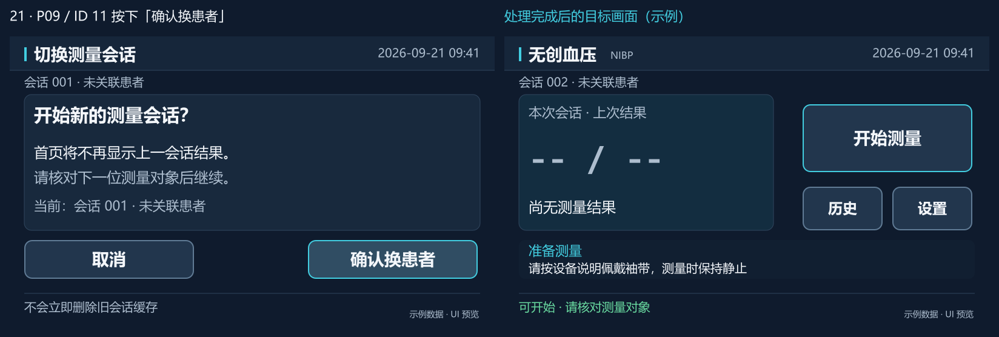

[按下状态原图](transitions/a21_pressed.png) · [目标页面原图](previews/idle_new.png)

### 22. P10 / B10 · 选择年

选择“年”字段，保持 P10；主控/已验证屏端逻辑回写高亮和编辑字段名。

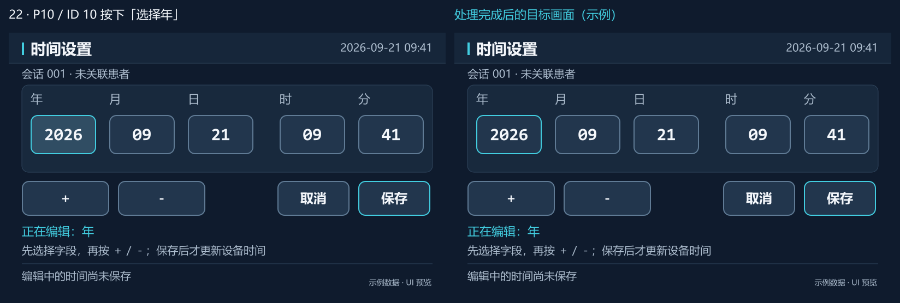

[按下状态原图](transitions/a22_pressed.png) · [目标页面原图](previews/time_year.png)

### 23. P10 / B11 · 选择月

选择“月”字段，保持 P10；主控/已验证屏端逻辑回写高亮和编辑字段名。

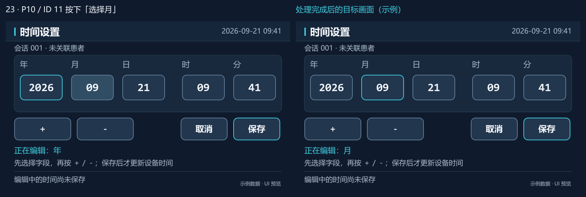

[按下状态原图](transitions/a23_pressed.png) · [目标页面原图](previews/time_month.png)

### 24. P10 / B12 · 选择日

选择“日”字段，保持 P10；主控/已验证屏端逻辑回写高亮和编辑字段名。

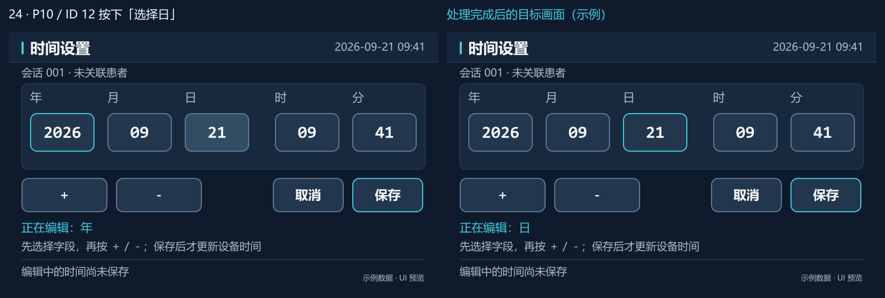

[按下状态原图](transitions/a24_pressed.png) · [目标页面原图](previews/time_day.png)

### 25. P10 / B13 · 选择时

选择“时”字段，保持 P10；主控/已验证屏端逻辑回写高亮和编辑字段名。

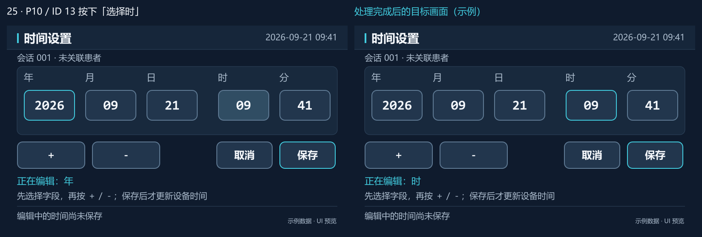

[按下状态原图](transitions/a25_pressed.png) · [目标页面原图](previews/time_hour.png)

### 26. P10 / B14 · 选择分

选择“分”字段，保持 P10；主控/已验证屏端逻辑回写高亮和编辑字段名。

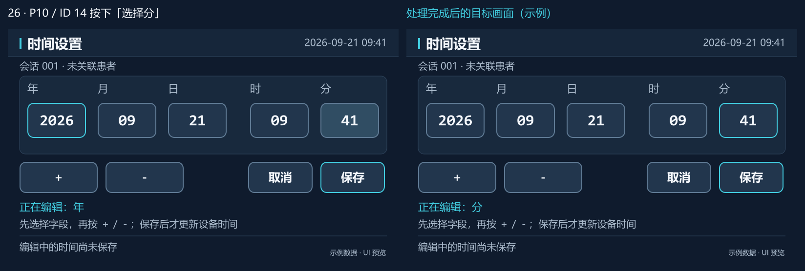

[按下状态原图](transitions/a26_pressed.png) · [目标页面原图](previews/time_minute.png)

### 27. P10 / B15 · ＋

将当前选中字段加 1，示例为年份 2026→2027；只改草稿。调整月份/年份时重新校验日期。

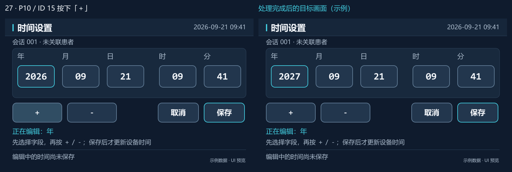

[按下状态原图](transitions/a27_pressed.png) · [目标页面原图](previews/time_increment.png)

### 28. P10 / B16 · －

将当前选中字段减 1，示例为年份 2026→2025；只改草稿。边界由实际 RTC 能力限定。

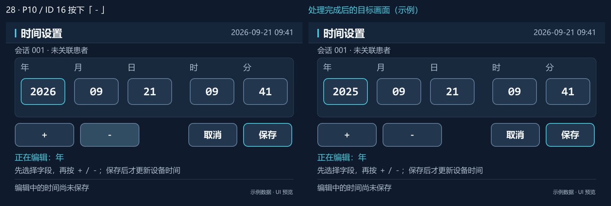

[按下状态原图](transitions/a28_pressed.png) · [目标页面原图](previews/time_decrement.png)

### 29. P10 / B17 · 取消

丢弃编辑草稿，返回 P06，设备时间不变。

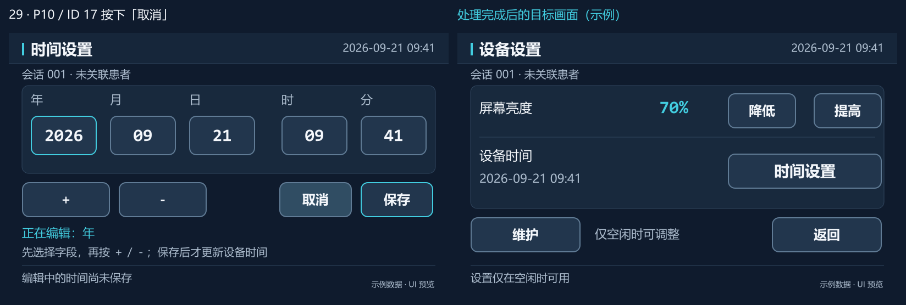

[按下状态原图](transitions/a29_pressed.png) · [目标页面原图](previews/p06_settings.png)

### 30. P10 / B18 · 保存

发送 SET_TIME 草稿；主控校验日期且 RTC 写入并读回成功后返回 P06；失败留在 P10 显示原因。

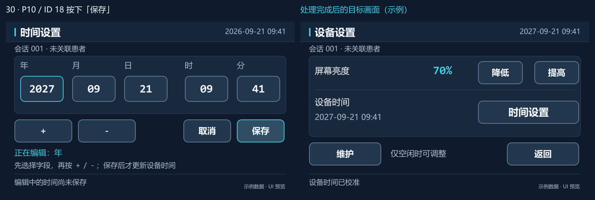

[按下状态原图](transitions/a30_pressed.png) · [目标页面原图](previews/time_saved.png)

### 31. P04 / B10 · 停止测量（故障锁定时）

P04 状态不明时 ID10 绑定 STOP；不得继续解释为重试。主控接受后显示 P08；无应答时保持锁定。

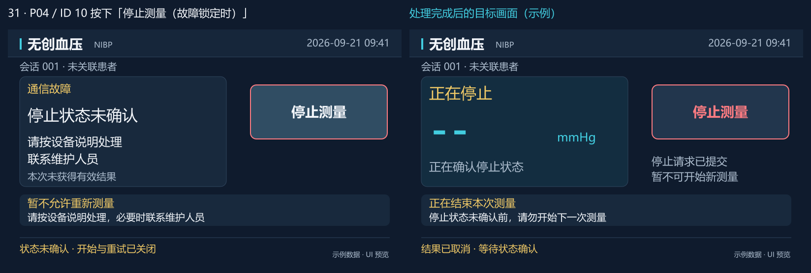

[按下状态原图](transitions/a31_pressed.png) · [目标页面原图](previews/p08_stopping.png)

### 32. P05 / B12 · 返回（从待机进入历史）

当 history_origin=P01 时返回 P01；这里补充另一条返回路径。

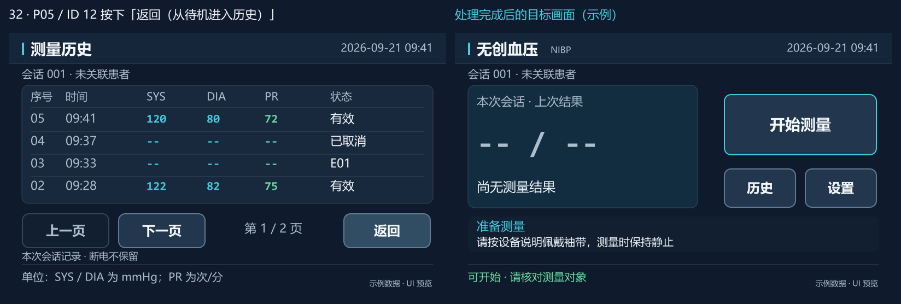

[按下状态原图](transitions/a32_pressed.png) · [目标页面原图](previews/p01_idle.png)

## 9. 不是按钮触发，但必须配置的状态

| 触发条件 | 页面行为 |
| --- | --- |
| 上电主控尚未就绪 | 保持 P00；P01 开始保持禁用 |
| 启动事件被接受 | P02：启动中、压力 --、已用时 00:00、停止可用 |
| 接收到有效过程压力 | P02：测量中、刷新真实袖带压力 |
| 完整有效结果 | 一次更新结果字段与会话、时间后进入 P03 |
| 用户停止且主控确认可重新测量 | P01：本次测量已取消；没有本次结果 |
| 压力数据过时 | P02：压力变 --；提示压力数据中断并保留停止 |
| 主控/模块通信故障或安全状态未确认 | P04 锁定：停止入口保留，重试关闭，返回隐藏且禁用 |
| 历史为空 | P05：四行清空，暂无记录，上/下页均禁用 |
| 维护权限确认 | P07 更新为只读版本与通信信息，不自动执行校准 |
| RTC 写入失败 | 保持 P10，说明保存失败，不改变已有结果的原始时间戳 |

### 状态：idle_blocked

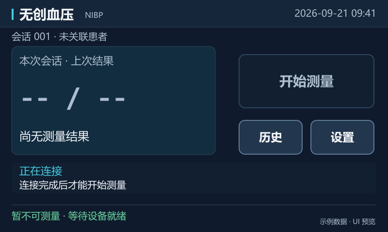

### 状态：starting

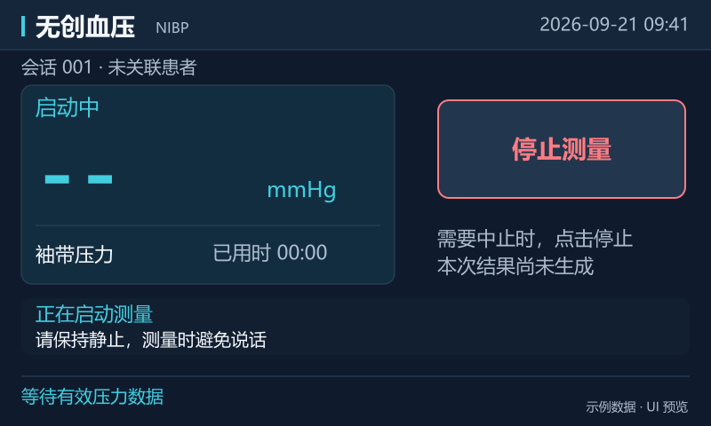

### 状态：pressure_stale

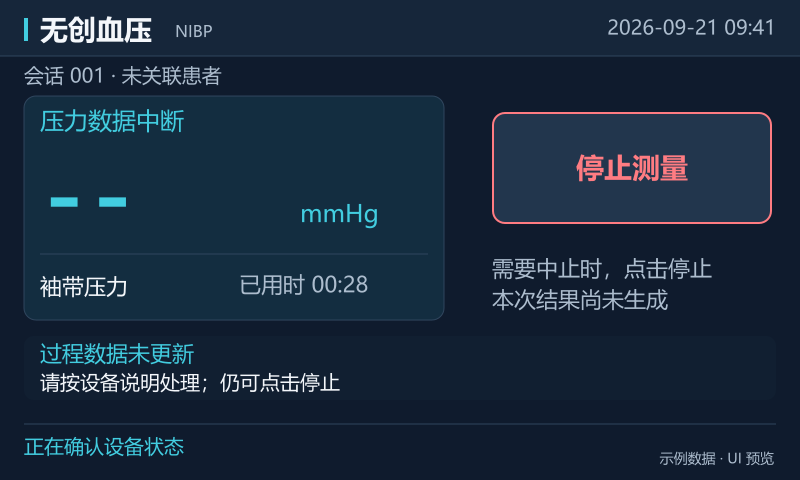

### 状态：idle_cancelled

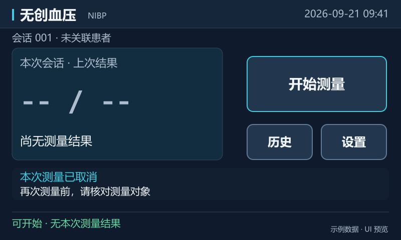

### 状态：notice_locked

### 状态：history_empty

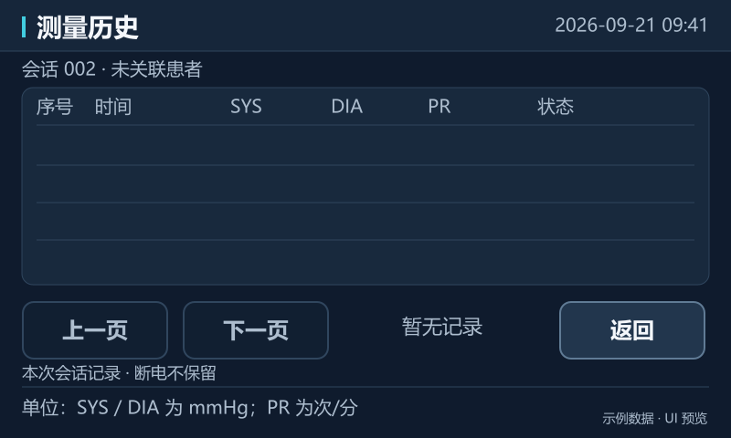

### 状态：maintenance_granted

### 状态：time_failed

P04 的 ID10 在两种模式下语义不同：允许重试时为 START，锁定时为 STOP。主控必须依据当前真实状态解析；切换图片不能独立改变动作。若不便动态更换按钮图片，可在同一位置叠放两个不同 ID 的按钮，由主控互斥显示并互斥使能，并同步修改映射表。

## 10. 页面跳转和主控数据怎么接

建议先照图绘完所有画面，再让主控提供下面这些语义事件和显示字段。它们是接口名称建议，不是可以直接发送的十六进制协议。屏幕串口波特率、帧头、文本编码和发送函数都按实物型号/固件以及现有驱动确认。

| 操作 | 主控职责 | 屏幕回写 |
| --- | --- | --- |
| START | 检查当前会话、启动许可和上一测量已终止；去重连点 | 被接受才切 P02；否则保持原页显示原因 |
| STOP | 优先处理停止；取消当前结果事务；去重但不丢弃安全请求 | 显示正在停止；可靠确认恢复后才开放开始 |
| OPEN_HISTORY / PREV / NEXT | 过滤当前会话、分页、带回来源页 | 四行＋页码＋翻页使能一并更新 |
| NEW_SESSION | 安全空闲才结束旧会话并建立新会话 | 清空当前结果、更新会话号、进入 P01 |
| BRIGHTNESS +/- | 限制范围并转换为该屏支持的亮度值 | 应用成功后回写百分比和按钮状态 |
| TIME_SELECT / TIME +/- | 维护编辑草稿、选中字段、日期合法性 | 更新 P10 数字与选中高亮 |
| SET_TIME | 校验 RTC 范围、闰年、时间源；写入并读回 | 成功才显示已校准；失败显示原因 |
| OPEN_MAINTENANCE | 检查授权状态，提供获准展示的只读数据 | 未授权仅说明；授权后才显示维护信息 |

文本更新建议：过程压力先按最多 5 Hz、已用时按 1 Hz 联调，状态/停止事件优先；这是性能调试起点，不是屏幕规格。结果用“暂隐藏 → 写全字段 → 显示”的顺序或固件已支持的批量刷新机制，防止不同次测量数据混在一起。

画面绘好并不会自动具有历史缓存、测量控制、RTC 保存、患者关联和维护鉴权。它们都要有主控或经验证的屏端逻辑配套。屏端失联提示还需要实物固件支持的超时/心跳机制；主控到屏幕断线后，主控自身无法再发一条提示让屏幕知道断线。

## 11. 在 VisualTFT 中按顺序检查

1. **逐页外观**：背景 800×480；按钮不拉伸，文字不重影，背景内没有演示血压数字。
2. **按下反馈**：每个按钮按下显示 down 图片，抬起恢复 up；长按不会连续开始测量。
3. **ID 和通知**：虚拟屏/串口调试窗口记录各按钮的真实画面 ID、控件 ID；确认一次按下只处理一次。
4. **测量链路**：开始 → 启动中 → 实际压力 → 完整结果；禁止用固定延时伪造成功。
5. **停止**：启动中、测量中、停止等待和故障锁定均可发停止；状态不明时不能重测。
6. **数值擦除**：把 188 改成 88、再改成 --，旧数字不得残留；单位不被擦除；三位脉率也不覆盖“次/分”。
7. **历史**：0、1、4、5 条分别查看；首/末页禁用正确，返回原页面正确；取消和错误不填 0/0。
8. **换患者**：取消保留原结果；确认建立新会话并清空显示；迟到结果不串到新患者。
9. **设置**：亮度到上下限正确禁用；时间选择和加减热区完整；非法日期不能保存；取消不修改系统时间。
10. **实屏检查**：核对屏幕料号、字体、16 位色彩显示、手套触摸和医护阅读距离。静态图片已检查不等于实机或医疗可用性验证通过。

## 12. 完整素材索引与本地依据

资源清单：[manifest.json](manifest.json)；可直接对照填表：[控件配置表.csv](控件配置表.csv)。所有 SVG 源稿在 `sources/`，生成程序在 `tools/`。PNG 用于 VisualTFT，SVG 用于以后修改版式。

本指南中的 VisualTFT 属性以本机安装资料和原工程核对：

- `F:\Program Files\VisualTFT\doc\工程技术笔记\工程技术笔记-按钮控件应用V2.2.pdf`：按钮属性、瞬变/开关、触控用途、事件通知和裁剪，PDF 第 7～12 页。
- `F:\Program Files\VisualTFT\doc\工程技术笔记\工程技术笔记-文本控件应用 V2.0.pdf`：文本颜色、背景、输入方式与字库选择，PDF 第 8～9 页。
- `F:\Program Files\VisualTFT\doc\工程技术笔记\工程技术笔记-如何自定义矢量字库V1.0.pdf`：不同产品系列的矢量字库能力，第 7 页。
- `F:\Program Files\VisualTFT\DeviceInfo.xml`：本机型号列表；本机 DN050 条目的键盘支持字段为 0，因此本稿未依赖系统键盘。
- 原资料包的 M 系列入门手册、大彩串口屏指令集 V5.1；按钮标准事件的状态语义应按所选型号复核。
- `F:\VisualTFT\SPO2_Hospital\tools\build_pages.py`、现有 `.tft` 和 PNG：系列配色来源。
- 原方案：`../docs/superpowers/specs/2026-09-20-n050-blood-pressure-ui-design.md`；HKB-08B+ 错误文案和状态边界沿用该方案。

### 素材验证范围

交付前自动核对图片尺寸、Markdown 图片引用、页面/控件 ID 唯一性、控件边界、按钮目标和压缩包完整性，并进行页面图片目检。未启动真实 VisualTFT 工程编译、未连接血压模块、未下载到实屏；以上步骤需在绘图与联调时完成。

