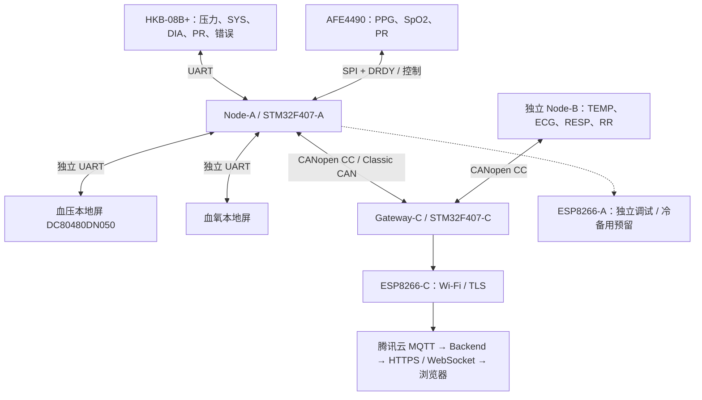
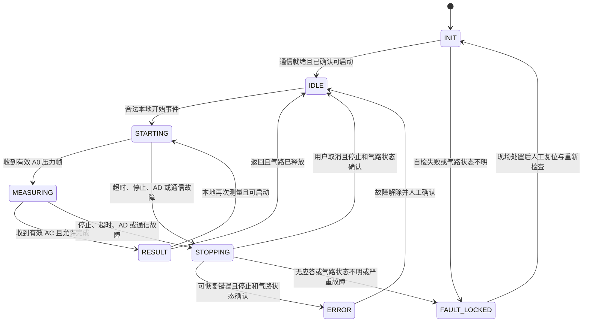

# 血压模块 + DC80480DN050 串口屏 + STM32F407 开发指南

版本：0.2（对齐总项目 v0.7）  
修订日期：2026-09-24  
适用范围：成员 A 的 Node-A 血压子系统，从单模块闭环到双模块、双屏及 CANopen 联调。  
首版路线：**HKB-08B+ 完成测压与泵阀控制，STM32F407 解析、管理和上报数据，DC80480DN050 本地显示，CANopen 接入 Gateway-C。**

本文件是开发设计与操作指南，不代表硬件已经联调通过。下文区分三类信息：**资料事实**（附来源）、**本指南建议**（可调整的实现选择）、**实物待确认**（不得凭型号前缀推定）。总项目只冻结 HKB-08 系列 UART 接口；B+ 是本指南沿用的首版具体选型，采购实物仍须核对。

## 1. 与总项目的关系及本次修订

### 1.1 必须实现的链路



依据 [S1] 第 3、4、6～8、14、17 节：

| 总项目要求 | 血压子系统的实现责任 | 验收证据 |
|---|---|---|
| Node-A 同时负责血氧与血压 | HKB 用 UART，AFE4490 用 SPI + DRDY，采集互不阻塞 | 泵工作、屏幕刷新和 CAN 发送期间的采样连续性记录 |
| 每模块一块本地屏 | 血压与血氧各占独立 UART；本地操作不依赖云端 | 断开 Gateway/网络后仍能本地测量、停止和显示 |
| 上报血压状态、实时压力、SYS、DIA、PR/Error | Node-A 内完成 HKB 私有帧解析，转换为统一业务对象 | 原始串口帧、Node-A 对象与 Gateway 接收值逐项一致 |
| CANopen CC / CiA 301 | 对象字典、PDO、SDO、NMT、Heartbeat、EMCY 使用标准机制 | 两节点同时在线、断线与恢复测试 |
| Gateway 独立上云与缓存 | Node-A 交付有效性、时间和来源信息；P 负责 MQTT/TLS、缓存和云端映射 | 关闭 PC 后真实链路继续工作；补传可与实时结果区分 |
| 不提前冻结详细协议 | 本文给出字段语义和接口建议，不写死项目对象索引、PDO 映射、Topic/Payload | A 与 P 在后续接口设计中共同确认 |
| 框架可裸机或 RTOS | 首轮可用非阻塞事件循环；后续按并发与时延实测决定 | 双模块、双屏、CAN 并行及 24 h 系统测试 |

**当前控制入口采用本地血压屏及本地停止键。** 本阶段不实现公网开始充气、泄压等动作；ESP8266-A 不承担正常上云出口。Node-A、Node-B、Gateway-C 保持三块独立开发板。

### 1.2 与旧版资料的区别

- 屏幕更正为用户提供规格书中的 **DN 系列 DC80480DN050**，M 系列资料只作通用指令和例程参考。
- 补充开发板基础参数、实际电源入口、板载外设冲突及 Node-A 接口预算。
- 修正实时压力解析：先剥离 `QYH.bit4` 心跳标志，再组合压力；`XL` 在项目层命名为 `nibp_pr_bpm`，避免混同 ECG 的 HR 或血氧 PR。
- 补充启动等待、停止等待、故障锁定、结果时效、CANopen 上报和分阶段验收。
- 沿用现有 `visualtft_bp` 的 P00～P10 页面和控件表，避免旧版“第 4 页是诊断页”等编号冲突。

同目录旧文件《血压模块_CAN主屏开发流程框架.md》中“本地屏仅调试、CAN 直连主屏、主屏直接控制测量”的路线与总项目 v0.7 不一致。它仅可参考底层实验，系统边界以 [S1] 和本指南为准。

## 2. 开发板基础信息与工程基线

本指南按用户提供的 `STM32F407_原理图.pdf` 和配套程序资料核对的郑州精畅科技 **STM32F4 神舟号开发板 V2.0** 编写。开发板资料原理图第 4 页标注 MCU 为 `STM32F407ZGT6`；模板工程和芯片数据手册须再次对照实物丝印。以下是板级基础信息：

| 项目 | 已核对信息 | 对本项目的影响 |
|---|---|---|
| 主控 | STM32F407ZGT6，ZG 封装；Cortex-M4F，最高 168 MHz；最多 1 MB Flash、192 KB SRAM + 4 KB Backup SRAM（芯片能力） | 本文不把芯片最大值当作板上可用余量；编译 map、栈和缓冲仍需记录 |
| 外部时钟 | 原理图 MCU 页标 `Y2=8 MHz`；以太网/音频页另有 `Y1=25 MHz` 给 LAN8720A；模板 `system_stm32f4xx.c` 的 PLL 宏含 25 MHz 配置 | 工程 `HSE_VALUE`、PLL 和实物晶振必须匹配；示例中 25 MHz 不能直接套给 MCU 而不测时钟 |
| 输入电源 | 原理图主电源页：DC 6～24 V 输入，板上 DC/DC、3.3 V LDO/5 V 输出，USB/串口供电路径 | HKB 泵电源使用独立 5 V 分支；不要将泵峰值从 MCU 3.3 V 取电 |
| 下载/调试 | SWD/JTAG、板载 USB-串口；BOOT/RESET 电路 | 首次先用 SWD 下载副本工程；记录 BOOT 桥和调试器，避免 USB/串口复用误判 |
| 板载资源 | CH340/USB-串口、RS232/RS485、ESP-01/Wi-Fi/蓝牙接口、TF 卡 SDIO、W25Q128 SPI Flash、CAN1/CAN2 收发器、LAN8720A、摄像头、音频等 | 默认禁用与任务无关的外设；它们会占用复用引脚、跳帽、DMA 或中断 |
| 板载 CAN1 | `PA11=CAN1_RX`、`PA12=CAN1_TX`，经 P6 在 USB/CAN1 间选择；U3 TJA1050；板上 R7=120 Ω | CAN 模式会占用 USB D-/D+ 复用；三节点总线的终端数量需现场核对，不能默认三块板都保留 120 Ω |
| 板载 CAN2 | PB12/PB13 经 U2 TJA1050，P4 引出；本项目优先使用 CAN1，CAN2 只作备用 | 不要同时打开 CAN1、CAN2 示例而未确认收发器、过滤器和终端 |
| 可用程序基线 | `STM32F407_Template`、`13_USART`、`16_DMA_UART`、`19_CAN`；这些是示例/底层工程，不是已经完成的 Node-A 固件 | 移植前建立副本并记录芯片、HSE、库版本、编译器；先编译空工程 |

### 2.1 Node-A 资源分配（建议基线）

| 资源 | 引脚 / 跳帽 | 首版用途 | 冲突与动作 |
|---|---|---|---|
| USART1 | PA9=TX、PA10=RX；P8-32/31 引出 | 血压 DN 屏 | 通过 P7 与板载 CH340/USB-串口复用；屏占用时断开 P7 的 MCU↔CH340 两组跳帽，调试改走 SWD 或另一 UART |
| USART3 | PB10=TX、PB11=RX；P9-30/29 或 P5-3/4 | HKB-08B+ TTL UART，115200 | P5 同时可连 RS232/BLE/Wi-Fi；接 HKB 前拆除 P5 其他跳帽，只保留 MCU 侧 TX/RX，严禁多个输出并联 |
| USART2（候选） | PA2=TX、PA3=RX；P9-38/36 | 血氧第二块本地屏的候选 UART | PA2 与 LAN8720A 的 ETH_MDIO 复用；使用前禁用 Ethernet、保持 PHY 复位（原理图 `PD3=ETH_RESET`），并实测无争用。若不能满足，第二屏改用外部转接/重新分配方案 |
| SPI2（候选） | PB13=SCK、PB14=MISO、PB15=MOSI；CS/DRDY/RESET 另选空闲 GPIO | AFE4490 血氧模块 SPI；不占 USART3 | 板上 NRF/W25Q128 使用 SPI1；优先 SPI2 避免共享。AFE 电平、CS、DRDY、RESET、INT 由模块资料和实物确认，不把“候选”写成已接线 |
| CAN1 | PA11=RX、PA12=TX；P6 置 CAN 模式，U3 TJA1050 | Node-A→Gateway-C CANopen | 与 USB D-/D+ 复用；CAN 物理总线使用 CANH/CANL 收发器端子，不把 MCU TX/RX 当长线总线 |
| UART4（预留） | PC10=TX、PC11=RX；P8 引出 | ESP8266-A 冷备用候选 | 与 TF 卡 SDIO_D2/D3 复用；拔除/禁用 SDIO 后才能使用，不能把板载 ESP 插座默认当 UART4 |
| USART6（调试候选） | PC6=TX、PC7=RX | 调试日志候选 | 与摄像头/SDIO/I2S/音频复用，且 PC6 可能接音频 MCLK；只在禁用冲突外设、断开相关模块后使用 |
| 调试输出 | SWD/JTAG 优先；不得占 HKB/屏 UART | 下载、HardFault、复位原因 | `printf` 不得默认重定向到血压屏或 HKB 通道 |

**推荐的第一版实际组合：** USART1=血压屏、USART3=HKB、SPI2=AFE4490、CAN1=Gateway-C；USART2 只在禁用 LAN8720A 后给血氧屏做候选，ESP8266-A 与额外调试 UART 暂不接。这样先完成 Node-A 血氧/血压/双屏/CAN 的资源验证，再决定是否增加第二屏或备用网络。

原理图只说明引出和复用关系，未替项目定义所有跳帽“默认安装状态”。上电前按实物逐个拍照记录 P3/P5/P6/P7 跳帽、USB/TF/摄像头/音频模块是否插接；以通断测试和示波器看到的真实波形为最终依据。

## 3. 血压模块、串口屏与电源

### 3.1 HKB-08B+ 已知参数

以下来自 [S2] PDF 第 3 页（印刷第 2 页），是厂家标称参数，不是本项目实测结果。

| 项目 | 参数 / 使用含义 |
|---|---|
| 工作电压 | 5 VDC |
| 工作电流 | 350～500 mA，资料说明气泵、气阀为主要功耗部件；未单列启动峰值 |
| 压力量程 / 分辨率 | 0～300 mmHg / 1 mmHg |
| 标称精度 | 静态 1 mmHg，动态 3 mmHg；不能据此宣称整机已达到该精度 |
| 袖带容量 | 资料标称 2 L；不是患者类型或任意袖带兼容性的证明 |
| 可选接口 | USB、RS232、UART（TTL）；本指南优先 TTL 版本 |
| 串口 | 115200 bit/s，8 数据位，无校验，1 停止位，全双工 |
| 普通测量 | 输出实时压力、SYS、DIA、XL、心率不齐标志及错误码 |
| B+ 扩展 | 静压模式补气压力 10 Hz、达到目标后波形 200 Hz；不是普通测量压力帧的已知频率 |

供应商资料未明确 B+ 接插件针序、TTL 电压门限及正常测量全过程的最大帧间隔。**不要用 A 型照片、线色或其他店铺针序替代 B+ 实物说明。** 接线表先按 VCC/GND/TX/RX 信号名管理，确认后补入实际端子号。

### 3.2 DC80480DN050 规格与接口

以下来自用户提供的 [S3] V1.0（2026-07-17），PDF 第 6～8、18 页。文件夹叫“M 系列开发包”，不改变这块屏的 DN 系列身份。

| 项目 | 规格 / 实施说明 |
|---|---|
| 完整料号 | `DC80480DN050_1111_0T` 电阻触摸；`..._0C` 电容触摸；`..._0N` 无触摸；须记录背面实物后缀 |
| 屏幕 | 5.0 英寸、800×480、24 位 RGB；有效显示区 108.0×64.8 mm |
| 外形 | 手册参数表 143.5×81.0×15.5 mm；机械安装仍核对具体触控版本尺寸图 |
| 电源 | DC 5～30 V，不能用 3.3 V 给屏供电 |
| 功耗 | 休眠 0.3 W；最暗无/有喇叭 0.83/1.0 W；最亮无/有喇叭 1.7/2.1 W |
| 电流估算 | 2.1 W 在 5 V 下约 0.42 A，是换算值；手册未给启动峰值保证 |
| UART 电气层 | **出厂默认 RS232，短接 J5 为 TTL**；TTL 幅度与输入门限未给，仍需核实与 3.3 V MCU 的兼容性 |
| 波特率 | 1200～921600 bit/s；115200 为典型值，不等于已证实的实物出厂配置 |
| 协议 | 默认大彩组态指令，可配置其他协议；本指南选大彩组态指令，不选 MODBUS/XGUS |
| 接插件 | J4，HY2.0-8P |
| 下载 | SD 卡、串口；MicroSD 按手册使用 FAT32；不推定支持 USB/U 盘下载 |
| 存储 / RTC | 128 Mbit（16 MiB，资源可用空间另核对），支持 RTC；不能由屏有 RTC 推定 Node-A 时间已同步 |
| 工具 / 脚本 | VisualTFT；新手册列出 LUA、矢量字体等能力，但需要匹配具体固件和工具版本 |

型号定义图说明末段 `0` 对应 RS232、`1` 对应 TTL，T/C/N 表示触摸类型；本次提供手册列出的 `_0T/_0C/_0N` 默认是 RS232。实际焊桥状态优先现场核对。若实物为无触摸 `_0N`，本地开始/停止需外置按键，不能照触摸页面验收。

J4 针序如下；**视角为手册 PDF 第 6 页的屏背面 PCB 元件面照片，J4 位于右侧，图中从下到上是 1→8**。这不是线束插头正面视角，接线前确认针 1 标记及通断。

| J4 针号 | 定义 | 应接信号 |
|---:|---|---|
| 1、2 | VCC | 屏幕电源正极，按原配线束接法 |
| 3 | NC | 悬空 |
| 4 | DOUT | 屏输出 → MCU RX，必要时经过电平转换 |
| 5、6 | DIN | MCU TX → 屏输入；按原配线束/实物确认选用，资料未说明必须并接，不自行短接 |
| 7、8 | GND | 屏电源地与通信参考地，按原配线束接法 |

**两种接法只选一种：**

- TTL 路线：断电确认并按厂家方式短接 J5；确认 DOUT 幅度和 DIN 门限与 F407 兼容后，再连接 MCU UART；若不兼容加合适的电平转换。
- RS232 路线：保持屏默认 RS232，在 MCU 与屏之间接由 3.3 V 供电且电平兼容的 RS232 收发器（例如按对应器件资料设计的 MAX3232 类电路）。`MCU_TX → T_IN → T_OUT → DIN`，`DOUT → R_IN → R_OUT → MCU_RX`，并共参考地。**RS232 信号不能直接进入 F407 引脚。**

当前本机旧 `DeviceInfo.xml` 与新手册在色深、键盘等能力上存在差异，旧 M 系列说明也不能推翻新 DN 手册。工程验收以完整料号、硬件/固件、匹配的 VisualTFT 与实屏为组合基线。

### 3.3 供电和气路实施原则

1. 开发板按第 2 节的实际入口供电；HKB 使用稳定 5 V 分支，屏幕使用其规格允许的独立电源分支。**屏幕能接较高电压，不代表 HKB 或 MCU 也能接该电压。**
2. 不经 MCU GPIO、开发板 3.3 V 引脚或 USB-TTL 小板给气泵/屏供电。板上有 5 V 引出针，也不等于已验证能供泵启动电流。
3. 电源预算分别计算：`I_HKB_peak + I_screen_peak + I_board + I_AFE + I_other`，只在同一电压电源轨上相加；不同电压轨按功率和转换效率折算。HKB 的 500 mA、屏幕典型功耗都不能替代峰值实测。
4. 台架初步选型可为 HKB + 单屏准备带限流的 5 V / 3 A 电源，开发板另按允许入口供电；这是调试起点，不是整机额定功率结论。接第二屏、AFE4490 和 ESP 后重新核算与测试。
5. 泵阀与 MCU/AFE 的供电回路分支布线，信号地在电源参考点可靠连接，避免泵电流流经细信号地线。模块附近按电源和供应商要求加去耦/储能电容，以示波器检查启动时 5 V、3.3 V 电压最低值和纹波。
6. 独立电源与 PC USB 同时接入前检查反灌路径，不把多个未经隔离的 5 V 输出直接并联；USB-TTL 调试通常只接 GND/TX/RX。
7. 气泵、阀、袖带、分气接头及漏气阀按供应商配套。MCU 只发送模块命令；不另接 IO 驱动泵阀，不猜测泄压阀的通断电状态。
8. 先用气路模拟负载和压力参考仪验证停止、超时、泄漏与超压故障处理。必须能在 MCU 死机或 UART 断线时独立断开泵电源并人工泄压；**断电不等于已经泄压**。

## 4. Node-A 接口分配与逐线接法

### 4.1 最小闭环（先只接血压屏和 HKB）

```text
5 V 独立分支 ───────────── HKB VCC
电源地 ────────────────┬─ HKB GND
                         ├─ F407 GND
                         └─ DN 屏 GND (J4-7 或 J4-8，按线束确认)

F407 USART3_TX (PB10) ──> HKB RX/TX 方向中的 RX
HKB TX/输出 ───────────> F407 USART3_RX (PB11)

F407 USART1_TX (PA9) ──> DN D IN (J4-5 或 J4-6，按线束确认)
DN DOUT (J4-4) ────────> F407 USART1_RX (PA10)
DN J4-1/J4-2 ──────────> 屏幕电源正极
DN J4-3 ─────────────── 悬空
```

上图只表达信号方向，不表达端子物理位置或线色。HKB 的端子针序、TTL/RS232 版本和 TX 电平必须以购买实物/厂家资料确认；DN 屏 J4 的 5、6 都标 DIN，但资料没有说明内部是否并联，按原配线束选一个，不能自行把 5、6 短接。

### 4.2 屏幕电气层选择

1. **屏为 `_0T/_0C/_0N` 默认 RS232**：MCU USART1 与屏之间加入匹配的 3.3 V RS232 收发器。RS232 的正负电平不能直接接 F407；收发器的逻辑侧接 PA9/PA10，线缆侧接屏 D IN/D OUT。屏幕 J5 保持厂家要求的 RS232 状态。
2. **屏确认短接 J5 为 TTL 且实测兼容**：才把 PA9/PA10 经过合适的 TTL 线连接 J4-5/6、J4-4。若屏输出电压高于 F407 可承受范围，加单向/双向电平转换；不能只凭“TTL”三个字保证 3.3 V 兼容。
3. HKB 选择 TTL 版本才可按上图直连；若购买 RS232 版本，在 HKB 与 F407 USART3 之间也需要对应收发器。不要把 HKB 的 RS232、DN 的 RS232、USB-TTL 三者混接。
4. 每路 UART 首次只接一个发送端和一个接收端。断开 USB-串口、蓝牙/Wi-Fi、RS485 等与目标引脚的其他跳线；用逻辑分析仪确认空闲电平、波特率和 8N1。

### 4.3 开发板跳帽和总线核对

| 目标 | 上电前动作 | 证据 / 风险 |
|---|---|---|
| 血压屏占 USART1 | 断开 P7 的 PA9↔CH340、PA10↔CH340 两组连接；从 P8-32/31 或板上 MCU 侧接屏 | 避免 CH340 与屏同时驱动；P8 号位按原理图实物核对 |
| HKB 占 USART3 | 拆开 P5 上与 RS232、BLE/Wi-Fi 连接的其他跳线；从 P5-3/4 或 P9-30/29 接 HKB | 例程 `13_USART` 把 USART3 默认成 9600，必须改为 115200 |
| CAN1 | P6 选择 CAN1：原理图标注 CAN 路径为 1-3、2-4；断开 USB 路径 3-5、4-6 | 不要在同一时间把 USB D-/D+ 和 CAN1 共线；实物跳帽优先 |
| CAN 终端 | 记录每板 R7=120 Ω 是否固定；总线物理两端只保留需要的终端 | 板上固定电阻可能使三板并联终端过多，需按实物/改板方案处理 |
| 血氧 SPI2 | 确认 PB13/14/15 未接其他外设；为 AFE 单独分配 CS、DRDY、RESET/EN | 不能把 SPI1 与 W25Q128/NRF24 的共享线直接当 AFE 专用 |
| 第二屏 USART2 | 只有禁用 LAN8720A、保持 PD3=ETH_RESET 的条件下使用 PA2/3 | 否则 PA2 的 ETH_MDIO 会与屏通信冲突 |

### 4.4 接线后的逐步检查

1. 断开 HKB 气泵/袖带气路，仅给 MCU 与屏提供受控电源，确认 MCU 不复位、屏可查询/切页/收按钮。
2. 断开屏，只接 HKB 的 GND、匹配电源和 UART；先复位 `FF 00`，再发送唤醒 `AA`，抓到正确应答后才接入泵阀和气路。
3. 连接 HKB 时测 TX/RX 的空闲电平和波形，确认与 F407 IO 门限兼容；发现 5 V/RS232 电平立即断电处理。
4. 连接屏和 HKB 后分别验证两路环形队列，故意拆线确认超时和故障锁定，不把“能收一次帧”当作长期可靠。
5. 最后打开 AFE4490 和 CAN1；先 CAN 回环/双节点，再接 Gateway-C。CANopen 联调前确认两端终端、波特率、Node-ID、NMT 状态和对象映射。

## 5. HKB-08B+ 协议：可直接用于联调

### 5.1 帧边界与校验

依据 [S2] PDF 第 4～7 页：

```text
FF C0 LEN CKSUM CMD DATA...
```

- `LEN` 包括 LEN 自身、CKSUM、CMD 和全部 DATA；完整帧总字节数为 `LEN + 2`。
- `CKSUM = (LEN + CMD + 所有 DATA 字节之和) & 0xFF`，不包括 `FF C0` 和校验字节自身。
- 多字节数值高字节在前；校验应针对原始字节完成，再剥离字段中的标志位。
- `FF 00` 是独立的两字节复位指令，无回复；资料描述其停止泵阀等工作并保持唤醒。不能等待不存在的 reset ACK，也不能只凭“已发送”确认气路已安全。

接收解析步骤：搜索 `FF C0` → 检查 `LEN` 上限 → 等待 `LEN+2` 字节 → 校验和 → 检查命令对应长度 → 解析与范围检查 → 投递事件。坏帧、半帧超时和噪声后须重新搜索帧头，支持一帧分多次收到、一次收到多帧及跨环形缓冲边界。只有完整有效帧刷新通信看门计时，乱码不能续命。

### 5.2 命令及期望响应

| 动作 | 下行十六进制字节 | 期望响应 / 约束 |
|---|---|---|
| 复位 | `FF 00` | 无应答；后续用 AA 验证通信，另确认气路状态 |
| 唤醒 | `FF C0 03 AD AA` | 同帧回复，LEN=3、CMD=AA |
| 开始测量 | `FF C0 03 A3 A0` | `FF C0 05 CKSUM A0 QYH QYL`；不是独立的 LEN=3 A0 ACK |
| 停止测量 | `FF C0 03 A4 A1` | 同帧回复，LEN=3、CMD=A1 |
| 休眠 | `FF C0 03 AB A8` | 同帧回复；普通测量停止和故障处置不要依赖休眠代替 |
| 静压设为 120 mmHg | `FF C0 05 4D D0 00 78` | 工程调试扩展，普通用户首版不开放 |
| 停止静压波形 | `FF C0 03 D4 D1` | 同帧回复；D0 模式的停止命令为 D1 |
| 波形放大 3 倍 | `FF C0 04 D9 D2 03` | 对应 D2 回复；允许倍数 1～7 |

上行普通测量帧固定形态：

| 命令 | LEN / 总长 | DATA | 对应事件 |
|---|---|---|---|
| `A0` | 5 / 7 字节 | QYH QYL | 压力更新，亦作为启动进入测量的依据 |
| `AC` | 8 / 10 字节 | SSYH SSYL SZYH SZYL XL | 一次完成结果 |
| `AD` | 4 / 6 字节 | X | 模块错误 |
| `AA/A1/A8` | 3 / 5 字节 | 无 | 对应命令应答 |

### 5.3 数值与标志位解析

以下是长度和校验已通过后的字段公式，不是完整串口驱动：

```c
pulse_detected = (QYH & 0x10u) != 0u;
pressure_mmHg  = ((uint16_t)(QYH & 0xEFu) << 8) | QYL;
irregular_pulse = (SSYH & 0x80u) != 0u;
sys_mmHg = ((uint16_t)(SSYH & 0x7Fu) << 8) | SSYL;
dia_mmHg = ((uint16_t)SZYH << 8) | SZYL;
nibp_pr_bpm = XL;
```

压力的 `0xEF` 掩码只清除资料明确的 bit4；其他异常高位不能默默全部丢弃，应在组合后做范围检查。压力、SYS、DIA 超出模块标称范围，或结果不满足约定的基本一致性检查时，标为无效并保留原帧诊断；不要截断成一个看似正常的读数。PR 的有效上下限需供应商/项目确认，不凭演示值设临床报警范围。

`irregular_pulse` 是模块报告标志，界面可显示“模块提示脉搏不规则”，不把它扩展成已确诊的心律失常。B+ 普通 AC 帧没有 MAP 字段，当前不把公式估算 MAP 当作模块实测值上报。

### 5.4 错误码

| X | 模块定义 | 显示与处理 |
|---:|---|---|
| 0 | 测不到有效脉搏 | 本次无有效结果，停止处置后检查连接与测量条件 |
| 1 | 11 s 内压力未达到 50 mmHg | 检查袖带、软管、接头及泄漏；不是直接判定硬件损坏 |
| 2 | 测量结果数值有误 | 保留原始错误，停止处置，本次不发布有效结果 |
| 3 | 气袋压力超过 295 mmHg，进入超压保护 | 立即进入故障处置并锁定重新开始，核查模块与气路 |
| 4 | 干预过多，如移动、说话 | 提示测量受干扰；停止完成后才允许人工重新开始 |
| 其他 | 当前版本未定义 | 显示未知模块错误及原码；不得当成功或无错误处理 |

**X=0 是一种真实错误，不是“无错误”。** 软件须另设 `error_active` 和错误来源；本地串口超时、队列溢出等与模块 X 值分开编码。

### 5.5 模拟帧检查表

只向 MCU 接收端注入测试数据，不把这些上行测试帧发给 HKB 当控制命令。

| 十六进制上行帧 | 应得到的解析结果 |
|---|---|
| `FF C0 05 1D A0 00 78` | 压力 120 mmHg，无心跳标志 |
| `FF C0 05 2D A0 10 78` | 压力仍为 120 mmHg，有心跳标志；不能显示为 4216 |
| `FF C0 08 C4 AC 00 78 00 50 48` | SYS=120、DIA=80、PR=72，标志为 0 |
| `FF C0 08 44 AC 80 78 00 50 48` | 同样 120/80、72，脉搏不规则标志为 1 |
| `FF C0 04 B1 AD 00` | 错误 X=0，不得判为成功 |
| `FF C0 04 B4 AD 03` | 超压错误 X=3，进入故障停止流程 |
| `FF C0 03 A4 A1` | 仅在等待停止应答时推进停止流程 |
| 把首帧校验 `1D` 改成 `1C` | 丢弃、增加校验错误计数，不更新显示或有效性 |

还应覆盖：每个字节边界的拆包、两帧粘连、垃圾前缀、LEN=0/过大/命令不匹配、半帧超时、环形队列回卷、重复结果、停止期间迟到结果及 MCU 复位后的旧帧。HKB 帧没有测量流水号，无法仅凭字节完全区分跨次迟到帧，须靠状态、停止/排空边界和联调时序约束降低风险。

## 6. 测量状态机与故障处置

### 6.1 状态定义



| 状态 | 必须执行的动作 | 不允许的行为 |
|---|---|---|
| INIT | 初始化接收、校验配置、读取屏状态、验证 HKB 唤醒；上电/复位后核查残余测量 | 默认 MCU 重启就代表 HKB 已停 |
| IDLE | 显示就绪或明确的禁止原因；保留上次结果与时间 | 把历史读数标为当前新结果 |
| STARTING | 生成测量 ID、清除本次结果有效位、发送一次 A0，屏显“启动中” | 连点或超时后反复发 A0 重新触发充气 |
| MEASURING | 更新压力/计时；随时处理停止；原子记录 AC 结果 | 以 UI 动画判断泵阀状态 |
| RESULT | 显示本次 SYS/DIA/PR、来源、测量时刻；单次发布结果事件 | 立即自动启动下一次测量 |
| STOPPING | 优先发送 A1，显示“正在停止”，禁止开始，持续监控 | 收到按钮即跳成“已安全停止” |
| ERROR | 保留错误来源和码，本次结果无效；恢复后允许人工操作 | 用上次结果覆盖失败提示 |
| FAULT_LOCKED | 显示“停止状态未确认/请现场处理”，执行独立停止泄压路径 | 网络恢复或迟到 ACK 自动解锁 |

停止请求优先于完成事件：进入 STOPPING 后，迟到 AC 只留诊断，不变成一次新成功。只接受当前状态下合理的命令应答。重复 AC 不重复生成测量记录；跨次边界清理接收残帧，但不能把尚在测量中的真实故障帧随意清空。

### 6.2 停止必须区分“收到应答”和“气路已释放”

- A1 应答证明模块收到了命令；资料没有给出“应答时已完成全部泄压”的保证，也未保证停止后持续上报压力。
- 台架必须实测 A1 后泵、阀和压力释放过程。运行时只有在设计已验证的释放确认条件满足后才能显示可重新开始；若没有持续压力反馈，不能靠不存在的零压力帧永远等待，也不能假装已测得零压力。
- STOPPING 超时：有限次数重发停止，必要时发送无应答的 `FF 00`，仍进入锁定态并要求现场检查。复位命令、IWDG 和断电均不能代替独立泄压手段。
- HMI 掉线时首版采用停止当前测量的保守策略；本地物理停止键须可用。CAN/Gateway/云断线仅影响外传，不能阻塞本地停止或迫使已验证的本地功能依赖网络。

### 6.3 时间参数的确认办法

厂商未给出普通测量完整的时间上限。将下列参数集中放入配置并记录测试依据，不能把建议初值写成产品保证或临床限制：

| 参数 | 首轮台架建议 / 确认方式 |
|---|---|
| 唤醒应答超时 | 可从 1 s 起调，最多 2 次重试；记录最坏响应时间 |
| 启动首帧超时 | 根据实测首个 A0 的最坏时延加裕量；超时走停止，不自动重发开始 |
| 测量中通信超时 | 先统计普通模式最大有效帧间隔，再设置阈值；不能套用静压模式的 10 Hz |
| 单次测量总超时 | 由配套模块、袖带和气路测试确认上限；未确认前只做有人值守的台架测试 |
| 停止应答超时 | 可从 1 s、最多 2 次重发起调；超过界限锁定，不无限等待 |
| 气路释放时间/条件 | 用参考压力仪验证，并与供应商确认；单独于 A1 ACK 管理 |
| 屏幕在线检测 | 建议每 1 s 查询当前画面，连续 3 次无匹配回复判失联；实机调整 |
| UI 周期 | 建议压力 100～200 ms 刷新；完成、错误和停止事件优先处理 |

没有供应商定义的普通压力帧频率、总超时和释放依据时，在第 12 节记录未确认，不能宣称已完成无人值守测量。首版不启用自动循环测压。

## 7. 数据模型、有效性和 CANopen 对接

### 7.1 Node-A 输出的血压业务对象

这是一份**逻辑数据字典建议**，不是已冻结的总线布局，不可将 C 结构体内存直接发送到 CAN。

| 字段 | 建议类型 / 单位 | 语义 |
|---|---|---|
| `source` | 枚举 | Node-A / HKB-08B+ / NIBP，区别于 AFE4490 PR 和 ECG HR |
| `boot_id`、`measurement_id` | 启动标识、递增序号 | 区分本次启动与测量；规则由 A/P 确认，MCU 重启后不能悄然重用同一身份 |
| `session_id` | 测量会话标识 | 本地换会话后递增/重建，不等同真实患者身份 |
| `state` | 枚举 | INIT、IDLE、STARTING、MEASURING、RESULT、STOPPING、ERROR、FAULT_LOCKED |
| `pressure_mmHg` | u16，mmHg | 当前袖带压力，仅 `pressure_valid` 为真时可作为新值 |
| `sys_mmHg`、`dia_mmHg` | u16，mmHg | 最近一次有效完成结果，不是连续采样值 |
| `nibp_pr_bpm` | u8，bpm | HKB XL；保持独立来源 |
| `pulse_detected`、`irregular_pulse` | bool | 当前压力帧标志 / 完成结果标志，分别存储 |
| `error_active`、`error_source`、`error_code` | bool / 枚举 / 整数 | 区分模块 AD、UART、本地超时、屏幕和 CAN；保留模块原始码 |
| `pressure_valid`、`result_valid` | bool | 分别判断实时压力与本次结果；无数据不能用数值 0 表示正常 |
| `last_good_result` | 独立快照 | 上次成功值、成功时间和所属会话；不能与本次失败混装 |
| `uptime_ms`、`result_uptime_ms` | 单调时间 | Node-A 本次启动以来的时间；需处理 32 位 tick 回卷 |
| `utc_time`、`time_valid` | 可选时间 / bool | 有可信时钟同步才填绝对时刻；未同步不能把启动毫秒伪装成 UTC |
| `age_ms`、`quality` | 时龄 / 状态集合 | 新结果、历史/过期、无效、模块离线等独立表达 |
| `fw_version`、`protocol_version` | 版本标识 | 追溯固件与解析规则，便于 Gateway 诊断 |

开始新测量先清本次 `result_valid`；保留上次成功记录及其时刻，显示“上次结果”。停止、错误、换会话时不得制造新有效结果。结果的“有效”与“当前是否在线”独立：节点离线后可以保留历史值，但必须同时标离线和时龄。结果过期策略由团队定义，不在本指南自定临床时效。

`pressure_valid` 只由当前测量的合法 A0 帧置真；初始化、新测量等待首帧、完成、取消、压力帧时龄超限及关键串口故障时置假。保留末次压力数值必须标为历史值，不能用来证明已泄压。STARTING 也可能直接收到 AD，须立即按其错误源和码进入停止处置，不能等到首个压力帧才处理错误。

### 7.2 CANopen 职责映射

| 标准机制 | 血压侧用途 | 实施边界 |
|---|---|---|
| Object Dictionary | 状态、压力、结果、有效性、错误及版本 | 具体 Index/Sub-index 由 P 主责，A 实现 |
| TPDO | 压力/状态、完成结果等过程数据 | Classic CAN 单帧最多 8 字节；超出需设计多 PDO 一致性或其他标准传输，不丢弃必要元数据 |
| SDO | 配置、诊断、版本及非实时数据读取 | 当前不开放能直接触发充气的外部写入口 |
| Heartbeat | Node-A 在线状态 | 在线不等于刚完成有效血压测量，也不等于 HKB 在线 |
| NMT | CANopen 通信状态管理 | NMT Stop 不是 HKB A1；通信复位不得绕过本地测量停止与恢复流程 |
| EMCY | 关键设备故障事件 | 错误映射与恢复按团队对象字典；不将每个脉搏点作为 EMCY |

PDO 映射必须解决同次测量的 SYS/DIA/PR/有效性/时间一致性。例如先形成不可变结果快照，再按冻结方案分发；Gateway 收齐同一 measurement_id 后提交。不要先显示新 SYS 却仍配旧 DIA。CANopen 多字节对象按协议栈编码，不沿用 HKB 或屏幕的大端字节序拼包。

**待团队冻结**：CAN 波特率、Node-ID、终端位置、对象索引、PDO 数量/映射/周期、Heartbeat 超时、EMCY 码、SDO 权限、时间同步和结果去重规则。初始负载建议：压力显示/传输先用 5～10 Hz 预算，完成结果与状态变化立即排队；普通模式原始上报不足时不得凭空插值成实测数据。

### 7.3 断网、缓存与恢复

- CAN 发送使用有界非阻塞队列；拥塞时优先合并旧压力更新，保留最新状态和完成事件，计数记录溢出。不能为了重发网络包阻塞本地停止。
- Gateway 已收到的关键结果由其离线缓存负责保存，联网后由 P 的 MQTT 逻辑补传。不能由此推定 CAN 断线期间的 Node-A 结果已保存到 Gateway。
- Node-A 建议暂存最近若干次完成结果，容量由 RAM/Flash 方案确认；重连后通过已冻结的 CANopen 读取/传输机制补交，明确原测量时间和补传属性。
- RAM 暂存掉电会丢失。若要求掉电保留，另设计持久化、Flash 寿命和掉电一致性；板载 Flash 的存在不等于缓存功能已经实现。
- 恢复时先同步当前状态与在线信息，再补交历史；重复传送依测量身份去重，不自动重启血压测量。Gateway 故障时也不自动启用尚未验收的 ESP8266-A 冷备用。

## 8. 串口屏协议与现有界面的衔接

### 8.1 先验证 DN 实机兼容，再复用 M 系列例程

[S4] 的大彩通用指令和 MCU 示例可作为移植起点，最终以 DN050 对应固件、VisualTFT 设备配置和实机抓帧为准。先设 115200/8N1，并确认双方 CRC 配置一致；首轮可选关闭 CRC，此选择不代表出厂默认。若启用 CRC，按该固件官方实现确认覆盖范围、算法和字节顺序，不能仅因同叫 CRC16 就互换。

```text
无 CRC：EE CMD PARAM... FF FC FF FF
有 CRC：EE CMD PARAM... CRC16 FF FC FF FF
```

画面 ID 和控件 ID 为 16 位、高字节在前；多字节字段不能只读低字节。收到帧须先验证完整长度、帧尾、指令类别和对应控件类型。

| 操作 | 无 CRC 示例帧 |
|---|---|
| 查询当前画面 | `EE B1 01 FF FC FF FF` |
| 切换到测量页 P02 | `EE B1 00 00 02 FF FC FF FF` |
| P02 压力文本 111 写入 ASCII `120` | `EE B1 10 00 02 00 6F 31 32 30 FF FC FF FF` |
| P03 SYS 文本 110 写入 ASCII `120` | `EE B1 10 00 03 00 6E 31 32 30 FF FC FF FF` |
| 按钮事件格式 | `EE B1 11 SH SL CH CL 10 Subtype Status FF FC FF FF` |

上述基本按钮通知无 CRC 时为 14 字节，带 CRC 时为 16 字节。[S4] PDF 第 43～44 页区分：`Subtype=00` 是切页按钮，Status 为保留字节；`Subtype=01` 是开关按钮，Status=01 按下、00 弹起。开关按钮选择其中一种边沿单次触发；切页按钮不能套用开关按钮的 Status 过滤。白名单检查 `(screen_id, control_id)`，再检查业务状态和去重。不要把通用控件通知全部解释为按钮，也不要把任意收到字节视为屏幕在线。

协议手册声明最大指令长度为 1024 字节；组帧缓存按 1024 字节上限做边界校验，RX 环形缓冲建议至少 2048 字节并明确有效容量。短按钮通知也要严格检查长度，不能用“大缓冲”代替解析检查。

### 8.2 已有页面与控件 ID

现有 [S5] 是**绘制资料包、PNG 素材与控件配置表**，不是已烧录工程或可编译 MCU 固件。CSV 中 ID 是现有设计约定，完成 `.tftprj` 后须与实际导出的 ID 对照。

| 页面 ID | 页面 | 关键控件（ID / 名称） | 本指南处理 |
|---:|---|---|---|
| 0 | boot | 110 BOOT_STATUS，111 BOOT_DETAIL，112 VERSION | 启动检查；未就绪不进入可开始状态 |
| 1 | idle | 10 开始；110 LAST_RESULT，111 LAST_INFO | 只有开始事件通过状态检查才进入启动中 |
| 2 | measuring | 10 停止；110 MEASURE_STATUS，111 PRESSURE，112 ELAPSED | STARTING 和 MEASURING 共用，显示不同状态 |
| 3 | result | 10 再测；110 SYS，111 DIA，112 PR | 仅填真实完成值，时间和有效性同步更新 |
| 4 | notice | 10 重测，11 返回；110 ERROR_CODE，111 ERROR_TITLE，114 RESULT_VALIDITY | 错误页；锁定时禁止重测 |
| 5 | history | 历史翻页及结果项 | 可选；未实现存储时禁用入口，不显示演示历史 |
| 6 | settings | 设置入口 | 首版只开放已实现功能 |
| 7 | maintenance | 维护与诊断 | 通信计数、版本、最后错误及复位原因 |
| 8 | stopping | 停止过程提示 | A1 等待和释放确认阶段，不能只做跳页动画 |
| 9 | confirm | 换测量会话确认 | 清本次有效值并更新会话；测量未停时禁止换会话 |
| 10 | time | 时间设置 | 未校时显示“时间未校准”；不影响单调超时计时 |

常用文本共用约定：100 CLOCK、101 CONTEXT、102 FOOTER、103 TIP_TITLE、104 TIP_DETAIL；均按具体页面 CSV 核实是否存在。按键 ID=10 在不同页面含义不同，必须同时判断画面 ID。

首轮最少实现 P00、P01、P02、P03、P04、P08；其他页面保留既有设计并按功能完成情况启用。使用 [S5] 的坐标表和背景 PNG，动态文本启用与背景一致的纯色填充，避免刷新残影。

### 8.3 建立、下载和联调顺序

1. 记录屏幕背面完整料号、固件版本、触控类型、J5 状态，按对应 DN 型号建立 800×480 工程。
2. 若本机设备库与新规格书不一致，先更新到厂家适配工具/设备定义；不能改选其他尺寸型号后把编译成功当作 DN 实机验证。
3. 按 [S5] 建立页面、控件和字库。背景只放静态元素；示例数值、日期和演示会话号不能烘焙成真实数据背景。
4. 开始、停止等按钮配置向 MCU 发送控件事件；MCU 确认业务状态后回写文字、可用状态和画面。导航可用屏内功能，测量动作不能只依赖屏内跳页。
5. MCU 先仅验证查询、切屏、写 ASCII 文本、按钮事件，再验证中文字库与编码。本文不依赖 LUA 实现测量控制；具体 LUA 能力以新规格及实际固件对应情况核实。
6. 编译后按型号的下载向导生成下载包，使用 SD 卡或串口下载。不要把编辑用单页 `.tft` 文件当作通用烧录包。
7. 记录实际 `DefineID.h` / ID 表、波特率、CRC、编码、固件和工具版本。测试屏掉电重启后 MCU 能重新握手、恢复当前状态，且不重新发送 A0。

## 9. STM32 软件分层和并行运行

### 9.1 建议文件职责

```text
bsp/
  board.c                  时钟、GPIO、停止键、复位原因、看门狗
  uart_bp.c                血压 UART 收发与错误处理
  uart_hmi_bp.c            血压屏 UART
  uart_hmi_spo2.c          血氧屏 UART
  can_port.c               bxCAN 底层及协议栈移植
drivers/
  hkb08b_protocol.c        长度、校验、标志、错误码
  hmi_protocol.c          帧解析和控件命令封装
services/
  bp_service.c            本地状态机、超时、启动/停止仲裁
  bp_data.c               原子快照、有效性、测量/会话身份
  ui_bp.c                 业务状态到既有控件的映射
  node_a_canopen.c        对象字典适配、PDO/SDO/Heartbeat/EMCY
  diagnostics.c           有界日志、计数器、测试记录
app/
  main.c                  裸机调度或 RTOS 任务初始化
```

这是目录设计建议，不表示上述源文件已随本文实现。

### 9.2 中断与调度

- UART RXNE/错误中断只收字节、读清 ORE/FE/NE 等状态、写对应队列并计数；不在 ISR 中 `printf`、切屏、等待应答或执行测量业务。
- 每路 UART 有独立环形缓冲、解析器和超时；共享索引需满足单生产者/单消费者约束和临界区要求，单用 `volatile` 不代表任意并发操作安全。
- 主循环按时间预算处理队列，优先本地停止与故障、传感器数据，再处理屏幕和 CAN 发送；每次处理有限条目，避免某个高流量队列饿死其他功能。
- 发送同样有界、非阻塞；开始只允许排队一次，停止优先进入血压串口发送通道，不能被日志占满。
- 屏幕刷新只发变化字段并限频。115200/8N1 理论最多约 11520 字节/s，仍需为回复、抖动和其他工作留裕量。
- B+ 首版可用 RXNE + 环形队列；DMA 是后续可选优化，不是总方案强制。采用 DMA 时校核 stream/channel 冲突、IDLE 清除和循环缓冲位置，DMA 缓冲放可访问 SRAM，不能放 CCM。
- 若使用 RTOS，依据 FreeRTOS 中断优先级约束使用 FromISR API；不要直接照抄裸机示例的 NVIC 数字。
- 看门狗仅在关键任务均健康时喂；MCU 重启后 HKB 可能继续工作，启动流程要先恢复已知安全状态，绝不能自动恢复充气。

容量建议：HKB RX 环形缓冲 256 字节、普通帧组包 32 字节并按已支持命令白名单限制 LEN；每块屏 RX 2048 字节、组包 1024 字节。事件队列、结果缓存、栈与 CAN 栈另行统计。队列溢出要丢弃未完成帧、重新同步并上报；测量中关键血压流丢失按故障处理。

### 9.3 可以复用与必须移植的内容

- [S4] 中 `hmi_driver.c/.h`、`cmd_queue.c/.h`、`cmd_process.c/.h` 可复用封装思路；审查原例程长度检查、全局串口和缓冲容量，双屏不能共用未区分端口的全局队列。
- 原 STM32F1 示例的 GPIO/USART 初始化不能直接放到 F407：按第 4 节处理 GPIO AF、APB 时钟和独立 IRQ。
- 本地 M 示例还存在串口不一致：`hmi_user_uart.c` 第 30～61 行初始化 USART2，第 68～72 行发送 USART1，`stm32f10x_it.c` 接收也用 USART1；`main.c` 使用 `UartInit(19200)`。移植时必须统一初始化、发送、接收和实际连线，改成项目配置。
- `hmi_driver.h` 的 `FIRMWARE_VER=921`、`CRC16_ENABLE=0`、`CMD_MAX_SIZE=64`、`QUEUE_MAX_SIZE=512` 是示例配置，不是 DN 实物事实；尤其不能声称原示例已支持接收 1024 字节指令。
- `SetScreen`、`SetTextValue` 等 API 以本地头文件原型为准；最小版本先用 ASCII 字符串写文本，不先依赖固件扩展数值指令。
- `16_DMA_UART` 主要是发送 DMA 例程，不能当成“已实现双串口 DMA 循环接收”；`19_CAN` 是底层 CAN 示例，不是完整 CANopen 栈。

## 10. 开发顺序与验收记录

按总项目“先单模块、再节点内、再 CANopen 和真实上云”的顺序推进。下表是任务关卡，不承诺按四天完成全部集成。

| 阶段 | 操作 | 通过条件与保存内容 |
|---|---|---|
| A0 资料/实物核对 | 填第 12 节；断电查跳帽与供电路径 | 完整型号、连接表、接口电平与气路图可复查 |
| A1 开发板最小工程 | 副本中编译模板、SWD 下载、LED/日志、时钟验证 | 芯片/时钟正确，能重复下载，记录工具与固件版本 |
| A2 屏幕单独联调 | 正确 TTL/RS232 连接，查询、切屏、写字、收按钮 | P01 开始和 P02 停止事件可抓到，编号一致 |
| A3 血压通信 | 泵供电尚未接入时完成 UART/唤醒验证；启动命令留到气路就绪后 | AA 响应正确，波特率/校验通过，不误发开始 |
| A4 解析与状态模拟 | 用第 5.5 节及故障注入数据回放 | 标志位、X=0、拆粘包、坏帧、超时和迟到结果均符合设计 |
| A5 台架闭环 | 接配套气路负载，执行开始、压力、完成、停止、异常流程 | 停止和释放实测成立；记录原帧、压力参考、结果、时延和波形 |
| A6 单模块重复运行 | 建议至少 10 次台架测量/模拟周期并覆盖失败分支 | 正常链路无非预期校验错误/溢出，错误可恢复；这不是整机精度认证 |
| A7 Node-A 并行 | AFE4490 + 血压 + 双屏一起工作，加入 CAN 负载 | 泵启动不重启 MCU，不导致血氧丢样；两屏互不影响 |
| A8 CANopen 联调 | 接独立 Node-B 和 Gateway；按冻结对象表测试 | Heartbeat、PDO/SDO、EMCY、断线恢复和数据一致性通过 |
| A9 全链路/故障 | Gateway 上云，拔网、关 PC、断 CAN、复位节点 | 本地不被网络阻塞，离线/历史/补传语义清晰，重复结果可去重 |
| A10 系统稳定性 | 按总方案完成 24 h 综合运行 | 记录复位、丢帧、CAN 错误、队列峰值及恢复；24 h 不等于对人连续循环测压 |

每次记录至少包括：日期、硬件版本、屏/模块完整型号、固件版本、线束/跳帽配置、供电最低电压、measurement_id、原始收发帧、SYS/DIA/PR、错误源和码、停止应答耗时、压力释放确认、CAN 接收记录和结论。

关键故障注入必须覆盖：测量中屏掉线、HKB TX 断开、HKB RX 断开、MCU 复位、连续点击开始、停止与结果同时到达、队列溢出、CAN bus-off、Gateway 重启、旧结果补传。通信已断时无法保证软件 A1 到达，必须验证独立停止和人工泄压路径。

## 11. 常见故障排查

| 现象 | 优先检查 |
|---|---|
| 屏有背光但 UART 不通 | DN 默认 RS232 与实际 J5；是否正确转换电平；TX/RX 方向、115200/8N1、CRC |
| 屏有事件却无法启动 | 画面/控件双 ID、触发边沿、系统是否 STARTING/STOPPING/锁定、HKB 就绪 |
| 屏显示切页但模块没测量 | 只配了屏内跳转，未发送/解析 MCU 事件，或 MCU 尚未接受开始 |
| HKB 完全无回复 | 接口版本、5 V 电源、共地、串口收发交叉、板载外设争用该引脚 |
| 偶发压力跳到四千多 | 未清 QYH.bit4；以带心跳模拟帧回归 |
| X=0 被当成功 | 软件把 0 当无错误；增加独立 error_active |
| 泵启动后 MCU/屏重启 | 电源压降、共地走线、峰值电流、USB 电源反灌和 BOR 原因 |
| USART3 异常或混入 AT 数据 | ESP/蓝牙/RS485 等板载连接是否仍接在同一 UART；禁止多输出并联 |
| CAN 能回环但外部不通 | 正常模式、收发器跳帽与使能、TX/RX路由、波特率、CANH/L、两端终端 |
| CAN 有数据却 Gateway 不识别 | 只跑了裸 CAN 演示，或 CANopen NMT/Node-ID/对象映射未一致 |
| 收到 A1 却仍显示停不下来 | 分别检查应答、泵停止和气路释放条件；不要伪造压力为 0 |
| 结果变成新旧混合 | 结果未形成原子快照，或多 PDO 缺少同次测量一致性规则 |
| 两屏一起工作就丢帧 | 共享全局接收队列/驱动端口、阻塞发送、过频刷新、缓冲溢出 |

建议诊断字段：`bp_rx_bytes`、`bp_frame_ok`、`bp_checksum_bad`、`bp_length_bad`、`bp_rx_overflow`、`hmi_rx/tx`、`hmi_bad_frame`、`hmi_timeout`、`start_timeout`、`stop_timeout`、`can_bus_off`、`can_tx_drop`、最大队列占用、最后有效接收时刻、最后错误、MCU 复位原因。日志不得占用 HKB 或屏协议 UART。

## 12. 开工配置表与尚待确认项

| 项目 | 已知依据 | 实物/联调时填写 |
|---|---|---|
| 开发板型号与硬件版 | 第 2 节原理图基线 | 丝印、照片编号、与原理图不同处 |
| MCU、HSE、工具链 | 第 2 节模板与原理图 | 芯片字样、实际时钟、下载器与版本 |
| UART/CAN 路由 | 第 4 节建议 | 实际针号、跳帽位置、停用板载外设 |
| HKB 接口 | B+ 支持三种版本 | TTL/RS232/USB、IO 门限、插座针序、固件 |
| HKB 气路 | 配套泵阀/袖带要求 | 型号、容量、方向、泄漏与断电阀状态 |
| 屏幕完整型号 | DC80480DN050_1111_0T/0C/0N 等规格 | 实物后缀、触控、固件、J5、针 1 方向 |
| 屏幕工程 | [S5] 为设计资料 | `.tftprj` 路径、实际 ID 表、工具版、CRC、文本编码 |
| 电源预算 | 厂家典型值不能代表峰值 | 每分支电流、启动峰值、最低电压、温升与接地 |
| 测量时间与释放 | 原资料未给完整保证 | 首帧/帧间/总超时、停止时延、压力释放判据 |
| CANopen 详细接口 | 总方案只冻结选型 | P 确认的 Node-ID、波特率、OD/PDO、时间与故障规则 |
| 结果存储 | Gateway 缓存为总方案要求 | Node-A 缓存深度、是否掉电保留、补交与去重 |
| 首版范围 | 本地单次手动测量 | 自动测量禁用；未实现历史/设置入口的禁用状态 |

## 13. 后续扩展边界

B+ 的 D0/D1/D2/D3 静压波形功能可在普通测量闭环验收后单独开发：200 Hz 波形不等于 ECG，也不替代 AFE4490 PPG。与普通测量互斥，按静压模式使用 D1 停止，并另做长时间持压和泄压验证。

旧版提到的 HKB-08D 原始数据路线不属于总项目 v0.7 血压模块必交项，不安排成自动进入的“第二阶段”。如决定更换模块或自研算法，应另外核对 D 型接口、电气层、采样帧和算法验证范围，评估对现有 Node-A、屏与 CANopen 数据字典的影响。

## 14. 资料索引与证据定位

以下 PDF 页码均从封面作为第 1 页计数；如原书另印页码，已注明。

| 编号 | 文件 / 定位 | 用途 |
|---|---|---|
| [S1] | 《多参数监护仪_总开发合同与系统方案》v0.7，第 3、4、6～8、14、17 节 | 责任边界、Node-A、标准协议与验收 |
| [S2] | HKB-08B+ V2.2，PDF 第 3 页参数，第 4～7 页协议（印刷第 2～6 页） | 供电、帧、标志位、错误码 |
| [S3] | DC80480DN050 V1.0，PDF 第 6 页针序，第 7～8 页供电/下载/规格，第 18 页型号 | 实际屏型号和电气接口 |
| [S4] | 大彩串口屏指令集 V5.1，PDF 第 8、42～44、48 页 | 通用帧、按钮、切页、文本；DN 兼容性需实机验证 |
| [S5] | VisualTFT 医院版血压界面绘制指南及同目录控件表 | 现有页面/控件设计基线 |
| [S6] | STM32F407_原理图.pdf，第 3 页电源，第 4 页 MCU/引出，第 5 页 UART/CAN 等，第 6 页网口/音频 | 神舟号开发板实物核对基线 |
| [S7] | 本地 STM32F407 数据手册；按器件 STM32F407ZG 查容量与 AF 表 | MCU 能力、引脚复用；不是板载资源可同时启用的保证 |
| [S8] | STM32F407_Template 的 USER 工程、system_stm32f4xx.c 与 stm32f4xx.h | 目标芯片、内存、晶振与 PLL 宏 |
| [S9] | 13_USART 的 usart.c | USART1/3 初始化参考 |
| [S10] | 19_CAN 的 can.c | PA11/PA12、CAN 时序和回环示例 |
| [S11] | 大彩 M 示例 hmi_user_uart.c，及同目录 main.c、stm32f10x_it.c | 移植时识别串口初始化/发送/接收不一致 |
| [S12] | 大彩 M 示例 hmi_driver.h | API 原型、示例 CRC/缓冲配置 |

[S1]: <F:/多参数心电监护仪系统-样机开发/其他资料/多参数监护仪_总开发合同与系统方案_v0.7 (1).md>
[S2]: <F:/多参数心电监护仪系统-样机开发/文档资料/医疗检测仪资料/医疗检测仪资料/血压/HKB-08B+血压传感器V2.2.pdf>
[S3]: <F:/多参数心电监护仪系统-样机开发/文档资料/医疗检测仪资料/医疗检测仪资料/M系列串口屏开发包V3.2/DC80480DN050_1111_0X(TCN) datasheet_V1.0.pdf>
[S4]: <F:/多参数心电监护仪系统-样机开发/文档资料/医疗检测仪资料/医疗检测仪资料/M系列串口屏开发包V3.2/M系列串口屏开发包V3.2/2. 技术资料/2. 大彩串口屏指令集V5.1 .pdf>
[S5]: <F:/多参数心电监护仪系统-样机开发/文档资料/医疗检测仪资料/医疗检测仪资料/血压/visualtft_bp/VisualTFT_医院版血压界面绘制指南.md>
[S6]: <F:/嵌入式/课件资料/1_开发资料/STM32F407_原理图.pdf>
[S7]: <F:/嵌入式/课件资料/1_开发资料/STM32F407-数据手册.pdf>
[S8]: <F:/嵌入式/课件资料/4_程序资料/STM32F407_Template/USER/STM32F407_Template.uvprojx>
[S9]: <F:/嵌入式/课件资料/4_程序资料/13_USART/HARDWARE/user_src/usart.c>
[S10]: <F:/嵌入式/课件资料/4_程序资料/19_CAN/HARDWARE/user_src/can.c>
[S11]: <F:/多参数心电监护仪系统-样机开发/文档资料/医疗检测仪资料/医疗检测仪资料/M系列串口屏开发包V3.2/M系列串口屏开发包V3.2/1. 入门教程/1.M系列出厂工程与配套的单片机程序_V1.0/1. M系列带RTC_V1.7/keil5_STM32/STM32/DCDEMO7/src/hmi_user_uart.c>
[S12]: <F:/多参数心电监护仪系统-样机开发/文档资料/医疗检测仪资料/医疗检测仪资料/M系列串口屏开发包V3.2/M系列串口屏开发包V3.2/1. 入门教程/1.M系列出厂工程与配套的单片机程序_V1.0/1. M系列带RTC_V1.7/keil5_STM32/STM32/DCDEMO7/inc/hmi_driver.h>

控件坐标与建议 ID 的直接入口：[控件配置表.csv](<F:/多参数心电监护仪系统-样机开发/文档资料/医疗检测仪资料/医疗检测仪资料/血压/visualtft_bp/控件配置表.csv>)。开发板资料目录实际是 `F:\嵌入式\课件资料\1_开发资料`，不是 `1\_开发资料`。

官方交叉核对：[ST STM32F407ZG 产品资料](https://www.st.com/en/microcontrollers-microprocessors/stm32f407zg.html)、[ST DS8626 Rev 12（2026-03）](https://www.st.com/resource/en/datasheet/stm32f407zg.pdf)用于确认内核、存储及外设能力；[CiA CANopen CC](https://www.can-cia.org/can-knowledge/canopen)用于确认协议组成。查阅日期 2026-09-24；不据此声称本项目已通过 CANopen 一致性测试。

## 15. 本次文档修订验证范围

本次核对了总项目的血压职责和接口边界、B+ 数据帧、屏幕规格、开发板原理图/示例以及已有界面设计表，并对示例帧长度、校验和、标志位剥离和 Markdown 结构进行检查。**没有连接实物运行，也没有生成或编译 STM32/VisualTFT 工程**；第 10 节是后续应执行的验收计划，不是已通过的测试报告。

原 0.1 版保存在同目录 `血压模块_串口屏_STM32F407_快速开发指南.v0.1_2026-09-24备份.md`，便于对照和回退。
