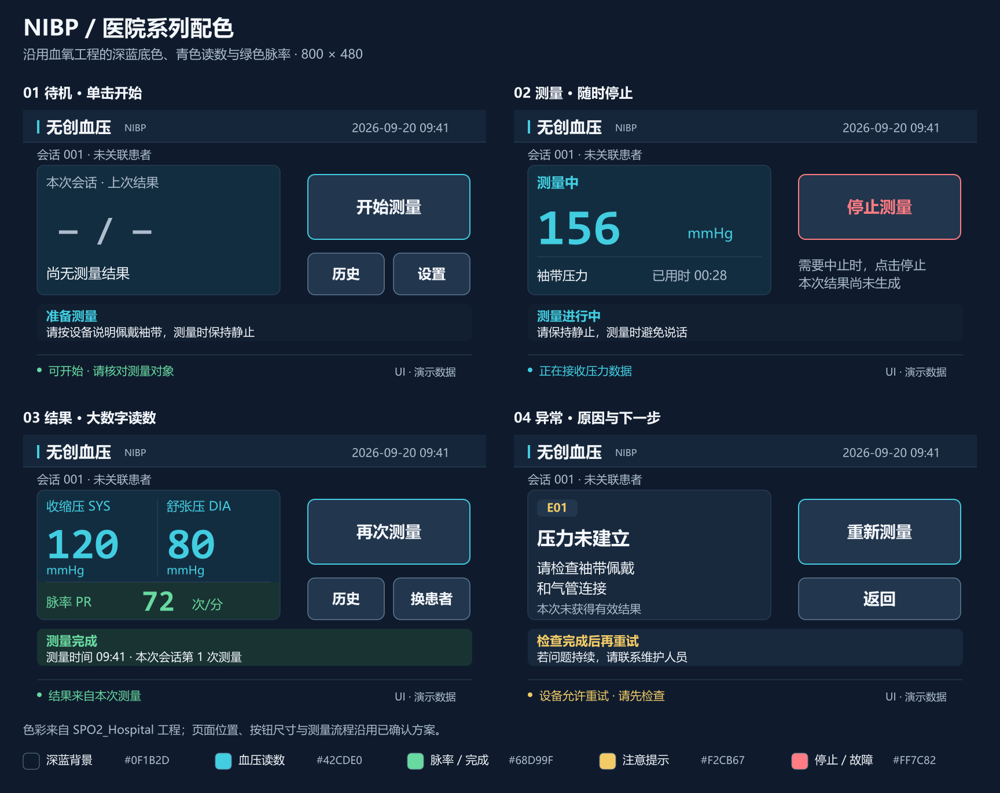
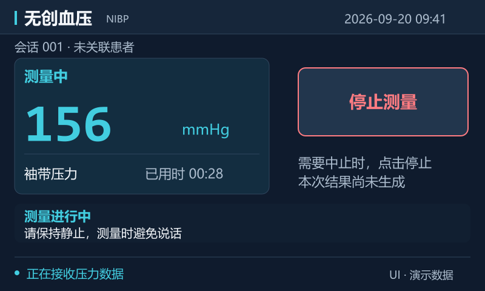
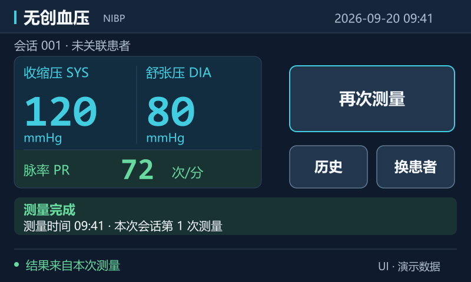
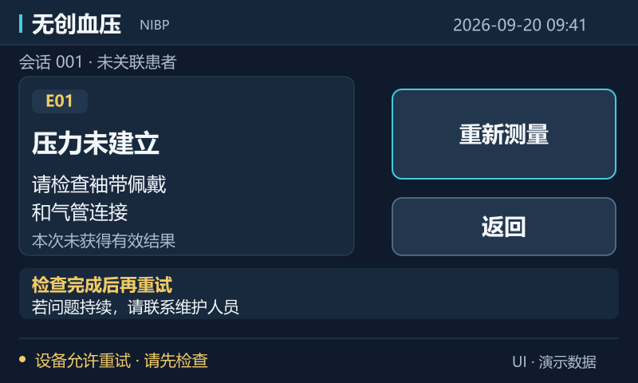
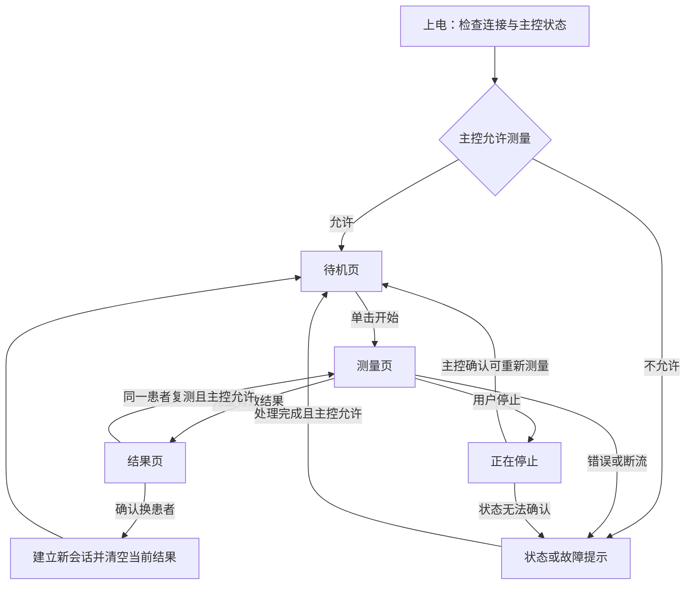

# 5 英寸电容串口屏血压界面设计方案

创建日期：2026-09-20　更新日期：2026-09-21　版本：0.2，设计评审稿

已确认：电容触摸、800×480 横屏布局；用户要求配色参照血氧模块 `F:\VisualTFT\SPO2_Hospital`。
本次修订：将已确认布局适配为血氧工程同款深蓝配色，补齐色表与按钮状态，测量流程沿用原方案。
交付范围：界面方案和静态示意图；尚未制作或验证可烧录的屏幕工程。

## 1. 设计定位与资料边界

首版按医院医护人员操作的单次测压场景设计：准备 → 开始 → 测量 → 查看结果 → 同一患者复测或换患者。暂不加入自动周期测量、儿童/新生儿模式、自助诊断、HIS 上传和多参数波形。上述功能需要独立的能力确认与流程设计。

用户提供的名称为“N050 类”，完整屏幕料号尚未核实。官方可查的 DC80480M050_B010_0C 是 5 英寸、800×480、电容触摸、VisualTFT 配套产品，但不能据此认定用户的 N050 就是该型号。本稿以已确认的 800×480 画布为设计假设；建立硬件工程前按实物标签选择型号、方向和固件。

当前本地资料支持 HKB-08B+ → STM32F407 → 串口屏的数据链。另一份 CAN 主屏文档将串口屏作为本地显示/调试端；本稿不改变这个架构决定。无论最终由串口还是 CAN 接入，主控均提供相同的界面状态与测量结果。若存在两个操作端，应由主控统一测量会话与命令仲裁。

证据来源：

- 本地《HKB-08B+血压传感器V2.2.pdf》第 3～5 页：测量压力、SYS、DIA、XL、节律标志、错误码和停止应答。
- 本地 M 系列入门手册第 7～18 页：背景、按钮、文本、图标、进度条和曲线控件；手册明确其他 M 系列尺寸可参考 7 英寸教程。
- 本地《大彩串口屏指令集 V5.1》：按画面 ID 与控件 ID 更新文本、接收按钮通知。
- [大彩 M050 官方产品页](https://www.gz-dc.com/article/id/7012.html)：核对屏幕示例规格和 VisualTFT 能力，不代表实物型号已确认。
- [FDA 人因设计考虑](https://www.fda.gov/medical-devices/human-factors-and-medical-devices/human-factors-considerations)：作为设计方法参考，强调操作者、使用环境与界面的共同验证，不作为中国注册要求的替代。

## 2. 视觉规范

采用血氧工程同款医院系列深蓝配色。用数字层级、对齐和留白形成美感，保持已确认的页面位置和按钮尺寸。

实际参考目录为 `F:\VisualTFT\SPO2_Hospital`（用户提供的 `SPO2\_Hospital` 在本机不存在）。文字/语义色来自该工程 `tools/build_pages.py` 第 42～48 行和 `主界面.tft`；背景、面板、按钮色与现有 PNG 素材的原始像素交叉核对。详细来源、RGB 配置和对比度见[配色说明](2026-09-21-blood-pressure-hospital-colors.md)。

| 元素 | 设计值 | 使用规则 |
|---|---|---|
| 画布 | 800×480 px | 横屏，坐标原点位于左上 |
| 外侧安全边距 | 至少 20 px | 常用内容从 x24 开始 |
| 顶栏 | y0～56 | 产品名与时间，不堆叠小图标 |
| 上下文行 | y64～88 | 会话或已确认患者标识 |
| 主内容 | y96～320 | 左数据、右操作 |
| 提示区 | y336～400 | 状态、下一步提示 |
| 底部状态栏 | y424～480 | 只显示状态与必要说明 |
| 页面背景 | #0F1B2D | 与血氧工程页面背景相同 |
| 顶栏 | #16263A | 与血氧工程顶栏相同 |
| 数据卡片 | #132D40 | 深青蓝底，边框 #30465E，圆角 12 px |
| 通用/异常卡片 | #18293D | 与血氧工程设置页面板同色 |
| 血压/压力主色 | #42CDE0 | SYS/DIA 和袖带压力使用青色；配标签区分含义 |
| 脉率 | #68D99F | PR 标签、数字、单位统一绿色；行底色 #193333 |
| 主文字 | #F4F7FB | 标题、按钮与重要说明 |
| 次文字 | #ADBDCE | 时间、辅助状态 |
| 按钮 | #22364D | 按下 #304D63；次级边框 #607B95；主要操作用青色边框 |
| 完成状态 | #68D99F | 配“测量完成”，不代表血压正常 |
| 注意状态 | #F2CB67 | 深色底上的琥珀提示 |
| 停止/故障 | #FF7C82 | 停止常态红字红边；按下亮色字、红边，配文字说明 |

按钮禁用态采用 #111F31 底、#30465E 边和 #ADBDCE 字，停止按钮只在非测量等不适用状态使用禁用样式，测量中保持可操作。全部状态可见[按钮色彩状态图](assets/bp-ui-hospital/button-states.png)。

这些颜色作为系列一致性设计选择，不代表临床参数颜色标准。脉率绿色与血氧 PR 一致，血压青色借用其强调色；不把血氧阈值、诊断含义或百分比搬到血压界面。

字号：标题 28 px；中文标签与按钮 24～28 px；正文 22～24 px；次要说明不小于 20 px；压力 88 px；SYS/DIA 76 px；PR 52 px。中文采用清晰的无衬线字体；数字采用清晰的等宽数字或固定宽度数字框，避免刷新时跳动，不采用难辨认的装饰字形。

本稿静态图使用系统字体展示风格。生产字库应确认字体授权、字形覆盖以及实屏渲染效果；不能只依据电脑预览。

关键动作固定在右侧 x492 y112 w280 h112：“开始测量／停止测量／再次测量”共用位置。次级按钮采用 x492 y248 w132 h72 与 x640 y248 w132 h72，按钮之间留 16 px。与此前骨架相比，次级按钮高度从 64 增至 72 px，提升实际触控面积；底部保留状态栏，不再重复放主按钮。

以官方示例型号有效显示区 108.9×65.8 mm 估算，72 px 高约为 9.9 mm；这是设计起点，并非通用医疗触控标准。电容触摸不等于支持医用手套，需用实际屏、盖板和目标手套验证。

## 3. 页面图与统一布局

四页总览：

图中的数字、时间和会话均为演示数据。静态图不表示模块已测得这些值，也不表示工程可烧录。

### 3.1 待机页

| 区域 | 坐标 x/y/w/h | 内容 |
|---|---|---|
| 本次会话 | 24/64/752/28 | 首版无患者系统时明确写“会话 001 · 未关联患者” |
| 上次结果 | 24/96/420/224 | 只显示同一会话上次结果与测量时间；首次显示“尚无测量结果” |
| 开始 | 492/112/280/112 | 蓝灰底、青色边框、亮色字的主按钮“开始测量” |
| 历史／设置 | 492/248/132/72；640/248/132/72 | 低频入口，层级弱于开始按钮 |
| 准备提示 | 24/336/752/64 | “请按设备说明佩戴袖带，测量时保持静止” |
| 状态 | 24/424/752/36 | 按主控实际状态显示“可开始”“正在连接”或具体故障 |

主控未完成就绪检查时禁用开始，并显示原因。没有袖带连接检测输入时，不显示“袖带已连接”“佩戴正确”。上次结果卡不显示其他患者或其他会话的数据。

开始点击被接受后先显示“启动中”、压力“—”并提供停止按钮；只有接收到有效测量过程状态才显示实际压力。主控拒绝开始时留在待机页并说明原因，不把触摸反馈当作模块已开始工作的证据。

### 3.2 测量页

左卡片顶部“测量中”；中央以青色显示当前袖带压力，例如 156 mmHg；下方“已用时 00:28”。袖带压力明确标注为过程压力，不能与最终血压混淆。右侧同一位置为红字红边、蓝灰底的“停止测量”。下方提示“请保持静止，测量时避免说话”。

普通 A0 测压协议未提供可靠的完成百分比、预计剩余秒数或独立的充气/放气阶段字段，因此首版统一显示“测量中”和实际已用时。没有额外可靠数据时，不用压力比例模拟完成进度，不做倒计时，不凭单次压力升降判断阶段。

仅使用实际过程压力；断流后将过程压力替换为“—”，显示“压力数据中断”，避免冻结数值看起来仍在更新。不在测量页保留上次 SYS/DIA 大数字，也不绘制装饰心电波形。压力与最终结果使用不同标签。

停止按钮单击生效，无二次确认。点击后立即显示“正在停止”，按钮位置保留；禁止开始、患者切换与设置。重复停止输入允许，主控去重并按安全策略处理，不能因通用按钮节流而丢弃停止请求。收到停止应答后仍不能仅凭 ACK 宣称“袖带已泄压”。

### 3.3 结果页

| 内容 | 坐标建议 | 样式 |
|---|---|---|
| 结果卡片 | 24/96/420/224 | 与待机/测量卡保持一致 |
| 收缩压 SYS | 左列 x40，数值 y140 | 数值 76 px，单位 mmHg 紧随下方 |
| 舒张压 DIA | 右列 x248，数值 y140 | 数值 76 px，与 SYS 同等重要 |
| 脉率 PR | 卡片底部，约 y256 | 52 px 数字，单位“次/分” |
| 再次测量 | 492/112/280/112 | 同一会话复测；由主控决定是否允许 |
| 历史／换患者 | 492/248/132/72；640/248/132/72 | 换患者只在安全空闲时可用 |
| 完成信息 | 24/336/752/64 | 完成状态、测量时间；有节律提示时展示提示 |

显示完整有效结果后才出现“测量完成”。SYS/DIA/PR、有效状态、会话与时间必须作为同一份结果更新；禁止混合两次测量的字段。界面示例 120/80 和 72 只作为排版示意。

XL 字段在厂家手册中称心率；本界面按袖带测量来源标为“脉率 PR”，以免与心电通道 HR 混用。这个标签是本方案的信息设计选择。

首版不显示“正常血压”“高血压等级”“健康评分”，不自动生成诊断建议。模块没有直接输出 MAP，因此不加入未验证的平均动脉压估算。仅有厂家节律标志时显示“节律提示，请由医护人员复核”，不显示房颤等诊断名称；无标志也不宣称已排除节律问题。

用户离开结果页前结果保留。患者或会话切换后，首页恢复“尚无测量结果”，不沿用旧患者数据。设备时间未经校准时显示“时间未校准”，并保留测量序号和上电后经过时间，不能伪造日期。

### 3.4 异常页

异常页显示“本次未获得有效结果”，主标题讲原因，正文讲下一步；错误码放在次要位置供维护人员定位。示意图为 E01 且主控已判定允许重试的情形。其他异常根据主控的 retry_allowed 决定按钮状态。

| 输入 | 用户文案 | 操作 |
|---|---|---|
| X=0 | 未检测到有效脉搏；检查袖带位置并由医护人员评估后复测 | 安全状态确认后允许手动重试 |
| X=1 | 压力未建立；请检查袖带佩戴和气管连接 | 不宣称已检测到漏气；处理后手动重试 |
| X=2 | 本次结果无效 | 不显示为有效血压，不加入有效结果列表 |
| X=3 | 超压保护；停止使用并检查设备 | 关闭重试，展示故障处理指引 |
| X=4 | 测量干扰过多；请保持静止后重试 | 安全状态确认后允许手动重试 |
| 通信故障 | 设备通信中断；停止状态未确认 | 保留停止入口，关闭开始与重试 |
| 用户停止 | 本次测量已取消 | 不生成血压结果，不弹“测量失败”责备用户 |

错误码可以显示为 E00～E04，但底层仍保留原始 X 值，避免“0=无错误”与“X=0=无有效脉搏”混淆。

异常出现时由主控发出相应停止与保护动作。未获得可靠的安全状态时保留“停止状态未确认”或“袖带压力未确认”，不显示“安全”“已泄压”，也不开放下一次测量。故障处理说明必须与经验证的设备操作说明一致。

## 4. 历史、换患者与设置

历史页首版显示当前会话的测量时间/序号、SYS、DIA、PR、有效性和节律提示；4 条记录一页，使用明显的上一页/下一页按钮，避免必须精准滑动小表格。记录包含取消和错误事件时，与有效结果分别标识，不填 0/0。

未接入患者身份系统时，始终显示“未关联患者”，不自动把记录归入某个床号。首版原型记录保存于主控当前会话缓存，明确提示“本次会话记录，断电不保留”；临床成品若要求持久化或上传，应单独确认保存位置、患者关联、写入确认与失败恢复。UI 只能在数据服务确认后显示“已保存”或“已上传”。

原型缓存容量按最近 100 条测量/事件设计，含各自会话编号；容量满时覆盖最旧条目。历史页只展示当前会话记录，换患者后不再在普通历史页展示旧会话；本原型不提供病历归档功能。

“换患者”弹出确认：“结束当前会话并开始新的测量会话？首页将不再显示上一会话结果。”确认后主控建立新会话、清空当前显示数据；缓存中的旧会话按上述 100 条容量策略保留，不将换患者等同于删除数据。测量中、正在停止或状态不明时禁止切换。若可识别为旧会话的结果迟到，丢弃其当前显示请求并记录事件。

HKB 原始结果帧没有测量序号，仅给数据补一个本地会话编号无法证明它来自新测量。主控必须完成上一测量终止确认与接收链路同步，再开放下一次开始；同步无法确认时禁止新测量。取消后的结果不能重新标为成功，已封闭事务不得再次更新当前结果。CAN 等传输若带序号，应同时检查序号。

设置页面向使用者，仅保留亮度、时间等必要选项。工程诊断、压力校准、通信参数进入明确的“维护”入口并使用权限控制；长按标题或连点版本号不是权限控制。首次不加入临床报警阈值编辑，以免界面先于经验证的报警功能。

## 5. 状态流程与职责

安全控制由血压模块与主控承担。屏幕负责显示主控状态和上传操作事件，不能依赖屏幕弹窗、动画或 Lua 作为唯一的超压/超时保护。物理停止或独立泄压路径由整机安全设计确定；触摸屏失效不应让保护失效。

| 单元 | 职责 | 边界 |
|---|---|---|
| 血压模块 | 执行测量，输出过程、结果、异常 | 不依赖 UI 动画运行 |
| 主控业务服务 | 校验数据、状态机、停止/保护、会话与命令仲裁 | 是测量状态与操作许可的唯一来源 |
| 主控显示服务 | 将完整状态快照转成页面/控件更新 | 不自行推断患者诊断 |
| 串口屏 | 绘制背景和动态值、触摸反馈、事件上传 | 不伪造连接、泄压或保存成功 |

显示模型至少包含：state、state_reason、session_id、measurement_id、pressure、pressure_valid、pressure_age、SYS、DIA、PR、result_valid、result_time、time_valid、rhythm_flag、error_source、error_code、start_allowed、retry_allowed。具体字段编码留给后续接口实现计划，本稿确定字段语义。

停止应答只证明命令得到回复。safe_to_restart 必须来自经过验证的主控/气路安全判定；尚无充分证据时保持 false。超时、过压、安全泄压阈值属于整机控制参数，不能由界面设计随意给值。

现有快速指南的压力解析把 QYH 整字节拼接成压力；厂家手册说明其中 bit4 是心跳标志。接入显示前必须剥离已定义状态位，并验证其他保留位与压力解码规则，避免将心跳标志误显示成数千 mmHg。此项作为接口核对要求，本轮不修改固件。

## 6. VisualTFT 落地方式

采用“静态背景 + 原生文本 + 原生按钮 + 状态图标”的组合。圆角、边框、分区可在背景图完成，实际压力/结果/时间使用文本控件覆盖；按钮提供常态、按下、禁用三种视觉状态。数字不得烘焙进背景素材。

| 页面逻辑名 | 建议页号 | 主要控件 |
|---|---:|---|
| BOOT | 0 | 自检状态、版本文本 |
| IDLE | 1 | START、LAST_RESULT、HISTORY、SETTINGS |
| MEASURING | 2 | PRESSURE、ELAPSED、STATUS、STOP |
| RESULT | 3 | SYS、DIA、PR、RESULT_TIME、RHYTHM、REMEASURE、NEW_SESSION |
| NOTICE | 4 | ERROR_TITLE、DETAIL、ERROR_CODE、STOP/RETRY、RETURN |
| HISTORY | 5 | 四行记录、PREVIOUS、NEXT、RETURN |
| SETTINGS | 6 | 亮度、时间、MAINTENANCE、RETURN |
| MAINTENANCE | 7 | 受权限保护的版本/通信诊断信息 |

页号为工程分配建议；以 VisualTFT 最终导出的 ID 表为准，不能直接照抄示例工程 ID。一个语义控件在不同页面上的实例使用明确的 page_id/control_id 映射。

仅在真实业务状态变更时切页。普通压力文本先以最多 5 Hz 的刷新频率作为联调起点，已用时按 1 Hz；状态、错误、停止事件优先处理。这里是性能设计建议，不是屏幕规格承诺。数据中断阈值按模块实际更新周期与整机风险分析设置。

模块到主控断流由主控处理；主控到屏幕断流时，主控无法再发送“通信中断”文案，因此屏端还需独立的显示数据超时机制（例如实际固件支持的定时器/最小 Lua 心跳监测）。超时后屏幕自行清除实时过程值、禁止开始并显示失联提示，已完成的历史结果保留时间与历史标识。这只保障信息不误导，不承担气路保护；后者始终由主控和硬件独立执行。

按实际固件支持采用批量更新或“先隐藏结果 → 写全字段 → 再显示”完成结果刷新。结果有效标识最后置为可见。进入页面时一次恢复完整当前状态，避免切页后保留旧控件内容。

背景按 800×480 输出，优先用不引入文字压缩毛边的素材格式，图片在实际固件上检查。减小动态重绘面积，不使用持续视频和装饰 GIF。仅在有实际数据输入且有使用价值时新增曲线。

## 7. 验证与验收场景

本稿中的静态排版审查不等于设备可用性验证。医院使用场景需由实际医护在目标设备与环境下验证；FDA 人因资料也将操作者、照明/噪声等环境与界面一起考虑。

| 场景 | 评审要求 |
|---|---|
| 首次使用 | 能识别设备状态和开始入口，不把空值看成 0 血压 |
| 读数 | 能区分袖带压力、SYS、DIA、PR 和单位，正确识别测量时间 |
| 连点开始 | 一次测量只启动一次 |
| 任意测量时刻停止 | 一次点击发送停止事件；停止状态未确认时不得显示安全完成 |
| 取消后晚到结果 | 不冒充一次新的成功结果，不污染下一会话 |
| 测量中断线/重启 | 停止更新动态数值，显示状态中断，禁止自动恢复开始 |
| X=0～4 | 各有可理解文案，X=0 不被吞作无故障 |
| 换患者 | 旧结果从当前显示移除，患者身份不明时明确标记 |
| 数据异常 | 压力标志位、残帧、错误校验和、字段超范围不生成有效结果 |
| 设备时间错误 | 不显示伪造的可信日期；显示时间未校准 |
| 手套操作 | 使用目标医用手套实测点击，记录漏触与误触；必要时调整硬件或按钮 |
| 实屏可读性 | 明亮/较暗环境、实际距离和视角下检查字号、颜色与禁用态 |

不把一次小规模试用或若干次成功测量视作临床验证通过。该界面设计用于样机与后续评审；进入医院临床使用仍需完成整机适用的测量性能、安全性和可用性验证。“医用级”屏幕称谓不能替代整机验证。

## 8. 交付与下一步

当前交付：本设计稿、四个 800×480 SVG/PNG 静态页面、四页总览、按钮状态图，以及[离线 HTML 预览](assets/bp-ui-hospital/preview.html)和[配色说明](2026-09-21-blood-pressure-hospital-colors.md)。图稿用于确认信息层级和视觉效果，不是可直接下载的 .tft/.tftprj 工程。原浅色图稿保留在 `assets/bp-ui/`，当前版本使用 `assets/bp-ui-hospital/`。

设计确认后，下一步依据本稿编写实施计划，核对实物完整料号，再制作 VisualTFT 工程、字体/按钮素材和主控控件映射，并用虚拟串口屏与实屏验证。

当前资料目录不是 Git 仓库；本次仅保存设计文件，未建立仓库、未作 Git 提交，也未改写原始开发包和已有两份开发指南。
