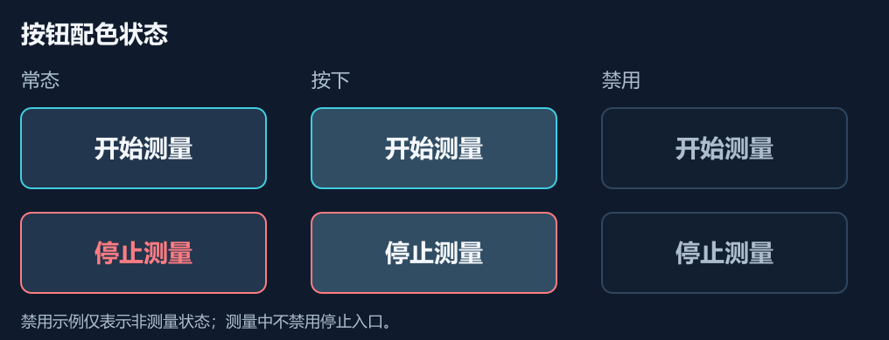

# 血压界面与 SPO2_Hospital 的配色统一

日期：2026-09-21。范围：已批准的 800×480 四页布局换色，版面与测量流程沿用原设计。

用户参考工程的实际路径是 `F:\VisualTFT\SPO2_Hospital`。原消息路径 `F:\VisualTFT\SPO2\_Hospital` 不存在，读取同名工程的真实目录完成核对。

## 配色来源与应用

| 角色 | HEX | VisualTFT RGB | 源位置 | 血压界面用途 |
|---|---|---|---|---|
| 页面 | #0F1B2D | 15;27;45 | build_pages.py:48、主界面.tft | 页面底色 |
| 顶栏 | #16263A | 22;38;58 | 主界面.tft、bg_0.png | 产品名、时间栏 |
| 通用面板 | #18293D | 24;41;61 | bg_3.png 像素 | 异常卡片、注意提示区 |
| 内嵌面板 | #111F31 | 17;31;49 | 主界面.tft、bg_0.png | 操作提示区、禁用按钮底色 |
| 青色数据底 | #132D40 | 19;45;64 | txt_spo2.bkg_color、bg_0.png | 血压、袖带压力卡片 |
| 绿色数据底 | #193333 | 25;51;51 | txt_pr.bkg_color、bg_0.png | PR 行、测量完成提示 |
| 分隔线 | #30465E | 48;70;94 | bg_0.png、bg_3.png | 卡片边线、分隔线 |
| 主文字 | #F4F7FB | 244;247;251 | build_pages.py:42 | 标题、正文、按钮 |
| 次文字 | #ADBDCE | 173;189;206 | build_pages.py:43、主界面.tft | 时间、单位以外辅助说明 |
| 强调色 | #42CDE0 | 66;205;224 | build_pages.py:44、txt_spo2.fore_color | SYS/DIA、袖带压力、主按钮边框 |
| 脉率/完成 | #68D99F | 104;217;159 | build_pages.py:45、txt_pr.fore_color | PR、完成状态 |
| 注意 | #F2CB67 | 242;203;103 | build_pages.py:46 | E01 标识与注意提示 |
| 停止/故障 | #FF7C82 | 255;124;130 | build_pages.py:47 | 停止按钮、故障强调 |
| 按钮常态 | #22364D | 34;54;77 | btn_confirm_up.png、btn_back_up.png 众数 | 所有按钮填充 |
| 按钮按下 | #304D63 | 48;77;99 | btn_confirm_down.png、btn_back_down.png 众数 | 按下反馈填充 |
| 次级按钮边 | #607B95 | 96;123;149 | btn_confirm_up.png、btn_back_up.png | 历史、设置、返回等 |

配色保持系列关系：血压结果青色，脉率绿色，界面外框深蓝。颜色与参数标签、单位同时出现。完成状态的绿色表示流程完成，不表示临床结果正常。血氧工程中的 SpO2 数值、阈值、波形和报警逻辑均不是本次配色参考的内容。

## 按钮状态

- 开始/重测：蓝灰常态底、青色边框、亮色字；按下后底色变为 #304D63。
- 停止：常态蓝灰底、红字红边；按下后为 #304D63 底、亮色字、红边。按下态不用红色文字，以维持更高对比度。
- 次级：蓝灰底、#607B95 边、亮色字；按下底色变为 #304D63。
- 禁用：#111F31 底、#30465E 边、#ADBDCE 字。实际不可操作状态由主控决定；测量中停止入口持续可用。

## 对比度核对

以下为 sRGB 名义颜色计算，用于设计审查，不代替实屏可读性验证。当前检查 15 组文字与背景组合，按 4.5:1 作为本稿的统一检查目标；结果保存在 `palette.json`。

| 组合 | 对比度 |
|---|---:|
| 正文 / 通用面板 | 13.73:1 |
| 辅助字 / 数据卡片 | 7.41:1 |
| 血压青色 / 数据卡片 | 7.47:1 |
| 脉率绿色 / 脉率行 | 7.69:1 |
| 按钮字 / 常态按钮 | 11.48:1 |
| 按钮字 / 按下按钮 | 8.26:1 |
| 停止红字 / 常态按钮 | 4.97:1 |
| 注意琥珀字 / 面板 | 9.49:1 |

本次 ui-ux-pro-max 查询为 `text contrast dark interface --domain ux`，命中 Contrast Readability 和 Color Contrast。将其对比度建议用于配色检查；手机系统 pt/dp、浏览器响应式断点不作为串口屏物理热区标准。

## 文件与复用

- [四页总览](assets/bp-ui-hospital/overview.png)
- [离线 HTML 预览](assets/bp-ui-hospital/preview.html)，内嵌 SVG，无外部字体或网络依赖。
- [待机 SVG](assets/bp-ui-hospital/idle.svg)、[测量 SVG](assets/bp-ui-hospital/measuring.svg)、[结果 SVG](assets/bp-ui-hospital/result.svg)、[异常 SVG](assets/bp-ui-hospital/error.svg)：均为 800×480，附相同名称 PNG。
- [配色 JSON](assets/bp-ui-hospital/palette.json)：HEX、VisualTFT RGB、来源和文字对比度。
- `assets/bp-ui-hospital/generate_preview.py`：生成矢量稿、色表与 HTML；`render_svg.cjs` 仅将 SVG 渲染为 PNG。两者是设计产物工具，不是屏幕运行代码。

VisualTFT 接入时，动态文本底色应与该位置背景一致：压力和 SYS/DIA 为 19;45;64，PR 行为 25;51;51。开启适用的纯色文本背景刷新方式，避免旧数字残留；以具体控件及固件实际属性为准。

原浅色图保留在 `assets/bp-ui/`，未修改血氧参考工程。本次未生成或烧录 VisualTFT 工程。
