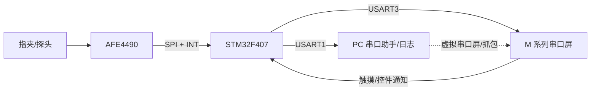
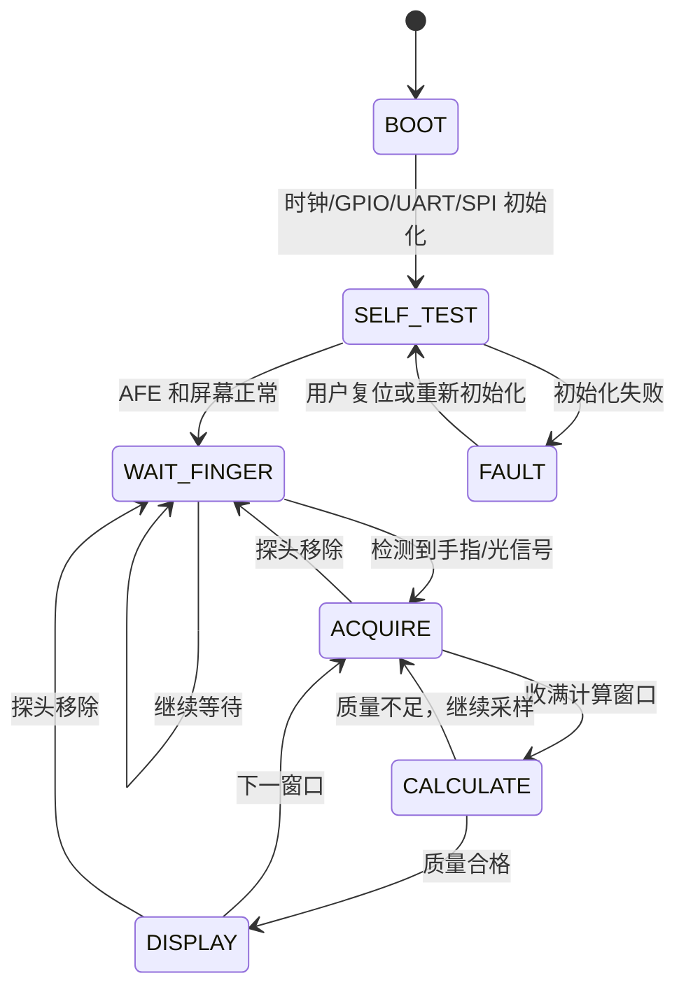
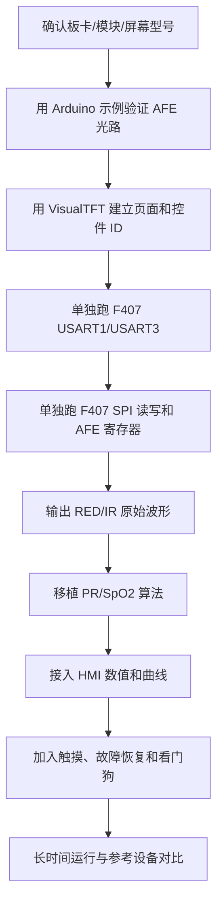
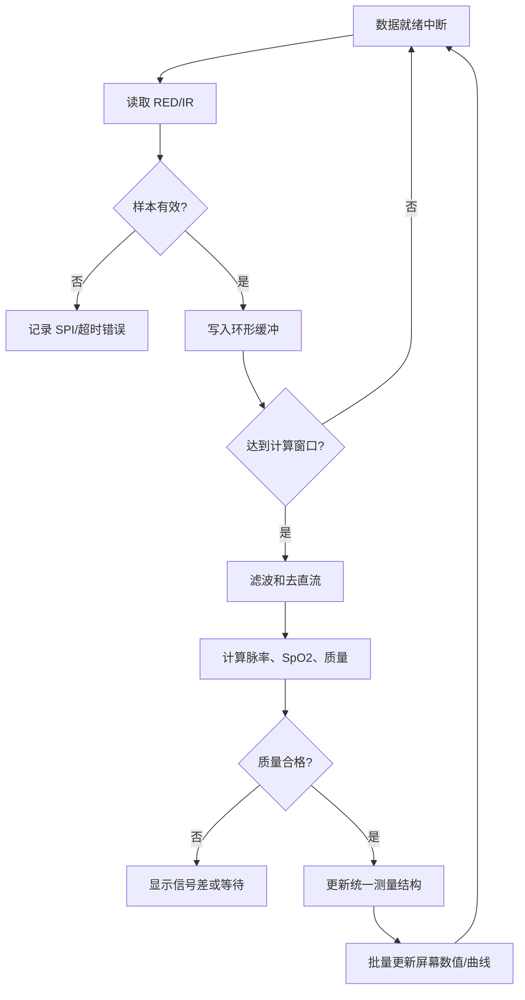
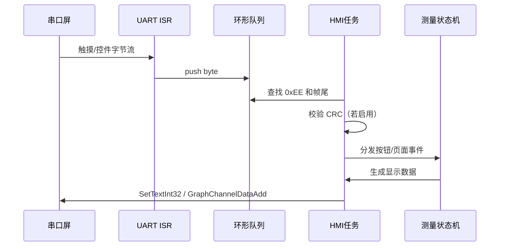

# STM32F407 + AFE4490 血氧 + M 系列串口屏调试 + CANopen 接入 Gateway-C

> **对齐版本**：《多参数监护仪_总开发合同与系统方案 v0.7》。本文件是成员 A 血氧模块（Node-A）的开发入口与设计基线，配套《血氧模块_CAN通信开发流程框架图.md》和《血氧模块_代码使用说明.md》使用。

## 快速结论

正式系统按“**Node-A（STM32F407-A）做采集、算法和状态管理，AFE4490 做红光/红外光电采集，M 系列串口屏做本模块的本地独立显示，CANopen 做模块对外数据出口**”来组织。合同 v0.7 冻结：血氧功能运行在 **Node-A**，与血压模块（HKB-08，UART）共用同一颗 STM32F407-A 和任务调度，但各自拥有**独立本地显示屏**；Node-A 作为 **CANopen 设备节点**通过 **CANopen CC（CiA 301） over Classic CAN** 把标准化的 SpO2、PR、信号质量、状态和故障数据汇聚到 **Gateway-C**，再由 Gateway-C 经 ESP8266-C 用 MQTT over TLS 上云。Arduino 示例只用于验证 AFE4490 模块和算法接口，最终产品代码移植到 STM32F407 的 SPI/GPIO/CAN 工程中。

**术语边界**：本文中的“本地屏/串口屏”指 Node-A 上属于血氧模块的那块**独立显示屏**，它是正式交付物，不是可选项；本模块上游的汇聚节点是 **Gateway-C**，不是“主控板”或“主屏幕”——合同 6.1 明确 PC 只作浏览器终端，不是网关。

本模块的速率指标统一为 **PR（Pulse Rate，脉率）**，由光电容积脉搏波 PPG 的有效脉搏间隔计算，单位为次/分（bpm）。项目字段使用 `pulse_rate`，算法文件使用 `pulse_rate.c`，屏幕标注为“PR/脉率”；本模块不承担 ECG 心率计算。

```text
指夹/光电探头
      │  红光 660 nm、红外光 905 nm
      ▼
AFE4490 模块（SPI + CS + PWDN + DRDY/INT）
      │
      ▼
Node-A / STM32F407-A
  ├─ SPI：读取红光/红外原始数据
  ├─ 算法：PPG、脉率 PR、SpO2、信号质量
  ├─ USART1：PC 调试和日志
  ├─ USART3：本模块独立显示屏（M 系列串口屏）
  └─ CAN1：CANopen 设备节点 → Gateway-C
      │
      ▼
大彩 M 系列串口屏（VisualTFT 工程 · 血氧独立显示屏）
```

正式产品链路应理解为：AFE4490 → Node-A（STM32F407-A）→ CAN 收发器 → CANopen 总线 → Gateway-C → ESP8266-C → MQTT/TLS → 腾讯云 → 浏览器 Web 大屏。串口屏链路用于本地监护和现场定位问题，**不应与 CANopen 上行数据形成两套独立的测量结果来源**：本地屏和 CANopen 对象必须读取同一份 `measurement_t`。

Node-A 同一块板卡上还承载血压模块（HKB-08，UART）及其独立显示屏。血氧与血压共用主控、时钟和总线资源，因此本模块的设计必须考虑：SPI 采样不被显示屏刷新阻塞、CANopen 发送不影响采集、两块屏互不影响（对应合同 14.2 的验收关注点）。

这份文档是开发入口和设计基线，不替代 AFE4490 数据手册、串口屏型号手册、F407 板卡原理图，也不构成医疗器械性能声明。所有最终针脚、电平、SPI 模式和血氧精度都要以实物和测试结果为准。

## 1. 资料范围和假设

| 资料 | 在本项目中的用途 |
|---|---|
| `M系列串口屏开发包V3.2` | VisualTFT 工程、M 系列指令集、控件教程、虚拟串口屏、MCU 示例、调试工具 |
| 思知瑞血氧页面 | AFE4490 模块的连接方式、红光/红外原理、Arduino 库和三个验证示例 |
| `F:\嵌入式\课件资料\1_开发资料` | STM32F4xx 标准外设库、CMSIS、启动文件和驱动基础 |
| `F:\嵌入式\课件资料\4_程序资料` | F407 的 USART、SPI、DMA、RS485 等可运行例程 |
| `F:\嵌入式\课件资料\5_程序思路整理` | 现有工程的程序组织和调试思路参考 |

用户给出的 `F:\嵌入式\课件资料\1\_开发资料` 在当前磁盘上对应为 `F:\嵌入式\课件资料\1_开发资料`；本文按后者引用。

血氧网页的关键事实如下：

- 网页把速率指标标为 HR，采用透射式指夹结构；本项目将基于 PPG 的速率输出统一定义为 PR（脉率）。
- 红光波长约 660 nm，红外光波长约 905 nm。
- AFE4490 通过 SPI 与主控连接；网页中的 Arduino 示例把结果输出到串口监视器或串口绘图器。
- 示例 1 用 115200 波特率输出原始 PPG；示例 2 用 115200 输出 SpO2 和示例标注的 HR；示例 3 用 57600 输出绘图数据。移植时核对速率值来自 PPG 后，将其映射为本项目的 PR。
- 网页示例代码 OCR 可见 `CS=D7`、`PWDN=D4`、`INT=D8`，硬件 SPI 为 Arduino 的 SPI 引脚。该映射只能作为参考，接入 F407 前必须核对模块丝印、原理图和库文件。

## 2. 系统节点

### 2.1 节点清单

| 节点 | 责任 | 输入 | 输出 |
|---|---|---|---|
| N1 指夹/光电探头 | 固定手指并完成光路 | 手指血流、环境光 | 红光/红外光信号 |
| N2 AFE4490 | LED 驱动、模拟前端、ADC 和采样 | PWDN、SPI 配置、探头信号 | RED/IR 原始采样、数据就绪中断 |
| N3 STM32F407 BSP | GPIO、SPI、UART、定时器、DMA/环形缓冲 | N2 的 SPI/INT，屏幕串口，调试串口 | 原始样本、协议帧、系统时基 |
| N4 信号与算法层 | 去直流、滤波、脉搏检测、PR/SpO2 计算、质量判断 | RED/IR 样本 | `spo2`、`pulse_rate`、`signal_quality`、`probe_state` |
| N5 应用状态机 | 启动、自检、等待手指、测量、故障恢复 | 算法结果、按键、超时 | 当前页面、报警状态、任务调度 |
| N6 M 系列串口屏 | 页面、文本、数值、曲线和触摸 | 大彩协议帧 | 用户看到的结果、触摸通知 |
| N7 PC 调试工具 | 下载、串口抓包、虚拟屏仿真、日志 | UART 数据 | 调试结果和问题定位 |

### 2.2 连接关系



## 3. 需求基线

### 3.1 功能需求

| 编号 | 需求 | 验收方式 |
|---|---|---|
| F-01 | 上电后完成 GPIO、SPI、UART、屏幕通信和 AFE4490 自检 | 通过 PC 日志看到各模块初始化结果 |
| F-02 | 能识别无手指、手指接入和信号丢失 | 拔插指夹，状态在限定时间内切换 |
| F-03 | 连续采集 RED/IR 原始数据 | PC 能输出带序号的样本，环形缓冲不溢出 |
| F-04 | 计算脉率、SpO2 和信号质量 | 手指稳定时数值更新；无效时显示 `--` 或“探头异常” |
| F-05 | 屏幕显示数值、状态、波形和报警 | 数值、波形、页面切换与主控状态一致 |
| F-06 | 屏幕触摸可执行开始测量、停止测量、回到首页等操作 | 每个按钮都有对应事件日志 |
| F-07 | 发生超时、SPI 错误、串口帧错误时可恢复 | 断开/重新接入模块后系统不死机 |
| F-08 | 作为 CANopen 设备节点，向 Gateway-C 提供标准化血氧数据（SpO2 / PR / 质量 / 状态 / 有效性） | CANopen 分析仪或 Gateway-C 侧能看到血氧过程数据；无效结果有明确定义值 |
| F-09 | 关键故障可通过 EMCY 上报，节点在线状态可被 Gateway-C 识别 | 断开 CAN 或制造 AFE 故障时，Gateway-C 侧能观察到 EMCY / 心跳超时 |

### 3.2 非功能需求

- 采集、算法、屏幕刷新和日志不能互相长时间阻塞；中断只做收字节、置标志和搬运数据。
- 数值刷新建议 2～5 Hz，波形刷新建议 20～50 Hz；最终频率由 AFE 采样率和屏幕曲线控件承载能力确定。
- 原始数据必须带样本序号或时间戳，便于定位丢样和算法异常。
- 页面控件更新集中在 HMI 任务中，不能在 SPI/UART 中断里直接发送完整屏幕帧。
- 算法输出必须带有效标志和质量等级，不能把上一笔有效结果伪装成当前结果。
- 本项目先做样机验证；和参考血氧仪的误差、低灌注、运动干扰、不同肤色和不同手指尺寸等指标，需要单独建立测试方案。

### 3.3 建议的第一版验收门槛

1. 连续运行 10 分钟，UART 接收队列和屏幕发送队列均无溢出。
2. 手指移除后 2 秒内进入“探头未接入”状态，屏幕不保留过期数值。
3. 手指稳定放置 30 秒，原始 RED/IR 波形连续、无明显断帧。
4. 屏幕数值和 PC 日志中的同一组结果一致。
5. 参考设备对比数据只作为工程验证记录，不直接作为医疗认证结论。

## 4. 数据模型和状态模型

### 4.1 测量数据模型

建议在 F407 中定义一个统一结果结构，所有 UI、日志和报警都读取这一结构：

```c
typedef struct {
    uint32_t sample_seq;       /* 原始样本序号 */
    uint32_t timestamp_ms;     /* 系统时间 */
    int32_t  red_raw;          /* 红光原始值 */
    int32_t  ir_raw;           /* 红外原始值 */
    int16_t  spo2;             /* 0~100，-1 表示无效 */
    int16_t  pulse_rate;       /* PR，次/分（bpm），-1 表示无效 */
    uint8_t  signal_quality;   /* 0~100 */
    uint8_t  probe_state;      /* 未接入/接入/信号差 */
    uint8_t  result_valid;     /* 结果是否可显示 */
    uint8_t  fault_code;       /* SPI、超时、算法等错误 */
    uint16_t algo_version;     /* 算法版本，随算法变更递增 */
} measurement_t;
```

实际项目可以把 `red_raw/ir_raw` 和算法结果分成两个结构，避免 UI 任务复制大块原始数据。曲线只取最近一段窗口，例如 256 或 512 点。

**三方共读同一份结果**：本地屏、USART1 日志和 CANopen 对象映射层都从 `measurement_t` 取值。`algo_version` 用于满足合同 8.6 数据字典中“算法版本或来源信息”的要求，便于云端区分数值变化来自病人还是算法换版。CANopen 对象只映射本模块负责的 **PPG / SpO2 / PR** 及本节点状态与故障，具体 Index/Sub-index 由 P 在《CANopen 对象字典与 PDO 映射设计》中冻结。

### 4.2 状态机



### 4.3 屏幕控制模型

在 VisualTFT 中给每个页面和控件建立固定 ID，并在 F407 中维护符号表：

| 逻辑控件 | 屏幕页面 ID | 控件 ID | 更新接口 |
|---|---:|---:|---|
| SpO2 数值 | 待定 | 待定 | `SetTextInt32()` 或 `SetTextValue()` |
| PR/脉率数值（次/分） | 待定 | 待定 | `SetTextInt32()` |
| 状态文本 | 待定 | 待定 | `SetTextValue()` |
| PPG 曲线 | 待定 | 待定 | `GraphChannelDataAdd()` |
| 开始按钮 | 待定 | 待定 | 触摸通知 |
| 停止按钮 | 待定 | 待定 | 触摸通知 |

先在 VisualTFT 中把页面和控件 ID 定下来，再写代码；不要在代码中到处散落裸数字。

### 4.4 PR 脉率算法

输入为带采样序号的 RED/IR 数据，先选择质量合格的一路 PPG 进行脉搏检测；SpO2 仍使用红光/红外双通道数据。建议流程如下：

1. 检查探头状态、采样连续性和信号饱和情况，去除直流并滤波。
2. 根据有效脉搏峰提取相邻脉搏间隔，使用幅度门限和最小峰间距抑制噪声、重搏波导致的重复计数。
3. 对满足质量和目标测量范围要求的多个间隔取中位数，计算 `PR = 60000 / T_ms`；`T_ms` 为代表性脉搏间隔（毫秒）。若使用采样点间隔，则 `PR = 60 * Fs / N`，其中 `Fs` 是实际检测数据的采样率（Hz），`N` 是代表性峰间样本数。
4. 将结果写入 `pulse_rate`，统一供日志、屏幕和 CAN 使用。丢样、切换检测通道或更改采样率后重新建立间隔窗口，不能跨不连续样本计算周期。
5. 无手指、信号质量不足、有效间隔不足或结果超时时，把 `pulse_rate` 置为 `-1` 并更新有效状态，屏幕显示 `--`；无效结果按 CAN 文档约定编码。

滤波带宽、最小峰间距、间隔窗口和结果超时应按目标脉率范围与采样率配置并验证。算法验证先输入已知周期的 PPG 测试序列：1000 ms 间隔应输出约 60 次/分，500 ms 间隔应输出约 120 次/分，再检查噪声、丢样和无脉搏时的无效状态。

## 5. 选型建议

| 部件 | 样机阶段选择 | 选择理由与注意事项 |
|---|---|---|
| 主控 | Node-A 现有 STM32F407 板（STM32F407-A） | 已有标准外设库、USART、SPI、DMA 例程，便于快速移植；同一板卡还需承载血压模块与两块独立屏 |
| 光电前端 | 现有 AFE4490 血氧模块和指夹 | 先用 Arduino 示例验证光路和算法输入，再移植到 F407 |
| 显示 | M 系列串口屏 | 图形、页面、曲线和触摸由屏端完成，降低 F407 UI 开发量 |
| 软件库 | STM32F4xx Standard Peripheral Library V1.4.0 | 与现有 `13_USART`、`15_SPI`、`16_DMA_UART` 工程一致 |
| 调试接口 | USART1 + USB 转串口 | 复用 F407 示例中的 PA9/PA10、115200 8N1 |
| 屏幕接口 | USART3（建议 PB10/PB11） | F407 示例已有 USART3，先按屏端真实波特率配置 |
| SPI 接口 | SPI1（建议 PB3/PB4/PB5） | F407 示例已有 SPI1 驱动；CS 可用 PB14 或其他空闲 GPIO |
| 电平转换 | 按实物电压确认后决定 | AFE4490 Arduino 盾板可能使用 5 V 体系，不能默认把 5 V GPIO 直接接到 3.3 V F407 |
| RS485 | 仅在屏幕或远距离总线确实需要时增加 | 现有 `18_RS485` 的 PG8 方向控制可复用，直连 TTL 屏不需要 RS485 |

### 5.1 针脚规划（建议值）

| 功能 | 建议 F407 针脚 | 依据 | 最终动作 |
|---|---|---|---|
| PC 调试 UART TX/RX | PA9/PA10，USART1 | `13_USART` | 保留 115200 8N1 |
| 屏幕 UART TX/RX | PB10/PB11，USART3 | `13_USART` | 与屏端设置同波特率，先验证 9600/19200，再按曲线需要提高 |
| SPI SCK/MISO/MOSI | PB3/PB4/PB5，SPI1 | `15_SPI` | 根据 AFE4490 数据手册设置 CPOL/CPHA，不要直接照搬 W25Q 的模式 3 |
| AFE CS | PB14 或空闲 GPIO | `15_SPI` 的软件片选示例 | 以板卡冲突检查为准 |
| AFE PWDN、INT | 两个空闲 GPIO/EXTI | Arduino 示例为 D4/D8 的逻辑参考 | 依据 AFE 模块原理图重新映射 |
| CAN1 TX/RX | PA11/PA12，CAN1 | `19_CAN` | 接外部 CAN 收发器后并入 CANopen 总线；确认板卡是否已占用 |
| 血压模块 HKB-08 UART | 按 5.1 的串口规划另行分配 | 合同 7.1：HKB-08 使用 UART | 与血氧屏幕、调试串口错开，避免争用 |

## 6. 三套资料如何结合

### 6.1 AFE4490 网页资料 → F407 采集层

网页中的 Arduino 代码主要展示初始化、读数和输出结果三个动作。下面仅示意数据流，字段拼写以实际库声明为准：

```text
AFE44XXINIT()                 初始化 AFE4490
GETAFE44XXDATA(&raw_data)     读取一组采样/计算结果
读取 RED/IR 和 SpO2/速率结果   适配到项目数据结构
```

外部库可能仍使用 `HEARTRATE` 等字段名，应保留库中实际声明，通过适配层映射到 `measurement_t.pulse_rate`；不要将库字段直接改成不存在的 `PR`。映射前核对该值来自 PPG 脉搏间隔，并确认单位、无效码和更新条件；若自行实现算法，按第 4.4 节使用 `pulse_rate.c`。

移植时按下面的顺序替换：

1. 把 Arduino `SPI.begin()` 换成 F407 的 SPI1 初始化。
2. 把 `CS`、`PWDN` 换成 F407 GPIO 输出。
3. 把 Arduino 外部中断 `INT` 换成 F407 EXTI 或定时轮询；优先使用数据就绪中断。
4. 把库内的寄存器配置和 SPI 读写函数移植为 `AFE4490_WriteReg()`、`AFE4490_ReadReg()`。
5. 先只输出 RED/IR 原始数据，再移植 SpO2/PR 算法；不要在采集尚未稳定时同时调 UI 和算法。

注意：网页示例中的 115200/57600 是 Arduino 输出到 PC 的串口波特率，不是 AFE4490 的通信接口。AFE4490 的主通信是 SPI。

### 6.2 F407 例程 → BSP 层

- `13_USART`：复制 USART1/USART3 的 GPIO、AF、NVIC 和中断框架。USART1 作为调试，USART3 作为屏幕。
- `15_SPI`：复制 SPI1 的时钟、AF、软件片选和收发等待逻辑；重新核对 AFE4490 的 SPI 模式、时序和最大频率。
- `16_DMA_UART`：参考 DMA 发送和大块数据搬运。它当前是 USART1 TX 示例，不能直接当作 AFE4490 数据接收方案；高频日志或曲线输出再增加 UART DMA/空闲中断环形缓冲。
- `18_RS485`：只在物理层需要 RS485 时使用，其中 PG8 是 DE/RE 方向控制；直连串口屏时不要无故加入 RS485 收发器。
- `1_开发资料` 的 StdPeriph 库：作为启动文件、CMSIS 和外设驱动的统一版本来源。

### 6.3 串口屏资料 → HMI 层

串口屏示例工程已经给出了可以移植的模式：

```text
UART 中断收字节
    ↓
queue_push() 环形队列
    ↓
queue_find_cmd() 按 0xEE 和帧尾识别完整帧
    ↓
ProcessMessage() 分发触摸/控件/页面事件
    ↓
SetTextInt32()、SetTextValue()、GraphChannelDataAdd()
```

F407 中只替换底层 `UartInit()`、发送函数和中断服务函数，保留队列、帧解析和事件分发思想。屏幕帧解析不要放在中断里完成。

## 7. 接口和协议要点

### 7.1 M 系列串口屏帧

当前示例工程的基本帧形如下：

```text
无 CRC：  EE | 命令和参数 | FF FC FF FF
有 CRC：  EE | 命令和参数 | CRC16 | FF FC FF FF
```

- 帧头是 `0xEE`，帧尾是 `FF FC FF FF`。
- 16 位和 32 位参数按高字节在前发送。
- 示例工程 `CRC16_ENABLE` 为 0；如果在 VisualTFT 中打开 CRC，MCU 端也必须同步打开并使用同一 CRC 配置。
- 示例工程的握手帧为：`EE 04 FF FC FF FF`。
- 常用 C 接口包括 `SetTextValue()`、`SetTextInt32()`、`GraphChannelDataAdd()`、`SetButtonValue()` 和 `GetControlValue()`。
- 触摸/控件消息由 `ProcessMessage()` 统一分发。示例中有触摸按下 `0x01`、触摸释放 `0x03`、定时器 `0x43`、控件通知 `0xB1`、握手 `0x55` 等事件。

不要根据本文手写未知命令的十六进制操作码；页面和控件类命令优先调用开发包中的 `hmi_driver.c` 封装，新增命令再对照《大彩串口屏指令集 V5.1》确认。

### 7.2 AFE4490 接口

建议抽象成下面的接口，算法层不直接操作 GPIO 或 SPI：

```c
void AFE4490_Init(void);
bool AFE4490_DataReady(void);
bool AFE4490_ReadSample(int32_t *red, int32_t *ir);
bool AFE4490_SetPowerDown(bool enable);
```

硬件层必须记录：SPI 模式、SPI 时钟、CS 有效电平、PWDN 有效电平、INT 边沿、模块供电和 I/O 电平。任何一项未确认，都先做单独的硬件验证。

### 7.3 建议的任务周期

| 任务 | 建议周期 | 主要工作 |
|---|---:|---|
| `task_acquire` | 数据就绪触发 | 读取 RED/IR，写入采样环形缓冲 |
| `task_algorithm` | 采满一窗口后 | 滤波、峰值、PR、SpO2、质量判断 |
| `task_hmi_value` | 200～500 ms | 更新 SpO2、PR、状态文本 |
| `task_hmi_wave` | 20～50 ms | 批量刷新曲线，避免每点发送一帧 |
| `task_canopen` | 1～10 ms（或按协议栈要求） | 协议栈处理、TPDO 触发、Heartbeat、EMCY |
| `task_log` | 100～1000 ms | 输出状态和错误，避免阻塞采集 |
| `task_watchdog` | 100 ms | 检查队列、采集、屏幕和算法超时 |

`task_canopen` 与两个 HMI 任务都必须让位给采样链：CANopen 发送失败或本地屏刷新变慢时，允许丢帧和降频，但不允许丢采样点。合同 7.4 只要求“多模块并行采集、显示不阻塞传感器采集、CAN 通信不影响采集”，**不强制指定 FreeRTOS 或裸机**，具体框架由成员 A 在详细设计阶段确定。

### 7.4 CANopen 接口要点

本模块的对外接口是 CANopen，不是自定义 CAN 帧（合同 8.1 / 8.7）。设计时需要明确：

- 节点 ID、总线波特率、PDO 周期、Heartbeat 周期由系统统一规划，不自行决定。
- 复用标准机制：**TPDO**（SpO2/PR/质量/状态）、**SDO**（配置与诊断）、**NMT**（启动/停止/复位）、**Heartbeat**（在线状态）、**EMCY**（关键故障）。
- **Index / Sub-index / PDO 字节布局不在本文件中冻结**，由 P 在《CANopen 对象字典与 PDO 映射设计》中确定；本模块只维护 `CONFIG/od_index.h` 的本地登记。
- 协议栈优先评估成熟开源实现（如 CANopenNode），不自行重写 CANopen 核心协议。
- 若样机阶段曾使用临时自定义帧（0x321/0x322/0x323/0x120）快速联调，接入 Gateway-C 前必须完成到 CANopen 的迁移，迁移对照见《血氧模块_CAN通信开发流程框架图.md》第 6.4 节。

### 7.5 上云链路（由 Gateway-C 承担，本模块不实现）

```text
Node-A（本模块）─ CANopen ─> Gateway-C ─ ESP8266-C ─ MQTT 3.1.1 over TLS ─> 腾讯云
                                                                              ↓
                                                              Backend → Nginx(HTTPS/WebSocket)
                                                                              ↓
                                                                      浏览器 Web 大屏
```

本模块不直接实现 MQTT、TLS、Nginx 或网页；这些由 P 主责。本模块只需保证：CANopen 对象里的数据语义与合同 8.6 的数据字典一致，且网络中断时本地监护不受影响。

## 8. 流程图

### 8.1 总体开发闭环



### 8.2 一次测量流程



### 8.3 屏幕串口收发



## 9. 建议的工程目录

```text
Project/
├─ APP/
│  ├─ app_main.c
│  ├─ app_state.c              # BOOT/WAIT/ACQUIRE/FAULT
│  └─ app_measurement.c        # 统一测量结构
├─ BSP/
│  ├─ bsp_usart.c              # USART1 调试、USART3 屏幕
│  ├─ bsp_spi.c                # SPI1 和软件 CS
│  ├─ bsp_time.c
│  └─ bsp_gpio.c
├─ DRIVER/
│  ├─ afe4490/
│  │  ├─ afe4490.c
│  │  └─ afe4490.h
│  ├─ can/
│  │  ├─ can_bsp.c             # CAN1 GPIO/时钟/过滤器/收发/错误状态
│  │  └─ can_bsp.h
│  ├─ canopen/
│  │  ├─ canopen_app.c         # 业务对象更新、TPDO 装配、EMCY 上报
│  │  ├─ canopen_app_od.c      # 对象字典（Index 由协议设计冻结）
│  │  └─ canopen_port.c        # 协议栈与 can_bsp 的移植层
│  └─ hmi/
│     ├─ hmi_driver.c
│     ├─ hmi_driver.h
│     ├─ cmd_queue.c
│     └─ cmd_process.c
├─ ALGO/
│  ├─ ppg_filter.c
│  ├─ pulse_rate.c
│  └─ spo2.c
└─ CONFIG/
   ├─ board_config.h
   ├─ hmi_ids.h
   └─ od_index.h               # 本节点使用的 OD 索引与通信参数
```

## 10. 开发规划

| 阶段 | 目标 | 产出 | 通过条件 |
|---|---|---|---|
| M0 环境 | 建立 F407 编译、下载和串口日志 | 可运行模板 | USART1 打印稳定 |
| M1 屏幕 | 完成 VisualTFT 页面、控件 ID、UART 通信 | 首页、测量页、报警页 | 能更新文本并收到触摸 |
| M2 AFE 原始采样 | 完成 SPI、PWDN、INT 和寄存器读写 | RED/IR 原始数据 | 手指放置时波形明显变化 |
| M3 算法 | 移植滤波、PR、SpO2 和质量判断 | 统一测量结构 | 质量不足时不输出假结果 |
| M4 UI 集成 | 数值、曲线、状态、按钮与状态机联动 | 可操作样机 | 页面和日志状态一致 |
| M5 CANopen 接入 | 对象字典条目、TPDO/SDO/NMT/Heartbeat/EMCY 与 Gateway-C 联调 | 可入网的血氧节点 | Gateway-C 侧能看到血氧过程数据与节点在线状态 |
| M6 稳定性 | 队列、超时、看门狗、错误恢复、与血压模块并行 | 稳定运行版本 | 连续运行 10 分钟无死机/溢出/丢点 |
| M7 验证 | 参考设备、不同手指、轻微运动和断线测试 | 测试记录与问题清单 | 明确下一轮硬件/算法改进项 |

## 11. 第一天上手步骤

1. 记录三块实物的完整型号：F407 板、AFE4490 模块、M 系列屏；拍下接口丝印和供电标识。
2. 在串口屏开发包中打开 VisualTFT，建立三个最小页面：首页、测量页、故障页；先只放两个文本控件和一个按钮。
3. 为页面和控件填写 `hmi_ids.h`，不要使用未命名的数字 ID。
4. 用屏幕资料中的虚拟串口屏或串口助手验证握手和文本更新；确认屏端波特率、帧格式和电平。
5. 从 `4_程序资料\13_USART` 建立 F407 工程：USART1 接 PC，USART3 接屏幕；先不接 AFE。
6. 让 USART1 每秒输出状态，让 USART3 每秒向屏幕写一个递增计数值，确认两个串口互不影响。
7. 从 `15_SPI` 复制 SPI1 框架，先接逻辑分析仪或已知 SPI 器件确认时序，再接 AFE4490。
8. 核对 AFE 模块的供电、电平、CS/PWDN/INT 和 SPI 模式；未核对前不要直接把 Arduino 盾板插到 F407。
9. 只实现 `AFE4490_Init()` 和 `AFE4490_ReadSample()`，把 RED/IR 原始数据通过 USART1 输出；先观察波形，再加入算法。
10. 接入算法和屏幕：先更新数值，后更新曲线，最后加入触摸、故障和看门狗。

## 12. 如何使用这份文档

### 查硬件和接口

先看第 2、5、6、7 节。第 5 节给出推荐资源，第 6 节说明三套资料的对应关系，第 7 节列出协议和必须确认的电气参数。

### 查软件实现顺序

按第 10 节的 M0→M7 顺序推进。每个阶段只解决一个边界：先串口屏，再 SPI，再原始数据，再算法，再 UI 集成，最后做 CANopen 接入。遇到问题时先回到该阶段的“通过条件”，不要同时修改多个层。

### 查串口屏控件

在 VisualTFT 中修改页面后，同步更新第 4.3 节的控件表和 `CONFIG/hmi_ids.h`。数值用 `SetTextInt32()`，状态用 `SetTextValue()`，曲线使用 `GraphChannelDataAdd()`；发送动作统一放在 HMI 任务中。

### 查 AFE4490 移植

先用网页中的 Arduino 示例确认模块能采到 PPG，再把库中的寄存器表和 SPI 读写移植到 `DRIVER/afe4490`。不要把 Arduino 的串口打印代码当成 F407 的 AFE 通信代码。

### 查调试工具

- VisualTFT：编辑页面、控件属性、页面 ID 和控件 ID。
- 虚拟串口屏：没有接实物屏时先验证帧和控件逻辑。
- 串口助手/BusHound：观察 F407 与屏幕之间的原始字节流。
- PC 串口绘图工具：观察 RED/IR 原始波形和算法输入。
- Keil 工程：用 `13_USART`、`15_SPI`、`16_DMA_UART` 的启动、驱动和中断写法作为 F407 标准外设库模板。

## 13. 风险、待确认项和记录表

在第一次通电前填写以下表格：

| 项目 | 当前状态 | 确认方法 |
|---|---|---|
| F407 板具体芯片和供电 | 待确认 | 看板卡原理图和丝印 |
| AFE4490 模块供电电压 | 待确认 | 看模块原理图/实测 |
| AFE I/O 是否 3.3 V | 待确认 | 看芯片/模块电平转换设计 |
| AFE SPI 模式和最高时钟 | 待确认 | 看库文件和 AFE4490 数据手册 |
| AFE CS/PWDN/INT 针脚 | 待确认 | 看模块丝印、库和原理图三方一致性 |
| M 系列屏幕具体型号 | 待确认 | 看背标和工程设置 |
| 屏幕 UART 波特率 | 待确认 | VisualTFT/屏端设置/串口扫描 |
| 屏幕与 F407 的逻辑电平 | 待确认 | 手册和万用表实测 |
| 页面与控件 ID | 待确认 | VisualTFT 导出或人工记录 |
| 算法窗口、采样率、滤波参数 | 待确认 | 由原始波形和目标响应时间确定 |

最容易导致“代码看似正确但系统不工作”的问题通常是：电平不兼容、SPI 模式错误、屏幕波特率不一致、CS/PWDN/INT 映射错误、屏幕控件 ID 改了但代码未同步，以及在中断中发送大量 UI 数据。

## 14. 资料索引

### 串口屏

- `F:\多参数心电监护仪系统-样机开发\文档资料\医疗检测仪资料\医疗检测仪资料\M系列串口屏开发包V3.2\M系列串口屏开发包V3.2\2. 技术资料\2. 大彩串口屏指令集V5.1 .pdf`
- `...\1. 入门教程\2.串口屏入门工程和视频教程\3.M系列入门手册V1.0.pdf`
- `...\1. 入门教程\1.M系列出厂工程与配套的单片机程序_V1.0\3.M系列MCU例程_V1.6.pdf`
- 示例源码中的 `hmi_driver.c/.h`、`cmd_queue.c`、`cmd_process.c`、`hmi_user_uart.c`

### 血氧模块

- [思知瑞科技：指夹式心率血氧传感器（原网页标题）](https://sichiray-tech.yuque.com/dm0eyv/chanpin/tfe0e5goi073bugh#muHw3)
- 网页中提供的 AFE4490 Arduino 库、PC 工具、Arduino IDE 导入库和烧录说明

### STM32F407

- `F:\嵌入式\课件资料\1_开发资料\1，STM32F4xx固件库\stm32f4_dsp_stdperiph_lib\STM32F4xx_DSP_StdPeriph_Lib_V1.4.0`
- `F:\嵌入式\课件资料\4_程序资料\13_USART`
- `F:\嵌入式\课件资料\4_程序资料\15_SPI`
- `F:\嵌入式\课件资料\4_程序资料\16_DMA_UART`
- `F:\嵌入式\课件资料\4_程序资料\18_RS485`
- `F:\嵌入式\课件资料\4_程序资料\19_CAN`（CAN1 驱动参考）

### CANopen 与系统方案

- 《多参数监护仪_总开发合同与系统方案 v0.7》第 6、7、8、11、14 章（架构、接口、协议选型、离线缓存、测试）
- CiA 301 / CAN in Automation：`https://www.can-cia.org/can-knowledge/canopen/`
- CANopenNode 等成熟开源 CANopen 协议栈（版本在详细设计后锁定）
- 《CANopen 对象字典与 PDO 映射设计》（P 主责，待产出）

文档生成时间：2026-09-18。每次更换屏幕、AFE 模块、F407 板或算法版本时，重新核对第 5、7、13 节，并在版本记录中写明变更原因。

## 15. CANopen 与 Gateway-C 集成补充

本模块的正式对外数据出口是 **CANopen**（合同 8.1 / 8.3：Node-A、Node-B → Gateway-C 采用 **CANopen CC（CiA 301） over Classic CAN**）。完整数据流应为：

```text
AFE4490 原始采样
    ↓
Node-A / STM32F407-A 算法和状态机
    ↓
统一 measurement_t（唯一结果源）
    ├─ USART1：PC 调试日志
    ├─ M 系列屏：血氧独立显示屏（正式本地显示）
    └─ CANopen 对象映射层：正式输出
            ↓ CANopen TPDO / SDO / Heartbeat / EMCY
        CAN 收发器 → CAN 总线
            ↓
        Gateway-C（CANopen 网络管理与汇聚节点）
            ↓ ESP8266-C → MQTT 3.1.1 over TLS
        腾讯云 → Backend → Nginx → 浏览器 Web 大屏
```

集成前需要先与 P 共同冻结（写入本地 `CONFIG/od_index.h`，与《CANopen 对象字典与 PDO 映射设计》同版本）：

- 节点 ID、总线波特率、TPDO 周期、Heartbeat 周期；
- 血氧业务对象的 Index / Sub-index 与 PDO 映射字段；
- 无效值编码、状态枚举和数据有效性语义（须与合同 8.6 数据字典一致）；
- 哪些故障走 EMCY、哪些走 SDO 诊断对象。

**推荐联调顺序**：先用 CANopen 分析仪或回环模式验证 NMT/Heartbeat → 再用 SDO 确认对象可读写且与 `measurement_t` 一致 → 再打开 TPDO 验证周期与映射 → 最后接入 Gateway-C 做双节点汇聚。

关于样机阶段的临时自定义帧：如果第一版固件为了快速联调使用了 `0x321` 测量结果、`0x322` 心跳/诊断、`0x323` 可选 PPG 波形、`0x120` 控制命令这套 11 位标准帧，**它们只是过渡期的调试约定，不是项目协议**。合同 8.7 明确“不再自行设计通用通信协议”，因此接入 Gateway-C 前必须迁移到 CANopen；逐条对照关系见《血氧模块_CAN通信开发流程框架图.md》第 6.4 节。

原有串口屏章节仍然适用于三种场景：显示监护数值、观察状态机、调试波形。正式系统中，**本地屏显示和 CANopen 对象必须读取同一份 `measurement_t`**，不能各自维护一套 SpO2/PR 状态。

### 15.1 本模块的边界（避免越界开发）

| 事项 | 责任方 | 本模块是否需要做 |
|---|---|---|
| AFE4490 采样、PPG/SpO2/PR 算法、状态机 | **A（本模块）** | 是 |
| 血氧独立显示屏页面与刷新 | **A（本模块）** | 是 |
| CANopen 设备节点实现（对象字典、PDO、NMT、Heartbeat、EMCY） | A 实现，P 主责协议 | 是 |
| CANopen 网络管理与汇聚、离线缓存、设备状态统一 | **P（Gateway-C）** | 否 |
| MQTT/TLS、腾讯云、Nginx、Backend、Web 大屏 | **P** | 否 |
| 血压模块 HKB-08 及其独立显示屏 | A（另一模块） | 否（但需共用主控资源） |

更完整的节点定位、对象映射、状态机与联调流程见同目录下的《血氧模块_CAN通信开发流程框架图.md》；固件层的 CAN 相关实现见《血氧模块_代码使用说明.md》第 8 节。

---

修订记录：

- 2026-09-21，项目速率指标统一为 PR/脉率，更新 `pulse_rate`、`pulse_rate.c`、控件标注、流程图和 CAN 输出说明，并补充 PPG 脉搏间隔算法及外部库字段映射说明。
- 2026-09-21，**按《总开发合同与系统方案 v0.7》对齐**：标题与快速结论改为“血氧功能运行在 Node-A、与血压共用主控/各自独立屏”；链路图补入 CAN1 与 Gateway-C、MQTT/TLS 上云；新增 F-08/F-09 两条 CANopen 需求；`measurement_t` 增加 `algo_version`；5.1 针脚表补充 CAN1 与血压 UART；新增 7.4 CANopen 接口要点、7.5 上云链路、`task_canopen` 任务与 CANopen 工程目录；开发规划插入 M5 CANopen 接入（原 M5/M6 顺延为 M6/M7）；第 15 节由“CAN 主屏幕集成补充”改写为“CANopen 与 Gateway-C 集成补充”并增加责任边界表。
