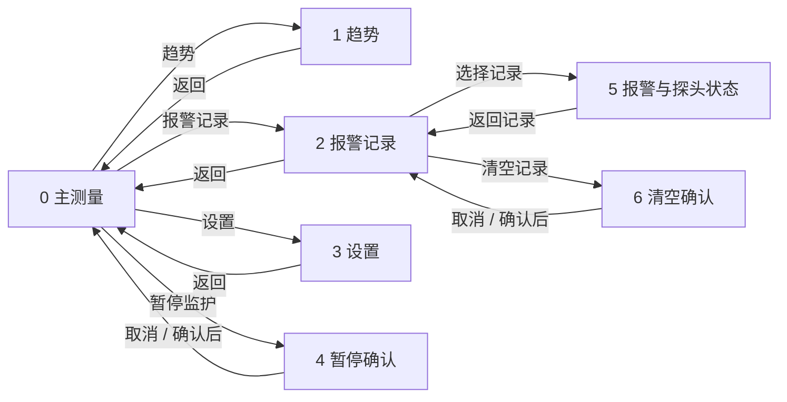

# VisualTFT 医院版血氧界面绘制指南

适用画布：**800 × 480，横屏**。基于本项目已完成的深蓝灰医院版界面，以及本地 M 系列开发包中的 VisualTFT 教程整理。本文提供绘制素材、控件坐标、建议 ID、按钮状态图、点击结果图和配置步骤。

**推荐做法：每页导入一张静态背景，再叠加真实的按钮、文本、曲线和滑块控件。** 效果图用于对照，背景图用于实际绘制；示例读数和曲线不应作为实时数据显示层。

当前设备的具体型号、固件和 VisualTFT 工程未提供，本文不假定串口参数，也未在实物屏或 VisualTFT 仿真中运行。本次已核对图片尺寸、文件链接及布局；文中的 ID 是新工程的建议分配，已有工程请整体映射。

## 目录

1. 素材分类与使用方法
2. 新建工程和公共配置
3. 页面 ID 与切换关系
4. 各页面绘制步骤和控件表
5. 所有按钮及小素材图片
6. 每个操作后的界面图
7. 绘制完成后的验证步骤
8. 资料来源与版本差异

## 1. 素材分类与使用方法

本文中的图片均可直接打开查看原尺寸。图片文件保存在与本文同级的 `visualtft_guide` 文件夹内，移动文档时应一并保留素材。本文使用本机绝对路径，若换电脑，可使用配套压缩包内的相对路径版文档。

| 类别 | 数量 | 用法 |
|---|---:|---|
| `backgrounds/bg_0.png`～`bg_6.png` | 7 张 | 真正导入画面背景的图片；动态内容与操作按钮已留空 |
| `buttons/*.png` | 48 张 | 按钮弹起/按压/选中态、声音开关、输入框、质量条和滑块指示器 |
| `states/*.png` | 19 张 | 完整效果图和操作结果，用于对照；不作为设备实时画面的背景 |
| `illustrations/*keyboard.png` | 2 张 | 数值键盘的位置示意，实际原生键盘由软件和固件决定 |
| `illustrations/button_atlas.png` | 1 张 | 素材总览，方便核对文件名 |
| `manifest.json` | 1 份 | 图片实际尺寸、字节数及坐标记录 |

`up` = 手指未按住时；`down` = 手指按住的瞬时反馈；`selected` = 选中的常驻状态。切换画面是另一个动作，**不能把目标画面截图填进独立小按钮的“按下时图片”**。

本指南沿用原来的 0～5 号画面，并新增 **6 号“清空记录确认”画面**。暂停态、声音关闭态、趋势时段和历史事件详情均为原画面内部状态，不额外占用画面 ID。系统小键盘也不在这 7 个画面中分配普通画面 ID。

## 2. 新建工程和公共配置

### 2.1 新建与素材导入

1. 打开 VisualTFT，通过“文件 → 新建工程”创建工程，选择**与你实际屏幕匹配的型号和系列**。确认分辨率为 800 × 480、横屏。不要只因分辨率相同而选另一个型号。
2. 建议先保存为 `SPO2_Hospital` 工程；将本文配套素材复制到工程工作目录，保留文件名。
3. 在工程的画面树中按顺序建立画面 0～6，名称按第 3 节填写。若软件自动分配 ID，逐页核对实际 ID。
4. 选中画面的空白处，在画面属性中选择对应的“背景图片”，导入 `backgrounds/bg_N.png`。位置为 `(0,0)`，尺寸为 `800×480`，完整显示，不缩放。
5. 如当前版本使用图片控件作为背景，把图片控件放在最底层、位置 `(0,0)`、尺寸 `800×480`，关闭不需要的触摸行为。不要把它放在按钮之上。
6. 导入 `buttons` 文件夹中的所需 PNG，按第 4 节表格添加控件并设置位置、尺寸。**PNG 是直接导入资源；HTML/SVG/MD 不是 VisualTFT 工程文件。**
7. 先完成主界面及一个“趋势 → 返回”的路径，在虚拟屏中确认坐标与素材正确，再按相同方式完成余下页面。

本地软件目录名为 `VisualTFT_3.0.0.1253`；教程中的属性名称来自不同修订版本。若属性所在位置不同，以对应控件的属性页名称为准。

### 2.2 公共颜色与字体

| 用途 | 颜色 |
|---|---|
| 页面背景 | `#0F1B2D` |
| 顶栏 | `#16263A` |
| 普通面板 | `#18293D` |
| 曲线/深色内区 | `#111F31` |
| 主文字 | `#F4F7FB` |
| 次要文字 | `#ADBDCE` |
| SpO₂ | `#42CDE0` |
| PR | `#68D99F` |
| 提示 | `#F2CB67` |
| 报警 | `#FF7C82` |
| 按钮底色 / 边框 | `#22364D` / `#607B95` |

静态中文、图标及装饰已在背景/按钮 PNG 中，不需要再次叠加。动态文字使用屏幕实际可用的中文字库；建议主读数约 72 px、重要数值约 28～32 px、正文 16 px、辅助信息 13～14 px。固件若无对应字号，选最接近的可用字库并检查是否裁切。动态字符串使用 `SpO2` 也可，背景中的 `SpO₂` 已是位图。

### 2.3 图片按钮公共属性

| 属性 | 本指南建议配置 |
|---|---|
| 控件 ID | 使用第 4 节分配；同画面唯一 |
| x / y / 宽 / 高 | 按本指南表格逐项输入 |
| 弹起时的图片 | 对应 `*_up.png` |
| 按下时的图片 | 普通瞬变按钮使用 `*_down.png` |
| 裁剪 | **不勾选**：这里提供的是与按钮同尺寸的独立切图 |
| 文字状态 | **否**：按钮 PNG 已包含文字，避免重复叠字 |
| 触摸虚框 | 否，使用提供的按压图反馈 |
| 触控用途 | 页面导航用“切换画面”；状态控制按下面的方式配置 |
| 目标画面 | 填第 3 节对应 ID，不是 PNG 的资源编号 |
| 子画面 | 本指南采用完整页面切换，选“否” |
| 切换动画 | 无/默认直接切换 |

**切换画面的按钮**可直接配置“触控用途 → 切换画面 → 目标画面”。**需要 MCU 处理的按钮**使用“开关描述”等能启用事件通知的用途，操作风格选“瞬变”，开启事件通知；主控只处理一次有效释放事件。不要把同一动作同时绑定在按下和弹起并各执行一次。

若明确需要“松开后才跳转”，而当前版本的直接切换触发时机不符合要求，可改用“开关描述 → 瞬变 → 对内指令 → 弹起时”，在指令助手里生成该工程的切换画面指令。**直接切换与该替代方式二选一**，不重复配置。

> 教程中部分示例勾选“裁剪”，是因为使用整张页面素材，取出按钮所在坐标区域。本指南提供独立小图，不能照搬那个勾选项。

### 2.4 动态数据与设备确认

文本读数、波形、报警记录、声音状态和暂停状态均应由设备实际数据驱动。仅切换到“暂停效果图”不会停止采集或报警；仅移动滑块不会改变背光。

建议处理顺序：**触摸请求 → 主控检查并执行 → 主控回写状态 → 切换/刷新显示**。画面 4 的确认暂停、画面 6 的确认清空、报警限值和声音开关都按此处理。未收到确认时保留原状态；首次启动和无效测量时主读数显示 `--`。

本文不填写未经当前工程验证的原始串口字节，也不新增 MCU/LUA 实现。纯页面跳转可以在 VisualTFT 直接完成；数据加载和设备动作仍需已有主控程序配合。

## 3. 页面 ID 与切换关系

| 画面 ID | 名称 | 入口 | 返回位置 |
|---:|---|---|---|
| 0 | 床旁血氧监护 | 上电首页 | — |
| 1 | 趋势分析 | 0 的“趋势” | 0 |
| 2 | 报警记录 | 0 的“报警记录” | 0 |
| 3 | 监护设置 | 0 的“设置” | 0 |
| 4 | 暂停监护确认 | 0 的“暂停监护” | 取消返回 0；确认后 0 显示暂停态 |
| 5 | 报警与探头状态 | 2 的任意记录；可选的主界面状态入口 | 来自记录返回 2；来自主界面返回 0 |
| 6 | 清空记录确认 | 2 的“清空记录” | 取消回 2；确认后 2 显示空列表 |

## 4. 各页面绘制步骤和控件表

坐标原点为左上角，单位为像素。以下表格是推荐的**设备侧控件布局**：对可能变为三位数、长状态文字的区域已预留宽度。主界面与趋势摘要中的数字单位固定在数值区右侧，避免读数变为三位数时挤压单位。

每页的公共 ID 90 为床位、91 为探头状态、92 为时钟。除特别说明的关联滑块和记录行显示层外，不要让可操作热区相互遮挡。表中“组合/区域”表示需要按正文拆成真实控件，并非某个必须存在的 VisualTFT 控件类型。

### 4.1 画面 0：床旁血氧监护

**完成后效果：**

**实际导入的背景：**

1. 导入 `bg_0.png`。标题、参数名、单位、面板和波形区标题已在背景中。
2. 添加 ID 1～4 的图片按钮，分别使用暂停、趋势、报警记录、设置素材。切换目标分别为 4、1、2、3。
3. 在数值区添加文本控件 ID 10、11，青蓝与绿色，水平左对齐、垂直居中；输入方式设为“用户主机输入”。初始值用 `--`，设备确认有效后再写入读数。
4. 加入有效性、报警限值、状态、信号质量和监护时长文本。主读数变化时清除原文字区域，避免透明文本残影。
5. ID 19 添加曲线控件，显示区 `(29,272,742,78)`，背景 `#111F31`，波形青蓝。网格通过曲线控件配置；示例图仅说明视觉形态。纵向映射、增益和刷新速率由实际 PPG 数据接口确定。
6. ID 18 使用质量条图标序列 `quality_0.png`～`quality_5.png`。图片实际大小 34×18，可放在 `(733,247)`；分级规则由主控决定，不能仅凭素材顺序推断设备算法。
7. 暂停确认成功后，ID 1 使用 `btn_resume_up/down.png`，两项读数显示 `--`，波形停止并清除，状态改为“已暂停”。恢复请求成功且收到新有效值后再显示读数。

可选：为当前探头详情增加 ID 5 透明热区 `(592,4,112,48)`，覆盖“探头已接入”状态文字，进入画面 5 的当前状态模式。若当前版本不能可靠地让透明按钮覆盖文字且接收触摸，可先省略此入口，画面 5 仍可从报警记录到达。主控进入前应设置 `detail_source=0`。

| ID | 名称 | 类型 | x | y | w | h | 初值/示例与配置 |
|---:|---|---|---:|---:|---:|---:|---|
| 1 | btn_pause | 图片按钮 | 16 | 396 | 183 | 68 | 暂停监护；切换到画面 4；暂停后用 btn_resume 两态图片替换 |
| 2 | btn_trend | 图片按钮 | 211 | 396 | 183 | 68 | 趋势；切换到画面 1 |
| 3 | btn_alarm | 图片按钮 | 406 | 396 | 183 | 68 | 报警记录；切换到画面 2 |
| 4 | btn_settings | 图片按钮 | 601 | 396 | 183 | 68 | 设置；切换到画面 3 |
| 10 | txt_spo2 | 文本 | 35 | 114 | 164 | 74 | 98；实际初始化为 --；青蓝；数字高度约 72 px |
| 11 | txt_pr | 文本 | 427 | 114 | 164 | 74 | 72；实际初始化为 --；绿色；数字高度约 72 px |
| 12 | txt_valid | 文本 | 307 | 88 | 66 | 22 | 测量有效；状态由 MCU 回写，暂停/无效时改变文字和颜色 |
| 13 | txt_spo2_limits | 文本 | 35 | 192 | 212 | 20 | 报警限值 90–100 %；与设备已确认的报警限值同步 |
| 14 | txt_spo2_state | 文本 | 270 | 192 | 103 | 20 | 稳定；无效时显示等待信号 |
| 15 | txt_pr_limit | 文本 | 427 | 192 | 210 | 20 | 报警高限 120 bpm；与设备已确认高限同步 |
| 16 | txt_pr_state | 文本 | 650 | 192 | 115 | 20 | 脉搏规则；文本表达状态；图标为可选装饰 |
| 17 | txt_quality | 文本 | 686 | 244 | 40 | 24 | 92；设备质量值；无效时 -- |
| 18 | icon_quality | 图标/图片 | 733 | 247 | 34 | 18 | 5 格；按质量等级切换图片 |
| 19 | graph_ppg | 曲线 | 29 | 272 | 742 | 78 | 示例 PPG；实时点由 MCU 发送；不要导入示例波形作为实时曲线 |
| 20 | txt_capture_state | 文本 | 33 | 355 | 390 | 20 | 脉搏波采集中；暂停时替换状态文字 |
| 21 | txt_duration | 文本 | 540 | 355 | 227 | 20 | 监护时间 00:23:18；计时由 MCU 更新 |
| 90 | txt_bed | 文本 | 160 | 16 | 98 | 23 | 床位 01；在同一位置添加床位文字；可省略床形装饰 |
| 91 | txt_probe_header | 文本 | 608 | 16 | 92 | 23 | 探头已接入；按下面导出的子区域放置；不占用时钟范围 |
| 92 | txt_clock | RTC/文本 | 720 | 16 | 60 | 23 | 14:32:08；RTC 配置或 MCU 定时写入 |

### 4.2 画面 1：趋势分析

**完成后效果：**

**实际导入的背景：**

1. 导入 `bg_1.png`，添加三个 122×48 的时段按钮，以及底部返回按钮。
2. 三个时段按钮设为“开关描述 → 开关”，初始仅 30 分钟处于选中态。选中三个按钮，通过“编辑 → 开关按钮互斥”配置互斥组；实际菜单位置以当前版本为准。
3. 在这个自锁/互斥配置中，弹起图片用 `*_up.png`，按下状态图片用 `*_selected.png`，以保持常驻选中外观；`*_down.png` 仅供另有独立瞬时反馈机制时使用。不要把自锁选中态当作一次点击后的跳页。
4. 上下两个趋势区分开配置：SpO₂ 曲线 ID 12 `(197,181,558,64)`，图中纵轴示例为 90～100；PR 曲线 ID 14 `(197,277,558,64)`，图中纵轴示例为 60～120。静态坐标只是当前视觉稿的显示量程，不是报警阈值。实际量程变化必须同步更换刻度，越出量程的数据不能悄悄截断。
5. 以历史曲线控件或主控重放曲线的方式加载数据。切换按钮后，请求真实的 30 分钟/2 小时/8 小时数据，更新横轴时间和“记录时段”。不能只改时间标签而保留旧点序列作为新时段数据。
6. 下表的 ID 15～18 显示四个横轴时间标签；刻度区在静态背景中预留。ID 4 返回画面 0。

当前主界面 PNG 的波形是示例，不参与历史记录。趋势曲线如何存储、补点和处理缺测由项目数据层决定；本文的操作结果图只用于确认布局。

| ID | 名称 | 类型 | x | y | w | h | 初值/示例与配置 |
|---:|---|---|---:|---:|---:|---:|---|
| 1 | btn_range_30 | 开关按钮 | 115 | 80 | 122 | 48 | 30 分钟；与 2、3 互斥；初始选中 |
| 2 | btn_range_2h | 开关按钮 | 247 | 80 | 122 | 48 | 2 小时；选中后请求对应历史数据 |
| 3 | btn_range_8h | 开关按钮 | 379 | 80 | 122 | 48 | 8 小时；选中后请求对应历史数据 |
| 4 | btn_back | 图片按钮 | 16 | 408 | 176 | 56 | 返回主测量；切换画面 0 |
| 10 | txt_last_spo2 | 文本 | 35 | 190 | 62 | 42 | 98；最近有效值；青蓝 |
| 11 | txt_last_pr | 文本 | 35 | 299 | 62 | 42 | 72；最近有效值；绿 |
| 12 | graph_spo2_trend | 历史曲线 | 197 | 181 | 558 | 64 | 90～100 显示量程；青蓝，上图；实际量程变化时更换刻度 |
| 13 | txt_period | 文本 | 480 | 426 | 304 | 21 | 记录时段 14:02–14:32；随时段和实际时间更新 |
| 14 | graph_pr_trend | 历史曲线 | 197 | 277 | 558 | 64 | 60～120 显示量程；绿色，下图 |
| 15 | txt_time_0 | 文本 | 197 | 354 | 58 | 24 | 14:02；横轴标签，按实际窗口更新 |
| 16 | txt_time_1 | 文本 | 363 | 354 | 58 | 24 | 14:12；横轴标签，按实际窗口更新 |
| 17 | txt_time_2 | 文本 | 549 | 354 | 58 | 24 | 14:22；横轴标签，按实际窗口更新 |
| 18 | txt_time_3 | 文本 | 697 | 354 | 58 | 24 | 14:32；横轴标签，按实际窗口更新 |
| 90 | txt_bed | 文本 | 119 | 16 | 98 | 23 | 床位 01；在同一位置添加床位文字；可省略床形装饰 |
| 91 | txt_probe_header | 文本 | 608 | 16 | 92 | 23 | 探头已接入；按下面导出的子区域放置；不占用时钟范围 |
| 92 | txt_clock | RTC/文本 | 720 | 16 | 60 | 23 | 14:32:08；RTC 配置或 MCU 定时写入 |

### 4.3 画面 2：报警记录

**完成后效果：**

**实际导入的背景：**

1. 导入 `bg_2.png`，配置“清空记录”按钮进入新建的画面 6，返回按钮进入画面 0。
2. 添加四行记录显示层，按下面的行内表填入时间、事件、级别和处理状态。正文至少 16 px；颜色与“提示/报警/信息”文字一起表达级别。
3. 每行按钮或热区的范围为下表 ID 3～6。`row_alarm_up/down.png` 是**空白行底图**，不含任何示例事件；实际事件必须用文本控件显示。
4. 若采用透明热区覆盖行内文本，应把热区置于最上层，并在虚拟屏验证点击文字处仍有响应。若当前版本没有可用的透明热区方式，改用能显示整行字符串的单个按钮，或让各列启用相同记录事件；不要用不透明行底图盖住文字。
5. 点击行后，主控先记录该行对应的记录 ID，更新画面 5 的事件文本，设置 `detail_source=2`，再进入画面 5。无数据的行应隐藏或禁用，不允许点到上一笔记录。
6. 清空成功时隐藏全部记录行和其文字层，显示 ID 11“暂无事件记录”，总数改为 `0 条`。切回有记录状态时反向恢复。

列表行为需使用当前设备真实的记录集合；文档中的 4 条记录只是视觉示例。

| ID | 名称 | 类型 | x | y | w | h | 初值/示例与配置 |
|---:|---|---|---:|---:|---:|---:|---|
| 1 | btn_clear | 图片按钮 | 634 | 74 | 150 | 52 | 清空记录；切换到本指南新增画面 6 |
| 2 | btn_back | 图片按钮 | 16 | 408 | 176 | 56 | 返回主测量；切换画面 0 |
| 3 | row_alarm_1 | 记录行热区 | 17 | 173 | 766 | 53 | 记录 1；选中记录后进入画面 5 |
| 4 | row_alarm_2 | 记录行热区 | 17 | 226 | 766 | 53 | 记录 2；同上，记录索引 1 |
| 5 | row_alarm_3 | 记录行热区 | 17 | 279 | 766 | 53 | 记录 3；同上，记录索引 2 |
| 6 | row_alarm_4 | 记录行热区 | 17 | 332 | 766 | 53 | 记录 4；同上，记录索引 3 |
| 10 | txt_event_count | 文本 | 96 | 88 | 43 | 24 | 4 条；由记录总数回写 |
| 11 | txt_empty | 文本 | 240 | 250 | 320 | 36 | 暂无事件记录；有记录时隐藏；空列表时显示 |
| 90 | txt_bed | 文本 | 119 | 16 | 98 | 23 | 床位 01；在同一位置添加床位文字；可省略床形装饰 |
| 91 | txt_probe_header | 文本 | 608 | 16 | 92 | 23 | 探头已接入；按下面导出的子区域放置；不占用时钟范围 |
| 92 | txt_clock | RTC/文本 | 720 | 16 | 60 | 23 | 14:32:08；RTC 配置或 MCU 定时写入 |

**记录行内部显示控件（四行重复使用）：**

下表中的 y 为 `173 + 53×行号`，行号从 0 到 3。文本处于行热区内部是有意的显示/触摸叠层；不是两个互相冲突的操作区。先验证层级与点击穿透，再复制四行。

| 行 | 时间 ID | 事件 ID | 级别 ID | 状态 ID | y |
|---:|---:|---:|---:|---:|---:|
| 1 | 20 | 21 | 22 | 23 | 173 |
| 2 | 24 | 25 | 26 | 27 | 226 |
| 3 | 28 | 29 | 30 | 31 | 279 |
| 4 | 32 | 33 | 34 | 35 | 332 |

时间区域 `(33,y,116,53)`；事件区域 `(192,y,350,53)`；级别区域 `(584,y,75,53)`；状态区域 `(685,y,76,53)`。示例时间用 15 px，事件用 16 px，级别与状态 13～14 px；居中或左对齐依照效果图。

如果采用按钮文字直接显示整行，可省略上表四列文本控件；此时不要重复放置显示层。空列表时连同行热区一并禁用。

### 4.4 画面 3：监护设置

**完成后效果：**

**实际导入的背景：**

1. 导入 `bg_3.png`。两栏面板、标题、输入框边线、单位与太阳图标已在背景中；不要重复添加框线图片。
2. 在 SpO₂ 数字区域 `(260,147,70,52)` 添加文本控件 ID 1；在 PR 数字区域 `(260,253,67,52)` 添加文本控件 ID 2。前景分别为青蓝与绿，字号约 28 px；数字左对齐、垂直居中。单位已烘焙在背景，文本只写数字。
3. 设置这两个文本控件的“输入方式”为“弹出系统键盘输入（用户主机可输入）”，“键盘类型”为“小键盘”，整数输入。开启“数值限定”，上下限填写项目确认的产品参数范围。图中 90 和 120 为示例值，本文不把它们定义为临床默认值。
4. 小键盘建议显示在右半屏以保留左侧原值，具体位置和尺寸以实际键盘资源为准。第 6 节提供位置示意；它不是该版本原生键盘的实机截图，也不是需要导入的页面背景。
5. 用户确认输入后，主控检查范围并回写已接受值；取消不改值，拒绝时恢复旧值并给出提示。不要仅依赖浏览器预览中的范围；该范围不是设备规格。
6. 亮度用进度条 ID 10 和关联滑块 ID 11。**关联控件 ID 连续，且进度条 ID 小于滑块 ID**；这是本地教程明确说明的关联要求。参考轨道 `(457,193,278,5)`，触摸/滑块区域 `(457,172,278,48)`，滑块指示图为 `slider_thumb.png`。
7. 亮度图示用 10～100、初值 80。若实际项目使用这个范围，进度条与滑块应设相同起始/终止值；否则两者和百分比文本一起更改。拖动输入可选择“允许【松开通知】”减少连续通知；在虚拟屏检查值域与位置一致。
8. 滑动后更新 ID 12，并由主控或核实后的背光指令设置真实亮度。单独改变 ID 12 的数字不改变背光。
9. 声音使用开关按钮 ID 3。若采用自锁开关，弹起态设为 `btn_sound_off_up.png`、按下态设为 `btn_sound_on_up.png`，默认态由主控实际值决定；设备拒绝修改时回写旧状态。若采用主控确认后的图片替换，可使用 on/off 各自的 up/down 两张图。
10. 声音状态更新后同步改 ID 13。报警声音与“触摸按键提示音”是不同功能，不能仅修改工程的触摸音效来实现报警声音开关。

本页 `field_spo2_up/down`、`field_pr_up/down` 是备用输入框底图。使用当前背景时不必导入；若改为独立框图，需恢复单位文字并避免覆盖数值控件。

| ID | 名称 | 类型 | x | y | w | h | 初值/示例与配置 |
|---:|---|---|---:|---:|---:|---:|---|
| 1 | txt_spo2_low | 输入文本 | 260 | 147 | 70 | 52 | 90；使用原生文本控件+系统小键盘；文字另见内框坐标 |
| 2 | txt_pr_high | 输入文本 | 260 | 253 | 67 | 52 | 120；使用原生文本控件+系统小键盘 |
| 3 | btn_alarm_sound | 开关按钮 | 641 | 257 | 124 | 56 | 开启；常驻开启/关闭状态与手指按压态分开 |
| 4 | btn_back | 图片按钮 | 16 | 408 | 176 | 56 | 返回主测量；切换画面 0 |
| 10 | bar_brightness | 进度条 | 457 | 193 | 278 | 5 | 80；水平亮度条；11 为关联滑块，连续 ID |
| 11 | slider_brightness | 滑块 | 457 | 172 | 278 | 48 | 80；与 10 的视觉层重叠是有意关联；热区高 48 |
| 12 | txt_brightness | 文本 | 697 | 142 | 68 | 30 | 80%；拖动后更新数值；硬件亮度还需命令 |
| 13 | txt_sound_state | 文本 | 427 | 337 | 338 | 31 | 声音提示已开启；关闭时改成黄色提示 |
| 90 | txt_bed | 文本 | 119 | 16 | 98 | 23 | 床位 01；在同一位置添加床位文字；可省略床形装饰 |
| 91 | txt_probe_header | 文本 | 608 | 16 | 92 | 23 | 探头已接入；按下面导出的子区域放置；不占用时钟范围 |
| 92 | txt_clock | RTC/文本 | 720 | 16 | 60 | 23 | 14:32:08；RTC 配置或 MCU 定时写入 |

### 4.5 画面 4：暂停监护

**完成后效果：**

**实际导入的背景：**

1. 导入 `bg_4.png`，放置 ID 1“取消”、ID 2“确认暂停”和 ID 3“返回主测量”。
2. 取消和返回均切到画面 0，不发送暂停请求。
3. 确认暂停按钮使用 `btn_confirm_up/down.png`，触控用途选择可启用事件通知的“开关描述”，操作风格“瞬变”。主控收到有效释放事件后执行暂停。
4. 主控确认暂停后，回写主界面暂停态并切回画面 0；第 6 节给出了暂停后的完整图。若没有设备确认，停留原状态并显示明确提示，不仅靠跳页假定暂停成功。
5. 这张图是完整确认页，本指南“子画面”选否；如改为叠加式子画面，应另行验证关闭方式、背景刷新和触摸阻挡。

| ID | 名称 | 类型 | x | y | w | h | 初值/示例与配置 |
|---:|---|---|---:|---:|---:|---:|---|
| 1 | btn_cancel_pause | 图片按钮 | 321 | 296 | 176 | 56 | 取消；切换画面 0，不改变监护状态 |
| 2 | btn_confirm_pause | 图片按钮 | 513 | 296 | 176 | 56 | 确认暂停；发送暂停请求，设备确认后回画面 0 暂停态 |
| 3 | btn_back | 图片按钮 | 16 | 408 | 176 | 56 | 返回主测量；切换画面 0，不改变状态 |
| 10 | txt_pause_context | 文本 | 179 | 153 | 186 | 21 | 当前床位 01 · 血氧与脉率监护；床位变化时同步 |
| 90 | txt_bed | 文本 | 119 | 16 | 98 | 23 | 床位 01；在同一位置添加床位文字；可省略床形装饰 |
| 91 | txt_probe_header | 文本 | 608 | 16 | 92 | 23 | 探头已接入；按下面导出的子区域放置；不占用时钟范围 |
| 92 | txt_clock | RTC/文本 | 720 | 16 | 60 | 23 | 14:32:08；RTC 配置或 MCU 定时写入 |

### 4.6 画面 5：报警与探头状态

**完成后效果：**

**实际导入的背景：**

1. 导入 `bg_5.png`，添加详情与测量控件；左栏状态标题、说明、右栏有效读数均为动态层。
2. 当前探头模式：左栏显示“当前状态 / 信号偏弱”等当前信息，返回按钮使用 `btn_back_up/down.png`，目标为 0。
3. 历史记录模式：左栏显示“事件详情”、选中事件的时间与处理状态。返回按钮使用 `btn_back_alarm_up/down.png`，目标为 2。标题变化不会更改画面 ID。
4. 右栏标题“当前探头状态”已在背景内，表示这里是**当前**信号数据，而不是所选历史事件发生时的测量值。若项目需要历史时刻数据，须更改该标签和数据来源，不能混用。
5. ID 16 为显示型进度条，范围 0～100，禁止拖动，背景灰蓝、前景黄色；质量恢复时可按实际状态改颜色。
6. “最近有效值”与“最近有效时间”成组更新。如果没有有效历史读数，显示 `--`；不要把过期值放回主测量区当作当前值。
7. 详情标题和事件级别可拆成两个文本控件：建议 ID 10 负责左侧标题 `(35,91,220,26)`，额外 ID 21 显示级别 `(307,91,66,26)`；状态图标可用本地画图控件或相同线形图标，至少保留文字级别。

| ID | 名称 | 类型 | x | y | w | h | 初值/示例与配置 |
|---:|---|---|---:|---:|---:|---:|---|
| 1 | btn_back | 图片按钮 | 16 | 408 | 176 | 56 | 返回主测量/返回报警记录；按来源返回 0 或 2 |
| 10 | txt_detail_title | 文本 | 35 | 91 | 338 | 26 | 当前状态；历史记录模式显示事件详情 |
| 11 | txt_detail_name | 文本/图标组合 | 35 | 138 | 338 | 44 | 信号偏弱；按事件显示名称和提示/报警颜色 |
| 12 | txt_detail_advice | 多行文本 | 35 | 197 | 338 | 61 | 请检查探头佩戴位置，并保持手指静止。；历史模式显示事件时间与状态 |
| 13 | txt_probe | 文本 | 302 | 292 | 71 | 23 | 已接入；来自当前设备状态 |
| 14 | txt_update | 文本 | 35 | 331 | 338 | 20 | 状态更新时间 14:32:08；当前状态时间或历史记录标记 |
| 15 | txt_quality | 文本 | 690 | 139 | 36 | 43 | 42；质量评分，不是血氧值 |
| 16 | bar_quality | 进度条 | 427 | 192 | 338 | 7 | 42；0–100，仅显示，不允许拖动 |
| 17 | txt_last_spo2 | 文本 | 648 | 226 | 117 | 30 | 98 %；最近有效值 |
| 18 | txt_last_pr | 文本 | 648 | 273 | 117 | 30 | 72 bpm；最近有效值 |
| 19 | txt_valid_time | 文本 | 427 | 311 | 338 | 32 | 最近有效时间 14:28:10；与历史值成组更新 |
| 20 | txt_footer | 文本 | 370 | 426 | 414 | 21 | 等待稳定信号；按当前/历史模式显示 |
| 90 | txt_bed | 文本 | 181 | 16 | 98 | 23 | 床位 01；在同一位置添加床位文字；可省略床形装饰 |
| 91 | txt_probe_header | 文本 | 608 | 16 | 92 | 23 | 探头已接入；按下面导出的子区域放置；不占用时钟范围 |
| 92 | txt_clock | RTC/文本 | 720 | 16 | 60 | 23 | 14:32:08；RTC 配置或 MCU 定时写入 |

### 4.7 画面 6：清空记录确认

这是一张为 VisualTFT 补齐的确认页，用来替代 HTML 预览中的浏览器原生确认框。页面 0～5 的 ID 不变。

**实际导入背景：**

1. 新建 ID 6，命名“清空记录确认”，导入 `bg_6.png`。
2. ID 1“取消”使用 `btn_cancel_up/down.png`，目标画面 2；ID 3“返回报警记录”使用 `btn_back_alarm_up/down.png`，目标画面 2。
3. ID 2“确认清空”使用 `btn_confirm_clear_up/down.png`，瞬变+事件通知，由主控执行记录清空。清空成功后回写画面 2 的总数和空状态，再返回画面 2。
4. 等待确认期间避免重复触发；失败时保留记录并显示失败信息。取消与返回不删除任何记录。

| ID | 名称 | 类型 | x | y | w | h | 配置 |
|---:|---|---|---:|---:|---:|---:|---|
| 1 | btn_cancel_clear | 图片按钮 | 321 | 296 | 176 | 56 | 目标画面 2 |
| 2 | btn_confirm_clear | 图片按钮 | 513 | 296 | 176 | 56 | 发送清空请求，确认后返回 2 |
| 3 | btn_back_alarm | 图片按钮 | 16 | 408 | 176 | 56 | 目标画面 2 |
| 10 | txt_clear_context | 文本 | 179 | 153 | 260 | 21 | 当前床位 01 · 事件记录 |
| 90 | txt_bed | 文本 | 160 | 16 | 98 | 23 | 床位 01，位置与本页标题右侧保持间距 |
| 91 | txt_probe_header | 文本 | 608 | 16 | 92 | 23 | 探头状态 |
| 92 | txt_clock | RTC/文本 | 720 | 16 | 60 | 23 | 时钟 |

## 5. 所有按钮及小素材图片

下表图片按真实尺寸展示；点击图片可打开文件。**同名资源只导入一次即可在多页复用**。图片的自动资源编号可能因导入顺序改变，因此本文以文件名对应，不预设资源编号。

| 文件前缀 / 用途 | 尺寸 | 弹起态 | 瞬时按压态 | 完成操作后的画面/状态 |
|---|---|---|---|---|
| `btn_pause` 暂停监护 | 183×68 |  |  | 画面 4，暂停确认 |
| `btn_trend` 趋势 | 183×68 |  |  | 画面 1，趋势 |
| `btn_alarm` 报警记录 | 183×68 |  |  | 画面 2，报警记录 |
| `btn_settings` 设置 | 183×68 |  |  | 画面 3，设置 |
| `btn_back` 返回主测量 | 176×56 |  |  | 画面 0 |
| `btn_confirm` 确认暂停 | 176×56 |  |  | 主控确认后画面 0 暂停态 |
| `btn_cancel` 取消 | 176×56 |  |  | 画面 4 中回 0；画面 6 中回 2 |
| `btn_clear` 清空记录 | 150×52 |  |  | 画面 6，清空确认 |
| `btn_resume` 恢复监护 | 183×68 |  |  | 恢复后仍在画面 0，等待新有效数据 |
| `btn_range_30` 30 分钟 | 122×48 |  |  | 画面 1，30 分钟状态 |
| `btn_range_2h` 2 小时 | 122×48 |  |  | 画面 1，2 小时状态 |
| `btn_range_8h` 8 小时 | 122×48 |  |  | 画面 1，8 小时状态 |
| `btn_back_alarm` 返回报警记录 | 176×56 |  |  | 画面 2 |
| `btn_confirm_clear` 确认清空 | 176×56 |  |  | 清空成功后画面 2 空列表 |
| `btn_sound_on` 报警声音：开启 | 124×56 |  |  | 请求关闭 → 画面 3 关闭态 |
| `btn_sound_off` 报警声音：关闭 | 124×56 |  |  | 请求开启 → 画面 3 开启态 |
| `field_spo2` SpO₂ 输入框底图 | 124×56 |  |  | 文本控件调用系统小键盘 |
| `field_pr` PR 输入框底图 | 124×56 |  |  | 文本控件调用系统小键盘 |
| `row_alarm` 报警记录行底图 | 766×53 |  |  | 画面 5，对应行的事件详情 |

### 5.1 趋势按钮的常驻选中态

互斥按钮配置的“按下状态”使用下面的 `selected` 图片，它会保持到另一个选项被选中。普通 `_down` 图片仅是较亮的按压反馈，不额外代表一个时间范围。

| 选中范围 | 选中态图片 |
|---|---|
| 30 分钟 |  |
| 2 小时 |  |
| 8 小时 |  |

### 5.2 信号质量与滑块素材

信号条图标是离散显示资源，编号只是图形亮起格数；具体质量算法和分级由主控决定。滑块指示器的视觉图片小于操作热区，保持 48 px 高的可触摸区域。

| 文件 | 尺寸 | 图片 |
|---|---|---|
| `quality_0.png` | 34×18 |  |
| `quality_1.png` | 34×18 |  |
| `quality_2.png` | 34×18 |  |
| `quality_3.png` | 34×18 |  |
| `quality_4.png` | 34×18 |  |
| `quality_5.png` | 34×18 |  |
| `slider_thumb.png` | 18×18 |  |

素材总览：[打开全部按钮及小素材总览](<./illustrations/button_atlas.png>)

## 6. 每个操作后的界面图

以下图区显示的是**点击完成后的结果**。按钮手指按住时的外观见第 5 节。没有跳转的按钮也列出其状态变化；多个按钮返回同一页面时复用同一张图。

### 6.1 操作到结果的完整对应表

| 所在页/控件 | 操作 | 结果 | 结果图位置 |
|---|---|---|---|
| 0 暂停监护 | 点击 | 进入画面 4 | 4.5 的效果图 |
| 0 趋势 | 点击 | 进入画面 1，默认 30 分钟 | 4.2 的效果图 |
| 0 报警记录 | 点击 | 进入画面 2 | 4.3 的效果图 |
| 0 设置 | 点击 | 进入画面 3 | 4.4 的效果图 |
| 0 恢复监护 | 设备确认 | 留在画面 0，先等待有效值 | 4.1 为获得有效值后的效果 |
| 1 30 分钟 | 点击 | 同页选中 30 分钟 | 4.2 的效果图 |
| 1 2 小时 | 点击 | 同页换时段 | 6.3 |
| 1 8 小时 | 点击 | 同页换时段 | 6.3 |
| 1/2/3 返回主测量 | 点击 | 回画面 0 | 4.1；若仍暂停应回暂停态 |
| 2 清空记录 | 点击 | 进入画面 6 | 4.7 |
| 2 第 1/2/3/4 行 | 点击 | 进入画面 5，显示对应事件 | 6.6 的四张图 |
| 3 SpO₂ 数字框 | 点击 | 弹出小键盘 | 6.4 示意 |
| 3 PR 数字框 | 点击 | 弹出小键盘 | 6.4 示意 |
| 小键盘数字键 | 点击 | 编辑输入缓冲，未提交设备值 | 依原生键盘显示 |
| 小键盘确认 | 点击 | 校验并请求更新，确认后关闭键盘 | 6.4 的两个更新示例 |
| 小键盘取消 | 点击 | 关闭键盘、原值不变 | 4.4 的原始设置图 |
| 3 亮度滑块 | 拖动并松开 | 留在画面 3，回写亮度百分比 | 6.5 |
| 3 报警声音开启 | 点击、设备确认 | 同页关闭态 | 6.5 |
| 3 报警声音关闭 | 点击、设备确认 | 同页开启态 | 4.4 |
| 4 取消/返回 | 点击 | 画面 0，监护状态不变 | 4.1 |
| 4 确认暂停 | 设备确认 | 画面 0 暂停态 | 6.2 |
| 5 返回报警记录 | 点击 | 画面 2 | 4.3 |
| 5 返回主测量 | 点击 | 画面 0 | 4.1 |
| 6 取消/返回报警记录 | 点击 | 画面 2，记录保留 | 4.3 |
| 6 确认清空 | 设备确认 | 画面 2 空列表 | 6.7 |

切换离开主界面不会自动恢复监护。暂停标志由主控持有，返回时应重新读取当前状态。

### 6.2 确认暂停后的主界面

恢复按钮成功响应后，先显示等待信号/`--`，获得新有效读数后才回到第 4.1 节示例。不要立即把暂停前的读数当作实时数据恢复。

### 6.3 趋势时段变化

**2 小时：**

**8 小时：**

两张图是同页布局示例；真实工程需要从相应时间范围读取历史数据。

### 6.4 数值输入：键盘位置与确认后的状态

键盘图为布局示意，**不是实际 VisualTFT 系统键盘截图，也不应作为 800×480 背景导入**。软件内置键盘的按键、字体、退格和输入框由当前版本决定。若要完全相同的深色键盘皮肤，可依本地《自定义系统键盘》教程另建键盘资源，但这不影响先使用原生小键盘完成输入。

**点击 SpO₂ 数字：**

**点击 PR 数字：**

**示例：SpO₂ 输入 92 并获设备接受：**

**示例：PR 输入 130 并获设备接受：**

以上 92/130 仅用于展示值变化，不构成使用建议；最终可输入范围来自项目规格。

### 6.5 设置页的声音与亮度变化

**报警声音关闭：**

**亮度显示 60%：**

亮度示例图只显示滑块位置和数字变化，未模拟整张图片变暗。实际背光应在设备上检验。

### 6.6 点击四条记录后分别显示的详情

画面 ID 均为 5，只更换左侧事件内容；右侧明确标记为当前探头信息。

**第 1 行：低信号质量**

**第 2 行：探头重新接入**

**第 3 行：SpO₂ 低于 90%**

**第 4 行：监护已暂停**

### 6.7 清空确认后的报警列表

“取消”不进入此状态，应回到保留原记录的画面 2。

## 7. 绘制完成后的验证步骤

### 7.1 在 VisualTFT 虚拟屏中

1. 编译工程并检查资源/字体缺失提示，打开虚拟串口屏。
2. 核对每页背景都是 800×480，无裁切、缩放、左下角调试编号，也无重复按钮文字。
3. 长按一个普通按钮，确认出现 `_down` 外观；松开后执行一次动作。若图片错位，检查是否误勾选“裁剪”。
4. 从首页依次进入趋势、报警、设置、暂停确认，再验证返回；画面 5 分别从当前状态和历史记录进入时返回来源正确。
5. 趋势只允许一个时段处于选中态。核对选中资源是 `selected`，并检查实际数据与横轴是否一起更新。
6. 点击两个数值框，检查小键盘位置、取消、确认、空输入、非整数和超限输入。阈值回写后应同步首页显示的限值。
7. 亮度检查最小值、中值、最大值，确认进度条与滑块同值域。亮度条/滑块关联允许视觉重叠，但不要再覆盖一个会吞触摸的图片控件。
8. 声音开关测试开启、关闭与主控拒绝时回滚；触摸提示音不应代替报警声音功能。
9. 报警每行验证进入对应记录。空记录行不可触发历史详情；清空取消后记录仍在，确认后才消失。
10. 暂停时数值为 `--`，恢复时等待新有效读数。主控未确认的动作不应被显示为成功。

### 7.2 本次文件检查与实物边界

本次已通过脚本核对全部 PNG 尺寸、MD 图片链接、文件存在性和控件矩形边界。主要触控按钮和数值输入区域至少 48 px 高；关联亮度进度条和滑块是有意叠层。报警列表是连续行热区，原设计行间距为 0，不满足独立按钮常用的 8 px 间隔，需在实物上检查相邻行误触；必要时拉开行距或减少可见行数。

**尚需你在实际 VisualTFT 与屏上验证：** 型号/固件匹配、字库字形、PNG 透明边缘、控件层级、真实曲线刷新、串口通知、设备状态确认及背光控制。本文没有声称已经执行这些设备侧测试。

### 7.3 常见问题

| 现象 | 处理 |
|---|---|
| 按钮只有一部分/图片偏移 | 独立切图取消“裁剪”，控件 w/h 与 PNG 一致 |
| 文字叠了两层 | 图片按钮“文字状态”设为否；背景里已有的静态文字不重复添加 |
| 98/72 一直留在画面里 | 导错了完整效果图；替换为 `backgrounds/bg_N.png` |
| 数字刷新残影 | 用匹配面板底色的单色文本背景，或核对控件背景恢复；不要只覆盖新字形 |
| 趋势按钮松开后没有选中状态 | 检查开关/互斥配置，按下状态资源应为 `selected` |
| 滑块与进度条不联动 | 确认 ID 连续、进度条 ID 小于滑块 ID，两者范围一致 |
| 声音图标变了但设备没变 | 检查 MCU 事件处理和状态回写；界面变化不等于设备动作 |
| 报警行点了没反应 | 检查覆盖文字或底图是否挡住热区、无数据行是否误禁用 |
| 进入详情后返回错页 | 存储详情来源，分别使用回 0 或回 2 的行为 |
| 图片颜色/透明角异常 | 核对固件支持；需要不透明素材时，用本页底色合成圆角外像素再导入 |
| SpO₂ 的下标无法用字库显示 | 静态标题保留 PNG；动态文字用 `SpO2` 或有该字符的字库 |

### 7.4 资源容量与导入数量

7 张背景和 48 张按钮/小素材 PNG 合计 **200.7 KiB** 的源文件。若全部按无压缩 RGB565 估算，像素存储约 **5.95 MiB**；这只是估算，实际编译资源还受压缩、对齐、字库和平台格式影响，应以 VisualTFT 编译后的占用为准。

`states` 完整效果图、`illustrations` 示意和总览不需要下载到屏中。备用输入框图片以及没有使用的瞬时按压资源也可不导入，以节省空间。

## 8. 资料来源与版本差异

配置依据优先使用你本地 M 系列开发包中的官方教程。下列 PDF 是核对来源，不是需要导入工程的素材。页码指 PDF 页序号，部分文档的印刷页码与它不同。

- 工程技术笔记-按钮控件的应用v1.0.pdf（见你的 M 系列开发包）：按钮控件：PDF 第 9～12 页属性与页面切换，第 21～22 页互斥配置；核对触控用途、目标画面、裁剪和操作风格。

- 工程技术笔记-文本控件应用 v1.0.pdf（见你的 M 系列开发包）：文本控件：第 5 章属性和第 6 章输入实例；核对系统小键盘、输入方式、对齐和数值限定。

- 工程技术笔记-进度条控件应用 v1.0.pdf（见你的 M 系列开发包）：进度条：PDF 第 9～10 页属性，第 13 页说明关联进度条/滑块 ID 的连续关系。

- 4.【串口屏】如何实现提示框功能_V1.0.pdf（见你的 M 系列开发包）：提示框：PDF 第 9～10 页说明完整画面与子画面的区别；本指南采用完整页。

- 8.【串口屏】自定义系统键盘_V1.1.pdf（见你的 M 系列开发包）：自定义系统键盘：PDF 第 1～3 页提供制作、导出和使用方法；本指南默认原生小键盘。

- 3.M系列入门手册V1.0.pdf（见你的 M 系列开发包）：M 系列入门手册：用于工程创建、下载和虚拟屏流程参考。

- 工程技术笔记-曲线控件应用 v1.0.pdf（见你的 M 系列开发包）：曲线控件：用于实时点显示、数据更新和属性配置参考。

官方在线对应说明：[按钮控件](https://doc.gz-dc.com/Control/01_button.html)、[文本控件](https://doc.gz-dc.com/Control/02_displayText.html)。不同系列的属性选项、字库和键盘资源可能不同，最终以本工程选定平台的属性窗口及对应教程为准。

### 8.1 重新生成本指南素材

维护源码为原 HTML 预览；本指南不改变已有 VisualTFT 私有工程。需要重新导出时，在项目根目录使用本机 Node.js 运行 `visualtft_spo2/tools/build_visualtft_guide.cjs`，再用 Python 运行 `visualtft_spo2/tools/write_visualtft_guide.py`。Node 需能找到 Playwright、Sharp 及 Chrome；当前脚本使用本机已有运行环境。

背景中不包含动态数值和操作按钮；效果图中的时间、阈值和记录都是示例。正文控件表是绘制依据，实际设备协议映射由你的工程维护。
