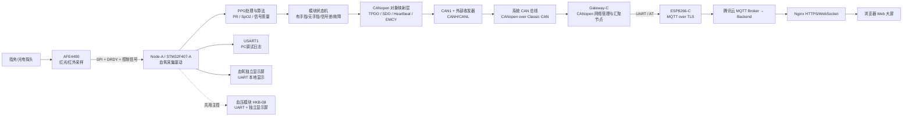
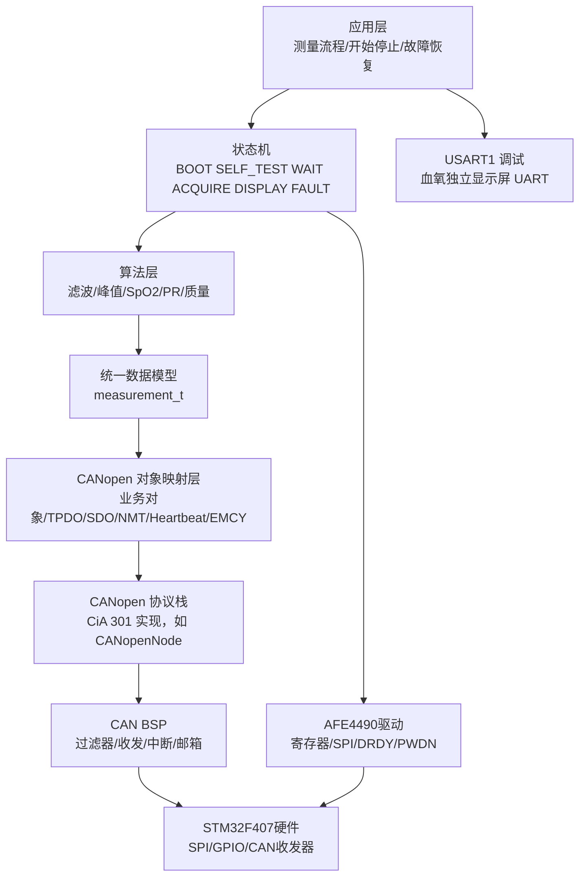
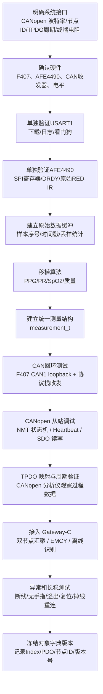
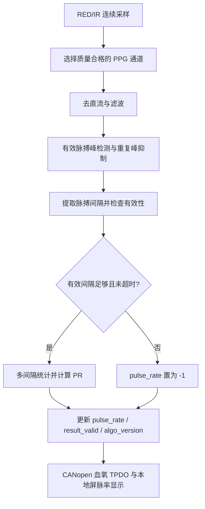
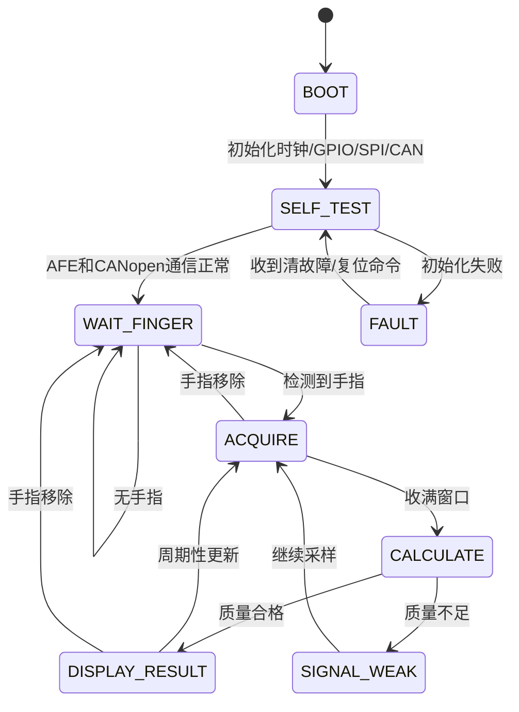
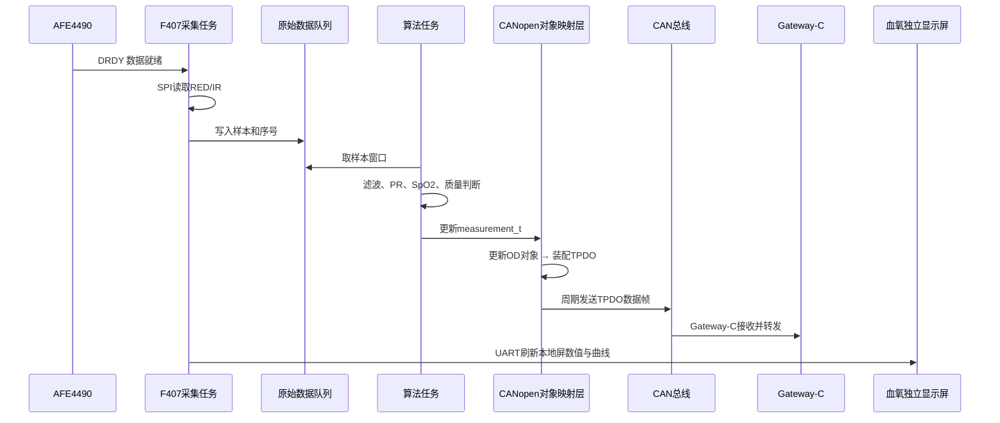
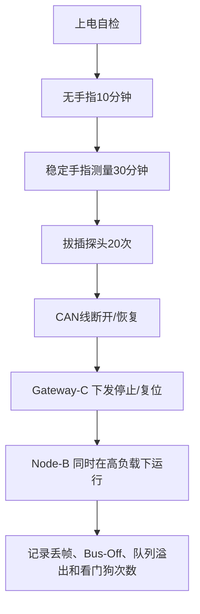

# 血氧模块 CANopen 通信开发流程框架图

> **文档定位**：本文件是《多参数监护仪_总开发合同与系统方案 v0.7》中**血氧模块（成员 A / Node-A）**的通信层设计框架，配套成员 A 的《血氧模块（AFE4490）详细设计与测试记录》使用。
> **对齐版本**：合同 v0.7「标准协议选型版」——板间链路采用 **CANopen CC（CiA 301）over Classic CAN**，上行链路采用 **MQTT 3.1.1 over TLS**。
> **文件名说明**：本文件原名《血氧模块_CAN通信开发流程框架图.md》。为不破坏已有的文档交叉引用，保留原文件名；内容已按合同 v0.7 从“自定义 CAN 报文”整体调整为“CANopen 标准协议”。

---

## 1. 模块定位

血氧功能运行在 **Node-A（STM32F407-A）** 内部，与血压模块（HKB-08，UART）**共用同一颗主控和本地显示屏资源**，两块模块各自拥有独立本地显示屏：

```text
指夹/光电探头
      ↓
AFE4490（红光 660nm / 红外 905nm 采样）
      ↓ SPI + DRDY / 控制信号
Node-A / STM32F407-A
      ├─ 血氧：采样驱动、PPG / SpO2 / PR 算法、状态机与故障管理
      ├─ 血压：HKB-08（UART）
      ├─ 血氧独立显示屏（UART）
      ├─ 血压独立显示屏（UART）
      ├─ USART1：PC 调试日志
      └─ CAN1 + 外部收发器 → CANopen 设备节点
              ↓
        CANopen over Classic CAN
              ↓
        Gateway-C（CANopen 网络管理与汇聚节点）
              ↓ ESP8266-C → MQTT 3.1.1 over TLS
        腾讯云 → Backend → Nginx → 浏览器 Web 大屏
```

要点：

1. **血氧模块不再是一个独立的血氧 MCU 采集节点**。合同 4.1 明确 Node-A 同时承载血氧（AFE4490，SPI + DRDY/控制信号）与血压（HKB-08，UART）；两者共享 STM32F407-A 的时钟、总线与任务调度。本模块的通信与算法设计必须兼顾与血压模块的并行性。
2. **AFE4490 是血氧模拟前端**。Node-A 负责读取红光/红外采样并形成 PPG、SpO2 和 PR。具体寄存器、采样时序和算法参数进入成员 A 的《血氧模块（AFE4490）详细设计与测试记录》，不在总线合同中冻结。
3. **本项目统一使用 PR（Pulse Rate，脉率）**：由 PPG 的有效脉搏间隔计算，单位为次/分（bpm）。内部字段为 `pulse_rate`，算法文件为 `pulse_rate.c`；本地屏和云端均使用“PR/脉率”标注。**本模块不承担 ECG 心率计算**，ECG/HR 由成员 B 的 ADS1292R 模块负责。
4. **对外数据出口是 CANopen，不是自定义 CAN 帧**。合同 8.1 / 8.7 冻结：板间链路复用 CANopen CC（CiA 301）标准机制（PDO / SDO / NMT / Heartbeat / EMCY / Object Dictionary），项目只自行定义**生理参数数据字典与对象映射**，不重新实现网络管理、心跳、可靠传输等通用机制。
5. **USART1 只用于 PC 调试**；血氧独立显示屏是正式的本地显示通道，不是“可选调试件”。

---

## 2. 总体架构图



### 节点职责

| 节点 | 主要职责 | 不应该承担的职责 |
|---|---|---|
| AFE4490 | LED 驱动、模拟前端、ADC、数据就绪 | 不负责显示和总线协议 |
| Node-A BSP | SPI、GPIO、EXTI、CAN、UART、定时器 | 不在中断里做完整算法或 UI 发送 |
| 算法层 | RED/IR 处理、PR、SpO2、质量判断 | 不直接操作 CAN 寄存器 |
| 状态机 | 启动、自检、测量、无手指、故障恢复 | 不保存一套独立于测量结构的结果 |
| CANopen 对象映射层 | 业务对象定义、TPDO 映射、SDO 访问、NMT 应答、Heartbeat、EMCY | 不直接读取 AFE4490 原始寄存器 |
| Gateway-C | CANopen 网络管理与汇聚、统一设备状态、MQTT/TLS 上云、离线缓存 | **不重新执行血氧等传感器底层解析** |
| 云端 / Web | 接收、转发、状态管理、记录、浏览器实时监护 | 不接收原始 RED/IR 样本 |

---

## 3. 模块内部软件分层



**分层原则**：`measurement_t` 是唯一结果来源；CANopen 对象映射层只读 `measurement_t`，不感知算法内部数组；协议栈层不感知生理语义；CAN BSP 不感知业务。合同 8.7 要求优先采用成熟开源协议栈（如 **CANopenNode**），**不要自行重写 CANopen 核心协议**；具体库版本在详细设计和许可证审查后确定。

建议工程目录：

```text
Project/
├─ APP/
│  ├─ app_main.c              # 主循环和任务调度（血氧 + 血压共用）
│  ├─ app_state.c             # 血氧状态机
│  └─ app_measurement.c       # 统一测量结构 measurement_t
├─ DRIVER/AFE4490/
│  ├─ afe4490.c
│  └─ afe4490.h
├─ DRIVER/CANOPEN/
│  ├─ canopen_app.c           # 业务对象 OD 条目、TPDO 映射装配
│  ├─ canopen_app_od.c        # 对象字典（Index/Sub-index 由协议设计冻结）
│  └─ canopen_port.c          # 协议栈与 F407 CAN BSP 的移植层
├─ DRIVER/CAN/
│  ├─ can_bsp.c               # CAN1 GPIO、时钟、过滤器、收发、错误状态
│  └─ can_bsp.h
├─ DRIVER/USART/
│  └─ debug_uart.c
├─ ALGO/
│  ├─ ppg_filter.c
│  ├─ pulse_rate.c
│  └─ spo2.c
└─ CONFIG/
   ├─ board_config.h
   └─ od_index.h              # 本节点占用的 OD 索引/通信参数集中定义
```

> `od_index.h` 只登记**本节点实际使用**的 Index/Sub-index 和通信参数；完整的《CANopen 对象字典与 PDO 映射设计》由 P 主责统一维护，A/B 双方必须在同一版本上对齐。

---

## 4. 开发流程框架图



开发顺序是：先证明每层能工作，再连接相邻两层。**不要在 AFE 原始数据尚未稳定时同时调 SpO2、CANopen 和本地屏页面**（合同 5.3 的明确禁止项）。

---

## 5. 测量数据模型

模块内部只有一份测量结果源，算法、日志、本地屏和 CANopen 都读取它：

```c
typedef struct {
    uint32_t sample_seq;        /* 原始样本序号 */
    uint32_t timestamp_ms;      /* F407 系统时间 */
    int32_t  red_raw;           /* 最近一次红光原始值 */
    int32_t  ir_raw;            /* 最近一次红外原始值 */
    int16_t  spo2;              /* 0~100，-1 为无效 */
    int16_t  pulse_rate;        /* PR，次/分（bpm），-1 为无效 */
    uint8_t  signal_quality;    /* 0~100 */
    uint8_t  probe_state;       /* 0无手指/1正常/2信号差 */
    uint8_t  result_valid;      /* 1表示结果可用 */
    uint8_t  fault_code;        /* 0表示无故障 */
    uint16_t algo_version;      /* 算法版本，随算法变更递增 */
} measurement_t;
```

**为什么必须带 `algo_version`**：合同 8.6 要求项目数据字典统一“参数名称、数据来源、单位、数据类型、有效/无效/离线状态、时间信息、算法版本或必要来源信息”。血氧算法参数在详细设计阶段还会继续演进，把算法版本随数据一起上报，云端才能区分“数值变化是病人变化还是算法换版”，也便于回溯验证记录。

**对象映射**：`measurement_t` 的每个字段对应 CANopen 对象字典中的一个业务对象（PPG、SpO2、PR、信号质量、探头状态、数据有效性、故障码、时间戳等）。**CANopen 层只读取这个结构**，不直接读取算法内部数组。无效值必须有明确编码（例如对象定义中的未定义值），不能沿用上一笔有效值冒充当前结果。

> 合同 8.6 冻结的数据字典对象清单为：`ECG / HR`、`RESP / RR`、`PPG / SpO2 / PR`、`NIBP`、`TEMP`、`Node / Gateway Status`、`Fault / Alarm`。本模块只负责其中 **PPG / SpO2 / PR** 以及本节点的 Node Status / Fault。

### 5.1 PR 算法数据流



建议以多个有效间隔的中位数 `T_ms` 计算 `PR = 60000 / T_ms`。按峰间样本数计算时使用 `PR = 60 * Fs / N`，`Fs` 为检测数据的实际采样率（Hz），`N` 为代表性峰间样本数。滤波参数、峰间距、统计窗口和超时按目标脉率范围配置；丢样、通道切换或采样率改变后重新积累间隔。SpO2 算法继续使用 RED/IR 双通道。

移植外部示例时，库内原有 `HEARTRATE` 等命名保留实际声明，先确认其值来自 PPG、单位及无效编码，再映射到内部 `pulse_rate`。本节是待实现的算法流程，**文档修改不代表已经完成固件实现或精度验证**。

---

## 6. CANopen 通信设计

### 6.1 协议与角色

| 项目 | 冻结结论（合同 8.1 / 8.3） |
|---|---|
| 板间协议 | **CANopen CC（CiA 301） over Classic CAN** |
| 与主屏/上层的分工 | 设备侧数据汇聚由 CANopen 完成；云端遥测采用标准 MQTT，不再另行设计自定义板间或云端通用协议 |
| Gateway-C 角色 | CANopen **网络管理与数据汇聚节点** |
| Node-A 角色 | CANopen **设备节点**（本血氧模块随 Node-A 一同入网） |
| 物理层 | CAN1 + 外部收发器，CANH/CANL/GND，总线两端各 120 Ω 终端电阻 |
| 节点 ID / 波特率 / 帧格式 | 由系统统一规划，在《CANopen 对象字典与 PDO 映射设计》中冻结 |
| 不冻结项 | **CANopen Index、Sub-index、PDO 字节布局**（P 在详细设计阶段冻结） |

### 6.2 复用哪些 CANopen 标准机制

| 机制 | 本模块的用途 |
|---|---|
| **PDO（TPDO）** | 周期性上传血氧过程数据：SpO2、PR、信号质量、探头状态、数据有效性、结果序号 |
| **PDO（RPDO）** | 接收 Gateway-C 下发的控制量（如开始/停止测量、暂停监护等，是否开放由系统决定） |
| **SDO** | 参数配置、诊断与非实时数据访问：算法参数查询、固件版本、自检结果、启动/停止命令 |
| **NMT** | 节点启动、停止和运行状态管理；Gateway-C 可远程复位本节点 |
| **Heartbeat** | 节点在线状态检测；Gateway-C 据此识别血氧/Node-A 离线 |
| **EMCY** | 关键故障和异常事件上报：AFE 无响应、SPI 异常、丢样、CAN Bus-Off |
| **Object Dictionary** | 统一组织设备通信参数和项目生理参数（PPG / SpO2 / PR 等业务对象） |

### 6.3 数据字典映射链

合同 8.6 要求同一份数据字典同时映射到 CANopen 对象字典、Gateway 内部数据模型、MQTT Topic/Payload 和 Backend/Web：

```text
measurement_t（本模块唯一结果源）
        ↓
CANopen Object Dictionary（P 主责冻结 Index/Sub-index）
        ↓
TPDO（周期上传） / SDO（按需查询）
        ↓
Gateway-C 内部数据模型
        ↓
MQTT Topic / Payload（LIVE / REPLAY 区分）
        ↓
Backend / Nginx / 浏览器 Web 大屏
```

这样即使未来更换物理链路或云端实现，**血氧数据的语义仍保持一致**。

### 6.4 与现有样机自定义帧的关系（迁移说明）

现有样机固件（见《血氧模块_代码使用说明.md》）在第一版联调时使用了一套临时自定义 11 位标准帧，便于在 CAN 分析仪上快速观察：

| 样机临时帧 | 用途 |
|---|---|
| `0x321`（200 ms） | SpO2、PR、质量、状态 |
| `0x322`（1000 ms） | 节点心跳、版本、故障码 |
| `0x323`（可选） | 降采样 PPG 波形 |
| `0x120`（事件触发） | 主控下发命令 |

> **这 4 个 ID 只是过渡期的调试约定，不是项目协议。** 合同 8.1 / 8.7 已冻结板间链路使用 CANopen，因此该临时帧层必须在接入 Gateway-C 前迁移：

| 临时帧 | 迁移到 |
|---|---|
| `0x321` 测量结果 | 血氧 **TPDO**（映射 SpO2 / PR / 质量 / 状态 / 有效性对象） |
| `0x322` 心跳诊断 | **Heartbeat**（在线状态）+ **SDO**（版本、计数等诊断量） |
| `0x323` 波形 | 低优先级 TPDO，或按需通过 SDO 分段读取；**是否上传波形由系统统一决定** |
| `0x120` 命令 | **SDO 写对象** 或 **RPDO**，具体形式在对象字典设计中确定 |
| 故障码 | **EMCY**（关键故障）+ 对象字典中的 Fault 对象 |

迁移期间可以保留一层薄的适配层，让 `app_state.c` / `can_protocol.c` 的业务逻辑不做大改，只把出口从“手写帧编码”换成“写 CANopen 对象”。

---

## 7. 模块状态机与 CANopen 行为



状态到 CANopen 的对应关系：

| 状态 | 血氧 TPDO | Heartbeat（NMT） | EMCY |
|---|---|---|---|
| WAIT_FINGER | 周期发送无手指状态 | 保持心跳 | 不发送 |
| ACQUIRE | 发送上一窗口无效或测量中 | 保持心跳 | 不发送 |
| DISPLAY_RESULT | 发送有效 SpO2 / PR | 保持心跳 | 不发送 |
| SIGNAL_WEAK | 发送信号差、结果无效 | 保持心跳 | 不发送 |
| FAULT | 发送无效结果 + 故障对象 | 心跳按协议维持 | 发送对应 EMCY 代码 |

**NMT 状态语义**：上电进入 Pre-operational，对象字典和 SDO 可访问但 TPDO 不发送；收到 `Start Remote Node` 后进入 Operational，TPDO 开始周期上传。这样 Gateway-C 可以先完成配置再放行数据，避免节点一上电就往总线打无效数据。

---

## 8. 一次数据发送流程



本地屏刷新与 TPDO 发送是**两条独立的出口**，必须读取同一份 `measurement_t`，不允许各自维护一套 SpO2/PR 状态。

---

## 9. 代码职责划分

### 9.1 CAN BSP

参考 `F:\嵌入式\课件资料\4_程序资料\19_CAN`，但按产品需求重新组织：

```c
void CAN1_BSP_Init(uint32_t baudrate);
bool CAN1_SendFrame(uint16_t id, uint8_t dlc, const uint8_t *data);
bool CAN1_ReadFrame(can_frame_t *frame);
void CAN1_ClearError(void);
```

BSP 负责 GPIO、时钟、过滤器、发送邮箱、接收 FIFO 和错误状态；它**不负责判断 SpO2 是否有效**，也不实现 CANopen 语义。

### 9.2 CANopen 移植层与对象映射层

```c
void CO_App_Init(void);                      /* 对象字典、TPDO映射、心跳周期、NMT */
void CO_App_UpdateMeasurement(const measurement_t *m);  /* 把结果写入业务对象 */
void CO_App_Process(void);                   /* 协议栈周期处理（发送/接收/超时） */
void CO_App_ReportEmergency(uint8_t code);   /* 上报关键故障 */
```

对象映射层负责单位、有效/无效编码、状态映射、TPDO 周期；所有 Index/Sub-index 与通信参数集中写入 `CONFIG/od_index.h`，**与协议设计文档保持同一版本**。

### 9.3 中断和任务边界

```text
SysTick 中断：只累加毫秒计数，不做业务
EXTI（DRDY）中断：只计数和置标志，不读 SPI
CAN RX 中断：由协议栈回调取帧入队，不解析业务、不执行命令
主任务：SPI 读数、算法计算、测量结果更新、本地屏刷新
周期任务：CANopen 协议栈处理、TPDO 触发、Heartbeat
故障任务：Bus-Off 检测、EMCY 上报、发送超时恢复
```

---

## 10. 调试和联调顺序

### 阶段 A：F407 单板验证

1. 用 `19_CAN` 工程确认 CAN1 GPIO、时钟和标准外设库能编译。
2. 先保留回环模式，用临时测试 ID 验证发送和接收函数。
3. 验证过滤器配置、DLC、标准帧/扩展帧和接收 FIFO。
4. 再切换正常模式，接入 CAN 收发器和 CAN 分析仪。

### 阶段 B：血氧模块内部验证（与血压模块并行性同时验证）

1. 先用 USART1 输出 AFE4490 RED/IR 原始波形。
2. 再在 PC 上验证 PR、SpO2 和信号质量：用已知周期的 PPG 序列检查 1000 ms 对应约 60 次/分、500 ms 对应约 120 次/分；同时检查无手指、丢样和噪声时的无效状态。
3. 确认 `measurement_t` 在无手指、信号差和正常测量时的字段变化。
4. 同时确认血压模块（UART）运行、本地屏刷新期间，血氧采样不丢点（合同 14.2 的验收关注点）。

### 阶段 C：CANopen 接入验证

1. 在回环模式下先调通 NMT 状态机和 Heartbeat，用 CANopen 分析仪确认节点能进入 Operational。
2. 逐个验证对象字典条目可通过 SDO 读写，且读回值与 `measurement_t` 一致。
3. 打开 TPDO，确认周期、映射字段顺序、无效值编码正确。
4. 接入 Gateway-C：验证双节点（Node-A / Node-B）同时在线、单节点掉线可被识别、EMCY 能上报。

### 阶段 D：稳定性验证



---

## 11. 需要确认的硬件和协议项目

| 项目 | 当前建议 | 最终确认来源 |
|---|---|---|
| CAN 控制器 | F407 CAN1 | 板卡原理图和引脚复用 |
| CAN1 引脚 | PA11/PA12 | `19_CAN` 示例；需确认板卡是否占用 |
| CAN 收发器 | 与系统电源匹配且 3.3 V 逻辑兼容 | 收发器数据手册和板卡原理图 |
| 总线波特率 | 由系统统一规划 | 《CANopen 对象字典与 PDO 映射设计》 |
| 节点 ID | 由系统统一分配，Node-A 与 Node-B 不得冲突 | 同上 |
| TPDO 周期 / 映射 | 血氧过程数据周期由协议设计确定 | 同上 |
| 终端电阻 | CAN 总线两端各 120 Ω | 实际拓扑和线长 |
| AFE SPI 模式 | 不能直接照搬 W25Q 示例 | AFE4490 库/数据手册/逻辑分析仪 |
| AFE 供电和 I/O 电平 | 必须实测 | AFE 模块原理图和 F407 电平 |
| 血氧独立显示屏 | 型号、波特率、帧格式 | 屏幕手册 + 实测 |
| 协议栈选型 | CANopenNode 等成熟开源实现 | 详细设计与许可证审查 |

---

## 12. 交付检查清单

- [ ] F407 工程可以独立打印 USART1 日志。
- [ ] AFE4490 可以独立输出连续 RED/IR 原始样本。
- [ ] `measurement_t` 在所有状态下字段含义明确，含 `algo_version`。
- [ ] `pulse_rate`、本地屏“PR/脉率”和 CANopen 血氧对象三处语义一致；无效脉率有明确定义值。
- [ ] CAN1 已从回环模式切换为正常模式，收发器、CANH/CANL、GND 和终端电阻连接正确。
- [ ] CANopen 节点 ID、波特率、Heartbeat 周期已按系统规划配置。
- [ ] 血氧业务对象已建立 SDO 访问，读回值与 `measurement_t` 一致。
- [ ] 血氧 TPDO 周期、映射字段和无效值编码已与 Gateway-C 联调通过。
- [ ] 关键故障能通过 EMCY 上报，Gateway-C 能收到并记录。
- [ ] Heartbeat 超时能在 Gateway-C 侧触发 Node-A 离线提示。
- [ ] 本地屏刷新与 TPDO 发送读取同一份 `measurement_t`，无第二套状态。
- [ ] 血氧与血压在同一 Node-A 内并行运行时，互不阻塞、不丢点。
- [ ] 完成断线、Bus-Off、无手指、信号差和复位测试。
- [ ] 对象字典版本号已冻结并记录到《CANopen 对象字典与 PDO 映射设计》。

---

## 13. 资料对应关系

| 本框架中的内容 | 对应资料 |
|---|---|
| F407 CAN BSP | `F:\嵌入式\课件资料\4_程序资料\19_CAN` |
| F407 USART 调试 | `F:\嵌入式\课件资料\4_程序资料\13_USART` |
| F407 SPI 读写 | `F:\嵌入式\课件资料\4_程序资料\15_SPI` |
| DMA/队列思路 | `F:\嵌入式\课件资料\4_程序资料\16_DMA_UART` |
| AFE4490 原理和 Arduino 验证 | 思知瑞科技血氧模块页面 |
| 血氧独立显示屏 | M 系列串口屏开发包 V3.2 及《STM32F407_AFE4490_M系列串口屏_快速上手开发规划.md》 |
| CANopen 规范 | CiA 301 / CAN in Automation（https://www.can-cia.org/can-knowledge/canopen/） |
| CANopen 协议栈 | CANopenNode 等成熟开源实现（版本在详细设计后锁定） |
| 系统级依据 | 《多参数监护仪_总开发合同与系统方案 v0.7》第 6、7、8、14 章 |

使用顺序：先看第 1～4 节确定边界，再按第 10 节分阶段实现，联调时按第 6 节冻结对象字典与 TPDO，遇到问题最后回到第 11～12 节逐项排查。

---

文档生成时间：2026-09-18。

修订记录：

- 2026-09-21，项目速率指标统一为 PR/脉率，更新算法流程、`pulse_rate`、`pulse_rate.c`、CAN 字段、图示和联调检查项；保留外部库原始字段的适配说明。
- 2026-09-21，**按《总开发合同与系统方案 v0.7》对齐**：模块定位由“独立血氧采集节点”改为“Node-A 内血氧功能（与血压共用主控与本地屏）”；板间协议由自定义 CAN 报文（0x321/0x322/0x323/0x120）改为 **CANopen CC（CiA 301）over Classic CAN**（PDO/SDO/NMT/Heartbeat/EMCY/Object Dictionary）；对外汇聚对象由“主控/主屏幕”改为 **Gateway-C**，并补充 MQTT/TLS 上云与离线缓存链路；数据模型新增 `algo_version`；新增对象字典映射链与自定义帧迁移说明；原自定义帧保留为过渡期调试约定并标注迁移去向。
